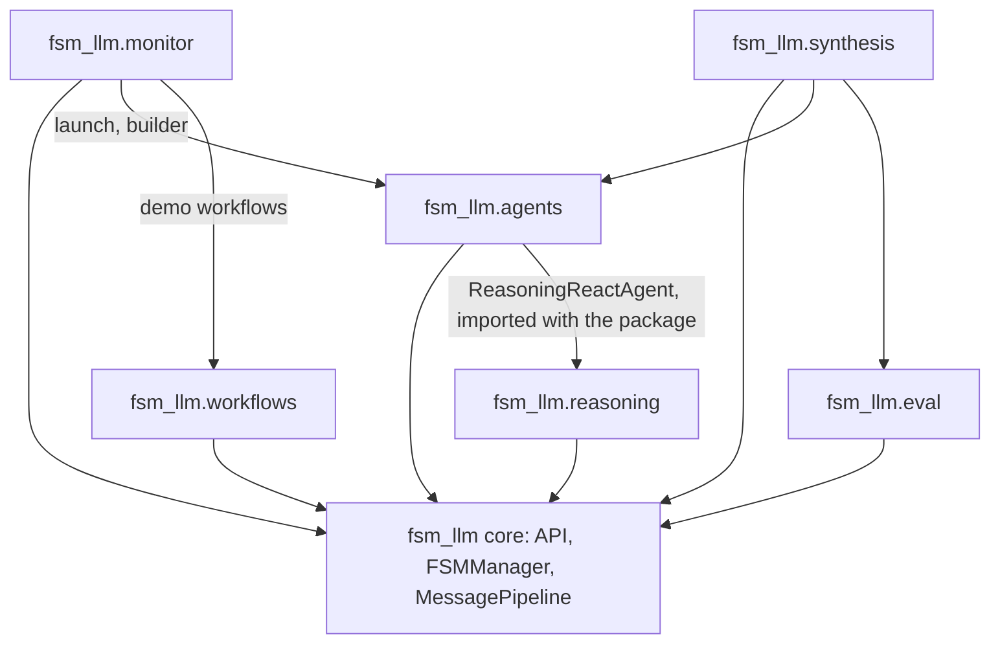

# FSM-LLM

Path: repository root (`.`)
Purpose: Python framework (v0.12.0, Apache-2.0, Python 3.10-3.12) for stateful conversational AI: JSON-defined finite state machines (FSMs) driven by an LLM through a 2-pass pipeline, shipped as one package `fsm_llm` with six subpackages.

## Scope

One distribution (`fsm-llm`, `pyproject.toml`, setuptools, flat src layout: the import package `fsm_llm` is the directory `src/` itself, mapped by `package-dir = {"fsm_llm" = "src"}`). Always use the project virtualenv: `.venv/bin/python`, or activate `.venv` first.

- In: `src/` (all source), `tests/`, `examples/` (100 runnable examples), `docs/` (guides), `scripts/` (supply-chain audit, benches, doc-count check), `evaluation/` (datasets and eval runs), `.github/workflows/`, `images/`, root build and policy files.
- Out: `build/`, `dist/`, `logs/`, `fsm_llm.egg-info/` (generated, removed by `make clean`). `plans/` is gitignored except `plans/ANCHORS.md` (append-only anchor manifest; never edit its lines).

## Architecture



2-pass flow per `converse` (`src/pipeline.py`): Pass 1 extracts data (LLM), context update, classification extractions, rule-based transition evaluation (an LLM classifier only on AMBIGUOUS), state transition, then Pass 2 writes the reply (LLM) from the post-transition state. Pass 2 is skipped when `response_instructions` is empty: a silent state makes no LLM call, returns `""` and adds nothing to history. Transition outcomes: one winner is DETERMINISTIC, a tie at the lowest priority is AMBIGUOUS, none passing is BLOCKED (stay).

Message-free step: `API.advance(conv_id)` runs the same turn with no user message (nothing added to history for a user, no-message prompt variants, the LLM layer sends a neutral user turn) and returns a frozen `AdvanceResult`; `run_until_terminal(conv_id, *, max_steps, max_seconds=None, before_step=None)` loops it until a terminal state and raises `RunBudgetExceededError` on a spent budget. Agents, workflow agent steps and the reasoning engine run on these loops; they never send a synthetic message. When the top of the stack is an ended pushed FSM, the loop calls `before_step` once (not a step, no budget check) so the hook can pop it and the run continues on the parent.

One LLM layer (`src/llm.py`, the only module that imports litellm): `LLMInterface.complete(CompletionRequest) -> CompletionResponse` is the one primitive for tool calling, plain and structured completion; `LiteLLMInterface` builds every request in one builder and sends it through one send path, counting each call (`usage()`); `LiteLLMEmbedder` makes embeddings. A state with the optional `completion` field makes its Pass 1 one `complete` call (tools or a structured turn) over a consumer-owned transcript and writes `{kind, text, calls}` to its result key; core runs no tool. `native_fc` and the meta-builder are FSMs built on it. Importing `fsm_llm.llm` sets `litellm.suppress_debug_info = True` once (litellm's red "Give Feedback" banner on a provider error would print to the host's stdout); a host that wants the banner sets it False after importing `fsm_llm`. `CompletionResponse` carries the provider's `finish_reason` and a `truncated` property (`finish_reason == "length"`, cut at `max_tokens`): `_send` logs one WARNING per cut non-streamed reply, a cut bulk or field extraction and a cut classification say so in their error, and a cut reply that opens `{`/`[` and does not parse is replaced in Pass 2 by a cut-off message, never shown as an unreadable half envelope; a cut envelope whose `message` can be read is shipped as read (it may be partial) and flagged `truncated`; a cut prose reply is shipped as is. The two reply models carry `truncated`, and the pipeline records a cut turn in the internal context key `definitions.CONTEXT_KEY_CUT_OFF` (`_cut_off`, last turn only, absent when nothing was cut). The completion-state result stays `{kind, text, calls}`.

`import fsm_llm` loads only the core; `fsm_llm/__init__.py` never imports a subpackage. Import one by name (`from fsm_llm.agents import create_agent`). Every subpackage ships in every install; an extra only adds third-party deps.

## Key files

| Path | Role | Notes |
| --- | --- | --- |
| `src/api.py`, `fsm.py`, `pipeline.py` | `API`, `FSMManager` (per-conversation locks, LRU definition cache), `MessagePipeline` | Read `# DECISION` anchors first |
| `src/definitions.py`, `transition_evaluator.py`, `expressions.py` | Pydantic FSM models, core exceptions, JsonLogic evaluation | No LLM in transitions |
| `src/llm.py`, `classification.py` | `LLMInterface`, `LiteLLMInterface` (`complete`, `usage`), `LiteLLMEmbedder`, `tool_exchange`; `Classifier` | Only litellm import; the classifier uses the conversation's interface |
| `src/security.py`, `constants.py` | `has_internal_prefix`, `is_forbidden_context_entry`, `resolve_within`, defaults, `OKF_*` limits | Single source for key filtering; shared path-confinement helper |
| `src/flow_analysis.py` | Static analysis over an `FSMDefinition`: `strongly_connected_components` (the one graph primitive, shared with `FSMValidator`), `analyze_data_flow` (G3), `analyze_liveness` (G4), `declared_available`, frozen `FlowFinding`s | Core module, imports only `definitions`; never logs, never raises on a loaded definition; `FSMValidator.validate()` calls none of the analyses (never stricter than the loader) |
| `src/okf.py`, `okf_cli.py` | Open Knowledge Format (OKF v0.2, SPEC at commit ad30107, pre-1.0 and mutable): `load_bundle`, `OKFBundle`, `check_bundle`, `write_bundle`; public helpers `iso_utc`, `has_lone_surrogate`, `writes_within_caps`, `capped_note`; `fsm-llm-okf` | Core modules, import no subpackage; not imported by `fsm_llm/__init__.py` |
| `src/okf_bridge.py` | Memory entries and plain FSMs to OKF: `bundle_from_memory_entries`, `create_okf_handler` | 289 lines, split out of `okf.py` (which is about 1,320 lines now); imports only public names of `okf`; no re-export |
| `src/cli_support.py` | The CLI skeleton `okf_cli` and `agent_skills_cli` share: `run_cli`, `exit_main`, `report_error`, `report_issues`, `add_max_seconds`, `escape_unencodable_output`, `positive_seconds` | Stdlib, `constants`, `okf.capped_line` and `okf.strip_unsafe_text` only; neither CLI imports a private name from the other |
| `src/frontmatter.py` | The one YAML frontmatter seam: `split_frontmatter`, `load_yaml` (one `yaml.SafeLoader` subclass, no aliases or anchors, size and depth limits are parameters), `read_bytes` (no-follow), `lone_surrogate` | Shared by OKF and Agent Skills; stdlib and `yaml` only; extracted from `okf.py` |
| `src/agent_skills.py`, `agent_skills_cli.py` | Agent Skills (SKILL.md folders, agentskills.io spec read 2026-10-23, unversioned and mutable), read-only: `load_skills`, `SkillCatalog` (`render_catalog`, `read_body`, `read_resource`, `files_under`), `AgentSkill`, `SkillIssue`, `SkillLimits`, `parse_skill_text`; `fsm-llm-skills validate\|list\|show` (`show --file` also lists a directory) | Core modules, import no subpackage; not imported by `fsm_llm/__init__.py`; nothing in a skill is executed |
| `src/reasoning/` | 9 strategies as stacked FSMs pushed and popped inside one message-free core run, validation with up to 3 retries | `ReasoningEngine.solve_problem(problem) -> (solution, trace_info)` |
| `src/workflows/` | Async in-memory engine, 11 step types, DSL | `WorkflowEngine`, `create_workflow`, `auto_step`, `condition_step` |
| `src/agents/` | 18 agent patterns (native_fc and the meta-builder are FSMs on core too), tools with annotations and enforced timeouts, HITL, memory, swarm/graph, MCP, A2A, SOPs | `create_agent`, `ReactAgent`, `ToolRegistry`, `@tool`, `MetaBuilderAgent` |
| `src/agents/okf.py` | Agents side of OKF: `create_okf_tools` (4 read-only tools), `OKFMemoryBackend` (read-only), `export_semantic_memory`, `export_agent_result` | Imports core only |
| `src/agents/agent_skills.py` | Agents side of Agent Skills: `create_skill_tools` (`skill_list`, `skill_load`, `skill_read`, all read-only) | Imports core and sibling agents modules; reuses private reply helpers of `agents/okf.py` (debt, see api_reference.md) |
| `src/agents/python_tools.py` | `PythonToolLoader` (`from_directory`, `load_directory` -> `PythonToolLoadReport`), `PythonToolDefinition`, `ToolRegistry.register_python_tool`: tools from folders of Python files (`PYTHON_TOOLS` list or `@tool`) | Executes the files it loads, trusted sources only; not Agent Skills; a file that fails to load is reported in the report and warned once (`UserWarning`) by `from_directory` |
| `src/monitor/` | FastAPI dashboard (REST, WebSocket, vanilla-JS SPA), OTEL exporter | `configure`, `InstanceManager`, `OTELExporter` |
| `src/eval/` | Examples scorer (0-4) and conversation cases (N trials, Wilson CIs) | `EvalConfig`, `run_examples`, `load_cases`, `run_cases`, `run_dataset`, `wilson_ci` |
| `src/synthesis/` | Runtime FSM synthesis: a model compiles a goal into an FSM, gates G1 to G7 judge it, a file-backed library with a lifecycle stores it, a runner pushes it as a child of a host conversation, traces, `diagnose` and a propose-only repair; agent tools `obtain_procedure` and `run_procedure` | `FSMSynthesizer`, `ProcedureRunner`, `FSMLibrary`, `SynthesisPolicy`, `run_gates`, `create_procedure_tools` |
| `tests/conftest.py` | `MockLLM2Interface`, `configure_mock_extract_field`, fixtures, `ollama_available()` | Default runs make no network or LLM call |
| `tests/test_packaging.py` | Pins package wiring and every test count in this file and `README.md` | See Working here |
| `scripts/audit_pth.py` | Flags known malicious and code-bearing `.pth` files in site-packages; exit 1 on issues | `make audit`, CI |
| `scripts/bench_common.py` | Shared stdlib bench helpers (statistics, row files, manifest and drift checks, wire capture); no CLI | Held equal to `fsm_llm.eval` by `test_bench_parity.py`; `agents_bench.py` and `skills_bench.py` load it |
| `scripts/agents_bench.py` | Pre-registered agent bench: `register`, `run`, `report` | Rows in tracked `scripts/bench_data/` |
| `scripts/synthesis_bench.py` | Pre-registered synthesis comparison (bench id `synthesis`, blocks `s0` to `s2`; arms `synth-fsm`, `hand-fsm`, `react`; 16 judge-free tasks): `register`, `smoke`, `run`, `report` | Bench status: blocks `s0`, `s1` and `s2` are registered, run and recorded (one model, `ollama_chat/bonsai-2:27b`, for every role and arm, no strong/cheap split); all three verdicts are INCONCLUSIVE and no registered block shows a compiled procedure beating a ReAct agent. See `docs/synthesis.md`. See `scripts/bench_data/README.md`; one model, `ollama_chat/bonsai-2:27b`, for every role and arm; `smoke` and `run` refuse (exit 3) while the shared model server is busy |
| `scripts/skills_bench.py` | Pre-registered Agent Skills read-hint ablation (bench id `skills-disclosure`, blocks B0 and B1): `register`, `run`, `report` | Registered, NOT RUN (live runs declined); the read hint is a recorded default, not a measurement |
| `scripts/type_check.py` | Runs mypy on the package `fsm_llm` by exposing `src/` under that name through a temporary symlink and `MYPYPATH` (`mypy src/` would name modules `src.*` and turn every `fsm_llm.*` import into `Any`); `make type-check`, tox, CI | Linux and macOS (symlink); `src/` must never be put on `sys.path` (it holds `logging.py`) |
| `scripts/doc_counts.py` | Compares the count tokens of the shapes it knows (`N tests`, marker, `N slow`, `N live`/`N gated`, `tests in N files`, rows) in the tracked `.md` files with one `pytest --collect-only`; exit 1 on drift or on such a token no rule names; prose numbers with no token shape are not read | `make counts`; skips when `mcp` is importable |
| `evaluation/datasets/` | `simple_greeting_cases.json`, `name_capture_fsm.json` | Samples for `fsm-llm-eval run` |
| `examples/<category>/<name>/` | `run.py` plus FSM JSON; 8 categories | Evaluation baselines |
| `pyproject.toml`, `Makefile`, `tox.ini`, `constraints.txt`, `MANIFEST.in`, `.pre-commit-config.yaml` | Build, tasks, envs, exact pins, sdist, hooks | All checked by `test_packaging.py` |
| `CHANGELOG.md`, `EVALUATE.md`, `CONTRIBUTING.md`, `SECURITY.md` | Release history, eval method and run log, contributor rules, security policy | |

## Public interface

Core: `API` (`from_file`, `from_definition`, `start_conversation`, `converse`, `converse_stream`, `advance`, `advance_stream`, `run_until_terminal`, `run_until_terminal_stream`, `get_data`, `push_fsm`/`pop_fsm`, `save_session`/`restore_session`), `AdvanceResult`, `FSMManager`, `MessagePipeline`, `HandlerTiming` (8 points), `HandlerErrorMode` (the one `handler_error_mode` vocabulary: `API`, `FSMManager`, `HandlerSystem` and the builders take a member or `"continue"`/`"raise"`), `create_handler`, `clear_keys_on_entry`, `typed_field_extraction`, `Classifier` (`llm_interface=` takes an interface), `LiteLLMInterface` (`complete`, `usage`, `reset_usage`), `CompletionRequest`, `CompletionResponse`, `ModelToolCall`, `LLMUsage`, `LiteLLMEmbedder`, `tool_exchange`, `CompletionStateConfig`, `WorkingMemory`, `FileSessionStore`, graph export `build_fsm_graph`, `to_mermaid`, `to_dot`. OKF is imported by module name: core `fsm_llm.okf` (`load_bundle`, `write_bundle`, `check_bundle`), `fsm_llm.okf_bridge` (`bundle_from_memory_entries`, `create_okf_handler`) and, for agents, `fsm_llm.agents` (`create_okf_tools`, `OKFMemoryBackend`, `export_semantic_memory`, `export_agent_result`). Agent Skills likewise: core `fsm_llm.agent_skills` (`load_skills`, `SkillCatalog`, `SkillLimits`; `SkillCatalog.files_under` is the one directory-listing rule) and, for agents, `fsm_llm.agents.create_skill_tools`. Runtime synthesis is a subpackage imported by name: `fsm_llm.synthesis` (`FSMSynthesizer`, `ProcedureRunner`, `FSMLibrary`, `SynthesisPolicy`, `run_gates`, `create_procedure_tools`, `diagnose`, `repair_procedure`); core carries only the `State.synthesize` field (`SynthesizeConfig` in `fsm_llm.definitions`, not re-exported from the package) and `fsm_llm.flow_analysis` (`analyze_data_flow`, `analyze_liveness`). `fsm_llm.eval.cases.run_case_trial(..., stop=)` takes a callable checked before every turn.

Model resolution: `model=` argument, then env `LLM_MODEL`, then `DEFAULT_LLM_MODEL` (`ollama_chat/bonsai-2:27b`). The process environment and a `.env` file (loaded when `fsm_llm` is imported, via litellm, and by the `fsm-llm` CLI; python-dotenv searches upward from the loading module's directory, which is the repository root in a checkout) set `LLM_MODEL` BEFORE the built-in default, so a stale `.env` silently beats `DEFAULT_LLM_MODEL`; `LITELLM_MODE=PRODUCTION` stops litellm's load. `.env.example` lists `OPENAI_API_KEY`, `LLM_MODEL`, `LLM_TEMPERATURE`, `LLM_MAX_TOKENS`.

```bash
fsm-llm --fsm <path.json>            # Run FSM interactively (needs env LLM_MODEL)
fsm-llm-visualize --fsm <path.json> [--format ascii|mermaid|dot]  # Diagram
fsm-llm-validate --fsm <path.json>   # Validate FSM definition
fsm-llm-monitor                      # Web dashboard at http://127.0.0.1:8420
fsm-llm-meta                         # Interactive artifact builder (fsm_llm.agents.meta_cli)
python -m fsm_llm.reasoning "problem" [--type T]    # Reasoning CLI (no console script)
fsm-llm-eval examples [--category C] [--fail-under PCT]  # Score every example 0-4
fsm-llm-eval run <dataset.json|.jsonl> [--trials N]     # Scripted conversation evals
fsm-llm-okf <validate|list|show|search|export>  # Open Knowledge Format bundles
fsm-llm-skills <validate|list|show> PATH...  # Agent Skills folders (validate --strict)
.venv/bin/python scripts/agents_bench.py report <bench-id>  # Recount a bench from rows
```

CLI exit codes: 0 ok, 1 failure, 130 Ctrl-C; a usage error exits 2 (argparse) except in `fsm-llm-eval`, which exits 1 for it. `fsm-llm-eval` exits 2 only below `--fail-under PCT`. `fsm-llm-eval examples` writes `scorecard.md`, `results.json`, `logs/` to a new `evaluation/<stamp>_<hash>_<model>[_N]/`; settings precedence is defaults < dataset `config` < `--config FILE` < flags.

## Data shapes

FSM definition (JSON, v4.1):

```json
{
  "name": "MyBot",
  "description": "What this FSM does",
  "initial_state": "start",
  "persona": "A friendly assistant",
  "states": {
    "start": {
      "id": "start",
      "description": "Brief state description",
      "purpose": "What should be accomplished",
      "extraction_instructions": "What data to extract",
      "response_instructions": "How to respond",
      "required_context_keys": ["key1"],
      "classification_extractions": [
        {"field_name": "user_intent",
         "intents": [{"name": "buy", "description": "User wants to purchase"},
                     {"name": "browse", "description": "User is just looking"}],
         "fallback_intent": "browse", "confidence_threshold": 0.7}
      ],
      "transitions": [
        {"target_state": "next", "description": "When this transition should fire", "priority": 100,
         "conditions": [{"description": "Human-readable condition",
                         "requires_context_keys": ["key1"],
                         "logic": {"==": [{"var": "key1"}, "expected_value"]}}]}
      ]
    },
    "next": {"id": "next", "description": "Terminal state", "purpose": "Wrap up the conversation",
             "response_instructions": "Say goodbye"}
  }
}
```

- `required_context_keys` only tells Pass 1 what to extract; it never blocks a transition. Gate with a condition (`requires_context_keys` + `logic`).
- `intents`/`fallback_intent` sit directly on the `classification_extractions` entry (no nested `schema`), at least two intents, `fallback_intent` one of them.
- A state without transitions is terminal. `state.id` must equal its key. Load needs a reachable terminal state and no orphaned states.
- Among passing transitions the unique lowest `priority` wins outright; only a tie at the lowest priority is AMBIGUOUS, with just the tied transitions as classifier candidates, one per distinct target (equal-priority transitions to one target are one candidate). A tie set the classifier schema cannot hold (15 or more distinct targets, a target named `_stay_in_state`) stays in the state with a WARNING.
- Optional `completion` state field (v4.1 unchanged): `{"tools": [OpenAI function schemas]` or `"response_format_key": "_<key>"` (exactly one), `"tool_choice", "instructions", "messages_key": "_completion_messages", "result_key": "completion_result"}`. Pass 1 is one `complete` call over `[system(instructions)] + context[messages_key]`; the result `{kind: calls|final|malformed, text, calls}` goes to `result_key` (handler-only, skip-if-set); transitions read `<result_key>.kind`. Such a state declares no other extraction and is not terminal.
- Optional `synthesize` state field (v4.1 unchanged, no existing `fsm_id` moves): `{"goal": "<author text>", "inputs": [...], "return_keys": [...] (at least one), "on_failure": "<state id>", "result_key": "synthesis_result", "min_lifecycle": "verified"|"trusted"}`. Core only loads and validates it; a runner outside core (`fsm_llm.synthesis.ProcedureRunner`) writes `context[result_key] = {status, procedure_id, version, reason}` (`status` in `ok|failed|aborted|running`), which the pipeline makes handler-only. A bare `API.converse` on such a state stays (BLOCKED). Such a state declares no `completion` and no extraction. The loader runs the real evaluator on sample results: no edge may pass before the runner wrote a result, and the edge to `on_failure` must pass for `failed` and for `aborted`, so write `status in [failed, aborted]` (a bare `== "failed"` is refused). Reference: `docs/synthesis.md`.

## Invariants and constraints

- Internal context keys (prefixes `_`, `system_`, `internal_`, `__`) are matched only through `fsm_llm.constants.has_internal_prefix` (case-insensitive). Never re-inline `startswith("_")`. `FSMContext.update` writes them without a WARNING (plan 0068b055 D-026); guard a new accidental-write path at that path, not by re-adding a warning.
- Secret-looking context entries are decided only by `constants.is_forbidden_context_entry(key, value)` (name patterns, whole-segment credential names, policy-suffix exceptions, value-shape layers for `*_key`/`*_token`). Matching entries are kept out of prompts. Never re-inline a check.
- Context filters share `MAX_CONTEXT_FILTER_DEPTH = 16` (fail closed) and drop cycles. Only the prompt filter truncates (`MAX_CONTEXT_FILTER_NODES = 100_000`); `utilities.filter_context_tree` never truncates and raises `ContextFilterError` (an `FSMError` and a `ValueError`) on a pathological cycle.
- Library logging is off until `setup_logging()` / `enable_debug_logging()`: one `logger.disable("fsm_llm")` at import covers every subpackage; never add a per-subpackage disable. Both also replace loguru's default handler (id 0) with an equivalent sink that skips `fsm_llm` records (`logging.replace_default_handler`), so a library record prints once; the library's plain stderr handler passes `fsm_llm` records only, so a host record prints once too while that sink exists (JSON, file and stdout sinks stay unfiltered). The replacement writes to `sys.stderr` as it is at write time.
- One turn per conversation at a time: a concurrent or re-entrant `converse` raises `FSMError`.
- One LLM layer: litellm is imported only in `src/llm.py` (`grep -rnE "litellm\.(a?completion|a?embedding)|import litellm|from litellm" src` hits only it). Never add a second request builder, send path or provider call outside an `LLMInterface`/`LiteLLMEmbedder`.
- The classifier (AMBIGUOUS ties, `classification_extractions`) calls the conversation's own `llm_interface`; only an entry naming a different `model` gets a private interface, with no inherited credentials. `API(llm_interface=...)` refuses every other LLM setting beside it (`ValueError`).
- Completion-state transcripts are consumer-owned context lists, never `Conversation.exchanges`; an unpaired transcript raises `LLMResponseError` before anything is sent.
- Synthesis (`src/synthesis/`, `src/flow_analysis.py`): a model-written FSM runs only after the gates: G1 loads, G2 structure, G3 data flow, G4 liveness, G5 policy allow-list, G6a dead edges through the real evaluator, G6b bounded simulation, G7 approval. `verified` means those gates passed over a model-written spec and model-written scenarios: it is not a proof of correctness, and a human approval (`trusted`) is separate provenance. The goal is untrusted caller text reaching a model only through `prompts.goal_block`; model-authored text never becomes a setting (a `model`, `prompt_config`, regex pattern, persona or unknown key is refused by G5); compiled text, receipts and approval requests reach a model only under `PROCEDURE_UNTRUSTED_LABEL` or `APPROVAL_UNTRUSTED_LABEL`, never as a tool description, `instructions`, persona or state instruction. No `litellm` import there: every request goes through an `LLMInterface` the caller supplied. The package imports core, `fsm_llm.agents` and `fsm_llm.eval`; none of them imports it, and `fsm_llm/__init__.py` loads no synthesis module. The synthesis names live in `src/synthesis/constants.py` and `src/definitions.py`, never in `src/constants.py` (a bench manifest pins it). `FSMValidator.validate()` is never stricter than the loader; the data-flow and liveness gates sit beside it in `flow_analysis.py`. Read `src/synthesis/AGENTS.md` and its `# DECISION plan-2026-11-10T194139-2cefeb61/D-NNN` anchors before editing.
- `# DECISION plan-<full-plan-id>/D-NNN` anchors state what NOT to do. Read them before editing nearby. `[STALE]`: plan dir retired, rule may still bind. `[SUPERSEDED BY D-nnn]`: follow the newer one.
- OKF text is untrusted. It reaches a model in three ways, all capped and control-stripped: tool output, summaries in a public context key (`trust_claimed` records), and `OKFMemoryBackend` summaries labelled `OKF_SUMMARY_LABEL` and concatenated into the task string; never as a tool description, `instructions`, persona or state instruction; `executor`/`attester` resources are never executed; the trust tier is a claim of the bundle, never authorization. Bundle paths are checked by the shared helper `security.resolve_within`, used by the OKF loader and writer and the Agent Skills reads; symlinks are skipped; hardlinks are not detected (an accepted residual). A spent load or check bound makes the bundle incomplete (`OKFBundle.incomplete`) and the okf tools and the CLI say so with a fixed note (handler records and backend summaries do not); `write_bundle` refuses what it cannot render within the caps, so a loaded bundle is not always writable.
- Agent Skills text is untrusted: it reaches a model only as capped, control-stripped tool output under `SKILL_UNTRUSTED_LABEL` (or in `render_catalog()` output that a caller puts in a task string); never as a tool description, `instructions`, persona or state instruction. Nothing in a skill folder is executed, imported or shelled out (no `skill_run`); `allowed-tools` is reported, never enforced. In-skill paths go through `security.resolve_within` plus a lexical-equality check; symlinks inside a skill are skipped, dot entries are never listed or readable. Discovery is explicit paths, depth 1. Read-only: no writer, exporter, memory backend or plain-FSM handler. One YAML loader, `frontmatter.py`: do not add a second.
- Agents HITL is a security boundary in `ReactAgent`, `ReflexionAgent`, `ReasoningReactAgent` when an approval policy is set, or a callback with `requires_approval=True` tools (the flag is then the policy): a gated tool runs only with the driver-only grant `_approval_granted` (`ContextKeys.DRIVER_APPROVAL`) bound to that exact call. Caller `initial_context` can never set that grant, run-output keys (`RUN_OUTPUT_KEYS`) or the pattern's own outputs (`_run_output_keys`). A `requires_approval` tool with no callback and no policy raises `AgentError`; ParallelReact, REWOO, native_fc, PlanExecute have no HITL and refuse registries holding one.
- Agents `AgentResult.success` means the run reached its goal; forced stops ship their answer with `success=False` and a `stop_reason`; a final reply cut by `max_tokens` is one (`truncated`, from the core cut-off record, D-025). A run closed from outside ends `ReactAgent.run_stream` without an error, and nothing flags a cut meta-builder artifact, `SelfConsistencyAgent` sample, `native_fc` tool call, streamed reply or earlier-turn cut; all deferred work.
- Do NOT modify `examples/` unless explicitly asked: baselines for `fsm-llm-eval examples`, loaded by `tests/test_examples/`.
- `scripts/bench_data/` is tracked on purpose. Blocks are pre-registered, run once at fixed n, never edited or re-run. The harness-only blocks (`l4-execute-write`, `l6-e2e`, `l7-explore-coldstart`, `l8-explore-loop`, `seed-probe`) are frozen history: the code that produced them was removed, and they are kept as the record. `skills-disclosure` B0 and B1 are registered but not run; its manifests pin the sha256 of `agent_skills.py`, `agents/agent_skills.py` and `constants.py`, so a run refuses after any edit to them. `synthesis` (blocks `s0`, `s1`, `s2`, each registered once and run once) pins the sha256 of its script, `bench_common.py`, `src/flow_analysis.py` and the synthesis, agents and eval modules it names (`SRC_PINS`) at `register`, so any later edit to one voids the block (the s2 manifests predate two later source edits, D-108 and D-109, so `report s2` now refuses by design; `s2/REPORT_s2.txt` is the record). Bench status: `s0`, `s1` and `s2` run, all INCONCLUSIVE; no fourth block was run. See `scripts/bench_data/README.md` and `docs/synthesis.md`.

## Dependencies

- Core: loguru>=0.7.3, litellm>=1.83.0,<2.0 (compromised 1.82.7/1.82.8 are below the floor; `constraints.txt` pins 1.102.1), pydantic>=2.0, python-dotenv>=1.0.0, pyyaml>=6.0 (parses OKF and Agent Skills YAML frontmatter, in `frontmatter.py` only; declared explicitly because it was only a transitive dependency), tenacity>=8.0 (unimported, needed by litellm's sync retry path; do not remove).
- Extras: `reasoning`, `agents`, `workflows`, `eval`, `synthesis` (no deps), `monitor` (fastapi, uvicorn, jinja2), `mcp` (mcp>=1.0.0), `otel` (opentelemetry-api/sdk>=1.20.0), `a2a` (httpx>=0.24.0), `all`, `dev`.
- `constraints.txt` pins litellm, pytest, pytest-asyncio, pytest-cov, pytest-mock, ruff, mypy, mcp exactly.

## Failure modes

- Core `FSMError` -> `ConversationBusyError`, `FSMDefinitionNotFoundError` (also `ValueError`), `BuildError` (also `ValueError`; every builder's `build()`), `StateNotFoundError`, `InvalidTransitionError`, `LLMResponseError`, `TransitionEvaluationError`, `ClassificationError` -> `ClassificationResponseError`, `RunBudgetExceededError` (a bounded run spent `max_steps` or `max_seconds`); `HandlerSystemError(FSMError)` -> `HandlerExecutionError`.
- Subpackage roots subclass `FSMError`: `ReasoningEngineError`, `WorkflowError`, `AgentError` (incl. `MetaBuilderError`), `EvalError` (`EvalConfigError`, `EvalDatasetError`), `SynthesisError` (`SynthesisRefusedError`, `PatchError`, `LibraryError`). `MonitorError` (and its four subclasses) subclass `FSMError` too.
- A reply cut off at `max_tokens` is no exception: it sets `truncated` on the response and `_cut_off` on the turn; a cut final reply of an agent run gives `success=False`, `stop_reason="truncated"`, and a cut REWOO plan runs no tool.
- `LLMInterface.complete` raises `LLMResponseError` for every failure (a malformed tool call is `kind="malformed"`, not an error); a completion-state outage rolls the turn back. The classifier soft-fails (stays) only on `ClassificationError`. A failed reasoning solve, a spent 170-step budget included, raises `ReasoningExecutionError` with `details["partial_context"]`; `native_fc` and the meta-builder wrap provider outages as `AgentError`/`BuilderError` chained from `LLMResponseError`.
- Synthesis: a compile that no round passes, or a spent `max_synthesis_seconds`, raises `SynthesisError` with `details["rounds"]` (codes, never provider text); a provider outage raises it chained from `LLMResponseError`, no retry; a refused approval or depth is `SynthesisRefusedError(code)`; a corrupt library file is `LibraryError` and is never overwritten. The runner does not raise for a failed run: it writes `{status: failed, reason}` to the result key with a reason code and unwinds the child, so the host FSM routes on it (a spent `ProcedureRunner.run` budget still raises `RunBudgetExceededError`).
- `test_packaging.py` fails on count drift or a subpackage missing from a build/CI slot. A clone from before the 2026-09-29 restructure must delete its old `src/fsm_llm_<sub>/` dirs by hand (`make clean` no longer does), then `pip install -e .`. A clone from before `src/fsm_llm/` was flattened into `src/` must run `pip install -e .` again (the old editable install points at the old layout) and delete any leftover `src/fsm_llm/` directory (only `__pycache__` remains of it).
- Eval baselines: Run 006 in `EVALUATE.md` is 95.3% (N=3 median, 101 examples, `ollama_chat/qwen3.5:4b`, commit `2df048f`); Run 007 (N=1, 2026-10-01) is 96.0% on the core step driver vs 96.8% for `d4b1626` run the same day; a later 9b run was 80.9% (N=1, `CHANGELOG.md`). Runs from before and after the 2026-09-29 restructure are not comparable. Neither are scores from before and after the 2026-11-06 scorer change: a clean exit that prints a line-anchored `Error:` or `Success: False` is now capped at 2, and an extraction rate of at most 50% is partial. Use `--workers 1` against a model server with one slot (`OLLAMA_NUM_PARALLEL=1`): extra workers queue and the example timeout counts the wait. The heuristic overstates; the mocked test suite says nothing about model quality.

## Working here

```bash
make test           # pytest -v (13,742 tests)
make lint           # ruff check src/ tests/
make format         # ruff format src/ tests/
make type-check     # python scripts/type_check.py (mypy -p fsm_llm)
make build          # python -m build (wheel + sdist)
make clean          # remove build artifacts, caches, logs/
make coverage       # pytest with --cov=fsm_llm
make install-dev    # pip install -c constraints.txt -e ".[dev,workflows,reasoning,agents,monitor,eval,synthesis]" + pre-commit install
make audit          # python scripts/audit_pth.py
make counts         # python scripts/doc_counts.py (fails when a documented test count drifts)
```

```bash
pytest                                 # Run all tests (13,742 collected)
pytest tests/test_fsm_llm/            # Core package tests (5,982 tests)
pytest tests/test_fsm_llm_reasoning/  # Reasoning tests (232 tests)
pytest tests/test_fsm_llm_workflows/  # Workflows tests (319 tests)
pytest tests/test_fsm_llm_agents/     # Agents tests (3,188 tests)
pytest tests/test_fsm_llm_monitor/    # Monitor tests (457 tests)
pytest tests/test_fsm_llm_meta/       # Meta-builder tests (515 tests)
pytest tests/test_fsm_llm_regression/ # Regression tests (264 tests)
pytest tests/test_examples/           # Example validation tests (67 tests)
pytest tests/test_fsm_llm_eval/       # Eval tests (430 tests)
pytest tests/test_fsm_llm_synthesis/  # Synthesis tests (2,037 tests)
# The 10 suites above sum to 13,491. The remaining 251 are five root-level files:
#   tests/test_integration_ollama.py (12), tests/test_packaging.py (50),
#   tests/test_bench_common.py (19), tests/test_agents_bench.py (132)
#   and tests/test_skills_bench.py (38)
pytest -m "not slow"                  # Skip slow tests
```

- Pinned counts: slow class `TestDocumentedTestCountsMatchCollection` in `tests/test_packaging.py` checks the `make test` line, the `Run all tests` line, every per-suite line, the "suites above sum to" sentence and root-file list above and the README `Run full test suite` line. Keep these line shapes. After adding tests re-measure with `.venv/bin/python -m pytest --collect-only -q | tail -1` and update all of them. A second slow class, `TestEveryDocumentedCountMatchesCollection`, runs `scripts/doc_counts.py` (`make counts`) over the count tokens of the shapes it knows in the tracked `.md` files (suite and folder docs, marker, `slow`, live and file counts, per-file rows) and fails on drift or on such a token no rule names; a number in prose with no token shape (`1 test`, `2,011 passed`) is not read; it skips when `mcp` is importable.
- `tests/test_fsm_llm/test_docs_snippets.py` loads every fenced `json`/`python` block containing `"initial_state"` in this file, `README.md`, `docs/quickstart.md`, `src/README.md` and four `docs/` guides through `FSMDefinition`. Keep the FSM example above valid.
- Test conventions: `test_<module>.py`, `test_<module>_elaborate.py`, classes `Test<Feature>`, helpers prefixed `_`; suite folders keep pre-move names (`tests/test_fsm_llm_agents/` tests `fsm_llm.agents`). Run from the repo root. Markers `slow`, `integration`, `examples`, `real_llm`; the Agent Skills home-directory test is opt-in with `FSM_LLM_REAL_SKILLS=1`.
- Style: ruff (py310, line 88; ignores E402, E501, RUF013, RUF001, RUF022, UP038; keep UP038, the pre-commit ruff v0.9.10 still emits it), mypy with the pydantic plugin, Pydantic v2 `model_validator`, `from fsm_llm.logging import logger`, constants in each `constants.py`, one static `__all__` per `__init__.py`.
- Core changes: read anchors in `src/pipeline.py`, `fsm.py`, `api.py`, `security.py`. A behaviour change needs a test that fails on the parent commit.
- New subpackage: under `src/` only, add to `_EXPECTED_SUBPACKAGES` in `tests/test_packaging.py` and to the explicit `packages` list in `pyproject.toml`, give it a same-named extra requested by `all`, `make install-dev`, tox and CI, add a per-suite line above, never import it from `fsm_llm/__init__.py`; runtime non-Python files go in `[tool.setuptools.package-data]`.
- CI (`.github/workflows/python-package.yml`): Python 3.10/3.11/3.12, installs with `mcp`, runs `audit_pth.py`, `ruff check`, `ruff format --check`, mypy, pytest `-m "not slow and not real_llm and not integration"` with one deselect. Pre-push hook runs `.venv/bin/python -m pytest tests/ -q --tb=no -x`.
- Release: version in `pyproject.toml` and `src/__version__.py`; `"0.12.0"` also pinned in `tests/test_fsm_llm_monitor/test_app.py` and `tests/test_fsm_llm_regression/test_regression_review.py`. Add an `Unreleased` entry to `CHANGELOG.md` for every public removal or rename. Plan-step commits: `[plan-YYYY-MM-DD-<8 hex>/iter-N/step-M] <type>(<scope>): <summary>`.
- Monitor docs belong in `docs/api_reference.md`; do not create `docs/monitor.md`. Run `make audit` after installing new packages.
