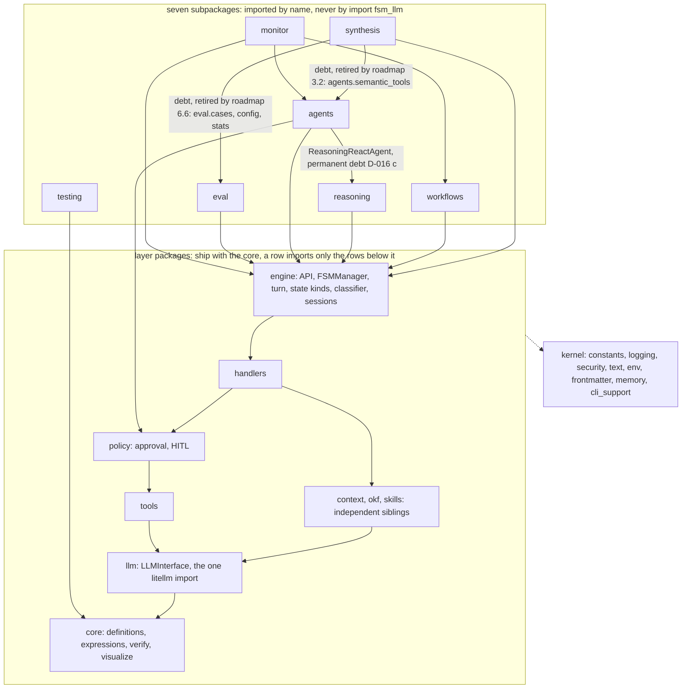

# FSM-LLM

Path: repository root (`.`)
Purpose: Python framework (v0.12.0, Apache-2.0, Python 3.11-3.12) for stateful conversational AI: JSON-defined finite state machines (FSMs) driven by an LLM through a 2-pass pipeline, shipped as one package `fsm_llm` with seven subpackages.

## Scope

One distribution (`fsm-llm`, `pyproject.toml`, setuptools, src layout: the import package `fsm_llm` is the directory `src/fsm_llm/`, found by `[tool.setuptools.packages.find]` with `where = ["src"]`). Always use the project virtualenv: `.venv/bin/python`, or activate `.venv` first.

- In: `src/fsm_llm/` (all source), `tests/`, `examples/` (100 runnable examples), `docs/` (guides), `scripts/` (supply-chain audit, benches, doc-count check), `evaluation/` (datasets and eval runs), `.github/workflows/`, `images/`, root build and policy files.
- Out: `build/`, `dist/`, `logs/`, `src/fsm_llm.egg-info/` (generated by `pip install -e .`, removed by `make clean`). `plans/` is gitignored except `plans/ANCHORS.md` (append-only anchor manifest; never edit its lines).

## Architecture



An arrow is an allowed import direction, and so is a path of arrows (a row may import every row below it, the kernel is importable from anywhere); a pair with no downward path is forbidden. `policy` is the one row drawn with a single arrow: it imports `tools` and nothing at the `context`, `okf` or `skills` level (the contract `policy-imports-no-sibling-layer`, D-037 and D-038; the layers contract alone would let it, because `policy` has a row of its own above the siblings), while `handlers` and `engine` may reach all four. The rules are `.importlinter` (`layers-section-5-2`, the kernel contract and the contracts the layers cannot express), run by `make lint-imports` and by `tests/test_fsm_llm_regression/test_import_contract.py`. The three labelled edges, `agents` to `reasoning`, `synthesis` to `agents` and `synthesis` to `eval`, are the named debts (a fourth, `engine.okf_bridge` to `okf`, sits inside the layers).

2-pass flow per `converse` (`src/fsm_llm/engine/turn/`): Pass 1 extracts data (LLM), context update, classification extractions, rule-based transition evaluation (an LLM classifier only on AMBIGUOUS), state transition, then Pass 2 writes the reply (LLM) from the post-transition state. Pass 2 is skipped when `response_instructions` is empty: a silent state makes no LLM call, returns `""` and adds nothing to history. Transition outcomes: one winner is DETERMINISTIC, a tie at the lowest priority is AMBIGUOUS, none passing is BLOCKED (stay).

Message-free step: `API.advance(conversation_id)` runs the same turn with no user message (nothing added to history for a user, no-message prompt variants, the LLM layer sends a neutral user turn) and returns a frozen `AdvanceResult`; `run_until_terminal(conversation_id, *, max_steps, max_seconds=None, before_step=None)` loops it until a terminal state and raises `RunBudgetExceededError` on a spent budget. Agents, workflow agent steps and the reasoning engine run on these loops; they never send a synthetic message. When the top of the stack is an ended pushed FSM, the loop calls `before_step` once (not a step, no budget check) so the hook can pop it and the run continues on the parent.

One LLM layer (the package `src/fsm_llm/llm/`; litellm is imported in exactly one module, `llm/providers/litellm.py`): `LLMInterface.complete(CompletionRequest) -> CompletionResponse` is the one primitive for tool calling, plain and structured completion; `LiteLLMInterface` builds every request in one builder and sends it through one send path, counting each call (`usage()`); `LiteLLMEmbedder` makes embeddings. A state with the optional `completion` field makes its Pass 1 one `complete` call (tools or a structured turn) over a consumer-owned transcript and writes `{kind, text, calls}` to its result key; core runs no tool. `native_fc` and the meta-builder are FSMs built on it. Importing `fsm_llm.llm` sets `litellm.suppress_debug_info = True` once (litellm's red "Give Feedback" banner on a provider error would print to the host's stdout); a host that wants the banner sets it False after importing `fsm_llm`. `CompletionResponse` carries the provider's `finish_reason` and a `truncated` property (`finish_reason == "length"`, cut at `max_tokens`): `_send` logs one WARNING per cut non-streamed reply, a cut bulk or field extraction and a cut classification say so in their error, and a cut reply that opens `{`/`[` and does not parse is replaced in Pass 2 by a cut-off message, never shown as an unreadable half envelope; a cut envelope whose `message` can be read is shipped as read (it may be partial) and flagged `truncated`; a cut prose reply is shipped as is. The two reply models carry `truncated`, and the pipeline records a cut turn in the internal context key `definitions.CONTEXT_KEY_CUT_OFF` (`_cut_off`, last turn only, absent when nothing was cut). The completion-state result stays `{kind, text, calls}`.

`import fsm_llm` loads only the core: the layer packages `core`, `engine`, `handlers`, `context`, `llm` and `security` and the kernel modules `constants`, `env`, `logging` and `memory`, and nothing else (no subpackage, no `okf`, `skills`, `tools`, `policy`, `text`, `frontmatter` or `cli_support`); `tests/test_fsm_llm_regression/test_import_laziness.py` pins that exact set in a fresh `python -I` process, so a new eager import is a visible diff. `fsm_llm/__init__.py` never imports a subpackage. Import one by name (`from fsm_llm.agents import create_agent`). Every subpackage ships in every install; an extra only adds third-party deps.

## Key files

| Path | Role | Notes |
| --- | --- | --- |
| `src/fsm_llm/engine/api/`, `engine/fsm/`, `engine/turn/` | `API` (the package `engine/api/` is the old `api.py`, split at step 81 of plan d454fd62, the old path `fsm_llm.api` is gone: `conversation.py` the `API` shell (`__init__`, factories, `start_conversation`, `converse`, `advance` and the streams, handler registration, `close`), `run.py` `RunMixin` (`run_until_terminal` and its stream, the budgets, the `before_step` rounds), `stack.py` `StackMixin` (`push_fsm`, `pop_fsm`, the context merge) with `FSMStackFrame` and `ContextMergeStrategy`, `lifecycle.py` `LifecycleMixin` (the ended-conversation cache, the getters, `end_conversation`, the idle sweep), `sessions.py` `SessionsMixin` (`save_session`, `load_session`, `restore_session`), `helpers.py` (`handle_conversation_errors`, `llm_settings_for` and the private helpers), `surface.py` (`_ApiSurface`, mypy-only declarations); `from fsm_llm import API` is unchanged, a patch aims at the module that performs the lookup, for example `fsm_llm.engine.api.conversation.LiteLLMInterface`, and the idle-clock tests bind `time` in every module of the package through `tests.conftest.bind_api_clock`), `FSMManager` (per-conversation locks, LRU definition cache; the package `engine/fsm/` is the old `fsm.py`, split at step 78 of plan d454fd62: `manager.py` shell, `turns.py` `TurnsMixin`, `snapshots.py` `SnapshotsMixin`, `helpers.py`), `MessagePipeline` (the package `engine/turn/` is the old `pipeline.py`, split at step 79: `message_pipeline.py` shell with `__init__`, `get_state` and `execute_handlers`, `driver.py` `DriverMixin` (the sync and stream turn drivers), `pass1.py` `Pass1Mixin` (the one Pass-1 seam), `transitions.py` `TransitionsMixin` (rules, the classifier tie-break and cache, the state transition), `pass2.py` `Pass2Mixin`, `records.py` (turn snapshot and record, small helpers), `surface.py` (`_PipelineSurface`, the mypy-only declarations the mixins share); the conversation kind's Pass-1 machinery is NOT in this package since step 80, it is `engine/kinds/conversation/`, below); a patch aims at the module that performs the lookup, `fsm_llm.engine.turn.transitions.Classifier`) | Read `# DECISION` anchors first; the lock order of `FSMManager` is pinned by `tests/test_fsm_llm/test_fsm_lock_order.py` |
| `src/fsm_llm/core/definitions/` (package: `limits`, `errors`, `completion`, `extraction`, `pass_models`, `classification`, `transition`, `kinds`, `state`, `results`, `fsm`, `schema`), `core/transition_evaluator.py`, `core/expressions/` (package: `comparison`, `arithmetic`, `logic_and_text`, `access`, `registry`, `evaluator`, `undefined`) | Pydantic FSM models, core exceptions, JsonLogic evaluation | No LLM in transitions; `fsm_llm.core.definitions` and `fsm_llm.core.expressions` are the one import surface of their package (static `__all__`), a private name or a patch target lives in the defining module |
| `src/fsm_llm/llm/`, `engine/classification.py` | `LLMInterface`, `LiteLLMInterface` (`complete`, `usage`), `LiteLLMEmbedder`, `tool_exchange`; `Classifier` | litellm is imported in exactly one module, `llm/providers/litellm.py`; the classifier (`engine/classification.py`, moved into the `engine` layer at step 82 of plan d454fd62, the old top-level `fsm_llm.classification` is gone; `from fsm_llm import Classifier` still works) uses the conversation's interface. `llm/` is a layer package (step 72 of plan d454fd62 created it, step 73 split the old `llm.py` and placed the old `ollama.py`): `interface.py` (`LLMInterface`, `tool_exchange`, `check_tool_transcript`, `implements_complete`, `interface_model`, `resolve_model`, `PLACEHOLDER_MODEL`, the connection defaults), `usage.py` (the usage meter, `_Metered`), `parsing.py` (the reply readers and `ParseMixin`), `providers/litellm.py` (`LiteLLMInterface`, the ONE `import litellm` with its `LITELLM_MODE` guard, the banner setting and the `completion` and `get_supported_openai_params` bindings), `providers/request.py` (`RequestMixin`: `_build_call_params`, the one request builder), `providers/embedder.py` (`LiteLLMEmbedder` and the `embedding` binding), `ollama.py` (`is_ollama_model` and friends; the old top-level `fsm_llm.ollama`, gone), `text.py`, `json_extraction.py`; the `__init__` re-exports the public names with a static `__all__` (`from fsm_llm.llm import LiteLLMInterface` still works) and a private name is imported from its defining module; a patch aims at the module that performs the lookup (`fsm_llm.llm.providers.litellm.completion`, `fsm_llm.llm.providers.embedder.embedding`, never the package); `llm/text.py` (`resolve_reasoning_trace`, `remove_think_blocks`, `strip_think_and_fences`) and `llm/json_extraction.py` (`extract_json_from_text`, `balanced_json_objects`) came from the old `utilities.py` |
| `src/fsm_llm/context/`, `core/coerce.py`, `core/loaders.py` | `context/__init__.py` (the one import surface: `ContextCompactor`, `clean_context_keys`, `clear_keys_delta`, `commit_with_key_rollback`, `record_cut_off`, `was_cut_off`), `context/compactor.py` (the old `context.py`: `ContextCompactor`, `clean_context_keys`), `context/commit.py` (`clear_keys_delta`, moved down from `handlers`, with `commit_with_key_rollback`, `was_cut_off`, `record_cut_off`), `context/layout/` (`base.py`, `extraction.py`, `response.py`, `classification.py`: the prompt builders, the old `prompts.py`), `context/filtering.py` (`filter_context_tree`, `ContextFilterError`, `redact_context`, `redact_non_json_leaf`, `redacting_json_default`), `core/coerce.py` (`coerce_confidence`, `coerce_int`, `coerce_float`, `parse_bool_word`), `core/loaders.py` (`load_fsm_from_file`, `load_fsm_definition`, `read_json_object`, `get_fsm_summary`) | The five-way split of the old `utilities.py` (step 72); the old `fsm_llm.utilities` is gone; step 74 split the old `prompts.py` into `context/layout/` (`fsm_llm.prompts` is gone, `from fsm_llm.context.layout import BasePromptBuilder`; the sanitizer's `_SAFE_TAGS` and `_TAG_PATTERN` stay together on `BasePromptBuilder` in `layout/base.py`) and moved `clear_keys_delta` from `handlers` to `context/commit.py` (`fsm_llm.handlers` still binds the name, so `from fsm_llm.handlers import clear_keys_delta` works; `context` imports no engine module), the top-level names `extract_json_from_text`, `load_fsm_definition`, `load_fsm_from_file`, `get_fsm_summary` still import from `fsm_llm` |
| `src/fsm_llm/security/`, `constants.py` | `has_internal_prefix`, `is_forbidden_context_entry`, `resolve_within`, defaults, `OKF_*` limits | `security/` is the first layer package (0.4 split, step 67; a kernel package, imports the standard library only, so `.importlinter` has a `security-is-a-leaf` contract): `names.py` (prefix test, `is_forbidden_context_entry`), `paths.py` (`resolve_within`), `api_keys.py`, `patterns.py` (layer 1 name regexes), `shape_data.py` and `shapes.py` (layer 2); its `__init__` re-exports the public names, a private helper is imported from the defining module. Single source for key filtering; shared path-confinement helper |
| `src/fsm_llm/core/verify/` | The old `validator.py` and `flow_analysis.py` (split at step 75 of plan d454fd62): `validator.py` (`FSMValidator`, a shell over `StructureMixin` in `structure.py` and `GraphMixin` in `graph.py`, and `validate_fsm_from_file`), `result.py` (`FSMValidationResult`), `upgrade.py` (`upgrade_fsm_file`, `UpgradeResult`), `cli.py` (`main`, `main_cli`: the `fsm-llm-validate` entry `fsm_llm.core.verify.cli:main_cli`), `flow.py`: `strongly_connected_components` (the one graph primitive, shared with `FSMValidator`), `analyze_data_flow` (G3), `analyze_liveness` (G4), `declared_available`, frozen `FlowFinding`s; the package `__init__` re-exports the validator names (`FSMValidator`, `FSMValidationResult`, `validate_fsm_from_file`, `upgrade_fsm_file`, `UpgradeResult`) | Layer `core`, imports the kernel and `core` only; `flow.py` is imported by name (`fsm_llm.core.verify.flow`), never logs, never raises on a loaded definition; `FSMValidator.validate()` calls none of the analyses (never stricter than the loader); the old paths `fsm_llm.validator` and `fsm_llm.flow_analysis` are gone |
| `src/fsm_llm/core/definitions/schema.py` | `SCHEMA_VERSION_DEFAULT` (`"4.2"`), `SCHEMA_VERSION_OLDEST` (`"4.0"`), `FIELD_VERSIONS` ("Model.field" to the definition version that added it), `parse_version`, `newer_fields`, frozen `SchemaFinding` | Leaf core module, imports no `fsm_llm` module, never logs; a test walks the models reachable from `FSMDefinition`, so a field missing from the table fails the build; the loader and `fsm-llm-validate` warn on a field newer than the declared version |
| `src/fsm_llm/core/state_kinds.py` | The state-kind registry (roadmap row 0.14): `KindSpec` (frozen; `name`, `config_field`, then per kind the rules `result_key`, `inherits_result_on_push`, `forbidden_declarations`, `dryrun_judged`, `minted_keys`, `produced_keys`, `check_state`, `sample_results`, `check_definition`, `mentioned_keys`, `typed_keys`, `lint_raw`, `raw_result_key`, `declared_tools`, `raw_declared_tools`, `supported_in_procedure`), `KINDS` (`conversation`, `completion`, `synthesize`, in detection order), `kind_of(state)`, `get_kind`, `CompletionStateKind`, `state_problem(state)` and `definition_problem(...)` (the loader's State-level and cross-state refusal rules; the edge check stays in the loader, never `core/verify/`), `declared_tool_names(states)` (the one declared-tool-names rule of the approval request and the library), `raw_kinds(state_dict)` and `RawLintServices` (the raw-dict twin the validator lints through); `State.kind` is a plain property over it | Leaf core module, imports only the standard library, never logs; `kind` is never a field, `computed_field` or `PrivateAttr` (it would move `fsm_id`); the spec registry is static and internal until the kind extension point is public (roadmap C10), not imported by `fsm_llm/__init__.py`; the pipeline, `API.push_fsm`, the State validator and loader, `core/verify/flow.py` (G3, G4), the dry-run gate G6a, the validator's raw lint, the synthesis tool-name readers (G5 through the raw hook, which stays raw) and the runner's `completion_unsupported` refusal all read the specs instead of testing `state.completion` or `state.synthesize` (an AST test bans those reads in the engine and the analyses); a new kind adds a spec here and an executor in `engine/kinds/` |
| `src/fsm_llm/engine/kinds/` | The engine side of the state kinds (roadmap row 0.14), the old flat `executors.py` (added in this release, never in a tagged version, so its move has no BREAKING entry; split at step 80 of plan d454fd62, D-030): `__init__.py` re-exports `StateExecutor`, `ConversationExecutor`, `CompletionExecutor`, `executor_for(state, executors=None)`, `register_executor(kind_name, executor)`, `check_executors(executors)` with a static `__all__`. Modules: `base.py` (`StateExecutor`: `extract`, `cleans_extracted`, `after_transition`), `services.py` (`_PipelineServices`, the `Protocol` of what an executor may ask of the pipeline: `llm_interface`, the two prompt builders, `fsm_resolver`, `get_state`, `execute_handlers`, `_apply_context_scope`, `_get_classifier`, `_build_classifier_context`), `registry.py` (the module table, `executor_for`, `register_executor`, `check_executors`, D-026 anchor), `completion.py` (`CompletionExecutor`: the one `complete` call of a completion state, `cleans_extracted = False`, D-021 and D-029 anchors), `records.py` (the provenance, classification-record, agent-managed and JSON-native helpers the executors write and `engine/turn/` also reads), `conversation/` (`executor.py`: `ConversationExecutor`, also the passive executor of `synthesize`, and `ConversationPass1`, the machinery bound to the services of one pipeline for one call; the five mixins `extraction.py`, `bulk.py`, `fields.py`, `classification.py`, `post_transition.py`: `_extract_after_transition`, `_execute_data_extraction`, `_build_field_configs_from_state`, `_bulk_extract_from_instructions`, `_execute_field_extractions`, `_validate_field_extraction`, `_execute_classification_extractions`; `surface.py`) | Sits BELOW `engine/turn/`: imports core, llm, context and handlers modules and never `engine/turn/` (the pipeline imports it; the contract `engine-kinds-imports-no-turn-or-manager-or-api` and an AST scan of every module, `TYPE_CHECKING` imports included, hold it); the conversation executor owns the Pass-1 methods and reads the pipeline only through `_PipelineServices` (a method reads a service as `self._services.<name>`, bodies otherwise the old ones; `engine/turn/` holds no conversation Pass-1 method and reads no `field_extractions`, `classification_extractions` or `extraction_instructions`, an AST test pins it); `executor_for` reads the per-instance `executors={kind_name: StateExecutor}` map of `API`, `FSMManager` and `MessagePipeline` (keyword-only, validated, read-only, wins over the module table for that pipeline only, never exported) and falls back to the conversation executor for a kind with no registration, through the instance's own `conversation` entry first (`synthesize` has no table entry of its own; a `conversation` override covers it); the pipeline dispatches at the one Pass-1 seam of `_execute_extraction_and_transition_pass` (both turn paths) and for `after_transition`; the cut-off recorders `context.record_cut_off` and `was_cut_off` live in `context/commit.py`; a private helper is imported from its defining module and a patch aims at the module that performs the lookup (`fsm_llm.engine.kinds.conversation.fields.logger`, `engine.kinds.registry._EXECUTORS`), never the package; internal, not imported by `fsm_llm/__init__.py` |
| `src/fsm_llm/core/codes.py` | `Status`, `Reason`, `CompletionKind` (`str, Enum` with `from_string`), `status_of_stop_reason`, `status_of_tool_status`, `approval_code` | Standard library only; values equal the wire strings of synthesis, agents and `CompletionResponse`, held by `test_codes.py` (the synthesize sample results of `state_kinds` are pinned against `Status` there) |
| `src/fsm_llm/handlers/` | `HandlerSystem`, `HandlerBuilder`, `create_handler`, `BaseHandler`, `LambdaHandler`, `HandlerTiming`, `HandlerErrorMode`, `FSMHandler`, `clear_keys_on_entry` | Layer package (step 77 of plan d454fd62) at the same dotted path as the old flat module, so `from fsm_llm.handlers import create_handler` is unchanged; modules `protocol`, `errors`, `base`, `system`, `lambda_handler`, `builder`, `helpers`; a row of its own BELOW `engine` in the layers contract (it imports no engine module); a patch aims at the defining module (`fsm_llm.handlers.system`) |
| `src/fsm_llm/core/visualize/`, `core/redaction.py` | ASCII diagrams and graph export (`build_fsm_graph`, `FSMGraph`, `to_mermaid`, `to_dot`, `visualize_fsm_ascii`; the old `visualizer.py`, split at step 76; `fsm-llm-visualize` is `fsm_llm.core.visualize.cli:main_cli`); the one redaction walk `redact_context` (`core/redaction.py`, moved down from the old `utilities.py` at step 95 so `tools` and `runner` reach it without `context`) | Layer `core`: imports the kernel and `core` only; the old paths `fsm_llm.visualizer` and `fsm_llm.utilities` are gone |
| `src/fsm_llm/engine/builders.py`, `engine/session.py` | `APIBuilder`, `FSMManagerBuilder`; `SessionState`, `SessionStore`, `FileSessionStore` | Layer `engine` (step 82 of plan d454fd62): the builders are the top of the layer (nothing in `engine` imports them), the session store a leaf; `from fsm_llm import APIBuilder, FileSessionStore` is unchanged |
| `src/fsm_llm/memory.py`, `logging.py`, `runner.py`, `__main__.py` | `WorkingMemory` and its buffers; the loguru setup (`setup_logging`, `enable_debug_logging`); the interactive `fsm-llm` CLI | `memory` and `logging` are kernel modules (import no layer; `fsm_llm.memory` is imported by examples); `runner` and `__main__` are entry modules that nothing imports, held by `.importlinter` |
| `src/fsm_llm/okf/` | Open Knowledge Format (OKF v0.2, SPEC at commit ad30107, pre-1.0 and mutable), the layer package of step 83 (plan d454fd62): `__init__` (the one import surface, static `__all__`: `load_bundle`, `OKFBundle`, `check_bundle`, `write_bundle`, `OKFConcept`, `OKFIssue`, `OKFLimits`, ...), `models`, `parser`, `links`, `bundle`, `loader`, `checker`, `writer`, `reading` (`body_page`, `close_ids`), `cli` (`fsm-llm-okf`, entry `fsm_llm.okf.cli:main_cli`); public helpers `has_lone_surrogate`, `writes_within_caps` (`writer.py`) and the re-exports `iso_utc`, `capped_note`, `capped_line`, `capped_issues`, `text_page`, `strip_unsafe_text` | Layer package: imports the kernel, `core` and `security`, no engine, llm, context, skills or subpackage module (import contract; no debt: `okf.cli` reads `okf/memory_export.py` for `export`, since step 95); not imported by `fsm_llm/__init__.py`; a private name is imported from its defining module (`fsm_llm.okf.parser`, `.links`, ...); the old `fsm_llm.okf_cli` is gone |
| `src/fsm_llm/engine/okf_bridge.py` | Plain FSMs to OKF: `create_okf_handler` (the old `fsm_llm.okf_bridge`, moved at step 83; it needs `handlers`, an engine module), and a re-export of `bundle_from_memory_entries`, which is DEFINED in `src/fsm_llm/okf/memory_export.py` since step 95 (D-042; the memory-entry export, `_native` and `_slug` moved byte-identical, so `okf.cli` reaches no engine module) | 289 lines; imports only public names of `okf`, no other engine module, and no engine module imports it (import contracts); no re-export |
| `src/fsm_llm/text.py` | The text hygiene of every output path (kernel, step 83): `strip_unsafe_text`, `capped_line`, `capped_issues`, `capped_note`, `text_page`, `iso_utc`; `fsm_llm.okf` re-exports all six as documented public names | Standard library and `constants` only (`frontmatter` for a type name under `TYPE_CHECKING`); no OKF or skills model; held by an import contract; not imported by `fsm_llm/__init__.py` |
| `src/fsm_llm/cli_support.py` | The CLI skeleton `okf/cli.py` and `skills/cli.py` share: `run_cli`, `exit_main`, `report_error`, `report_issues`, `add_max_seconds`, `add_env_file`, `apply_env_file`, `escape_unencodable_output`, `positive_seconds` | Stdlib, `constants`, `env.load_env`, `text.capped_line` and `text.strip_unsafe_text` only (a kernel leaf, held by an import contract since step 83; the old debt `core.visualize.cli` to `cli_support` is retired); neither CLI imports a private name from the other; `add_env_file`/`apply_env_file` are the shared `--env-file` of the five model CLIs |
| `src/fsm_llm/env.py` | The one explicit `.env` seam: `load_env(path=None, *, override=False) -> Path \| None` (exported from `fsm_llm`); `fsm-llm --env-file` calls it, and so does `cli_support.apply_env_file` for the other model CLIs | Imports only `os`, `pathlib` and python-dotenv, the one module that imports it; never called at import; searches from the working directory, never the package location |
| `src/fsm_llm/frontmatter.py` | The one YAML frontmatter seam: `split_frontmatter`, `load_yaml` (one `yaml.SafeLoader` subclass, no aliases or anchors, size and depth limits are parameters), `read_bytes` (no-follow), `lone_surrogate` | Shared by OKF and Agent Skills; stdlib and `yaml` only; extracted from the old `okf.py` (now the package `okf/`) |
| `src/fsm_llm/skills/` | Agent Skills (SKILL.md folders, agentskills.io spec read 2026-10-23, unversioned and mutable), read-only, the layer package of step 84 (plan d454fd62, D-034): `__init__` (the one import surface, static `__all__`: `load_skills`, `SkillCatalog` (`render_catalog`, `read_body`, `read_resource`, `files_under`), `AgentSkill`, `SkillIssue`, `SkillLimits`, `SkillError`, `parse_skill_text`, `incomplete_note`, `skipped_note`), `catalog` (the old `agent_skills.py`, one module, 710 lines: parser, bounded loader, catalog, confined reads), `cli` (`fsm-llm-skills validate\|list\|show`, entry `fsm_llm.skills.cli:main_cli`; `show --file` also lists a directory) | Layer package: imports the kernel (`constants`, `frontmatter`, `security`, `text`, `cli_support`) and `core`, never `okf`, an engine module or a subpackage (import contract, no debt; the OKF helpers it shares are the kernel module `text`); not imported by `fsm_llm/__init__.py`; nothing in a skill is executed; a private name is imported from `skills.catalog` |
| `src/fsm_llm/tools/` | The tool layer, a layer package of step 85 (plan d454fd62, D-035 and D-036; the old `agents/tools.py` of 1,399 lines, the tool models of `agents/definitions.py`, the tool errors and `require_int_limit` of `agents/exceptions.py`, and the old `agents/truncation.py`): `__init__` (the one import surface, static `__all__`: `ToolRegistry`, `ToolDefinition`, `ToolCall`, `ToolResult`, `ToolAnnotations`, `READ_ONLY_ANNOTATIONS`, `tool`, `registry_from`, `redact_secret_entries`, `ToolExecutionError`, `ToolNotFoundError`, `ToolTimedOut`, `check_timeout`, `call_with_timeout`, `schema_types`, `tool_parameters_schema`, `infer_schema_from_hints`, `callable_name`, `smart_truncate`, `bounded_repr`, `require_int_limit`, `ToolRunStatus`, `ToolObservationPrefix`), `models`, `registry`, `decorator`, `schema`, `arguments`, `hints`, `timeouts`, `errors`, `limits`, `truncation`, `constants` (the subset of the agents `ContextKeys`, `Defaults`, `ErrorMessages`, `LogMessages` these modules read; the agents classes assign each attribute from it and are linked to it by `MirroredConstants`/`mirror` (D-045): `vars()` of the agents classes is unchanged and setting or deleting a shared name on any of the classes reaches every reader) | Layer package: imports the kernel (`logging`), `core` (`AgentError` now lives in `core/definitions/errors.py`) and the redaction walk `core.redaction.redact_context` (moved down from `context.filtering` at step 95, which retired the one named debt of this layer), never `agents`, the engine, `llm` or a subpackage; `fsm_llm.agents` re-exports the public names (`from fsm_llm.agents import ToolRegistry` unchanged; `fsm_llm.agents.tools` keeps `register_agent` and three agent-only helpers, example-visible); `agents.tools.ToolRegistry`, `agents.definitions.ToolDefinition`, `agents.exceptions.ToolExecutionError` and `agents.truncation` are gone, no shim (BREAKING in `CHANGELOG.md`); every module is bench-pinned in `scripts/synthesis_bench.py` `_TOOLS`; not in `docs/api.txt` (its names are the `fsm_llm.agents` ones); loguru records of the registry are named `fsm_llm.tools.*` |
| `src/fsm_llm/policy/` | The policy layer, a layer package of step 86 (plan d454fd62, D-037; the old `agents/hitl.py`, `ApprovalRequest` of `agents/definitions.py`, `ApprovalDeniedError` of `agents/exceptions.py`): `__init__` (the one import surface, static `__all__`: `HumanInTheLoop`, `ApprovalRequest`, `ApprovalPolicy`, `ApprovalCallback`, `EscalationCallback`, `ApprovalDeniedError`), `approval` (the four approval names), `hitl` (`HumanInTheLoop`, `EscalationCallback`), `constants` (the subset of the agents `Defaults` and `LogMessages` the manager reads; the agents classes assign each attribute from it and are linked to it, so an override on either class reaches every reader, D-045) | Layer package: imports the kernel (`constants`, `logging`), `core` (`AgentError`, the base of `ApprovalDeniedError`) and `fsm_llm.tools` (the tool models, the per-call timeout and `redact_secret_entries`), never `agents`, the engine, `llm`, `context` or a subpackage; it sits above `tools`, a deviation from the roadmap Section 5.2 row that lists the two as siblings (step 95 amends the `layers` contract); the driver-only `_approval_granted` grant and the gate handler `make_hitl_checker` stay in `agents/base/hitl_gate.py` and `agents/tools.py`; `fsm_llm.agents` and `fsm_llm.synthesis` re-export or import the public names (`from fsm_llm.agents import HumanInTheLoop` unchanged); `agents.hitl`, `agents.definitions.ApprovalRequest` and `agents.exceptions.ApprovalDeniedError` are gone, no shim (BREAKING in `CHANGELOG.md`); every module is bench-pinned (`scripts/synthesis_bench.py` `_POLICY`); not in `docs/api.txt`; loguru records are named `fsm_llm.policy.hitl` (was `fsm_llm.agents.hitl`) |
| `src/fsm_llm/reasoning/` | 9 strategies as stacked FSMs pushed and popped inside one message-free core run, validation with up to 3 retries | `ReasoningEngine.solve_problem(problem) -> (solution, trace_info)` |
| `src/fsm_llm/workflows/` | Async in-memory engine (the `engine/` package, a shell over seven mixins), 11 step types (the `steps/` package, one module per group of kinds), DSL | `WorkflowEngine`, `create_workflow`, `auto_step`, `condition_step` |
| `src/fsm_llm/agents/` | 18 agent patterns (native_fc and the meta-builder are FSMs on core too), tools with annotations and enforced timeouts, HITL, memory, swarm/graph, MCP, A2A, SOPs | `create_agent`, `ReactAgent`, `ToolRegistry`, `@tool`, `MetaBuilderAgent` |
| `src/fsm_llm/agents/okf.py` | Agents side of OKF: `create_okf_tools` (4 read-only tools), `OKFMemoryBackend` (read-only), `export_semantic_memory`, `export_agent_result` | Imports core only |
| `src/fsm_llm/agents/agent_skills.py` | Agents side of Agent Skills: `create_skill_tools` (`skill_list`, `skill_load`, `skill_read`, all read-only) | Imports `fsm_llm.skills`, core and sibling agents modules; reuses private reply helpers of `agents/okf.py` (debt, see api_reference.md) |
| `src/fsm_llm/agents/python_tools.py` | `PythonToolLoader` (`from_directory`, `load_directory` -> `PythonToolLoadReport`), `PythonToolDefinition`, `ToolRegistry.register_python_tool`: tools from folders of Python files (`PYTHON_TOOLS` list or `@tool`) | Executes the files it loads, trusted sources only; not Agent Skills; a file that fails to load is reported in the report and warned once (`UserWarning`) by `from_directory` |
| `src/fsm_llm/monitor/` | FastAPI dashboard (REST, WebSocket, vanilla-JS SPA), OTEL exporter | `configure`, `InstanceManager`, `OTELExporter` |
| `src/fsm_llm/eval/` | Examples scorer (0-4) and conversation cases (N trials, Wilson CIs) | `EvalConfig`, `run_examples`, `load_cases`, `run_cases`, `run_dataset`, `wilson_ci` |
| `src/fsm_llm/synthesis/` | Runtime FSM synthesis: a model compiles a goal into an FSM, gates G1 to G7 judge it, a file-backed library with a lifecycle stores it, a runner pushes it as a child of a host conversation, traces, `diagnose` and a propose-only repair; agent tools `obtain_procedure` and `run_procedure` | `FSMSynthesizer`, `ProcedureRunner`, `FSMLibrary`, `SynthesisPolicy`, `run_gates`, `create_procedure_tools` |
| `src/fsm_llm/testing/` | Public test doubles, scripted user and assertions for code built on `fsm_llm` (seventh subpackage; today `MockLLM2Interface` and `PromptGroundedLLM`, promoted from `tests/conftest.py` and moved verbatim into `testing/doubles.py`, plus `ScriptedLLM`, `UnscriptedCallError`, `state_in_prompt` and `hash_embed` there and the reply builders `final_reply`, `tool_call_reply`, `malformed_reply` in `testing/builders.py`, and `ScriptedUser`, `ConversationRun` (frozen record with the visited `states`) and `advance_until_terminal` in `testing/user.py`, and the assertions `assert_state`, `assert_context`, `assert_path`, `assert_result` (explicit `AssertionError`, never `assert`) with the opt-in `PathRecorder` handler in `testing/assertions.py`) | Imports core and `fsm_llm.core.codes` only, never `pytest`, `litellm` or another subpackage; no library module imports it; `fsm_llm/__init__.py` never loads it (`tests/test_fsm_llm_testing/`); recorded debt: `doubles.py` imports the private usage meter `_Metered`/`_meter_of` of `fsm_llm.llm.usage` (a test pins exactly these two names and that module; step 73 retargeted them, it did not give the seam a public name) |
| `tests/conftest.py` | `configure_mock_extract_field`, fixtures, `ollama_available()`, `block_network`; the doubles are imported from `fsm_llm.testing`, not from here | Default runs make no network or LLM call |
| `tests/test_packaging.py` | Pins package wiring and every test count in this file and `CONTRIBUTING.md` | See Working here |
| `scripts/audit_pth.py` | Flags known malicious and code-bearing `.pth` files in site-packages; exit 1 on issues | No allowlist: the editable install writes a plain `<repo>/src` path entry; the old code-bearing finder hook of the flat layout is flagged until `pip install -e .` is re-run; `make audit`, CI |
| `scripts/bench_common.py` | Shared stdlib bench helpers (statistics, row files, manifest and drift checks, wire capture); no CLI | Held equal to `fsm_llm.eval` by `test_bench_parity.py`; `agents_bench.py` and `skills_bench.py` load it |
| `scripts/agents_bench.py` | Pre-registered agent bench: `register`, `run`, `report` | Rows in tracked `scripts/bench_data/` |
| `scripts/synthesis_bench.py` | Pre-registered synthesis comparison (bench id `synthesis`, blocks `s0` to `s2`; arms `synth-fsm`, `hand-fsm`, `react`; 16 judge-free tasks): `register`, `smoke`, `run`, `report` | Bench status: blocks `s0`, `s1` and `s2` are registered, run and recorded (one model, `ollama_chat/bonsai-2:27b`, for every role and arm, no strong/cheap split); all three verdicts are INCONCLUSIVE and no registered block shows a compiled procedure beating a ReAct agent. See `docs/synthesis.md`. See `scripts/bench_data/README.md`; one model, `ollama_chat/bonsai-2:27b`, for every role and arm; `smoke` and `run` refuse (exit 3) while the shared model server is busy |
| `scripts/skills_bench.py` | Pre-registered Agent Skills read-hint ablation (bench id `skills-disclosure`, blocks B0 and B1): `register`, `run`, `report` | Registered, NOT RUN (live runs declined); the read hint is a recorded default, not a measurement |
| `scripts/doc_counts.py` | Compares the count tokens of the shapes it knows (`N tests`, marker, `N slow`, `N live`/`N gated`, `tests in N files`, rows) in the tracked `.md` files with one `pytest --collect-only`; exit 1 on drift or on such a token no rule names; prose numbers with no token shape are not read | `make counts`; skips when `mcp` is importable |
| `scripts/coverage_ratchet.py` | Branch-coverage ratchet over a `coverage json` report: `check COVERAGE_JSON` fails when the combined or branch percent is below `coverage-baseline.json` minus 0.10 pp, `update` only raises the baseline (floor to 0.01), `guard` fails on any decrease against `origin/main`; stdlib only, exit 0/1 | The baseline file is written from the canonical leg (Linux, Python 3.12, `mcp` installed) only; `[tool.coverage]` in `pyproject.toml`, `coverage` pinned in `constraints.txt` |
| `scripts/api_snapshot.py` | Prints the public API (static `__all__` of the eight packages and the named core modules, with signatures) for `docs/api.txt`; `--write PATH`; `make api-snapshot`; walks the MRO: members of a private (`_`-prefixed) base or of a same-package `<Group>Mixin` are listed under the class and the class line names only declared bases, so a class split into mixins keeps its text | `tests/test_fsm_llm_regression/test_api_snapshot.py` fails when `docs/api.txt` differs; regenerate and review the diff in the same commit; never edit `docs/api.txt` by hand |
| `scripts/decision_index.py` | Anchor scanner and manifest parser (roadmap row 0.5, plan d454fd62 steps 98 to 100): `scan(root)` finds every `# DECISION [plan-id/]D-NNN [STALE]` anchor of `src`, `tests`, `scripts`, `.github` and the four root files (the grammar of the planner's `validate-plan.mjs`), `load_manifest(path)` parses `plans/ANCHORS.md`, `classify` sorts each anchor into `resolved` (a manifest line exists), `retired` (`[STALE]` and no line: resolved by tag), `unresolved` (live, no line) or `badprefix` (a prefix that is not a plan id, or a bare `D-NNN`); a record names the path and the enclosing `Class.method`, never a line number; `render(anchors, manifest)` builds the decision index from the anchors and the manifest only (plans by date, decisions by number, `path` plus enclosing definition, a rule summary cut at 120 characters from the anchor comment, a Retired section for `[STALE]` anchors, the manifest entries with no anchor; ASCII, no line numbers, no environment or clock); `--write PATH` writes it, `--check PATH` exits 1 when the file differs from the fresh text or any anchor is `unresolved` or `badprefix` (the message names the cause and the fix command), `--report` prints the counts, `resolved + retired`, the report-only `resolved-local` tier (a local `plans/<id>/decisions.md`, only while `CI` is unset, never changes `render` or `--check`) and the comment share (`tokenize` over `src`, reported, never gated); `make decision-index` and `make decision-check` | Stdlib only, never imports `fsm_llm`, never touches `sys.path`; `docs/decisions/index.md` is GENERATED and committed: any change to an anchor or its comment, or to `plans/ANCHORS.md`, needs `make decision-index` in the same commit or `tests/test_fsm_llm_regression/test_decision_index_gate.py` fails; the planner and this script read a `#`, a space and `DECISION` followed by a plan-id-like token in ANY string of a `.py` file as an anchor, so a test builds such fixture text in pieces (`tests/test_fsm_llm_regression/test_decision_index.py`); not bench-pinned |
| `docs/decisions/index.md` | The decision index: every `# DECISION` anchor grouped by plan (manifest date and rationale, places as path plus enclosing definition, a Retired section for `[STALE]` anchors, manifest entries with no anchor) | GENERATED by `make decision-index` (`scripts/decision_index.py --write`), committed, never edited by hand; `make decision-check` and `tests/test_fsm_llm_regression/test_decision_index_gate.py` fail when it is stale or an anchor has no line in `plans/ANCHORS.md`; the lookup path from a decision to its code (replaces reading `Anchor-Refs`) |
| `mkdocs.yml`, `docs/index.md`, the `docs` dependency group | The documentation site skeleton (roadmap row 0.7, plan d454fd62 step 102): `mkdocs.yml` (theme `material` with `font: false`, plugins `search`, `include-markdown` and `mkdocstrings` with `handlers.python.paths: [src]` and `docstring_style: null`, `extra.version.provider: mike`, the mermaid fence of `pymdownx.superfences`, `strict: true`, a `validation` block that turns link, anchor and omitted-file findings into warnings, and `exclude_docs` for every `AGENTS.md`, `api.txt` and `docs/README.md`), `docs/index.md` (the landing page), `[dependency-groups] docs` in `pyproject.toml` (a PEP 735 group, NOT an extra: Material needs Python 3.11 and the tools are for maintainers; `mkdocs<2`) with exact pins in `constraints.txt`, and the Makefile targets `docs`, `docs-serve`, `docs-clean` | Install with `pip install --group docs -c constraints.txt` (pip 25.1 or newer), build with `make docs` (a strict build into the ignored `site/`); `.pre-commit-config.yaml` `check-yaml` skips `mkdocs.yml` (its `!!python/name:` tag); `tests/test_fsm_llm/test_docs_site.py` reads the config without importing mkdocs (every page in the nav or in `exclude_docs`, no `AGENTS.md` reachable, every `include-markdown` target exists); a new page under `docs/` must be added to the `nav`; the nav lists only pages that exist; step 103 added the generated pages: `docs/reference/<dotted.module>.md` (one mkdocstrings stub, a title and one `::: <module>` block, per entry of `MODULES` in `scripts/api_snapshot.py`), `docs/reference/api-snapshot.md` (`docs/api.txt` through `include-markdown` inside a fenced `text` block), `docs/reference/cli.md` (every console script of `[project.scripts]`, its entry point, usage and exit codes, plus `python -m fsm_llm.reasoning`) and `docs/packages/<pkg>.md` (an include of `src/fsm_llm/<pkg>/README.md`), all pinned by `tests/test_fsm_llm/test_docs_reference.py` (a module added to `MODULES`, a script added to `pyproject.toml` or a subpackage README added without its page fails the non-slow suite; a stub whose name mkdocstrings cannot resolve fails the strict build); a README that an included page publishes must carry no relative link (a link resolves against the README, not the page); Material for MkDocs reaches end of life on 2027-05-05, so every tool is pinned exactly; step 104 added the content pages: `docs/concepts.md` (standalone prose from the README sections Why, How It Works, Key Features, Status and References), `docs/examples.md` (the examples table with absolute GitHub URLs: the examples are not part of the site), four one-line wrapper pages that include the root files (`docs/contributing.md`, `security.md`, `evaluate.md` and `changelog.md`; the changelog wrapper has `search: exclude: true`), both roadmaps published unedited, and the nav grouped Home, Getting started, Guides, Reference, Packages, Architecture, Decisions, Project; `tests/test_fsm_llm/test_docs_links.py` checks every relative link and anchor of the pages under `docs/` without importing mkdocs (anchors by the `toc` rules, a link out of `docs/` or to an excluded file is refused, included root files are judged by the strict build, not by the page text) and `tests/test_fsm_llm/test_docs_content.py` pins the nav groups, the wrapper pages, the unedited roadmaps, the examples links and the landing page links; a fence info string with a bare word after the language (```` ```python notest ````) is refused because the site's fence parser cannot open it (the testing guide uses ```` ```python {.notest} ````) |
| `.github/workflows/docs.yml` | The docs workflow (roadmap row 0.7, plan d454fd62 step 106): job `build` (ubuntu-24.04, Python 3.12, `pip install -c constraints.txt --group docs`, `NO_MKDOCS_2_WARNING=1 mkdocs build --strict`, checkout with `persist-credentials: false`) on pull requests, tags `v*` and dispatch; job `deploy` (`needs: build`, tag pushes only, `contents: write`, `fetch-depth: 0`, `concurrency: docs-deploy` without cancel, bot identity `github-actions[bot]`, the guard step `version`, then `mike deploy --push --update-aliases "$VERSION"` with `latest` only for a final release) | The package is not installed in the job (mkdocstrings reads `src/` statically; a clean venv proved the strict build); `mike set-default` is an owner step after the first deploy, with enabling Pages from `gh-pages` (`docs/README.md`); a workflow edit is checked with `uvx --from actionlint-py actionlint`; the action pins are the table of progress.md "Step 106" of the plan and the other workflows reuse them |
| `evaluation/datasets/` | `simple_greeting_cases.json`, `name_capture_fsm.json` | Samples for `fsm-llm-eval run` |
| `examples/<category>/<name>/` | `run.py` plus FSM JSON; 8 categories | Evaluation baselines |
| `pyproject.toml`, `Makefile`, `tox.ini`, `constraints.txt`, `MANIFEST.in`, `.pre-commit-config.yaml` | Build, tasks, envs, exact pins, sdist, hooks | All checked by `test_packaging.py`, which also builds a wheel (slow) and compares its file set with the tracked package files |
| `.importlinter` | import-linter contracts (32), run by `make lint-imports` and by the non-slow test `tests/test_fsm_llm_regression/test_import_contract.py` (so pytest gates them; the test skips, with its reason, only when the `dev` extra is absent); `root_package = fsm_llm`, `include_external_packages`, `exclude_type_checking_imports`. (1) `layers-section-5-2`, the roadmap Section 5.2 contract (plan d454fd62, step 95, D-016 and D-042), top to bottom: `(serve) | monitor | eval`, `agents | synthesis | workflows | reasoning`, `(simulation) | (oo)`, `engine`, `handlers`, `policy`, `context | (retrieval) | okf | skills | tools`, `(runtime)`, `llm`, `core`; a row imports only the rows below it, `|` joins independent siblings, a name in parentheses is a roadmap package that does not exist yet (optional); `policy` sits ABOVE `tools` (it imports them: a deviation from the roadmap's independent L3 siblings, D-037) and `handlers` is a row below `engine` (stricter than D-016's `engine : handlers`). (2) `kernel-imports-no-layer`: `constants`, `logging`, `security`, `text`, `env`, `frontmatter`, `memory` and `cli_support` import no layer package, subpackage, `testing`, `runner` or `__main__` (`security` imports the standard library only, `security-is-a-leaf`). (3) What the layers contract cannot say: `okf`, `skills`, `tools` and `policy` import no `llm` (only `context` does); `policy` imports no `context`, `okf` or `skills`; `core` imports no `memory`; `engine` imports no `okf` or `skills` except the one bridge module `engine.okf_bridge`. (4) `litellm` imported only by `fsm_llm.llm.providers.litellm`, nothing imports `fsm_llm.testing`, `pytest` is never imported, nothing imports the entry modules `fsm_llm.runner` and `fsm_llm.__main__`, only `fsm_llm.reasoning` itself and `fsm_llm.agents.reasoning_react` import `fsm_llm.reasoning`. (5) The order of the modules INSIDE one layer package, which the layers contract does not express: `engine` (`turn`, `kinds`, `fsm`, `api`, `builders`, `classification`, `session`, `okf_bridge`, steps 79 to 83), `agents.base`, `agents.handlers`, `agents.meta_builders`, `agents.meta_builder` (steps 87 to 90), `workflows.engine`, `workflows.steps` (91, 92), `monitor.instance_manager`, `monitor.server` (93, 94). Named debts (every `ignore_imports` line carries `# retired by: <row>` or `# permanent: <reason>`, and the test pins the whole set, so adding one is a visible diff): `synthesis.simulation` to `eval.cases`, `eval.config`, `eval.stats` and `synthesis.repair` to `eval.stats`, retired by roadmap 6.6 and P7.6; `synthesis.library` and `synthesis.synthesizer` to `agents.semantic_tools`, retired by roadmap 3.2; `agents.reasoning_react` to `reasoning`, PERMANENT, no roadmap row retires it (D-016 c, reported to the owner for a decision); `engine.okf_bridge` to `okf` (the engine's one module on OKF), the one `import litellm` and `__main__` to `runner`, permanent. Three earlier debts were retired at step 95 by moving a symbol down (D-042): the redaction walk to `core/redaction.py` (`tools` to `context`), `bundle_from_memory_entries` to `okf/memory_export.py` (`okf.cli` to the engine bridge), `OBSERVATION_ENTRY` to `tools/constants.py` (`synthesis.tools` to `agents.constants`) | The layers contract replaced the per-package "imports no higher layer" lists of steps 69 to 86; no `forbidden` contract uses `allow_indirect_imports` (a chain through another module counts); with a bare `fsm_llm` as the source and a forbidden module inside it import-linter reports nothing (use `fsm_llm.*` or an explicit module list); a new layer package is added to the `layers` rows and to the kernel contract's forbidden list (the test cross-checks both against the directories of `src/fsm_llm/`); `import-linter` and `grimp` pinned in `constraints.txt`, `import-linter` in the `dev` extra; CI runs it twice over: the `lint` job of `python-package.yml` runs `test_import_contract.py` on its own (the same command as `make lint-imports`, step 108) and every matrix leg runs it with the rest of the suite; the tox wiring is still pending |
| `CHANGELOG.md`, `EVALUATE.md`, `CONTRIBUTING.md`, `SECURITY.md` | Release history, eval method and run log, contributor rules, security policy | |

## Public interface

Core: `API` (`from_file`, `from_definition`, `start_conversation`, `converse`, `converse_stream`, `advance`, `advance_stream`, `run_until_terminal`, `run_until_terminal_stream`, `get_data`, `push_fsm`/`pop_fsm`, `save_session`/`restore_session`), `AdvanceResult`, `FSMManager`, `HandlerTiming` (8 points), `HandlerErrorMode` (the one `handler_error_mode` vocabulary: `API`, `FSMManager`, `HandlerSystem` and the builders take a member or `"continue"`/`"raise"`), `create_handler`, `clear_keys_on_entry`, `typed_field_extraction`, `Classifier` (`llm_interface=` takes an interface), `LiteLLMInterface` (`complete`, `usage`, `reset_usage`), `CompletionRequest`, `CompletionResponse`, `ModelToolCall`, `LLMUsage`, `LiteLLMEmbedder`, `tool_exchange`, `CompletionStateConfig`, `WorkingMemory`, `FileSessionStore`, `load_env`, graph export `build_fsm_graph`, `to_mermaid`, `to_dot`. OKF is imported by module name: core `fsm_llm.okf` (`load_bundle`, `write_bundle`, `check_bundle`), `fsm_llm.engine.okf_bridge` (`bundle_from_memory_entries`, `create_okf_handler`) and, for agents, `fsm_llm.agents` (`create_okf_tools`, `OKFMemoryBackend`, `export_semantic_memory`, `export_agent_result`). Agent Skills likewise: the layer package `fsm_llm.skills` (`load_skills`, `SkillCatalog`, `SkillLimits`; `SkillCatalog.files_under` is the one directory-listing rule) and, for agents, `fsm_llm.agents.create_skill_tools`. Runtime synthesis is a subpackage imported by name: `fsm_llm.synthesis` (`FSMSynthesizer`, `ProcedureRunner`, `FSMLibrary`, `SynthesisPolicy`, `run_gates`, `create_procedure_tools`, `diagnose`, `repair_procedure`); core carries only the `State.synthesize` field (`SynthesizeConfig` in `fsm_llm.core.definitions`, not re-exported from the package) and `fsm_llm.core.verify.flow` (`analyze_data_flow`, `analyze_liveness`). `fsm_llm.eval.cases.run_case_trial(..., stop=)` takes a callable checked before every turn.

Model resolution: `model=` argument, then env `LLM_MODEL`, then nothing: there is no built-in default model, and `llm.resolve_model` (the one resolver: `API`, `Classifier`, `AgentConfig`, `ReasoningEngine`, eval, monitor) raises `ModelNotConfiguredError` (a `FSMError` and a `ValueError`; a blank value counts as unset; an injected `llm_interface` needs no model). A CLI without a model exits 1 with that one message on stderr. The process environment sets `LLM_MODEL`. Importing `fsm_llm` loads no `.env` file: `src/fsm_llm/llm/providers/litellm.py` sets `LITELLM_MODE=PRODUCTION` around its one `import litellm` (when the caller has not set one) and restores the environment, so litellm's import-time `load_dotenv()` is skipped (an explicit `LITELLM_MODE=DEV` opts back in; a host that imports litellm before `fsm_llm` has already loaded the file, which cannot be undone). A `.env` file is read only on request: `fsm_llm.load_env(path=None, *, override=False) -> Path | None` (`src/fsm_llm/env.py`, the one module that imports python-dotenv; `None` searches from the working directory upward, never from the package location; an explicit missing path raises `FileNotFoundError`; a variable the process already has is not replaced unless `override=True`; a blank one, empty or whitespace only, counts as unset, as `resolve_model` treats it, so the file fills it when it gives a non-blank value, and a `${VAR}` in that value resolves as for an unset variable: `LLM_MODEL=""` in the shell no longer blocks `--env-file`, plan d454fd62 D-024; to keep a variable deliberately empty, such as `HTTP_PROXY=`, do not name it in the file), or `--env-file PATH` on `fsm-llm`, `fsm-llm-eval`, `fsm-llm-meta`, `python -m fsm_llm.reasoning` and `fsm-llm-monitor` (one flag, `cli_support.add_env_file` and `apply_env_file`; a missing file is one stderr line and exit 1; the CLIs that call no model, `fsm-llm-okf`, `fsm-llm-skills`, `fsm-llm-validate`, `fsm-llm-visualize`, do not take it). Every model CLI takes `--model` (`-m` on `fsm-llm` and the reasoning CLI); the precedence is `--model`, then the process environment, then the `--env-file` file, then `ModelNotConfiguredError`. `fsm-llm-monitor` starts without a model: the file supplies `LLM_MODEL` to the launch routes, which answer 400 when none is set. `.env.example` lists `OPENAI_API_KEY`, `LLM_MODEL`, `LLM_TEMPERATURE`, `LLM_MAX_TOKENS`.

```bash
fsm-llm --fsm <path.json> [--model M] [--env-file PATH]  # Run FSM interactively (needs LLM_MODEL, --model or --env-file)
fsm-llm-visualize --fsm <path.json> [--format ascii|mermaid|dot]  # Diagram
fsm-llm-validate --fsm <path.json> [--upgrade]  # Validate FSM definition (--upgrade validates first, rewrites only a 4.0 or 4.1 file (any version from 4.0 up to below the default); exit 1 if refused)
fsm-llm-monitor [--env-file PATH]     # Web dashboard at http://127.0.0.1:8420
fsm-llm-meta [--model M] [--env-file PATH]  # Interactive artifact builder (fsm_llm.agents.meta_cli)
python -m fsm_llm.reasoning "problem" [--type T] [--model M] [--env-file PATH]    # Reasoning CLI (no console script)
fsm-llm-eval examples [--category C] [--fail-under PCT] [--env-file PATH]  # Score every example 0-4
fsm-llm-eval run <dataset.json|.jsonl> [--trials N] [--env-file PATH]     # Scripted conversation evals
fsm-llm-okf <validate|list|show|search|export>  # Open Knowledge Format bundles
fsm-llm-skills <validate|list|show> PATH...  # Agent Skills folders (validate --strict)
.venv/bin/python scripts/agents_bench.py report <bench-id>  # Recount a bench from rows
```

CLI exit codes: 0 ok, 1 failure, 130 Ctrl-C; a usage error exits 2 (argparse) except in `fsm-llm-eval`, which exits 1 for it. `fsm-llm-eval` exits 2 only below `--fail-under PCT`. `fsm-llm-eval examples` writes `scorecard.md`, `results.json`, `logs/` to a new `evaluation/<stamp>_<hash>_<model>[_N]/`; settings precedence is defaults < dataset `config` < `--config FILE` < flags.

## Data shapes

FSM definition (JSON, default `version` 4.2):

```json
{
  "name": "MyBot",
  "description": "What this FSM does",
  "initial_state": "start",
  "persona": "A friendly assistant",
  "states": {
    "start": {
      "id": "start",
      "description": "Brief state description",
      "purpose": "What should be accomplished",
      "extraction_instructions": "What data to extract",
      "response_instructions": "How to respond",
      "required_context_keys": ["key1"],
      "classification_extractions": [
        {"field_name": "user_intent",
         "intents": [{"name": "buy", "description": "User wants to purchase"},
                     {"name": "browse", "description": "User is just looking"}],
         "fallback_intent": "browse", "confidence_threshold": 0.7}
      ],
      "transitions": [
        {"target_state": "next", "description": "When this transition should fire", "priority": 100,
         "conditions": [{"description": "Human-readable condition",
                         "requires_context_keys": ["key1"],
                         "logic": {"==": [{"var": "key1"}, "expected_value"]}}]}
      ]
    },
    "next": {"id": "next", "description": "Terminal state", "purpose": "Wrap up the conversation",
             "response_instructions": "Say goodbye"}
  }
}
```

- `required_context_keys` only tells Pass 1 what to extract; it never blocks a transition. Gate with a condition (`requires_context_keys` + `logic`).
- `intents`/`fallback_intent` sit directly on the `classification_extractions` entry (no nested `schema`), at least two intents, `fallback_intent` one of them.
- A state without transitions is terminal. `state.id` must equal its key. Load needs a reachable terminal state and no orphaned states.
- Among passing transitions the unique lowest `priority` wins outright; only a tie at the lowest priority is AMBIGUOUS, with just the tied transitions as classifier candidates, one per distinct target (equal-priority transitions to one target are one candidate). A tie set the classifier schema cannot hold (15 or more distinct targets, a target named `_stay_in_state`) stays in the state with a WARNING.
- Optional `completion` state field (additive, no version of its own; `completion` is registered as introduced in 4.1): `{"tools": [OpenAI function schemas]` or `"response_format_key": "_<key>"` (exactly one), `"tool_choice", "instructions", "messages_key": "_completion_messages", "result_key": "completion_result"}`. Pass 1 is one `complete` call over `[system(instructions)] + context[messages_key]`; the result `{kind: calls|final|malformed, text, calls}` goes to `result_key` (handler-only, skip-if-set); transitions read `<result_key>.kind`. Such a state declares no other extraction and is not terminal.
- Optional `synthesize` state field (the definition `version` default is 4.2 from this field on; a definition that omits `version` keeps its `fsm_id`, one that declares `"version": "4.1"` explicitly gets a new `fsm_id` and library digest): `{"goal": "<author text>", "inputs": [...], "return_keys": [...] (at least one), "on_failure": "<state id>", "result_key": "synthesis_result", "min_lifecycle": "verified"|"trusted"}`. Core only loads and validates it; a runner outside core (`fsm_llm.synthesis.ProcedureRunner`) writes `context[result_key] = {status, procedure_id, version, reason}` (`status` in `ok|failed|aborted|running`), which the pipeline makes handler-only. A bare `API.converse` on such a state stays (BLOCKED). Such a state declares no `completion` and no extraction. The loader runs the real evaluator on sample results: no edge may pass before the runner wrote a result, and the edge to `on_failure` must pass for `failed` and for `aborted`, so write `status in [failed, aborted]` (a bare `== "failed"` is refused). Reference: `docs/synthesis.md`.

## Invariants and constraints

- Internal context keys (prefixes `_`, `system_`, `internal_`, `__`) are matched only through `fsm_llm.constants.has_internal_prefix` (case-insensitive). Never re-inline `startswith("_")`. `FSMContext.update` writes them without a WARNING (plan 0068b055 D-026); guard a new accidental-write path at that path, not by re-adding a warning.
- Secret-looking context entries are decided only by `constants.is_forbidden_context_entry(key, value)` (name patterns, whole-segment credential names, policy-suffix exceptions, value-shape layers for `*_key`/`*_token`). Matching entries are kept out of prompts. Never re-inline a check.
- Context filters share `MAX_CONTEXT_FILTER_DEPTH = 16` (fail closed) and drop cycles. Only the prompt filter truncates (`MAX_CONTEXT_FILTER_NODES = 100_000`); `context.filtering.filter_context_tree` never truncates and raises `ContextFilterError` (an `FSMError` and a `ValueError`) on a pathological cycle.
- Library logging is off until `setup_logging()` / `enable_debug_logging()`: one `logger.disable("fsm_llm")` at import covers every subpackage; never add a per-subpackage disable. Both also replace loguru's default handler (id 0) with an equivalent sink that skips `fsm_llm` records (`logging.replace_default_handler`), so a library record prints once; the library's plain stderr handler passes `fsm_llm` records only, so a host record prints once too while that sink exists (JSON, file and stdout sinks stay unfiltered). The replacement writes to `sys.stderr` as it is at write time.
- One turn per conversation at a time: a concurrent or re-entrant `converse` raises `FSMError`.
- One LLM layer: litellm is imported in exactly one module, `llm/providers/litellm.py` (`grep -rnE "litellm\.(a?completion|a?embedding)|import litellm|from litellm" src` hits only it; `llm/providers/embedder.py` takes the `embedding` binding from it and `llm/__init__.py` loads it, so `import fsm_llm.llm` sets `suppress_debug_info`). Never add a second request builder, send path or provider call outside an `LLMInterface`/`LiteLLMEmbedder`.
- The classifier (AMBIGUOUS ties, `classification_extractions`) calls the conversation's own `llm_interface`; only an entry naming a different `model` gets a private interface, with no inherited credentials. `API(llm_interface=...)` refuses every other LLM setting beside it (`ValueError`).
- Completion-state transcripts are consumer-owned context lists, never `Conversation.exchanges`; an unpaired transcript raises `LLMResponseError` before anything is sent.
- Synthesis (`src/fsm_llm/synthesis/`, `src/fsm_llm/core/verify/flow.py`): a model-written FSM runs only after the gates: G1 loads, G2 structure, G3 data flow, G4 liveness, G5 policy allow-list, G6a dead edges through the real evaluator, G6b bounded simulation, G7 approval. `verified` means those gates passed over a model-written spec and model-written scenarios: it is not a proof of correctness, and a human approval (`trusted`) is separate provenance. The goal is untrusted caller text reaching a model only through `prompts.goal_block`; model-authored text never becomes a setting (a `model`, `prompt_config`, regex pattern, persona or unknown key is refused by G5); compiled text, receipts and approval requests reach a model only under `PROCEDURE_UNTRUSTED_LABEL` or `APPROVAL_UNTRUSTED_LABEL`, never as a tool description, `instructions`, persona or state instruction. No `litellm` import there: every request goes through an `LLMInterface` the caller supplied. The package imports core, the layer packages `fsm_llm.tools`, `fsm_llm.policy`, `fsm_llm.okf`, `fsm_llm.llm` and `fsm_llm.engine`, and the kernel; it reaches `fsm_llm.agents` only for `agents.semantic_tools` (roadmap 3.2 debt) and `fsm_llm.eval` only for the simulator and the repair statistics (roadmap 6.6 and P7.6 debt), the five edges `.importlinter` names; none of `agents`, `eval` or the layers imports it, and `fsm_llm/__init__.py` loads no synthesis module. The synthesis names live in `src/fsm_llm/synthesis/constants.py` and `src/fsm_llm/core/definitions/`, never in `src/fsm_llm/constants.py` (a bench manifest pins it). `FSMValidator.validate()` is never stricter than the loader; the data-flow and liveness gates sit beside it in `core/verify/flow.py`. Read `src/fsm_llm/synthesis/AGENTS.md` and its `# DECISION plan-2026-11-10T194139-2cefeb61/D-NNN` anchors before editing.
- `# DECISION plan-<full-plan-id>/D-NNN` anchors state what NOT to do. Read them before editing nearby. `[STALE]`: plan dir retired, rule may still bind. `[SUPERSEDED BY D-nnn]`: follow the newer one. `make decision-check` fails on an anchor with no line in `plans/ANCHORS.md` and on a stale `docs/decisions/index.md`; `make decision-index` regenerates it (commit it with the anchor change).
- OKF text is untrusted. It reaches a model in three ways, all capped and control-stripped: tool output, summaries in a public context key (`trust_claimed` records), and `OKFMemoryBackend` summaries labelled `OKF_SUMMARY_LABEL` and concatenated into the task string; never as a tool description, `instructions`, persona or state instruction; `executor`/`attester` resources are never executed; the trust tier is a claim of the bundle, never authorization. Bundle paths are checked by the shared helper `security.resolve_within`, used by `okf/loader.py` and `okf/writer.py` and the Agent Skills reads; symlinks are skipped; hardlinks are not detected (an accepted residual). A spent load or check bound makes the bundle incomplete (`OKFBundle.incomplete`) and the okf tools and the CLI say so with a fixed note (handler records and backend summaries do not); `write_bundle` refuses what it cannot render within the caps, so a loaded bundle is not always writable.
- Agent Skills text is untrusted: it reaches a model only as capped, control-stripped tool output under `SKILL_UNTRUSTED_LABEL` (or in `render_catalog()` output that a caller puts in a task string); never as a tool description, `instructions`, persona or state instruction. Nothing in a skill folder is executed, imported or shelled out (no `skill_run`); `allowed-tools` is reported, never enforced. In-skill paths go through `security.resolve_within` plus a lexical-equality check; symlinks inside a skill are skipped, dot entries are never listed or readable. Discovery is explicit paths, depth 1. Read-only: no writer, exporter, memory backend or plain-FSM handler. One YAML loader, `frontmatter.py`: do not add a second.
- Agents HITL is a security boundary in `ReactAgent`, `ReflexionAgent`, `ReasoningReactAgent` when an approval policy is set, or a callback with `requires_approval=True` tools (the flag is then the policy): a gated tool runs only with the driver-only grant `_approval_granted` (`ContextKeys.DRIVER_APPROVAL`) bound to that exact call. Caller `initial_context` can never set that grant, run-output keys (`RUN_OUTPUT_KEYS`) or the pattern's own outputs (`_run_output_keys`). A `requires_approval` tool with no callback and no policy raises `AgentError`; ParallelReact, REWOO, native_fc, PlanExecute have no HITL and refuse registries holding one.
- Agents `AgentResult.success` means the run reached its goal; forced stops ship their answer with `success=False` and a `stop_reason`; a final reply cut by `max_tokens` is one (`truncated`, from the core cut-off record, D-025). A run closed from outside ends `ReactAgent.run_stream` without an error, and nothing flags a cut meta-builder artifact, `SelfConsistencyAgent` sample, `native_fc` tool call, streamed reply or earlier-turn cut; all deferred work.
- Layout (roadmap Section 5, plan d454fd62): no `src/fsm_llm` module is over 800 physical lines (`test_module_size_guard.py`, its `OVERSIZED` table is empty); a layer package imports only the layers below it and the kernel imports no layer (`.importlinter`, 32 contracts, named debts only); a moved module leaves no shim at its old path, `fsm_llm.agents`, `fsm_llm.handlers`, `fsm_llm.llm` and the other example-visible paths are packages that re-export their public names (`tests/fixtures/module_path_map.json` is the old-to-new record); module and doc statements name the new dotted path, and `tests/test_fsm_llm_regression/test_docs_layout_paths.py` fails on a doc that still names a removed module.
- Do NOT modify `examples/` unless explicitly asked: baselines for `fsm-llm-eval examples`, loaded by `tests/test_examples/`.
- `scripts/bench_data/` is tracked on purpose. Blocks are pre-registered, run once at fixed n, never edited or re-run. The harness-only blocks (`l4-execute-write`, `l6-e2e`, `l7-explore-coldstart`, `l8-explore-loop`, `seed-probe`) are frozen history: the code that produced them was removed, and they are kept as the record. `skills-disclosure` B0 and B1 are registered but not run; its manifests pin the sha256 of `agent_skills.py` (now `skills/catalog.py`: `SRC_PINS` keeps the manifest key and names the new path, D-034), `agents/agent_skills.py` and `constants.py`, and all three already differ from the recorded hashes, so a run refuses by design. `synthesis` (blocks `s0`, `s1`, `s2`, each registered once and run once) pins the sha256 of its script, `bench_common.py`, `src/fsm_llm/core/verify/` (the validator and `flow.py`, split at step 75 of plan d454fd62) and the synthesis, agents and eval modules it names (`SRC_PINS`) at `register`, so any later edit to one voids the block (the s2 manifests predate two later source edits, D-108 and D-109, so `report s2` now refuses by design; `s2/REPORT_s2.txt` is the record). Bench status: `s0`, `s1` and `s2` run, all INCONCLUSIVE; no fourth block was run. See `scripts/bench_data/README.md` and `docs/synthesis.md`.

## Naming conventions

Rules for NEW code, so the vocabulary stays one across core and the subpackages. Core is the reference.

- Ids are `<thing>_id`, spelled out: `conversation_id`, `fsm_id`, `state_id`, `session_id`, `instance_id`, `step_id`. Never `conv_id` as a parameter. Workflow routing fields end in `_step_id` (one suffix rule, `WorkflowStep.referenced_step_ids`).
- Time is in seconds with the unit in the name, as a float: `timeout_seconds` is how long one call may take, `max_seconds` is a run budget. A step budget is `max_steps`; a budget of anything else keeps its own noun (`max_reflections`, `max_replans`). `max_iterations` stays the agents term for think turns (it is not a core step). Existing outliers, not templates: `LiteLLMInterface(timeout=)`, `HandlerSystem(handler_timeout=)`, `EvalConfig.timeout` (int), `timeout` in agents `remote.py` and `mcp.py`, the integer `max_*_seconds` fields of `SynthesisPolicy`, `ConversationStep.conversation_timeout` (a second limit beside `timeout_seconds`, the smaller one applies) and `Defaults.MAX_TOOL_TIMEOUT_S` (agents, breaks the `_SECONDS` suffix of the constants rule). Known ambiguity, not renamed: a `WaitEventStep` has two `timeout_seconds`, the inherited step limit on `execute()` (which only registers the wait) and `config.timeout_seconds` (how long the wait lasts); `wait_event_step(timeout_seconds=)` fills the config one, and a step-level `timeout_seconds` on a `WaitEventStep` limits nothing useful.
- Constants: `DEFAULT_*` is a parameter default, `MAX_*` a hard cap, `CONTEXT_KEY_*` a context key; unit suffix `_SECONDS` or `_BYTES`; a subsystem prefix comes first (`OKF_`, `SKILL_`). Write flat module constants. Agents and reasoning keep their class-grouped `Defaults`/`ContextKeys`; do not copy that layout elsewhere.
- A closed vocabulary is a `str, Enum` with UPPER members, snake_case values and a `from_string` that refuses unknown values (`HandlerErrorMode`, `ContextMergeStrategy`; the latter also lowercases and strips its input, the former matches exactly). In messages use `.value`: formatting of a str-mixin enum differs between Python versions. The string status and reason constants in synthesis are a wire contract: do not convert them.
- `create_<thing>` returns an object, `build_<thing>` returns data or text. A builder has `add_*`/`set_*` and one `build()`; `with_*` is option chaining (`HandlerBuilder`; `WorkflowDefinition.with_step` applies at once, unlike `WorkflowBuilder.add_step`). `*Builder` means a fluent builder; the prompt classes `*PromptBuilder` are a known exception.
- Exceptions: the root of a package is `<Pkg>Error(FSMError)`. The constructor takes the message first, ids and extras keyword-only and optional, `details` last. Core outliers, not templates: `HandlerExecutionError(handler_name, original_error)` and `RunBudgetExceededError(budget, limit, steps_done)` build their own message. Nest only when a caller catches the parent. Give an existing `ValueError` subclass `FSMError` as `(FSMError, ValueError)`.
- Verbs: `start` begins, `advance` takes one step, `cancel` aborts one run, `end_*` finishes one conversation or instance, `close` stops an engine or manager. `get_*` returns one, `list_*` returns many. A method name does not repeat its class (`engine.start`, not `engine.start_workflow`).
- One parameter name per concept: `llm_interface`, `path`, `model`, `definition`. Existing outliers, not templates: `FSMSynthesizer(llm=)` and `Simulator(llm)` (synthesis, deferred). When a `**kwargs` could swallow a removed keyword, refuse it explicitly and test the refusal (see `Classifier`).
- A removed keyword on a pydantic model must raise, not be dropped: pydantic ignores unknown keywords by default, so a model that lost a field spelling sets `extra="forbid"` (`WorkflowStep`, `WorkflowStepResult`, `WorkflowInstance`, `EventListener`, `WaitEventConfig`, `ToolDefinition`, `AgentConfig`) and carries a test that the removed spellings raise (`test_removed_keywords.py`, `test_removed_timeout_keyword.py`); every step class inherits the refusal from `WorkflowStep`.
- Do not rename a wire or persisted string along with an identifier: context-key values, `StopReason` values, REST and WebSocket fields (`workflow_instance_id`, `max_iterations`), the trace key `"conv"`, `SessionState` fields, serialized type tags. The exception is a deliberate break recorded as `**BREAKING:**` in `CHANGELOG.md`; the precedent is the workflows rename, which changed the `serialize()` `"type"` tag of four step classes and the field names in `serialize()`/`model_dump()` output (`timeout_seconds`, `max_seconds`), the dict keys inside the `_waiting_info` and `_timer_info` context values, the `next_step_id` key of the `step_completed` hook data and `details["current_step_id"]` of `WorkflowStateError`.
- Renaming procedure: a clean break, no alias or shim. Find readers by word-bound grep, an `ast` scan (multi-line calls, keyword arguments), string forms and mock-by-attribute tests (assert the mock is still called). Update examples, docs, README and AGENTS.md in the same commit, add one `**BREAKING:**` bullet per rename under `## [Unreleased]` in `CHANGELOG.md`; `tests/test_examples/` binds example calls to live signatures.
- Decided and kept, do not reopen without a new decision: `max_iterations` (agents), `solve_problem` returning a tuple, `workflow_instance_id`, `SynthesisPolicy`, `serialize()`, the `with_step` and `create_workflow` shapes, the `<kind>_step` factories, `register_workflow`, `remove_instance`, `load_fsm_definition(fsm_id_or_path)`, `TrustTier` values, session id spelling (`save_session(conversation_id)`, `load_session(session_id)`), the eval `timeout` flag, the `*PromptBuilder` class names, class-grouped constants in agents and reasoning.

## Dependencies

- Core: loguru>=0.7.3,<1, litellm>=1.109.0,<2.0 (compromised 1.82.7/1.82.8 are below the floor; `constraints.txt` pins 1.109.1), pydantic>=2.0,<3, python-dotenv>=1.0.0,<2, pyyaml>=6.0,<7 (parses OKF and Agent Skills YAML frontmatter, in `frontmatter.py` only; declared explicitly because it was only a transitive dependency), tenacity>=8.0,<10 (unimported, needed by litellm's sync retry path; do not remove).
- Extras: `reasoning`, `agents`, `workflows`, `eval`, `synthesis`, `testing` (no deps), `monitor` (fastapi, uvicorn, jinja2), `mcp` (mcp>=2.2,<3), `otel` (opentelemetry-api/sdk>=1.20.0,<2), `a2a` (httpx>=0.24.0,<1), `all`, `dev`.
- `constraints.txt` pins every direct dependency (core, extras, dev tools) and the build backend exactly, one line each, and every declared range has an upper bound containing its pin (`TestDeclaredRangesMatchPins`).
- Docs tools are the PEP 735 dependency group `docs` (`mkdocs>=1.6.1,<2`, `mkdocs-material`, `mkdocstrings`, `mkdocstrings-python`, `mike`, `mkdocs-include-markdown-plugin`, `pymdown-extensions`), not an extra and not in `all` or `dev`: Material needs Python 3.11 and the tools are for maintainers. Install with `pip install --group docs -c constraints.txt`; the pins are in `constraints.txt` and `TestDeclaredRangesMatchPins` covers the group.

## Failure modes

- Core `FSMError` -> `ConversationBusyError`, `FSMDefinitionNotFoundError` (also `ValueError`), `BuildError` (also `ValueError`; every builder's `build()`), `StateNotFoundError`, `InvalidTransitionError`, `LLMResponseError`, `TransitionEvaluationError`, `ClassificationError` -> `ClassificationResponseError`, `RunBudgetExceededError` (a bounded run spent `max_steps` or `max_seconds`); `HandlerSystemError(FSMError)` -> `HandlerExecutionError`.
- Subpackage roots subclass `FSMError`: `ReasoningError`, `WorkflowError`, `AgentError` (incl. `MetaBuilderError`; defined in `core/definitions/errors.py` since step 85 so the tool layer can subclass it for `ToolExecutionError` and `ToolNotFoundError`), `EvalError` (`EvalConfigError`, `EvalDatasetError`), `SynthesisError` (`SynthesisRefusedError`, `PatchError`, `LibraryError`). `MonitorError` (and its four subclasses) subclass `FSMError` too.
- A reply cut off at `max_tokens` is no exception: it sets `truncated` on the response and `_cut_off` on the turn; a cut final reply of an agent run gives `success=False`, `stop_reason="truncated"`, and a cut REWOO plan runs no tool.
- `LLMInterface.complete` raises `LLMResponseError` for every failure (a malformed tool call is `kind="malformed"`, not an error); a completion-state outage rolls the turn back. The classifier soft-fails (stays) only on `ClassificationError`. A failed reasoning solve, a spent 170-step budget included, raises `ReasoningExecutionError` with `details["partial_context"]`; `native_fc` and the meta-builder wrap provider outages as `AgentError`/`BuilderError` chained from `LLMResponseError`.
- Synthesis: a compile that no round passes, or a spent `max_synthesis_seconds`, raises `SynthesisError` with `details["rounds"]` (codes, never provider text); a provider outage raises it chained from `LLMResponseError`, no retry; a refused approval or depth is `SynthesisRefusedError(code)`; a corrupt library file is `LibraryError` and is never overwritten. The runner does not raise for a failed run: it writes `{status: failed, reason}` to the result key with a reason code and unwinds the child, so the host FSM routes on it (a spent `ProcedureRunner.run` budget still raises `RunBudgetExceededError`).
- `test_packaging.py` fails on count drift or a subpackage missing from a build/CI slot. A clone from before the 2026-09-29 restructure must delete its old `src/fsm_llm_<sub>/` dirs by hand (`make clean` no longer does), then `pip install -e .`. A clone from before the move of the package to `src/fsm_llm/` (plan d454fd62, step 62) must run `pip install -e .` again: the old editable install points at the flat `src/` through a code-bearing finder, and `scripts/audit_pth.py` flags that finder until it is replaced by the plain path entry `<repo>/src`. Delete leftover `src/*.py` or `__pycache__` directories of the flat layout by hand.
- Eval baselines: Run 006 in `EVALUATE.md` is 95.3% (N=3 median, 101 examples, `ollama_chat/qwen3.5:4b`, commit `2df048f`); Run 007 (N=1, 2026-10-01) is 96.0% on the core step driver vs 96.8% for `d4b1626` run the same day; a later 9b run was 80.9% (N=1, `CHANGELOG.md`). Runs from before and after the 2026-09-29 restructure are not comparable. Neither are scores from before and after the 2026-11-06 scorer change: a clean exit that prints a line-anchored `Error:` or `Success: False` is now capped at 2, and an extraction rate of at most 50% is partial. Use `--workers 1` against a model server with one slot (`OLLAMA_NUM_PARALLEL=1`): extra workers queue and the example timeout counts the wait. The heuristic overstates; the mocked test suite says nothing about model quality.

## Working here

```bash
make test           # pytest -v (14,043 tests)
make lint           # ruff check src/ tests/
make format         # ruff format src/ tests/
make type-check     # python -m mypy -p fsm_llm (`mypy_path = "src"` in pyproject.toml)
make lint-imports   # lint-imports: the import contracts of .importlinter (the layers contract of Section 5.2, kernel, litellm, testing, pytest, entry modules, reasoning, security, core, engine, agents.base, agents.handlers, agents.meta_builders, agents.meta_builder, workflows.engine, workflows.steps, monitor.instance_manager, monitor.server)
make build          # python -m build (wheel + sdist)
make clean          # remove build artifacts, caches, logs/
make coverage       # pytest with --cov=fsm_llm --cov-branch
make install-dev    # pip install -c constraints.txt -e ".[dev,workflows,reasoning,agents,monitor,eval,synthesis,testing]" + pre-commit install
make audit          # python scripts/audit_pth.py
make counts         # python scripts/doc_counts.py (fails when a documented test count drifts)
make api-snapshot   # python scripts/api_snapshot.py --write docs/api.txt (regenerate the public API snapshot)
make decision-index # python scripts/decision_index.py --write docs/decisions/index.md (regenerate the decision index after an anchor change)
make decision-check # python scripts/decision_index.py --check docs/decisions/index.md (fails when the index is stale or an anchor does not resolve)
make docs           # NO_MKDOCS_2_WARNING=1 mkdocs build --strict (needs `pip install --group docs -c constraints.txt`; writes the ignored site/)
make docs-serve     # mkdocs serve (live reload at http://127.0.0.1:8000)
make docs-clean     # rm -rf site/
```

```bash
pytest                                 # Run all tests (14,043 collected)
pytest tests/test_fsm_llm/            # Core package tests (6,237 tests)
pytest tests/test_fsm_llm_reasoning/  # Reasoning tests (232 tests)
pytest tests/test_fsm_llm_workflows/  # Workflows tests (330 tests)
pytest tests/test_fsm_llm_agents/     # Agents tests (3,194 tests)
pytest tests/test_fsm_llm_monitor/    # Monitor tests (458 tests)
pytest tests/test_fsm_llm_meta/       # Meta-builder tests (515 tests)
pytest tests/test_fsm_llm_regression/ # Regression tests (268 tests)
pytest tests/test_examples/           # Example validation tests (67 tests)
pytest tests/test_fsm_llm_eval/       # Eval tests (431 tests)
pytest tests/test_fsm_llm_synthesis/  # Synthesis tests (2,037 tests)
# The 10 suites above sum to 13,769. The remaining 274 are five root-level files:
#   tests/test_integration_ollama.py (12), tests/test_packaging.py (73),
#   tests/test_bench_common.py (19), tests/test_agents_bench.py (132)
#   and tests/test_skills_bench.py (38)
pytest -m "not slow"                  # Skip slow tests
```

- Pinned counts: slow class `TestDocumentedTestCountsMatchCollection` in `tests/test_packaging.py` checks the `make test` line, the `Run all tests` line, every per-suite line, the "suites above sum to" sentence and root-file list above and the `CONTRIBUTING.md` `Run full test suite` line. Keep these line shapes (the README is the PyPI page and holds no count line). After adding tests re-measure with `.venv/bin/python -m pytest --collect-only -q | tail -1` and update all of them. A second slow class, `TestEveryDocumentedCountMatchesCollection`, runs `scripts/doc_counts.py` (`make counts`) over the count tokens of the shapes it knows in the tracked `.md` files (suite and folder docs, marker, `slow`, live and file counts, per-file rows) and fails on drift or on such a token no rule names; a number in prose with no token shape (`1 test`, `2,011 passed`) is not read; it skips when `mcp` is importable.
- `tests/test_fsm_llm/test_docs_snippets.py` loads every fenced `json`/`python` block containing `"initial_state"` in this file, `README.md`, `docs/quickstart.md`, `src/fsm_llm/README.md` and four `docs/` guides through `FSMDefinition`. Keep the FSM example above valid.
- Test conventions: `test_<module>.py`, `test_<module>_elaborate.py`, classes `Test<Feature>`, helpers prefixed `_`; suite folders keep pre-move names (`tests/test_fsm_llm_agents/` tests `fsm_llm.agents`). Run from the repo root. Markers `slow`, `integration`, `examples`, `real_llm`; the Agent Skills home-directory test is opt-in with `FSM_LLM_REAL_SKILLS=1`.
- Layout safety nets (`tests/test_fsm_llm_regression/`, `tests/test_examples/`; the layout plan moves modules, these keep it honest): `tests/fixtures/module_path_map.json` records every module as `unmoved` or as a `moved` old-to-new entry and `test_module_path_map.py` fails on a module without a decision, an old path that still imports (no shim) or a new path or symbol that does not resolve; `tests/fixtures/anchor_multiset.json` holds the multiset of `plan-<id>/D-NNN` tokens of `src/` and `test_decision_anchor_multiset.py` fails when a split loses or adds one unless the same commit appends a `reasons` entry; `test_module_size_guard.py` fails on a `src` module over 800 physical lines unless it is in its `OVERSIZED` ceiling table (a split deletes the entry; the table is empty since step 94, so the limit holds for every module); `test_patch_targets.py` fails on a patch string in `tests/` that aims at a package `__init__` which only re-exports the name (a patch aims at the module whose code performs the lookup); `test_example_import_paths.py` fails when an `fsm_llm` import in `examples/` stops resolving (the examples are never edited, so the module or package at that path must keep the name). All four read the file system (the package directory is `src/` or `src/fsm_llm/`), so they hold across the 0.3 move.
- Style: ruff (py311, line 88; ignores E402, E501, RUF013, RUF001, RUF022, UP038; keep UP038, the pre-commit ruff v0.9.10 still emits it), mypy with the pydantic plugin, Pydantic v2 `model_validator`, `from fsm_llm.logging import logger`, constants in each `constants.py`, one static `__all__` per `__init__.py`.
- Core changes: read anchors in `src/fsm_llm/engine/turn/`, `engine/fsm/`, `engine/api/`, `security/` (48 anchors, mostly in `patterns.py`, `shape_data.py`, `shapes.py`, `names.py`). A behaviour change needs a test that fails on the parent commit.
- New subpackage: under `src/` only, add to `_EXPECTED_SUBPACKAGES` in `tests/test_packaging.py` (`packages.find` ships it without a `pyproject.toml` edit), give it a same-named extra requested by `all`, `make install-dev`, tox and CI, add a per-suite line above, never import it from `fsm_llm/__init__.py`; runtime non-Python files go in `[tool.setuptools.package-data]`.
- New layer package (the 0.4 layout of plan d454fd62: `security`, `core`, `llm`, `context`, `handlers`, `engine`, `okf`, `skills`, `tools` and `policy` so far): it ships with the core, so it needs no extra, no entry in `all`, `make install-dev`, tox or CI and no per-suite line; add its name to `LAYER_PACKAGES` in `tests/test_packaging.py` (the test pins that set to the non-extra packages on disk, so a package on disk and missing there, or listed and absent, fails) and put its contract in `.importlinter`. The package `__init__` may be imported by `fsm_llm/__init__.py`; a subpackage's may not.
- Docs workflow (`.github/workflows/docs.yml`, step 106 of plan d454fd62): `mkdocs build --strict` on every pull request and tag `v*`; a tag deploys with `mike` to `gh-pages` after a guard (tag equals `src/fsm_llm/__version__.py`; a pre-release never takes the `latest` alias; CI never runs `mike set-default`, an owner step in `docs/README.md`). Top-level `permissions: contents: read`, `contents: write` on the deploy job only, no `pull_request_target`, no secret, no event field in a `run:` (use `env:`), `runs-on: ubuntu-24.04`, `timeout-minutes` on every job, and every `uses:` a 40-hex commit SHA with its release tag in a trailing comment (`actions/checkout` v7.0.1, `actions/setup-python` v7.1.0: reuse these pins in the other workflows); `tests/test_fsm_llm_regression/test_docs_workflow.py` pins all of it and runs the guard on synthetic refs.
- CI (`.github/workflows/python-package.yml`, steps 108 and 109 of plan d454fd62): four parallel jobs on every push and pull request to `main`, one concurrency group per ref (`ci-<workflow>-<ref>`; a new push cancels the run in progress on a pull request only). `lint` runs once (Linux, Python 3.12): `ruff check`, `ruff format --check`, mypy, `audit_pth.py`, the import contracts through pytest (`test_import_contract.py`, the same command as `make lint-imports`), `decision_index.py --check` with its `--report` as the step summary (it reads the committed `plans/ANCHORS.md`), then `pip install -c constraints.txt zizmor actionlint-py` and the two workflow linters `actionlint` and `zizmor --offline .github/workflows` (pins in `constraints.txt`). `supply-chain` (Linux, 3.12) installs the same environment as the matrix and runs `pip-audit --skip-editable` over it (a known vulnerability in any installed distribution fails the build), then a canary: `pip-audit -r tests/fixtures/canary-vulnerable-pins.txt --no-deps --disable-pip`, which must exit 1 with a non-empty report or the step fails (the fixture pins old releases with published advisories and is never installed). `dependency-review` (pull requests only, `actions/dependency-review-action`, `fail-on-severity: high`) holds the one write scope of the file, `pull-requests: write` for its failure comment, at job level. `test` is a matrix of nine legs, `fail-fast: false`: Linux on Python 3.11, 3.12, 3.13, 3.14 and 3.15, macOS (`macos-15`) and Windows (`windows-2025`) on 3.11 and 3.15; every leg installs with `mcp` against `constraints.txt` (pip cache from `setup-python`), runs `audit_pth.py` and pytest `-m "not slow and not real_llm and not integration"` with no deselect, with `PYTHONUTF8=1`, `timeout-minutes: 45` and bash as the shell. The canonical leg (Linux, 3.12) runs the coverage form of the same selection (`--cov --cov-branch --cov-report=json`), then `scripts/coverage_ratchet.py check coverage.json` and, on pull requests, `guard` against `origin/main`. Top-level `permissions: contents: read`, runners pinned (never `-latest`), every `uses:` of EVERY workflow file a 40-hex SHA with its release tag in a trailing comment (same pins as `docs.yml`), checkouts without credentials, no `pull_request_target`, a job-level write only where the allowlist of `test_supply_chain.py` names it (the docs deploy `contents` and the review `pull-requests`; a new workflow registers its grant there); `tests/test_fsm_llm_regression/test_ci_workflow.py` computes the legs from the YAML and pins the job set, and `test_supply_chain.py` pins the audit, the canary (the shipped script is run in bash against a stub `pip-audit`), the review, the pins of `pip-audit`, `zizmor` and `actionlint-py` and the policy text of `SECURITY.md`. macOS, Windows and Python 3.13 to 3.15 are not verified until the first matrix run (progress.md "Step 108"). Pre-push hook runs `.venv/bin/python -m pytest tests/ -q --tb=no -x`.
- Release: version in `pyproject.toml` and `src/fsm_llm/__version__.py`; `"0.12.0"` also pinned in `tests/test_fsm_llm_monitor/test_app.py` and `tests/test_fsm_llm_regression/test_regression_cli_and_exports.py`. Add an `Unreleased` entry to `CHANGELOG.md` for every public removal or rename. Plan-step commits: `[plan-YYYY-MM-DD-<8 hex>/iter-N/step-M] <type>(<scope>): <summary>`.
- Monitor docs belong in `docs/api_reference.md`; do not create `docs/monitor.md`. Run `make audit` after installing new packages.
