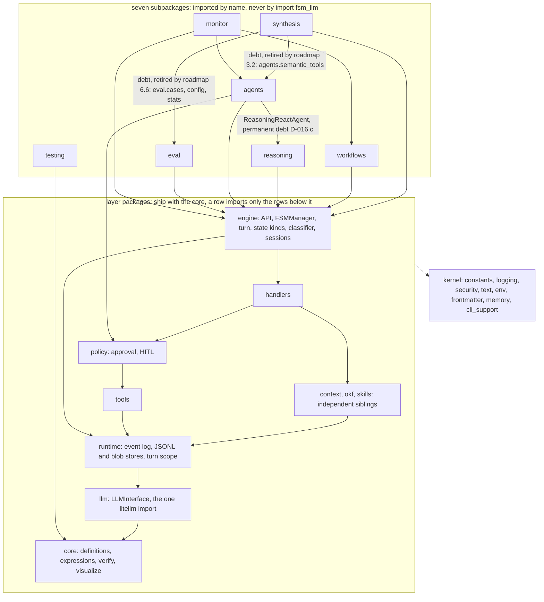

# FSM-LLM

Path: repository root (`.`)
Purpose: Python framework (v0.13.0, Apache-2.0, Python 3.11-3.15) for stateful conversational AI: JSON-defined finite state machines (FSMs) driven by an LLM through a 2-pass pipeline, shipped as one package `fsm_llm` with seven subpackages.

## Scope

One distribution (`llm-fsm` on PyPI, installed with `pip install llm-fsm`; `fsm-llm` on PyPI is a different project, never install that name). The build is `pyproject.toml` with setuptools and a src layout: the import package `fsm_llm` is the directory `src/fsm_llm/`, found by `[tool.setuptools.packages.find]` with `where = ["src"]`. Always use the project virtualenv: `.venv/bin/python`, or activate `.venv` first.

- In: `src/fsm_llm/` (all source), `tests/`, `examples/` (100 runnable examples), `docs/` (the documentation pages, see `docs/AGENTS.md`), `scripts/` (supply-chain audit, benches, gates, doc-count check), `evaluation/` (datasets and eval runs), `.github/workflows/`, `images/`, root build and policy files.
- Out: `build/`, `dist/`, `logs/`, `site/`, `src/fsm_llm.egg-info/` (generated by `pip install -e .`, removed by `make clean`). `plans/` is gitignored except `plans/ANCHORS.md` (append-only anchor manifest; never edit its lines).

## Architecture



An arrow is an allowed import direction, and so is a path of arrows (a row may import every row below it, the kernel is importable from anywhere); a pair with no downward path is forbidden. The rules are `.importlinter` (32 contracts: the layers contract of the roadmap's Section 5.2, the kernel contract and the contracts the layers cannot express, for example `policy-imports-no-sibling-layer`), run by `make lint-imports` and by `tests/test_fsm_llm_regression/test_import_contract.py`. The three labelled edges are the named debts: `agents` to `reasoning` (permanent: `ReasoningReactAgent` is built on the reasoning engine), `synthesis` to `agents` (`agents.semantic_tools`, retired by roadmap row 3.2) and `synthesis` to `eval` (`eval.cases`, `config`, `stats`, retired by roadmap row 6.6). A fourth, `engine.okf_bridge` to `okf`, sits inside the layers; every `ignore_imports` line of the file carries a `# retired by:` or `# permanent:` comment.

2-pass flow per `converse` (`src/fsm_llm/engine/turn/`): Pass 1 extracts data (LLM), context update, classification extractions, rule-based transition evaluation (an LLM classifier only on AMBIGUOUS), state transition, then Pass 2 writes the reply (LLM) from the post-transition state. Pass 2 is skipped when `response_instructions` is empty: a silent state makes no LLM call, returns `""` and adds nothing to history. Transition outcomes: one winner is DETERMINISTIC, a tie at the lowest priority is AMBIGUOUS, none passing is BLOCKED (stay).

Message-free step: `API.advance(conversation_id)` runs the same turn with no user message (nothing added to history for a user, no-message prompt variants, the LLM layer sends a neutral user turn) and returns a frozen `AdvanceResult`; `run_until_terminal(conversation_id, *, max_steps, max_seconds=None, before_step=None)` loops it until a terminal state and raises `RunBudgetExceededError` on a spent budget. Agents, workflow agent steps and the reasoning engine run on these loops; they never send a synthetic message. When the top of the stack is an ended pushed FSM, the loop calls `before_step` once (not a step, no budget check) so the hook can pop it and the run continues on the parent.

One LLM layer (the package `src/fsm_llm/llm/`; litellm is imported in exactly one module, `llm/providers/litellm.py`): `LLMInterface.complete(CompletionRequest) -> CompletionResponse` is the one primitive for tool calling, plain and structured completion; `LiteLLMInterface` builds every request in one builder and sends it through one send path, counting each call (`usage()`); `LiteLLMEmbedder` makes embeddings. A state with the optional `completion` field makes its Pass 1 one `complete` call (tools or a structured turn) over a consumer-owned transcript and writes `{kind, text, calls}` to its result key; core runs no tool. `native_fc` and the meta-builder are FSMs built on it. Importing `fsm_llm.llm` sets `litellm.suppress_debug_info = True` once (litellm's red "Give Feedback" banner on a provider error would print to the host's stdout); a host that wants the banner sets it False after importing `fsm_llm`. `CompletionResponse` carries the provider's `finish_reason` and a `truncated` property (`finish_reason == "length"`, cut at `max_tokens`): `_send` logs one WARNING per cut non-streamed reply, a cut bulk or field extraction and a cut classification say so in their error, and a cut reply that opens `{`/`[` and does not parse is replaced in Pass 2 by a cut-off message, never shown as an unreadable half envelope; a cut envelope whose `message` can be read is shipped as read (it may be partial) and flagged `truncated`; a cut prose reply is shipped as is. The two reply models carry `truncated`, and the pipeline records a cut turn in the internal context key `definitions.CONTEXT_KEY_CUT_OFF` (`_cut_off`, last turn only, absent when nothing was cut). The completion-state result stays `{kind, text, calls}`.

`import fsm_llm` loads only the core: the layer packages `core`, `engine`, `handlers`, `context`, `llm`, `runtime` and `security` and the kernel modules `constants`, `env`, `logging` and `memory`, and nothing else (no subpackage, no `okf`, `skills`, `tools`, `policy`, `text`, `frontmatter` or `cli_support`); `tests/test_fsm_llm_regression/test_import_laziness.py` pins that exact set in a fresh `python -I` process, so a new eager import is a visible diff. `fsm_llm/__init__.py` never imports a subpackage. Import one by name (`from fsm_llm.agents import create_agent`). Every subpackage ships in every install; an extra only adds third-party deps.

## Key files

| Path | Role | Notes |
| --- | --- | --- |
| `src/fsm_llm/engine/api/`, `engine/fsm/`, `engine/turn/` | `API` (`conversation.py`, `run.py`, `stack.py`, sessions, `forks.py` for `fork` and `resume`, `budget.py`), `FSMManager` (per-conversation locks, LRU definition cache, one turn budget record per conversation; `manager.py`, `turns.py`, `snapshots.py`, `budget.py`), `MessagePipeline` (Pass 1, Pass 2, transitions, stack) | Read the `# DECISION` anchors first; the lock order of `FSMManager` is pinned by `tests/test_fsm_llm/test_fsm_lock_order.py` |
| `src/fsm_llm/engine/kinds/`, `core/state_kinds.py` | The state kinds (`conversation`, `completion`, `synthesize`): the static `KindSpec` registry in core and the `StateExecutor` of each kind in the engine; `executors=` on `API`, `FSMManager` and `MessagePipeline` (keyword-only, validated, per instance) | Internal, not exported from `fsm_llm`; the engine, the loader and the analyses read the specs and never test `state.completion` or `state.synthesize` (an AST test bans it); a new kind adds a spec and an executor |
| `src/fsm_llm/engine/builders.py`, `engine/session.py`, `engine/classification.py`, `engine/okf_bridge.py` | `APIBuilder`, `FSMManagerBuilder`; `SessionState`, `SessionStore`, `FileSessionStore`; `Classifier`; `create_okf_handler` | `engine` imports no subpackage, `okf` bundle code excepted through the bridge |
| `src/fsm_llm/core/definitions/`, `core/expressions/`, `core/transition_evaluator.py` | Pydantic FSM models and core exceptions, JsonLogic evaluation, the DETERMINISTIC, AMBIGUOUS and BLOCKED outcome | No LLM in transitions; `fsm_llm.core.definitions` and `fsm_llm.core.expressions` are the one import surface of their package (static `__all__`), a private name or a patch target lives in the defining module |
| `src/fsm_llm/core/definitions/schema.py` | `SCHEMA_VERSION_DEFAULT` (`"4.2"`), `SCHEMA_VERSION_OLDEST` (`"4.0"`), `FIELD_VERSIONS`, `parse_version`, `newer_fields`, `SchemaFinding` | Leaf module, never logs; a test walks the models reachable from `FSMDefinition`, so a field missing from the table fails the build |
| `src/fsm_llm/core/verify/`, `core/visualize/`, `core/loaders.py`, `core/coerce.py`, `core/codes.py` | `FSMValidator` and `fsm-llm-validate` (`cli.py`, `upgrade.py`), the data-flow and liveness analyses (`flow.py`, imported by name), graph export and ASCII diagrams (`fsm-llm-visualize`), `load_fsm_definition`, `coerce_*`, `Status`, `Reason`, `CompletionKind` | `FSMValidator.validate()` calls none of the analyses (never stricter than the loader); `codes.py` values equal the wire strings, held by `test_codes.py` |
| `src/fsm_llm/llm/` | `LLMInterface`, `LiteLLMInterface` (`complete`, `usage`), `LiteLLMEmbedder`, `tool_exchange`, reply parsing, usage meter, `ollama.py`, `text.py`, `json_extraction.py` | litellm is imported in exactly one module, `llm/providers/litellm.py`; a patch aims at the module that performs the lookup (`fsm_llm.llm.providers.litellm.completion`, `fsm_llm.llm.providers.embedder.embedding`, never the package) |
| `src/fsm_llm/context/`, `handlers/` | Context compaction, filtering and the prompt builders (`context/layout/`); `HandlerSystem`, `HandlerBuilder`, `create_handler`, `HandlerTiming`, `HandlerErrorMode` | `context` imports no engine module; `handlers` imports no engine peer and no subpackage |
| `src/fsm_llm/security/`, `constants.py` | `has_internal_prefix`, `is_forbidden_context_entry`, `resolve_within`, API key helpers, defaults, `OKF_*` limits | `security/` is a kernel package (standard library only, `security-is-a-leaf`); the single source for key filtering and path confinement |
| `src/fsm_llm/tools/`, `policy/` | The tool layer (`ToolRegistry`, `@tool`, models, timeouts, `redact_secret_entries`) and the approval vocabulary with `HumanInTheLoop` | `fsm_llm.agents` re-exports the public names; `policy` imports `tools` and none of `context`, `okf`, `skills` |
| `src/fsm_llm/runtime/`, `llm/observer.py`, `engine/events.py`, `engine/api/events.py`, `engine/api/forks.py` | The opt-in durable event log (plans 21e6f00d, roadmap rows 1.1 to 1.3, and 5a6a1f80, rows 1.4, 1.7, 1.11 and 1.13): `EventLog` (`runtime/log.py`), the JSONL store (`runtime/stores/jsonl.py`), `BlobStore` (`runtime/blobs.py`), the format and its safe encoder (`runtime/events.py`, `constants.py`), the checkpoint rule (`runtime/checkpoint.py`), the turn scope (`runtime/scope.py`) the session projection (`runtime/stores/session.py`) and the stack projection with the turn index (`runtime/stores/stack.py`), the privacy levels and redaction hook (`runtime/privacy.py`), explicit retention (`runtime/retention.py`) and the usage fold (`runtime/usage.py`); the `RequestObserver` Protocol called from `LiteLLMInterface._send`; the engine producers; `API(event_log=)`, `API.fork`, `API.resume` and `EventLogSessionStore` (`engine/session.py`) | Layer `runtime` sits between `llm` and the siblings and imports `core`, `llm` and the kernel only; off by default and then nothing changes; read the `# DECISION` anchors of D-002, D-008, D-009 and D-011 of plan 21e6f00d and of D-004, D-009, D-016 and D-018 of plan 5a6a1f80 first |
| `src/fsm_llm/okf/`, `skills/`, `frontmatter.py`, `text.py` | Open Knowledge Format (OKF v0.2, pre-1.0 and mutable) and Agent Skills (agentskills.io, unversioned and mutable), both read-only; the one YAML frontmatter seam; the text hygiene of every output path | Independent siblings, import no subpackage; `fsm-llm-okf` and `fsm-llm-skills` |
| `src/fsm_llm/env.py`, `cli_support.py`, `runner.py`, `__main__.py`, `logging.py`, `memory.py` | `load_env` (the one `.env` seam, the one module that imports python-dotenv), the shared CLI skeleton, the `fsm-llm` CLI, loguru setup, `WorkingMemory` | `import fsm_llm` loads no `.env`; the entry modules are imported by nothing |
| `src/fsm_llm/reasoning/`, `workflows/`, `agents/`, `monitor/`, `eval/`, `synthesis/`, `testing/` | The seven subpackages, each with its own `README.md` and `AGENTS.md`: 9 reasoning strategies as stacked FSMs; an async in-memory workflow engine (11 step types); 18 agent patterns, MCP, A2A, memory, meta-builder; a FastAPI dashboard and OTEL exporter; the examples scorer and conversation evals; runtime FSM synthesis; public test doubles and assertions | Read the subpackage `AGENTS.md` before editing it; `src/fsm_llm/synthesis/AGENTS.md` and its `# DECISION plan-2026-11-10T194139-2cefeb61/D-NNN` anchors bind synthesis |
| `src/fsm_llm/agents/okf.py`, `agents/agent_skills.py`, `agents/python_tools.py` | The agents side of OKF and Agent Skills (read-only tools), and `PythonToolLoader` (tools from folders of Python files) | `PythonToolLoader` executes the files it loads, trusted sources only; a failed file is reported and warned once |
| `tests/conftest.py`, `tests/fixtures/` | Fixtures, `block_network`, `configure_mock_extract_field`; `api_snapshot.txt` (the public API snapshot), `module_path_map.json`, `anchor_multiset.json`, `em_dash_allowlist.json`, `canary-vulnerable-pins.txt` | Default runs make no network or LLM call; the doubles are imported from `fsm_llm.testing` |
| `tests/test_packaging.py` | Pins package wiring, every test count of this file, `CONTRIBUTING.md` and the folder docs, the changelog and the wheel contents | See Working here |
| `scripts/api_snapshot.py` | Prints the public API (static `__all__` of the eight packages and the named core modules, with signatures); `--write PATH`; `make api-snapshot` writes `tests/fixtures/api_snapshot.txt` | Held by `tests/test_fsm_llm_regression/test_api_snapshot.py`; regenerate and review the diff in the same commit; never edit the fixture by hand |
| `scripts/decision_index.py` | Anchor scanner and manifest parser; `--check` fails when an anchor has no line in `plans/ANCHORS.md` or names no plan id (reads the manifest only); `--write PATH` renders a report on demand; `--report` prints counts | Stdlib only; `make decision-check`, the CI lint job; nothing of the report is committed (`make decision-index` writes `build/decision-index.md`) |
| `scripts/changelog_check.py` | `check` judges the CHANGELOG form (headings and their order, the `[Unreleased]` compare reference, section order, the exact `**BREAKING:**` marker); `extract VERSION [--link-base URL]` prints one release section | Stdlib only, read-only; `make changelog-check`, the CI lint job, `TestTheRealChangelog` |
| `scripts/doc_counts.py`, `scripts/coverage_ratchet.py`, `scripts/refresh_pins.py`, `scripts/audit_pth.py` | The documented-count check (`make counts`), the branch-coverage ratchet against `coverage-baseline.json`, the weekly litellm and mcp pin proposal, the malicious `.pth` and `.start` audit (`make audit`) | `doc_counts.py` skips when `mcp` is importable; the ratchet baseline is written from the Linux, Python 3.12 leg only |
| `scripts/bench_common.py`, `agents_bench.py`, `skills_bench.py`, `synthesis_bench.py`, `scripts/bench_data/` | Pre-registered benches and their recorded rows | `bench_data/` is tracked on purpose and never edited; see the invariants |
| `.github/workflows/`, `mkdocs.yml`, `Makefile`, `tox.ini`, `pyproject.toml`, `constraints.txt`, `MANIFEST.in`, `.pre-commit-config.yaml`, `.importlinter` | CI (`python-package.yml`), the docs site (`docs.yml`), the pin refresh (`refresh-pins.yml`), the release (`release.yml`); the site configuration; tasks, envs, exact pins, sdist, hooks, import contracts | All checked by tests; `docs/` is not shipped in the wheel or the sdist |
| `evaluation/datasets/`, `examples/<category>/<name>/` | Eval samples; `run.py` plus FSM JSON, 8 categories | Examples are the baselines of `fsm-llm-eval examples` |
| `CHANGELOG.md`, `EVALUATE.md`, `CONTRIBUTING.md`, `SECURITY.md` | Release history and the migration record (each `**BREAKING:**` entry names the old form and the new), eval method and run log, contributor rules and the release procedure, security policy | `docs/` includes these four by wrapper pages |

## Public interface

Core: `API` (`from_file`, `from_definition`, `start_conversation`, `converse`, `converse_stream`, `advance`, `advance_stream`, `run_until_terminal`, `run_until_terminal_stream`, `get_data`, `push_fsm`/`pop_fsm`, `save_session`/`restore_session`, `fork`/`resume` and the read-only `event_log`; `max_steps` and `max_seconds` on `API`, `start_conversation` and `push_fsm`), `AdvanceResult`, `FSMManager`, `HandlerTiming` (8 points), `HandlerErrorMode` (the one `handler_error_mode` vocabulary: `API`, `FSMManager`, `HandlerSystem` and the builders take a member or `"continue"`/`"raise"`), `create_handler`, `clear_keys_on_entry`, `typed_field_extraction`, `Classifier` (`llm_interface=` takes an interface), `LiteLLMInterface` (`complete`, `usage`, `reset_usage`), `CompletionRequest`, `CompletionResponse`, `ModelToolCall`, `LLMUsage`, `LiteLLMEmbedder`, `tool_exchange`, `CompletionStateConfig`, `WorkingMemory`, `FileSessionStore`, `load_env`, graph export `build_fsm_graph`, `to_mermaid`, `to_dot`. OKF is imported by module name: core `fsm_llm.okf` (`load_bundle`, `write_bundle`, `check_bundle`), `fsm_llm.engine.okf_bridge` (`bundle_from_memory_entries`, `create_okf_handler`) and, for agents, `fsm_llm.agents` (`create_okf_tools`, `OKFMemoryBackend`, `export_semantic_memory`, `export_agent_result`). Agent Skills likewise: the layer package `fsm_llm.skills` (`load_skills`, `SkillCatalog`, `SkillLimits`; `SkillCatalog.files_under` is the one directory-listing rule) and, for agents, `fsm_llm.agents.create_skill_tools`. Runtime synthesis is a subpackage imported by name: `fsm_llm.synthesis` (`FSMSynthesizer`, `ProcedureRunner`, `FSMLibrary`, `SynthesisPolicy`, `run_gates`, `create_procedure_tools`, `diagnose`, `repair_procedure`); core carries only the `State.synthesize` field (`SynthesizeConfig` in `fsm_llm.core.definitions`, not re-exported from the package) and `fsm_llm.core.verify.flow` (`analyze_data_flow`, `analyze_liveness`). `fsm_llm.eval.cases.run_case_trial(..., stop=)` takes a callable checked before every turn.

Model resolution: `model=` argument, then env `LLM_MODEL`, then nothing: there is no built-in default model, and `llm.resolve_model` (the one resolver: `API`, `Classifier`, `AgentConfig`, `ReasoningEngine`, eval, monitor) raises `ModelNotConfiguredError` (a `FSMError` and a `ValueError`; a blank value counts as unset; an injected `llm_interface` needs no model). A CLI without a model exits 1 with that one message on stderr. The process environment sets `LLM_MODEL`. Importing `fsm_llm` loads no `.env` file: `src/fsm_llm/llm/providers/litellm.py` sets `LITELLM_MODE=PRODUCTION` around its one `import litellm` (when the caller has not set one) and restores the environment, so litellm's import-time `load_dotenv()` is skipped (an explicit `LITELLM_MODE=DEV` opts back in; a host that imports litellm before `fsm_llm` has already loaded the file, which cannot be undone). A `.env` file is read only on request: `fsm_llm.load_env(path=None, *, override=False) -> Path | None` (`src/fsm_llm/env.py`, the one module that imports python-dotenv; `None` searches from the working directory upward, never from the package location; an explicit missing path raises `FileNotFoundError`; a variable the process already has is not replaced unless `override=True`; a blank one, empty or whitespace only, counts as unset, as `resolve_model` treats it, so the file fills it when it gives a non-blank value, and a `${VAR}` in that value resolves as for an unset variable: `LLM_MODEL=""` in the shell no longer blocks `--env-file`, plan d454fd62 D-024; to keep a variable deliberately empty, such as `HTTP_PROXY=`, do not name it in the file), or `--env-file PATH` on `fsm-llm`, `fsm-llm-eval`, `fsm-llm-meta`, `python -m fsm_llm.reasoning` and `fsm-llm-monitor` (one flag, `cli_support.add_env_file` and `apply_env_file`; a missing file is one stderr line and exit 1; the CLIs that call no model, `fsm-llm-okf`, `fsm-llm-skills`, `fsm-llm-validate`, `fsm-llm-visualize`, do not take it). Every model CLI takes `--model` (`-m` on `fsm-llm` and the reasoning CLI); the precedence is `--model`, then the process environment, then the `--env-file` file, then `ModelNotConfiguredError`. `fsm-llm-monitor` starts without a model: the file supplies `LLM_MODEL` to the launch routes, which answer 400 when none is set. `.env.example` lists `OPENAI_API_KEY`, `LLM_MODEL`, `LLM_TEMPERATURE`, `LLM_MAX_TOKENS`.

```bash
fsm-llm --fsm <path.json> [--model M] [--env-file PATH]  # Run FSM interactively (needs LLM_MODEL, --model or --env-file)
fsm-llm-visualize --fsm <path.json> [--format ascii|mermaid|dot]  # Diagram
fsm-llm-validate --fsm <path.json> [--upgrade]  # Validate FSM definition (--upgrade validates first, rewrites only a 4.0 or 4.1 file (any version from 4.0 up to below the default); exit 1 if refused)
fsm-llm-monitor [--env-file PATH]     # Web dashboard at http://127.0.0.1:8420
fsm-llm-meta [--model M] [--env-file PATH]  # Interactive artifact builder (fsm_llm.agents.meta_cli)
python -m fsm_llm.reasoning "problem" [--type T] [--model M] [--env-file PATH]    # Reasoning CLI (no console script)
fsm-llm-eval examples [--category C] [--fail-under PCT] [--env-file PATH]  # Score every example 0-4
fsm-llm-eval run <dataset.json|.jsonl> [--trials N] [--env-file PATH]     # Scripted conversation evals
fsm-llm-okf <validate|list|show|search|export>  # Open Knowledge Format bundles
fsm-llm-skills <validate|list|show> PATH...  # Agent Skills folders (validate --strict)
.venv/bin/python scripts/agents_bench.py report <bench-id>  # Recount a bench from rows
```

CLI exit codes: 0 ok, 1 failure, 130 Ctrl-C; a usage error exits 2 (argparse) except in `fsm-llm-eval`, which exits 1 for it. `fsm-llm-eval` exits 2 only below `--fail-under PCT`. `fsm-llm-eval examples` writes `scorecard.md`, `results.json`, `logs/` to a new `evaluation/<stamp>_<hash>_<model>[_N]/`; settings precedence is defaults < dataset `config` < `--config FILE` < flags.

## Data shapes

FSM definition (JSON, default `version` 4.2):

```json
{
  "name": "MyBot",
  "description": "What this FSM does",
  "initial_state": "start",
  "persona": "A friendly assistant",
  "states": {
    "start": {
      "id": "start",
      "description": "Brief state description",
      "purpose": "What should be accomplished",
      "extraction_instructions": "What data to extract",
      "response_instructions": "How to respond",
      "required_context_keys": ["key1"],
      "classification_extractions": [
        {"field_name": "user_intent",
         "intents": [{"name": "buy", "description": "User wants to purchase"},
                     {"name": "browse", "description": "User is just looking"}],
         "fallback_intent": "browse", "confidence_threshold": 0.7}
      ],
      "transitions": [
        {"target_state": "next", "description": "When this transition should fire", "priority": 100,
         "conditions": [{"description": "Human-readable condition",
                         "requires_context_keys": ["key1"],
                         "logic": {"==": [{"var": "key1"}, "expected_value"]}}]}
      ]
    },
    "next": {"id": "next", "description": "Terminal state", "purpose": "Wrap up the conversation",
             "response_instructions": "Say goodbye"}
  }
}
```

- `required_context_keys` only tells Pass 1 what to extract; it never blocks a transition. Gate with a condition (`requires_context_keys` + `logic`).
- `intents`/`fallback_intent` sit directly on the `classification_extractions` entry (no nested `schema`), at least two intents, `fallback_intent` one of them.
- A state without transitions is terminal. `state.id` must equal its key. Load needs a reachable terminal state and no orphaned states.
- Among passing transitions the unique lowest `priority` wins outright; only a tie at the lowest priority is AMBIGUOUS, with just the tied transitions as classifier candidates, one per distinct target (equal-priority transitions to one target are one candidate). A tie set the classifier schema cannot hold (15 or more distinct targets, a target named `_stay_in_state`) stays in the state with a WARNING.
- Optional `completion` state field (additive, no version of its own; `completion` is registered as introduced in 4.1): `{"tools": [OpenAI function schemas]` or `"response_format_key": "_<key>"` (exactly one), `"tool_choice", "instructions", "messages_key": "_completion_messages", "result_key": "completion_result"}`. Pass 1 is one `complete` call over `[system(instructions)] + context[messages_key]`; the result `{kind: calls|final|malformed, text, calls}` goes to `result_key` (handler-only, skip-if-set); transitions read `<result_key>.kind`. Such a state declares no other extraction and is not terminal.
- Optional `synthesize` state field (the definition `version` default is 4.2 from this field on; a definition that omits `version` keeps its `fsm_id`, one that declares `"version": "4.1"` explicitly gets a new `fsm_id` and library digest): `{"goal": "<author text>", "inputs": [...], "return_keys": [...] (at least one), "on_failure": "<state id>", "result_key": "synthesis_result", "min_lifecycle": "verified"|"trusted"}`. Core only loads and validates it; a runner outside core (`fsm_llm.synthesis.ProcedureRunner`) writes `context[result_key] = {status, procedure_id, version, reason}` (`status` in `ok|failed|aborted|running`), which the pipeline makes handler-only. A bare `API.converse` on such a state stays (BLOCKED). Such a state declares no `completion` and no extraction. The loader runs the real evaluator on sample results: no edge may pass before the runner wrote a result, and the edge to `on_failure` must pass for `failed` and for `aborted`, so write `status in [failed, aborted]` (a bare `== "failed"` is refused). Reference: `docs/synthesis.md`.

## Invariants and constraints

- Internal context keys (prefixes `_`, `system_`, `internal_`, `__`) are matched only through `fsm_llm.constants.has_internal_prefix` (case-insensitive). Never re-inline `startswith("_")`. `FSMContext.update` writes them without a WARNING (plan 0068b055 D-026); guard a new accidental-write path at that path, not by re-adding a warning.
- Secret-looking context entries are decided only by `constants.is_forbidden_context_entry(key, value)` (name patterns, whole-segment credential names, policy-suffix exceptions, value-shape layers for `*_key`/`*_token`). Matching entries are kept out of prompts. Never re-inline a check.
- Context filters share `MAX_CONTEXT_FILTER_DEPTH = 16` (fail closed) and drop cycles. Only the prompt filter truncates (`MAX_CONTEXT_FILTER_NODES = 100_000`); `context.filtering.filter_context_tree` never truncates and raises `ContextFilterError` (an `FSMError` and a `ValueError`) on a pathological cycle.
- Library logging is off until `setup_logging()` / `enable_debug_logging()`: one `logger.disable("fsm_llm")` at import covers every subpackage; never add a per-subpackage disable. Both also replace loguru's default handler (id 0) with an equivalent sink that skips `fsm_llm` records (`logging.replace_default_handler`), so a library record prints once; the library's plain stderr handler passes `fsm_llm` records only, so a host record prints once too while that sink exists (JSON, file and stdout sinks stay unfiltered). The replacement writes to `sys.stderr` as it is at write time.
- One turn per conversation at a time: a concurrent or re-entrant `converse` raises `FSMError`.
- One LLM layer: litellm is imported in exactly one module, `llm/providers/litellm.py` (`grep -rnE "litellm\.(a?completion|a?embedding)|import litellm|from litellm" src` hits only it; `llm/providers/embedder.py` takes the `embedding` binding from it and `llm/__init__.py` loads it, so `import fsm_llm.llm` sets `suppress_debug_info`). Never add a second request builder, send path or provider call outside an `LLMInterface`/`LiteLLMEmbedder`.
- The event log (`src/fsm_llm/runtime/`, opt-in through `API(event_log=)`, plan 21e6f00d): off means no file, no extra call and the same snapshots and lock order; on, one `logs/<root conversation id>.jsonl` per conversation tree plus sha256 blobs, written and fsynced before every model call (a log that cannot be written refuses the call). The request observer of `llm/observer.py` is called from `_send` with an allow-list of keys and is not a counter (D-004 of plan 944e2692 stays). `seq` is the order, never `ts`. The log holds user text and prompts as the model saw them: keep the log directory as private as the session directory; only entries secret-looking by `is_forbidden_context_entry` are redacted. Snapshots stay authoritative (`FileSessionStore` is unchanged and restores the ROOT frame only); `EventLogSessionStore` restores from the log; the greeting request is not logged (D-021). Plan 5a6a1f80 added, all off with the log off: `API.fork(conversation_id, *, at_turn)` (a new conversation from the state at the end of turn N, read only, takes no writer lock) and `API.resume(conversation_id)` (the same id and log after a crash or a close, the writer lock taken BEFORE the fold, in-flight tools written once as `unknown` and never re-run, no closing `turn/end` for a killed turn); both rebuild the stack from `fold_stack` through the one restore body, and a frame above the root is trusted only through its loaded definition with a matching recomputed `fsm_id` (a transcript only under the default `messages_key`, no `response_format_key`), and every internal-prefixed key a restore reads from the log (a frame's return context and shared key names included) is dropped, so a forged log cannot carry `_approval_granted` or `_run_output_keys`; the PUBLIC keys of a forged root blob (`final_answer`, `approval_granted`, `should_terminate`, ...) are seeded as given, as a plain snapshot would: the log is trusted as much as the session directory (D-009). The fold is depth-indexed with the written recovery rule of D-004 (a duplicate or lost push or pop never shifts a frame; a frame with no covering push is `LogCorruptError`). Turn budgets (`max_steps`, `max_seconds`: `API`, `start_conversation`, `push_fsm`, `APIBuilder`) are one private `TurnBudget` per manager conversation, charged in `_enter_turn`, outside the rollback snapshot and every model-writable place; a spent frame raises `RunBudgetExceededError` on its next turn, is never popped by the engine, and a fork or resume rebuilds a pushed frame with the limits its push logged and a FRESH count (the API default fills a limit it never had), a snapshot restore starts fresh from the API defaults (a spent count is not persisted: carried). Usage is a projection: the meter is a ledger that only grows and `reset_usage()` moves a marker (D-014), `runtime/usage.py` folds the log through the same record shape, a reader uses one source and never sums them. Privacy: `EventLog(root, privacy="values"|"shape", redact=hook)`; the default is `values`, so the log directory is as private as the session directory; `shape` writes no blob and no ref and its logs are refused by every fold with `LogPrivacyError`; free text (a card number in a message) is handled ONLY by the user's redaction hook, which runs inside `put_json` after the built-in filters and fails closed (D-016). `EventLog.prune` is explicit retention, default deletes nothing, a held writer lock is skipped, `.lock` files are never unlinked, and it is for a root with no active writer on the same blobs (D-018). Not done: zstd blobs and an SQLite store (D-030 cut them: row 1.2 stays JSONL plus migrations), and the monitor view of the log (row 1.10). Power-loss durability is argued, not tested; the lock, raw fd and `Popen.kill()` are proven on Linux and covered on Windows only by the CI legs, so every Windows behavior of this log (the lock after a kill, a refused unlink in `prune`) is unverified until the Windows legs run.
- The classifier (AMBIGUOUS ties, `classification_extractions`) calls the conversation's own `llm_interface`; only an entry naming a different `model` gets a private interface, with no inherited credentials. `API(llm_interface=...)` refuses every other LLM setting beside it (`ValueError`).
- Completion-state transcripts are consumer-owned context lists, never `Conversation.exchanges`; an unpaired transcript raises `LLMResponseError` before anything is sent.
- Synthesis (`src/fsm_llm/synthesis/`, `src/fsm_llm/core/verify/flow.py`): a model-written FSM runs only after the gates: G1 loads, G2 structure, G3 data flow, G4 liveness, G5 policy allow-list, G6a dead edges through the real evaluator, G6b bounded simulation, G7 approval. `verified` means those gates passed over a model-written spec and model-written scenarios: it is not a proof of correctness, and a human approval (`trusted`) is separate provenance. The goal is untrusted caller text reaching a model only through `prompts.goal_block`; model-authored text never becomes a setting (a `model`, `prompt_config`, regex pattern, persona or unknown key is refused by G5); compiled text, receipts and approval requests reach a model only under `PROCEDURE_UNTRUSTED_LABEL` or `APPROVAL_UNTRUSTED_LABEL`, never as a tool description, `instructions`, persona or state instruction. No `litellm` import there: every request goes through an `LLMInterface` the caller supplied. The package imports core, the layer packages `fsm_llm.tools`, `fsm_llm.policy`, `fsm_llm.okf`, `fsm_llm.llm` and `fsm_llm.engine`, and the kernel; it reaches `fsm_llm.agents` only for `agents.semantic_tools` (roadmap 3.2 debt) and `fsm_llm.eval` only for the simulator and the repair statistics (roadmap 6.6 and P7.6 debt), the five edges `.importlinter` names; none of `agents`, `eval` or the layers imports it, and `fsm_llm/__init__.py` loads no synthesis module. The synthesis names live in `src/fsm_llm/synthesis/constants.py` and `src/fsm_llm/core/definitions/`, never in `src/fsm_llm/constants.py` (a bench manifest pins it). `FSMValidator.validate()` is never stricter than the loader; the data-flow and liveness gates sit beside it in `core/verify/flow.py`. Read `src/fsm_llm/synthesis/AGENTS.md` and its `# DECISION plan-2026-11-10T194139-2cefeb61/D-NNN` anchors before editing.
- `# DECISION plan-<full-plan-id>/D-NNN` anchors state what NOT to do. Read them before editing nearby. `[STALE]`: plan dir retired, rule may still bind. `[SUPERSEDED BY D-nnn]`: follow the newer one. `make decision-check` fails on an anchor with no line in `plans/ANCHORS.md` or with no plan id; `make decision-index` writes a report to `build/decision-index.md` (never committed).
- OKF text is untrusted. It reaches a model in three ways, all capped and control-stripped: tool output, summaries in a public context key (`trust_claimed` records), and `OKFMemoryBackend` summaries labelled `OKF_SUMMARY_LABEL` and concatenated into the task string; never as a tool description, `instructions`, persona or state instruction; `executor`/`attester` resources are never executed; the trust tier is a claim of the bundle, never authorization. Bundle paths are checked by the shared helper `security.resolve_within`, used by `okf/loader.py` and `okf/writer.py` and the Agent Skills reads; symlinks are skipped; hardlinks are not detected (an accepted residual). A spent load or check bound makes the bundle incomplete (`OKFBundle.incomplete`) and the okf tools and the CLI say so with a fixed note (handler records and backend summaries do not); `write_bundle` refuses what it cannot render within the caps, so a loaded bundle is not always writable.
- Agent Skills text is untrusted: it reaches a model only as capped, control-stripped tool output under `SKILL_UNTRUSTED_LABEL` (or in `render_catalog()` output that a caller puts in a task string); never as a tool description, `instructions`, persona or state instruction. Nothing in a skill folder is executed, imported or shelled out (no `skill_run`); `allowed-tools` is reported, never enforced. In-skill paths go through `security.resolve_within` plus a lexical-equality check; symlinks inside a skill are skipped, dot entries are never listed or readable. Discovery is explicit paths, depth 1. Read-only: no writer, exporter, memory backend or plain-FSM handler. One YAML loader, `frontmatter.py`: do not add a second.
- Agents HITL is a security boundary in `ReactAgent`, `ReflexionAgent`, `ReasoningReactAgent` when an approval policy is set, or a callback with `requires_approval=True` tools (the flag is then the policy): a gated tool runs only with the driver-only grant `_approval_granted` (`ContextKeys.DRIVER_APPROVAL`) bound to that exact call. Caller `initial_context` can never set that grant, run-output keys (`RUN_OUTPUT_KEYS`) or the pattern's own outputs (`_run_output_keys`). A `requires_approval` tool with no callback and no policy raises `AgentError`; ParallelReact, REWOO, native_fc, PlanExecute have no HITL and refuse registries holding one.
- Agents `AgentResult.success` means the run reached its goal; forced stops ship their answer with `success=False` and a `stop_reason`; a final reply cut by `max_tokens` is one (`truncated`, from the core cut-off record, D-025). A run closed from outside ends `ReactAgent.run_stream` without an error, and nothing flags a cut meta-builder artifact, `SelfConsistencyAgent` sample, `native_fc` tool call, streamed reply or earlier-turn cut; all deferred work.
- Layout (roadmap Section 5, plan d454fd62): no `src/fsm_llm` module is over 800 physical lines (`test_module_size_guard.py`, its `OVERSIZED` table is empty); a layer package imports only the layers below it and the kernel imports no layer (`.importlinter`, 32 contracts, named debts only); a moved module leaves no shim at its old path, `fsm_llm.agents`, `fsm_llm.handlers`, `fsm_llm.llm` and the other example-visible paths are packages that re-export their public names (`tests/fixtures/module_path_map.json` is the old-to-new record); module and doc statements name the new dotted path, and `tests/test_fsm_llm_regression/test_docs_layout_paths.py` fails on a doc that still names a removed module.
- Do NOT modify `examples/` unless explicitly asked: baselines for `fsm-llm-eval examples`, loaded by `tests/test_examples/`.
- `scripts/bench_data/` is tracked on purpose. Blocks are pre-registered, run once at fixed n, never edited or re-run. The harness-only blocks (`l4-execute-write`, `l6-e2e`, `l7-explore-coldstart`, `l8-explore-loop`, `seed-probe`) are frozen history: the code that produced them was removed, and they are kept as the record. `skills-disclosure` B0 and B1 are registered but not run; its manifests pin the sha256 of `agent_skills.py` (now `skills/catalog.py`: `SRC_PINS` keeps the manifest key and names the new path, D-034), `agents/agent_skills.py` and `constants.py`, and all three already differ from the recorded hashes, so a run refuses by design. `synthesis` (blocks `s0`, `s1`, `s2`, each registered once and run once) pins the sha256 of its script, `bench_common.py`, `src/fsm_llm/core/verify/` (the validator and `flow.py`, split at step 75 of plan d454fd62) and the synthesis, agents and eval modules it names (`SRC_PINS`) at `register`, so any later edit to one voids the block (the s2 manifests predate two later source edits, D-108 and D-109, so `report s2` now refuses by design; `s2/REPORT_s2.txt` is the record). Bench status: `s0`, `s1` and `s2` run, all INCONCLUSIVE; no fourth block was run. See `scripts/bench_data/README.md` and `docs/synthesis.md`.

## Naming conventions

Rules for NEW code, so the vocabulary stays one across core and the subpackages. Core is the reference.

- Ids are `<thing>_id`, spelled out: `conversation_id`, `fsm_id`, `state_id`, `session_id`, `instance_id`, `step_id`. Never `conv_id` as a parameter. Workflow routing fields end in `_step_id` (one suffix rule, `WorkflowStep.referenced_step_ids`).
- Time is in seconds with the unit in the name, as a float: `timeout_seconds` is how long one call may take, `max_seconds` is a run budget. A step budget is `max_steps`; a budget of anything else keeps its own noun (`max_reflections`, `max_replans`). `max_iterations` stays the agents term for think turns (it is not a core step). Existing outliers, not templates: `LiteLLMInterface(timeout=)`, `HandlerSystem(handler_timeout=)`, `EvalConfig.timeout` (int), `timeout` in agents `remote.py` and `mcp.py`, the integer `max_*_seconds` fields of `SynthesisPolicy`, `ConversationStep.conversation_timeout` (a second limit beside `timeout_seconds`, the smaller one applies) and `Defaults.MAX_TOOL_TIMEOUT_S` (agents, breaks the `_SECONDS` suffix of the constants rule). Known ambiguity, not renamed: a `WaitEventStep` has two `timeout_seconds`, the inherited step limit on `execute()` (which only registers the wait) and `config.timeout_seconds` (how long the wait lasts); `wait_event_step(timeout_seconds=)` fills the config one, and a step-level `timeout_seconds` on a `WaitEventStep` limits nothing useful.
- Constants: `DEFAULT_*` is a parameter default, `MAX_*` a hard cap, `CONTEXT_KEY_*` a context key; unit suffix `_SECONDS` or `_BYTES`; a subsystem prefix comes first (`OKF_`, `SKILL_`). Write flat module constants. Agents and reasoning keep their class-grouped `Defaults`/`ContextKeys`; do not copy that layout elsewhere.
- A closed vocabulary is a `str, Enum` with UPPER members, snake_case values and a `from_string` that refuses unknown values (`HandlerErrorMode`, `ContextMergeStrategy`; the latter also lowercases and strips its input, the former matches exactly). In messages use `.value`: formatting of a str-mixin enum differs between Python versions. The string status and reason constants in synthesis are a wire contract: do not convert them.
- `create_<thing>` returns an object, `build_<thing>` returns data or text. A builder has `add_*`/`set_*` and one `build()`; `with_*` is option chaining (`HandlerBuilder`; `WorkflowDefinition.with_step` applies at once, unlike `WorkflowBuilder.add_step`). `*Builder` means a fluent builder; the prompt classes `*PromptBuilder` are a known exception.
- Exceptions: the root of a package is `<Pkg>Error(FSMError)`. The constructor takes the message first, ids and extras keyword-only and optional, `details` last. Core outliers, not templates: `HandlerExecutionError(handler_name, original_error)` and `RunBudgetExceededError(budget, limit, steps_done)` build their own message. Nest only when a caller catches the parent. Give an existing `ValueError` subclass `FSMError` as `(FSMError, ValueError)`.
- Verbs: `start` begins, `advance` takes one step, `fork` starts a new conversation from an old one at a turn, `resume` continues the same conversation after a crash, `cancel` aborts one run, `end_*` finishes one conversation or instance, `close` stops an engine or manager. `get_*` returns one, `list_*` returns many. A method name does not repeat its class (`engine.start`, not `engine.start_workflow`).
- One parameter name per concept: `llm_interface`, `path`, `model`, `definition`. Existing outliers, not templates: `FSMSynthesizer(llm=)` and `Simulator(llm)` (synthesis, deferred). When a `**kwargs` could swallow a removed keyword, refuse it explicitly and test the refusal (see `Classifier`).
- A removed keyword on a pydantic model must raise, not be dropped: pydantic ignores unknown keywords by default, so a model that lost a field spelling sets `extra="forbid"` (`WorkflowStep`, `WorkflowStepResult`, `WorkflowInstance`, `EventListener`, `WaitEventConfig`, `ToolDefinition`, `AgentConfig`) and carries a test that the removed spellings raise (`test_removed_keywords.py`, `test_removed_timeout_keyword.py`); every step class inherits the refusal from `WorkflowStep`.
- Do not rename a wire or persisted string along with an identifier: context-key values, `StopReason` values, REST and WebSocket fields (`workflow_instance_id`, `max_iterations`), the trace key `"conv"`, `SessionState` fields, serialized type tags. The exception is a deliberate break recorded as `**BREAKING:**` in `CHANGELOG.md`; the precedent is the workflows rename, which changed the `serialize()` `"type"` tag of four step classes and the field names in `serialize()`/`model_dump()` output (`timeout_seconds`, `max_seconds`), the dict keys inside the `_waiting_info` and `_timer_info` context values, the `next_step_id` key of the `step_completed` hook data and `details["current_step_id"]` of `WorkflowStateError`.
- Renaming procedure: a clean break, no alias or shim. Find readers by word-bound grep, an `ast` scan (multi-line calls, keyword arguments), string forms and mock-by-attribute tests (assert the mock is still called). Update examples, docs, README and AGENTS.md in the same commit, add one `**BREAKING:**` bullet per rename under `## [Unreleased]` in `CHANGELOG.md`; `tests/test_examples/` binds example calls to live signatures.
- Decided and kept, do not reopen without a new decision: `max_iterations` (agents), `solve_problem` returning a tuple, `workflow_instance_id`, `SynthesisPolicy`, `serialize()`, the `with_step` and `create_workflow` shapes, the `<kind>_step` factories, `register_workflow`, `remove_instance`, `load_fsm_definition(fsm_id_or_path)`, `TrustTier` values, session id spelling (`save_session(conversation_id)`, `load_session(session_id)`), the eval `timeout` flag, the `*PromptBuilder` class names, class-grouped constants in agents and reasoning.

## Dependencies

- Core: loguru>=0.7.3,<1, litellm>=1.109.0,<2.0 (compromised 1.82.7/1.82.8 are below the floor; `constraints.txt` pins 1.109.1), pydantic>=2.0,<3, python-dotenv>=1.0.0,<2, pyyaml>=6.0,<7 (parses OKF and Agent Skills YAML frontmatter, in `frontmatter.py` only; declared explicitly because it was only a transitive dependency), tenacity>=9.0,<10 (unimported, needed by litellm's sync retry path; do not remove).
- Extras: `reasoning`, `agents`, `workflows`, `eval`, `synthesis`, `testing` (no deps), `monitor` (fastapi, uvicorn, jinja2), `mcp` (mcp>=2.2,<3), `otel` (opentelemetry-api/sdk>=1.20.0,<2), `a2a` (httpx>=0.24.0,<1), `all`, `dev`.
- `constraints.txt` pins every direct dependency (core, extras, dev tools) and the build backend exactly, one line each, and every declared range has an upper bound containing its pin and admits no major other than the pinned one (`TestDeclaredRangesMatchPins`, `TestNoRangeAdmitsAnUntestedMajor`; the first component of a floor equals the pin's, `0.x` packages are bounded by `<1`, and the build backend `setuptools>=77,<85` is the one named exception).
- Docs tools are the PEP 735 dependency group `docs` (`mkdocs>=1.6.1,<2`, `mkdocs-material`, `mike`, `mkdocs-include-markdown-plugin`, `pymdown-extensions`), not an extra and not in `all` or `dev`: Material needs Python 3.11 and the tools are for maintainers. Install with `pip install --group docs -c constraints.txt`; the pins are in `constraints.txt` and `TestDeclaredRangesMatchPins` covers the group.

## Failure modes

- Core `FSMError` -> `ConversationBusyError`, `FSMDefinitionNotFoundError` (also `ValueError`), `BuildError` (also `ValueError`; every builder's `build()`), `StateNotFoundError`, `InvalidTransitionError`, `LLMResponseError`, `TransitionEvaluationError`, `ClassificationError` -> `ClassificationResponseError`, `RunBudgetExceededError` (a bounded run spent `max_steps` or `max_seconds`, or a conversation or pushed frame spent its lifetime turn budget); `HandlerSystemError(FSMError)` -> `HandlerExecutionError`.
- Subpackage roots subclass `FSMError`: `ReasoningError`, `WorkflowError`, `AgentError` (incl. `MetaBuilderError`; defined in `core/definitions/errors.py` so the tool layer can subclass it for `ToolExecutionError` and `ToolNotFoundError`), `EvalError` (`EvalConfigError`, `EvalDatasetError`), `SynthesisError` (`SynthesisRefusedError`, `PatchError`, `LibraryError`). `MonitorError` (and its four subclasses) subclass `FSMError` too.
- A reply cut off at `max_tokens` is no exception: it sets `truncated` on the response and `_cut_off` on the turn; a cut final reply of an agent run gives `success=False`, `stop_reason="truncated"`, and a cut REWOO plan runs no tool.
- `LLMInterface.complete` raises `LLMResponseError` for every failure (a malformed tool call is `kind="malformed"`, not an error); a completion-state outage rolls the turn back. The classifier soft-fails (stays) only on `ClassificationError`. A failed reasoning solve, a spent 170-step budget included, raises `ReasoningExecutionError` with `details["partial_context"]`; `native_fc` and the meta-builder wrap provider outages as `AgentError`/`BuilderError` chained from `LLMResponseError`.
- Synthesis: a compile that no round passes, or a spent `max_synthesis_seconds`, raises `SynthesisError` with `details["rounds"]` (codes, never provider text); a provider outage raises it chained from `LLMResponseError`, no retry; a refused approval or depth is `SynthesisRefusedError(code)`; a corrupt library file is `LibraryError` and is never overwritten. The runner does not raise for a failed run: it writes `{status: failed, reason}` to the result key with a reason code and unwinds the child, so the host FSM routes on it (a spent `ProcedureRunner.run` budget still raises `RunBudgetExceededError`).
- `test_packaging.py` fails on count drift or a subpackage missing from a build/CI slot. A clone from before the 2026-09-29 restructure must delete its old `src/fsm_llm_<sub>/` dirs by hand (`make clean` no longer does), then `pip install -e .`. A clone from before the move of the package to `src/fsm_llm/` must run `pip install -e .` again: the old editable install points at the flat `src/` through a code-bearing finder, and `scripts/audit_pth.py` flags that finder until it is replaced by the plain path entry `<repo>/src`. Delete leftover `src/*.py` or `__pycache__` directories of the flat layout by hand.
- Eval baselines: Run 006 in `EVALUATE.md` is 95.3% (N=3 median, 101 examples, `ollama_chat/qwen3.5:4b`, commit `2df048f`); Run 007 (N=1, 2026-10-01) is 96.0% on the core step driver vs 96.8% for `d4b1626` run the same day; a later 9b run was 80.9% (N=1, `CHANGELOG.md`). Runs from before and after the 2026-09-29 restructure are not comparable. Neither are scores from before and after the 2026-11-06 scorer change: a clean exit that prints a line-anchored `Error:` or `Success: False` is now capped at 2, and an extraction rate of at most 50% is partial. Use `--workers 1` against a model server with one slot (`OLLAMA_NUM_PARALLEL=1`): extra workers queue and the example timeout counts the wait. The heuristic overstates; the mocked test suite says nothing about model quality.

## Working here

```bash
make test           # pytest -v (19,071 tests)
make lint           # ruff check src/ tests/
make format         # ruff format src/ tests/
make type-check     # python -m mypy -p fsm_llm (`mypy_path = "src"` in pyproject.toml)
make lint-imports   # lint-imports: the import contracts of .importlinter (32: layers, kernel, litellm, testing, pytest, entry modules, and the per-package contracts)
make build          # python -m build (wheel + sdist)
make clean          # remove build artifacts, caches, logs/
make coverage       # pytest with --cov=fsm_llm --cov-branch
make install-dev    # pip install -c constraints.txt -e ".[dev,workflows,reasoning,agents,monitor,eval,synthesis,testing,otel,a2a]" + pre-commit install
make audit          # python scripts/audit_pth.py
make counts         # python scripts/doc_counts.py (fails when a documented test count drifts)
make api-snapshot   # python scripts/api_snapshot.py --write tests/fixtures/api_snapshot.txt (regenerate the public API snapshot)
make decision-check # python scripts/decision_index.py --check (fails when an anchor has no line in plans/ANCHORS.md or names no plan id)
make decision-index # python scripts/decision_index.py --write build/decision-index.md (an on-demand report, never committed)
make changelog-check # python scripts/changelog_check.py check (the CHANGELOG form; also run by the CI lint job and by tests/test_packaging.py::TestTheRealChangelog)
make docs           # NO_MKDOCS_2_WARNING=1 mkdocs build --strict (needs `pip install --group docs -c constraints.txt`; writes the ignored site/)
make docs-serve     # mkdocs serve (live reload at http://127.0.0.1:8000)
make docs-clean     # rm -rf site/
```

```bash
pytest                                 # Run all tests (19,071 collected)
pytest tests/test_fsm_llm/            # Core package tests (8,230 tests)
pytest tests/test_fsm_llm_reasoning/  # Reasoning tests (232 tests)
pytest tests/test_fsm_llm_workflows/  # Workflows tests (407 tests)
pytest tests/test_fsm_llm_agents/     # Agents tests (3,428 tests)
pytest tests/test_fsm_llm_monitor/    # Monitor tests (538 tests)
pytest tests/test_fsm_llm_meta/       # Meta-builder tests (558 tests)
pytest tests/test_fsm_llm_regression/ # Regression tests (2,059 tests)
pytest tests/test_examples/           # Example validation tests (110 tests)
pytest tests/test_fsm_llm_eval/       # Eval tests (438 tests)
pytest tests/test_fsm_llm_synthesis/  # Synthesis tests (2,123 tests)
pytest tests/test_fsm_llm_testing/    # Public test doubles and assertions (317 tests)
# The 11 suites above sum to 18,440. The remaining 631 are six root-level files:
#   tests/test_integration_ollama.py (12), tests/test_packaging.py (385),
#   tests/test_bench_common.py (19), tests/test_agents_bench.py (132),
#   tests/test_skills_bench.py (38) and tests/test_coverage_ratchet.py (45)
pytest -m "not slow"                  # Skip slow tests
```

- Pinned counts: slow class `TestDocumentedTestCountsMatchCollection` in `tests/test_packaging.py` checks the `make test` line, the `Run all tests` line, every per-suite line, the "suites above sum to" sentence and root-file list above and the `CONTRIBUTING.md` `Run full test suite` line. Keep these line shapes (the README is the PyPI page and holds no count line). After adding tests re-measure with `.venv/bin/python -m pytest --collect-only -q | tail -1` and update all of them. A second slow class, `TestEveryDocumentedCountMatchesCollection`, runs `scripts/doc_counts.py` (`make counts`) over the count tokens of the shapes it knows in the tracked `.md` files (suite and folder docs, marker, `slow`, live and file counts, per-file rows) and fails on drift or on such a token no rule names; a number in prose with no token shape (`1 test`, `2,011 passed`) is not read; it skips when `mcp` is importable.
- `tests/test_fsm_llm/test_docs_snippets.py` loads every fenced `json`/`python` block containing `"initial_state"` in this file, `README.md`, `docs/index.md`, `docs/quickstart.md`, `src/fsm_llm/README.md` and six more `docs/` pages through `FSMDefinition`. Keep the FSM example above valid. The docs site tests (`test_docs_site.py`, `test_docs_content.py`, `test_docs_links.py`) and `docs/AGENTS.md` describe the page set.
- Test conventions: `test_<module>.py`, `test_<module>_elaborate.py`, classes `Test<Feature>`, helpers prefixed `_`; suite folders keep pre-move names (`tests/test_fsm_llm_agents/` tests `fsm_llm.agents`). Run from the repo root. Markers `slow`, `integration`, `examples`, `real_llm`; the Agent Skills home-directory test is opt-in with `FSM_LLM_REAL_SKILLS=1`.
- Safety nets (`tests/test_fsm_llm_regression/`, `tests/test_examples/`): `tests/fixtures/module_path_map.json` records every module as `unmoved` or as a `moved` old-to-new entry and `test_module_path_map.py` fails on a module without a decision, an old path that still imports (no shim) or a new path or symbol that does not resolve; `tests/fixtures/anchor_multiset.json` holds the multiset of `plan-<id>/D-NNN` tokens of `src/` and `test_decision_anchor_multiset.py` fails when a split loses or adds one unless the same commit appends a `reasons` entry; `test_module_size_guard.py` fails on a `src` module over 800 physical lines (its `OVERSIZED` ceiling table is empty); `test_patch_targets.py` fails on a patch string in `tests/` that aims at a package `__init__` which only re-exports the name; `test_example_import_paths.py` fails when an `fsm_llm` import in `examples/` stops resolving (the examples are never edited, so the module or package at that path must keep the name); `test_api_snapshot.py` fails when `tests/fixtures/api_snapshot.txt` differs from the public API; `test_docs_layout_paths.py` fails on a doc that names a module the layout no longer has; a per-file ratchet (`tests/fixtures/em_dash_allowlist.json`, regenerate with the command in its failure message) fails when a tracked file gains an em dash.
- Style: ruff (py311, line 88; ignores E402, E501, RUF013, RUF001, RUF022, UP038; keep UP038, the pre-commit ruff v0.9.10 still emits it), mypy with the pydantic plugin, Pydantic v2 `model_validator`, `from fsm_llm.logging import logger`, constants in each `constants.py`, one static `__all__` per `__init__.py`. No emoji and no em dash in text this repository writes.
- Core changes: read anchors in `src/fsm_llm/engine/turn/`, `engine/fsm/`, `engine/api/`, `security/` (mostly in `patterns.py`, `shape_data.py`, `shapes.py`, `names.py`). A behaviour change needs a test that fails on the parent commit.
- New subpackage: under `src/` only, add to `_EXPECTED_SUBPACKAGES` in `tests/test_packaging.py` (`packages.find` ships it without a `pyproject.toml` edit), give it a same-named extra requested by `all`, `make install-dev`, tox and CI, add a per-suite line above, never import it from `fsm_llm/__init__.py`; runtime non-Python files go in `[tool.setuptools.package-data]`.
- New layer package (`security`, `core`, `llm`, `runtime`, `context`, `handlers`, `engine`, `okf`, `skills`, `tools` and `policy` so far): it ships with the core, so it needs no extra, no entry in `all`, `make install-dev`, tox or CI and no per-suite line; add its name to `LAYER_PACKAGES` in `tests/test_packaging.py` (the test pins that set to the non-extra packages on disk, so a package on disk and missing there, or listed and absent, fails) and put its contract in `.importlinter`. The package `__init__` may be imported by `fsm_llm/__init__.py`; a subpackage's may not.
- Docs workflow (`.github/workflows/docs.yml`): `mkdocs build --strict` on every pull request and tag `v*`; a tag deploys with `mike` to `gh-pages` after a guard (tag equals `src/fsm_llm/__version__.py`; a pre-release never takes the `latest` alias; CI never runs `mike set-default`, an owner step in `docs/README.md`). Top-level `permissions: contents: read`, `contents: write` on the deploy job only, no `pull_request_target`, no secret, no event field in a `run:` (use `env:`), `runs-on: ubuntu-24.04`, `timeout-minutes` on every job, and every `uses:` a 40-hex commit SHA with its release tag in a trailing comment; `tests/test_fsm_llm_regression/test_docs_workflow.py` pins all of it.
- CI (`.github/workflows/python-package.yml`): four parallel jobs on every push and pull request to `main`, one concurrency group per ref. `lint` (Linux, Python 3.12): `ruff check`, `ruff format --check`, mypy, `audit_pth.py`, the import contracts through pytest, `decision_index.py --check` with its `--report` as the step summary, `changelog_check.py check`, then the workflow linters `actionlint` and `zizmor --offline`. `supply-chain` runs `pip-audit --skip-editable` over the installed environment and a canary (`tests/fixtures/canary-vulnerable-pins.txt` must make `pip-audit` exit 1). `dependency-review` (pull requests only) fails on a high severity. `test` is a matrix of seven legs, `fail-fast: false`: Linux on Python 3.11 to 3.15, Windows on 3.11 and 3.15 (macOS is not tested in CI); every leg installs the `dev` extra and every other extra against `constraints.txt`, runs `audit_pth.py` and pytest `-m "not slow and not real_llm and not integration"` with no deselect; the canonical leg (Linux, 3.12) runs the coverage form and `scripts/coverage_ratchet.py`. Runners are pinned (never `-latest`), checkouts carry no credentials, and a job-level write scope exists only where the allowlist of `test_supply_chain.py` names it; `test_ci_workflow.py` computes the legs from the YAML. Pre-push hook runs `.venv/bin/python -m pytest tests/ -q --tb=no -x`.
- Pin refresh (`.github/workflows/refresh-pins.yml`, `scripts/refresh_pins.py`): once a week (and on dispatch) the newest litellm and mcp release that is stable, not yanked, at least 7 days old (litellm 1.82.7 and 1.82.8 were malware for hours), admits every matrix Python and stays in the major of the current pin replaces its pin in `constraints.txt`; the read-only `test` job runs the suite on it, and only a green run lets the `propose` job open a pull request for the owner. Nothing merges by itself.
- Release workflow (`.github/workflows/release.yml`): one pushed tag `vX.Y.Z` builds the package once, writes an SBOM, publishes to PyPI by trusted publishing with PEP 740 attestations and creates the GitHub release; `id-token: write` (job `publish`) and `contents: write` (job `github-release`) are its only write scopes. The owner steps are in CONTRIBUTING.md, "Releasing". Nothing publishes from a developer machine.
- Release: version in `pyproject.toml` and `src/fsm_llm/__version__.py`; `"0.13.0"` also pinned in `tests/test_fsm_llm_monitor/test_app.py` and `tests/test_fsm_llm_regression/test_regression_cli_and_exports.py`. Add an `Unreleased` entry to `CHANGELOG.md` for every public removal or rename. Plan-step commits: `[plan-YYYY-MM-DD-<8 hex>/iter-N/step-M] <type>(<scope>): <summary>`.
- Monitor docs belong in `docs/api_reference.md`; do not create `docs/monitor.md`. Run `make audit` after installing new packages.
