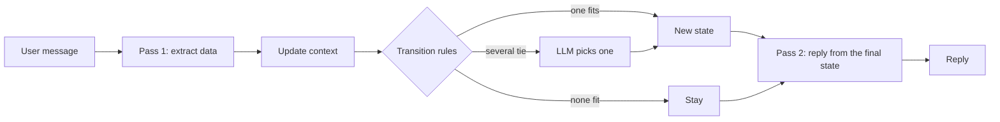
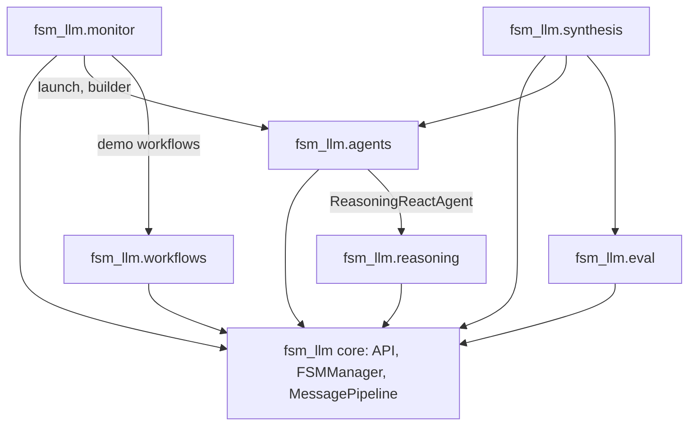

<p align="center">
  <a href="https://www.apache.org/licenses/LICENSE-2.0">
    
  </a>
  
  
  <a href="https://github.com/NikolasMarkou/fsm_llm/actions/workflows/python-package.yml">
    
  </a>
</p>

<p align="center">
  
</p>

A language model call starts from nothing. A multi-turn conversation that must collect data, follow a set flow and decide the same way every time needs structure around the model. **FSM-LLM** is a Python framework for chatbots and agents that follow a fixed structure: you describe the conversation as a finite state machine in JSON, and the language model does the language work inside each state.

It is one package, `fsm_llm`, with a small core and six subpackages on top: reasoning strategies, a workflow engine, 18 agent patterns, a monitoring dashboard, an evaluation harness and runtime FSM synthesis. Every subpackage is built from the same parts as the core (stacked FSMs, message-free steps, one LLM layer), so there is one way to run a model, not five.

---

## Table of Contents
1.  [**Key Features**](#key-features): What is in the box.
2.  [**Why FSM-LLM?**](#why-fsm-llm): Where it fits and where it does not.
3.  [**Installation**](#installation): Get running from a clone.
4.  [**Quick Start**](#quick-start): A conversation, a fake model, a builder, an agent, a workflow.
5.  [**How It Works**](#how-it-works): The two-pass turn.
6.  [**In-Depth Documentation**](#in-depth-documentation): Guides and per-package READMEs.
7.  [**Examples and Command-Line Tools**](#examples-and-command-line-tools): 100 runnable examples and the CLIs.
8.  [**Project Structure**](#project-structure): A tour of the repository.
9.  [**Contributing**](#contributing): Rules, workflow and open items.
10. [**Status**](#status): Maturity and things to know.
11. [**License**](#license)
12. [**Acknowledgments**](#acknowledgments)
13. [**References**](#references): The work this library builds on.

---

## Key Features

The library is organized into five pillars. Each one is a collapsible section.

<details>
<summary><b>1. The Core: Finite State Machines Driven by an LLM</b></summary>
<p>

- **Two-pass turns**: every message goes through Pass 1 (extract data) and Pass 2 (write the reply from the state you ended up in). Transition rules are JsonLogic evaluated in plain Python, so they are predictable and unit-testable. The LLM is asked to choose only when two rules tie at the lowest priority.
- **Handlers**: your functions run at 8 points (start, before and after processing, before and after a transition, context update, end, error), built with `create_handler`.
- **Intent classification**: `classification_extractions` on a state, plus `Classifier`, `HierarchicalClassifier` and `IntentRouter`.
- **FSM stacking**: hand a conversation to a sub-FSM and come back with its results (`push_fsm` / `pop_fsm`).
- **Streaming**: `converse_stream()` yields reply tokens as they arrive.
- **Steps without a user message**: `advance()` runs one turn and returns an `AdvanceResult`; `run_until_terminal()` repeats it within a step and time budget and raises `RunBudgetExceededError` when the budget is spent. Agents and the reasoning engine run on these loops.
- **Tool calling and structured output**: a state with the optional `completion` field makes one native tool-calling or JSON-schema call. Core runs no tool; your handlers do.
- **Sessions and memory**: `save_session` / `restore_session` with `FileSessionStore`, and `WorkingMemory` buffers.
- **Diagrams**: `build_fsm_graph()`, `to_mermaid()`, `to_dot()` and the `fsm-llm-visualize` command.
</p>
</details>

<details>
<summary><b>2. Reasoning, Workflows and Agents</b></summary>
<p>

- **`fsm_llm.reasoning`**: a solver that picks one of 9 reasoning strategies, runs it as stacked FSMs inside one message-free core run, validates the answer and retries up to 3 times. `ReasoningEngine.solve_problem(problem)` returns the solution and a trace.
- **`fsm_llm.workflows`**: an async in-memory engine with 11 step types and a Python DSL (`create_workflow`, `auto_step`, `condition_step`). It runs without an LLM unless you add LLM steps.
- **`fsm_llm.agents`**: 18 agent patterns (`react`, `rewoo`, `reflexion`, `plan_execute`, `prompt_chain`, `self_consistency`, `debate`, `orchestrator`, `adapt`, `evaluator_optimizer`, `maker_checker`, `reasoning_react`, `parallel_react`, `verified_react`, `auto_memory`, `native_fc`, `swarm`, `meta_builder`) plus `AgentGraph`.
- **Tools done properly**: the `@tool` decorator, annotations, enforced timeouts, MCP and A2A support, tools loaded from folders of Python files, and standard operating procedures.
- **Human approval as a security boundary**: a gated tool runs only with a driver-only grant bound to that exact call, which a caller's initial context can never set.
- **A meta-builder** that designs FSMs, workflows and agents by chat (`fsm-llm-meta`).
- **`fsm_llm.synthesis`**: a host FSM names a goal in a `synthesize` state, a model writes a child FSM for it, static checks, a bounded simulation and an optional approval decide whether it may run, a file-backed library stores it and a runner pushes it as a child of the host conversation (`FSMSynthesizer`, `ProcedureRunner`, `FSMLibrary`, `create_procedure_tools`). `verified` means those checks passed over a model-written spec, not that the procedure is correct. The tests are offline. Bench status: blocks `s0`, `s1` and `s2` are registered, run and recorded (one model, `ollama_chat/bonsai-2:27b`, for every role and arm, no strong/cheap split); all three verdicts are INCONCLUSIVE and no registered block shows a compiled procedure beating a ReAct agent. See `docs/synthesis.md`. See [docs/synthesis.md](docs/synthesis.md).
</p>
</details>

<details>
<summary><b>3. Knowledge Bundles and Agent Skills</b></summary>
<p>

- **Open Knowledge Format (OKF)**: `fsm_llm.okf` reads, searches, validates and writes OKF bundles (a directory of markdown files with YAML frontmatter). `fsm_llm.okf_bridge.create_okf_handler()` puts capped concept summaries into a plain FSM's context. `fsm_llm.agents` adds read-only OKF tools, a read-only memory backend and bundle exporters. `fsm-llm-okf` runs it from the shell. This follows OKF v0.2 (SPEC.md at commit ad30107, pre-1.0 and mutable).
- **Agent Skills**: `fsm_llm.agent_skills` reads folders with a `SKILL.md` from the paths you name (the open standard at agentskills.io as read on 2026-10-23, unversioned and mutable). `fsm_llm.agents.create_skill_tools` gives an agent three read-only tools (`skill_list`, `skill_load`, `skill_read`), and `fsm-llm-skills` validates, lists and shows them.
- **Untrusted by design**: bundle and skill text reaches a model only as capped, control-stripped tool output (or labelled summaries), never as a tool description, instruction or persona. Nothing in a bundle or skill folder is executed, and `allowed-tools` is reported, not enforced.
</p>
</details>

<details>
<summary><b>4. Monitoring and Evaluation</b></summary>
<p>

- **`fsm_llm.monitor`**: a FastAPI dashboard (REST, WebSocket, vanilla-JS single-page app) to launch, watch and chat with FSMs, agents and workflows, with optional OpenTelemetry export.
- **`fsm_llm.eval`**: scores the examples 0 to 4, or runs scripted conversations N times and reports pass rates with Wilson confidence intervals (`EvalConfig`, `run_examples`, `run_cases`, `run_dataset`, `wilson_ci`).
- **Pre-registered benches**: `scripts/agents_bench.py`, `scripts/skills_bench.py` and `scripts/synthesis_bench.py` record blocks that are run once at a fixed n and never edited, so a number in the repository can be recounted from its rows.
</p>
</details>

<details>
<summary><b>5. One LLM Layer, Security and Reliability</b></summary>
<p>

- **One LLM layer**: `src/llm.py` is the only module that imports litellm. `LLMInterface.complete(CompletionRequest)` is the single primitive for tool calling, plain and structured completion, with per-interface call and token counters (`usage()`) and an embedder (`LiteLLMEmbedder`). Any litellm model string works.
- **Cut-off replies are visible**: a reply that stops at `max_tokens` is flagged (`truncated`, a WARNING, a named cause in extraction errors) and never shown as an unreadable half envelope.
- **Context security**: internal keys (prefixes `_`, `system_`, `internal_`, `__`) and secret-looking entries are kept out of prompts. The compromised litellm 1.82.7 and 1.82.8 are below the required version, and `make audit` scans for malicious `.pth` files.
- **Assured reliability**: an offline-by-default suite (a fake model, no network) covering the core, every subpackage, packaging, regressions, and the 100 examples.
- **Decisions are recorded**: `# DECISION plan-<id>/D-NNN` comments in the code say what not to do and why.
</p>
</details>

---

## Why FSM-LLM?

FSM-LLM splits the work three ways:

*   **The LLM handles language**: understanding the user, pulling out facts, writing replies.
*   **The state machine handles flow**: which state you are in and where you go next is a rule, not a mood. The LLM breaks a tie between two equal rules and nothing else.
*   **The framework handles state**: what has been collected, history, your own hooks, and saving and restoring sessions.

Use it when the conversation has steps: forms and intake, onboarding, support triage, tutoring flows, anything where "what must happen next" is a rule.

Do not use it for open-ended chat with no structure (a plain LLM call is simpler), or when you need a hosted, production-hardened agent platform. The project is young, and one subpackage is explicitly experimental (see [Status](#status)).

---

## Installation

> **Note:** This library requires Python 3.10 to 3.12. `fsm-llm` on PyPI is a different, unrelated project, so install from a clone.

1.  **Clone the repository:**
    ```bash
    git clone https://github.com/NikolasMarkou/fsm_llm.git
    cd fsm_llm
    ```

2.  **Create an environment and install:**
    ```bash
    python -m venv .venv && source .venv/bin/activate
    pip install -e .
    ```

3.  **Optional extras:**
    `import fsm_llm` loads only the core, and every subpackage ships in every install. An extra only adds third-party dependencies.

    | Extra | Adds |
    |-------|------|
    | `reasoning`, `agents`, `workflows`, `eval`, `synthesis` | No third-party packages (the code ships in every install) |
    | `monitor` | fastapi, uvicorn, jinja2 |
    | `mcp` | mcp (>=1.0.0) |
    | `otel` | opentelemetry-api, opentelemetry-sdk (>=1.20.0) |
    | `a2a` | httpx (>=0.24.0) |
    | `all`, `dev` | Everything / everything plus the dev tools |

    ```bash
    pip install -e ".[monitor]"
    pip install -e ".[all]"
    ```

    The core install needs loguru, litellm, pydantic, python-dotenv and pyyaml (>=6.0, which parses OKF and Agent Skills frontmatter; declared explicitly because it used to arrive only through another package).

4.  **Pick a model:**
    ```bash
    export LLM_MODEL=ollama_chat/qwen3.5:4b      # or openai/gpt-4o-mini with OPENAI_API_KEY set
    ```
    The model is the `model=` argument, then `LLM_MODEL`, then the built-in default `ollama_chat/bonsai-2:27b`. A `.env` file (see `.env.example`) is read too.

5.  **Verify the installation:**
    ```bash
    python -c "import fsm_llm; print('Installation successful!')"
    ```

---

## Quick Start

### 1. Define and Run a Conversation

Define the conversation (`greeter.json`). It asks for a name, then moves to a final state:

```json
{
  "name": "Greeter",
  "description": "Learns the user's name, then says goodbye",
  "initial_state": "ask_name",
  "persona": "A friendly assistant",
  "states": {
    "ask_name": {
      "id": "ask_name",
      "description": "Find out the user's name",
      "purpose": "Learn the user's name",
      "extraction_instructions": "Extract the user's name if they gave it",
      "response_instructions": "Greet the user and ask for their name if you do not know it yet",
      "required_context_keys": ["name"],
      "transitions": [
        {
          "target_state": "goodbye",
          "description": "The name is known",
          "conditions": [
            {
              "description": "A name was collected",
              "requires_context_keys": ["name"],
              "logic": {"has_context": "name"}
            }
          ]
        }
      ]
    },
    "goodbye": {
      "id": "goodbye",
      "description": "Say goodbye",
      "purpose": "Wrap up the conversation",
      "response_instructions": "Say a short goodbye to the user by name. Do not ask a question"
    }
  }
}
```

Run it:

```python
from fsm_llm import API

api = API.from_file("greeter.json")   # no model given: env LLM_MODEL, else ollama_chat/bonsai-2:27b
conv_id, opening = api.start_conversation()
print("bot:", opening)
print("bot:", api.converse("Hi, I'm Alice.", conv_id))
print(api.get_data(conv_id))
print(api.get_current_state(conv_id), api.has_conversation_ended(conv_id))
```

A real run against a local Ollama `qwen3.5:4b` (the wording differs on every run):

```text
bot: Hello! How do you do? I'm here to get to know you better. What's your name?
bot: Nice meeting you, Alice! It was a pleasure getting to know you.
{'name': 'Alice'}
goodbye True
```

To use a hosted model, pass `model=` (for example `API.from_file("greeter.json", model="openai/gpt-4o-mini")`) and set the provider key (`OPENAI_API_KEY`).

A state with no transitions (`goodbye`) is terminal. `required_context_keys` only tells Pass 1 what to extract; it never blocks a transition, so the transition above carries its own condition (`requires_context_keys` plus `logic`).

### 2. Try It Without a Model

Pass your own `llm_interface` (a subclass of `LLMInterface`) and nothing touches the network. This is how the repository's tests run:

```python
from fsm_llm import API, LLMInterface
from fsm_llm.definitions import FieldExtractionResponse, ResponseGenerationResponse


class FakeLLM(LLMInterface):
    """Fixed reply and a fixed name; makes no network call."""

    def generate_response(self, request):
        return ResponseGenerationResponse(
            message="Nice to meet you!", message_type="response", reasoning="fake"
        )

    def extract_field(self, request):
        return FieldExtractionResponse(
            field_name=request.field_name, value="Alice", confidence=1.0,
            reasoning="fake", is_valid=True,
        )


api = API.from_file("greeter.json", llm_interface=FakeLLM())
conv_id, _ = api.start_conversation()
print(api.converse("anything", conv_id))                    # Nice to meet you!
print(api.get_data(conv_id), api.get_current_state(conv_id))  # {'name': 'Alice'} goodbye
```

`API` refuses `model=`, `temperature=` and similar settings next to `llm_interface=`, because the interface owns them.

### 3. Assemble It Step by Step

Anything with more than a couple of settings can be put together by chaining calls. While you chain, nothing is checked; the final `.build()` checks everything at once and hands back a private copy, so one recipe can make many independent objects.

A conversation with a hook and a model:

```python
from fsm_llm import APIBuilder, HandlerTiming, create_handler

audit = (
    create_handler("audit")
    .at(HandlerTiming.POST_TRANSITION)
    .do(lambda context: {"audited": True})
)

api = (
    APIBuilder()
    .set_definition("greeter.json")
    .set_model("ollama_chat/qwen3.5:4b")
    .set_temperature(0.2)
    .add_handler(audit)
    .build()
)
```

An agent with a tool, an instruction and an iteration limit (a real run against the local model; the wording differs each time):

```python
from fsm_llm.agents import ConfiguredAgentBuilder, tool


@tool
def add(a: int, b: int) -> int:
    """Add two integers."""
    return a + b


agent = (
    ConfiguredAgentBuilder()
    .set_pattern("react")
    .add_tool(add)
    .set_system_prompt("Answer in one short sentence.")
    .set_max_iterations(6)
    .build()
)
result = agent("What is 19 + 23? Use the add tool.")
print(result.answer, result.success, result.stop_reason)
# 19 + 23 equals 42, as calculated by the add tool. True answered
```

Mistakes come back together, in one error, instead of one at a time:

```python
from fsm_llm import APIBuilder, BuildError

try:
    APIBuilder().set_llm_option("model", "a").set_llm_option("max_history_size", 3).build()
except BuildError as err:
    print(*err.errors, sep="\n")
# option 'model' names a constructor parameter; use set_model()
# option 'max_history_size' names a constructor parameter; use set_max_history_size()
```

What you get from this style:

- Setters only record, so you can chain them in any order and pass the half-built recipe around.
- One `.build()` does all the checking and raises one error type. `BuildError` is a `ValueError` that lists every problem in `.errors` and keeps the underlying cause attached.
- The result is a private copy: change the recipe afterwards, or build again, and nothing already built moves. Objects you hand in (a model interface, a tool, a store) stay shared, not copied.
- Settings that pass straight through to the model library are accepted without a whitelist, and a name that clashes with a typed setter is refused with a message that names the setter to use.
- It is an alternative, not a replacement: the plain constructors and `from_file` still work everywhere.

The same shape builds conversations, agents of any pattern, workflows, agent graphs and handlers. The rules are in [docs/api_reference.md](docs/api_reference.md).

### 4. Create an Agent in One Line

```python
from fsm_llm.agents import create_agent, tool


@tool
def add(a: int, b: int) -> int:
    """Add two integers."""
    return a + b


agent = create_agent("react", [add])
result = agent("What is 19 + 23? Use the add tool.")
print(result.answer, result.success, result.stop_reason)   # 19 + 23 equals 42. True answered
```

`success` is `True` only when the run reached its goal. A forced stop still returns its last answer, with `success=False` and a `stop_reason`.

### 5. Run a Workflow (No LLM Needed)

This prints `WorkflowStatus.COMPLETED`:

```python
import asyncio
from fsm_llm.workflows import WorkflowEngine, auto_step, condition_step, create_workflow_builder

wf = (
    create_workflow_builder("orders", "Order check")
    .set_initial_step(auto_step("load", "Load order", next_step_id="route",
                                action=lambda ctx: {"amount": 1500}))
    .add_step(condition_step("route", "Big order?", condition=lambda ctx: ctx["amount"] >= 1000,
                             true_step_id="review", false_step_id="done"))
    .add_step(auto_step("review", "Manual review", next_step_id="done"))
    .add_step(auto_step("done", "Finish", next_step_id=""))
    .build()
)


async def main():
    engine = WorkflowEngine()
    engine.register_workflow(wf)
    instance_id = await engine.start("orders")
    print(engine.get_status(instance_id))


asyncio.run(main())
```

### 6. Solve a Problem with the Reasoning Engine

```python
from fsm_llm.reasoning import ReasoningEngine

engine = ReasoningEngine(model="ollama_chat/qwen3.5:4b")
solution, trace = engine.solve_problem("If all cats are mammals and Tom is a cat, what is Tom?")
print(solution)
print(trace["summary"])
```

---

## How It Works

Every user message goes through two LLM passes:



- The context is a dictionary of everything collected so far in one conversation.
- Transition rules use JsonLogic, for example `{">=": [{"var": "age"}, 18]}`. If several transitions pass, the lowest `priority` number wins outright. The LLM is asked only when two or more tie at that lowest priority. If none pass, the conversation stays put.
- Pass 2 runs after the transition, so the reply comes from the state the conversation is actually in. A state with empty `response_instructions` makes no LLM call, replies with `""` and adds nothing to the history.

The subpackages sit on top of the core and never the other way round:



| Subpackage | What it adds | Maturity |
|------------|--------------|----------|
| [`fsm_llm.reasoning`](src/reasoning/README.md) | 9 reasoning strategies as stacked FSMs, validation, up to 3 retries | Tested offline; live behavior depends on the model |
| [`fsm_llm.workflows`](src/workflows/README.md) | Async in-memory workflow engine, 11 step types, a Python DSL | Runs without an LLM unless you add LLM steps |
| [`fsm_llm.agents`](src/agents/README.md) | 18 agent patterns, tools, human approval, memory, MCP, A2A, meta-builder | Documented known limits, see [docs/agents_roadmap.md](docs/agents_roadmap.md) |
| [`fsm_llm.monitor`](src/monitor/README.md) | FastAPI dashboard, optional OpenTelemetry export | Needs the `monitor` extra |
| [`fsm_llm.eval`](src/eval/README.md) | Examples scorer (0 to 4), conversation cases with Wilson intervals | Scores are a heuristic that overstates quality; read the logs too |
| [`fsm_llm.synthesis`](src/synthesis/README.md) | A model compiles a goal into an FSM, gates judge it, a library stores it, a runner executes it; agent tools | Tested offline with scripted models. Bench status: three blocks run on one model, all INCONCLUSIVE; no result favours synthesis. |

**Evaluation honesty.** The examples scorer reads each run's output with simple rules and gives 0 to 4. It overstates quality, and runs from before and after the 2026-09-29 restructure are not comparable. The method and the run log are in [EVALUATE.md](EVALUATE.md). Offline tests (the default) replace the model with a fake, so they say nothing about model quality.

---

## In-Depth Documentation

### Start Here: [`docs/README.md`](docs/README.md)

The index of the guides. For a first read, go in this order:

-   **[Quickstart](docs/quickstart.md)**: from zero to a running conversation.
-   **[FSM Design](docs/fsm_design.md)**: states, transitions, priorities, classification and the `completion` field.
-   **[Handlers](docs/handlers.md)**: the 8 hook points and how to write a handler.
-   **[Architecture](docs/architecture.md)**: the pipeline internals, the LLM layer, the step driver.
-   **[API Reference](docs/api_reference.md)**: every public name, builders, OKF, Agent Skills and the monitor.
-   **[Agents Roadmap](docs/agents_roadmap.md)**: the agents audit record and deferred work.

### Per-Package READMEs

[`src/`](src/README.md) documents the core, and one README sits inside each subpackage folder (linked in the table above). [`tests/README.md`](tests/README.md) explains how the test suite is laid out.

### Project Records

[CHANGELOG.md](CHANGELOG.md) (release history and known open items), [EVALUATE.md](EVALUATE.md) (evaluation method and run log), [CONTRIBUTING.md](CONTRIBUTING.md) and [SECURITY.md](SECURITY.md).

---

## Examples and Command-Line Tools

### Examples

100 runnable examples in 8 categories. Each is a folder with `run.py` and its FSM JSON:

```bash
python examples/basic/simple_greeting/run.py     # needs a model: an OpenAI key, or a local Ollama
```

| Category | Count | Highlights |
|----------|-------|------------|
| Basic | 14 | simple_greeting, form_filling, multi_turn_extraction |
| Intermediate | 3 | book_recommendation, product_recommendation, adaptive_quiz |
| Advanced | 17 | e_commerce (FSM stacking), support_pipeline, concurrent_conversations |
| Classification | 4 | intent_routing, smart_helpdesk, multi_intent |
| Reasoning | 1 | math_tutor |
| Workflows | 8 | order_processing, parallel_steps, conditional_branching |
| Agents | 48 | react_search, plan_execute, reflexion, debate, orchestrator |
| Meta | 5 | build_fsm, build_workflow, build_agent |

The examples are evaluation baselines: `fsm-llm-eval examples` runs them in parallel and scores each. Do not edit them unless a maintainer asks.

### Command-Line Tools

| Command | Description |
|---------|-------------|
| `fsm-llm --fsm <path.json>` | Chat with an FSM interactively (`--mode validate` and `--mode visualize` also exist) |
| `fsm-llm-visualize --fsm <path.json> [--format ascii\|mermaid\|dot]` | Draw an FSM |
| `fsm-llm-validate --fsm <path.json>` | Check an FSM definition for problems |
| `fsm-llm-monitor` | Web dashboard at http://127.0.0.1:8420 (`--host`, `--port`, `--no-browser`, `--api-key`, `--otel`) |
| `fsm-llm-meta [--model M] [--output FILE]` | Build FSMs, workflows or agents by chatting |
| `fsm-llm-okf <validate\|list\|show\|search\|export>` | Check, browse, search and export Open Knowledge Format bundles |
| `fsm-llm-skills <validate\|list\|show> PATH...` | Check (`--strict` for API portability), list and read Agent Skills folders |
| `fsm-llm-eval examples [--category C] [--fail-under PCT]` | Score every example 0 to 4 |
| `fsm-llm-eval run <dataset.json\|.jsonl> [--trials N]` | Run scripted conversations and report pass rates |
| `python -m fsm_llm.reasoning "problem" [--type T]` | Solve a problem with the reasoning engine (no console script) |

`fsm-llm` needs `LLM_MODEL` (set in the environment or a `.env` file) and stops with `Missing required environment variable: LLM_MODEL` without it. It also reads `LLM_TEMPERATURE` (default 0.5) and `LLM_MAX_TOKENS` (default 1000). `.env.example` lists the variables. Exit codes: 0 ok, 1 failure (a failed first model call prints `Error: ...` like a later turn), 130 Ctrl-C; `fsm-llm-eval` exits 2 below `--fail-under` and 130 on Ctrl-C or SIGTERM.

---

## Project Structure

The repository is one distribution (`fsm-llm`, setuptools, flat src layout). The directory `src/` is the import package `fsm_llm` (`package-dir` in `pyproject.toml`), so `src/api.py` is `fsm_llm.api`, and a subpackage is imported by name, for example `from fsm_llm.agents import create_agent`.

```
fsm_llm/
├── src/               # THE LIBRARY
│   ├── api.py, fsm.py,        # API, FSMManager, MessagePipeline (the 2-pass turn)
│   │   pipeline.py
│   ├── definitions.py         # Pydantic FSM models and core exceptions
│   ├── transition_evaluator.py, expressions.py   # JsonLogic evaluation, no LLM
│   ├── flow_analysis.py       # Data-flow and liveness analysis of an FSM
│   ├── llm.py                 # The only module that imports litellm
│   ├── classification.py      # Classifier, intent routing
│   ├── security.py, constants.py   # Key filtering, path confinement, limits
│   ├── okf.py, okf_bridge.py, okf_cli.py   # Open Knowledge Format
│   ├── agent_skills.py, agent_skills_cli.py   # Agent Skills (read-only)
│   ├── frontmatter.py         # The one YAML frontmatter loader
│   ├── reasoning/             # 9 strategies as stacked FSMs
│   ├── workflows/             # Async workflow engine, 11 step types, DSL
│   ├── agents/                # 18 agent patterns, tools, HITL, MCP, A2A, meta-builder
│   ├── monitor/               # FastAPI dashboard, OTEL exporter
│   ├── eval/                  # Examples scorer, conversation cases
│   └── synthesis/             # Runtime FSM synthesis: compile, gates, library, runner
├── tests/                     # One folder per subpackage plus root-level files
├── examples/                  # 100 runnable examples in 8 categories (evaluation baselines)
├── docs/                      # Guides and API reference
├── evaluation/                # Datasets and recorded eval runs
├── scripts/                   # Supply-chain audit, benches, doc-count check
├── images/                    # Logo and diagrams
├── .github/workflows/         # CI: Python 3.10, 3.11, 3.12
└── CHANGELOG.md, EVALUATE.md, CONTRIBUTING.md, SECURITY.md
```

---

## Contributing

Contributions are welcome, from a typo fix to a new agent pattern. Full rules are in [CONTRIBUTING.md](CONTRIBUTING.md); report vulnerabilities as described in [SECURITY.md](SECURITY.md).

### Getting Started

```bash
make install-dev    # editable install with every extra, plus pre-commit hooks
make test           # Run full test suite (13,763 tests)
make lint           # ruff check src/ tests/
make format         # ruff format src/ tests/
make type-check     # mypy on the fsm_llm package (src/)
make audit          # scan site-packages for malicious .pth files
make counts         # fail when a test count written in a .md file differs from a collection
make build          # wheel and sdist
```

The default test run needs no network and no model. `pytest -m "not slow"` skips the slow tests. Live tests skip without a local Ollama. CI runs Python 3.10, 3.11 and 3.12: `.pth` audit, ruff lint and format check, mypy, and pytest without the `slow`, `real_llm` and `integration` markers.

### Development Standards

- A behavior change needs a test that fails on the code before your change.
- Add an entry under `Unreleased` in `CHANGELOG.md` for any public removal or rename.
- Do not edit `examples/` unless asked: they are evaluation baselines.
- Naming for new code (ids, units, constants, exceptions, verbs) follows the `Naming conventions` section of [AGENTS.md](AGENTS.md).
- litellm is imported only in `src/llm.py`. Do not add a second request builder or provider call elsewhere.
- Internal-key and secret-key checks go through `fsm_llm.constants.has_internal_prefix` and `is_forbidden_context_entry`. Do not re-inline them.
- Anything new that is configured with many settings gets a step-by-step builder that follows the convention in [src/AGENTS.md](src/AGENTS.md): setters only record, `build()` is the only validator.
- Read `# DECISION plan-<id>/D-NNN` comments before editing nearby code: they say what not to do and why.
- Test counts in this file and in `AGENTS.md` are pinned by `tests/test_packaging.py`. After adding tests, re-measure with `pytest --collect-only -q | tail -1` and update them. Every FSM JSON block in this file is loaded by `tests/test_fsm_llm/test_docs_snippets.py`, so keep it valid.
- Commit messages follow `<type>(<scope>): <summary>`. Plan-step commits start with `[plan-YYYY-MM-DD-<8 hex>/iter-N/step-M]`.

### Good Places to Help

All taken from recorded open items:

- **Agents** ([docs/agents_roadmap.md](docs/agents_roadmap.md), Known open items and Track B): `AgentGraph` has no failure routing, so a fallback branch cannot be built; Orchestrator subtasks dropped over `max_workers` do not affect `success`; a reply cut off by `max_tokens` is detected (`finish_reason`, a WARNING, a named cause in extraction errors, no unreadable half envelope shown as a reply) and a cut final reply (or answer field) of an agent run ends it with `success=False` and `stop_reason="truncated"` (REWOO stops on a cut plan), but a cut `native_fc` tool call, a `SelfConsistencyAgent` sample, a long meta-builder artifact, a streamed reply and a cut in an earlier turn are still not flagged; Swarm never hands off by itself; real human-in-the-loop for REWOO, PlanExecute, ParallelReact and native_fc; MCP v2 and A2A v1.0.
- **Core** (`CHANGELOG.md`, Unreleased, Known open): validating an `FSMDefinition` for the first time from several threads at once can race; the message-free `classification_extractions` path has offline coverage only; nothing was checked live on a non-Ollama provider.
- **Reasoning** (`CHANGELOG.md`, Known open): cheaper typed per-key reasoning fields were tried and reverted after losing answers on a pre-registered probe, so a new attempt needs its own probe; a `final_context` passed back as `initial_context` still carries the previous problem's analysis.
- **Measurement**: every live number here comes from one small local model. Runs on other models and providers are welcome, as new pre-registered blocks (see `scripts/bench_data/README.md`).

---

## Status

- Version 0.12.0. Most tests are offline and use a fake model, so they check logic and wiring, not model quality.
- Evaluation scores are a heuristic and overstate quality. The recorded runs in [EVALUATE.md](EVALUATE.md) used a 4B local model, and scores on other models differ.

Things to know:

- The `fsm-llm` command needs `LLM_MODEL`. The Python `API` falls back to `LLM_MODEL`, then to `ollama_chat/bonsai-2:27b`. A `.env` file (loaded when `fsm_llm` is imported, and by `fsm-llm`) sets `LLM_MODEL` before that built-in default, so a stale `.env` silently beats it.
- The library logs nothing until you call `setup_logging()` or `enable_debug_logging()`; both also replace loguru's default handler, so a library record prints once.
- One conversation handles one message at a time: a second `converse` on a conversation that is mid-turn raises `FSMError`.
- Upgrading a clone from before the 2026-09-29 restructure: delete the old `src/fsm_llm_<sub>/` folders by hand (`make clean` does not remove them), then `pip install -e .`. A leftover folder breaks imports. After the later move of `src/fsm_llm/` to `src/`, run `pip install -e .` again.
- `constraints.txt` pins litellm and the dev tools to exact versions so CI and local runs match.

---

## License

This project is licensed under the **Apache License 2.0**.

- **Permissive**: you may use, modify and distribute the library, including in commercial and closed-source products.
- **Attribution**: redistributions must retain the copyright notice and a copy of the license, and modified files must carry a notice stating that they were changed.
- **Patent grant**: contributors grant an express patent license covering their contributions.

See the [LICENSE](LICENSE) file for complete details.

---

## Acknowledgments

FSM-LLM stands on open-source work: [litellm](https://github.com/BerriAI/litellm) for the provider layer, [Pydantic](https://docs.pydantic.dev) for the models, [loguru](https://github.com/Delgan/loguru) for logging, [JsonLogic](https://jsonlogic.com) for transition rules, and [Ollama](https://ollama.com) for the local models the evaluation runs used. Thanks to everyone who has reported issues and run the examples against other models.

---

## References

The agent patterns, reasoning strategies and standards in this library follow published work and open specifications. Each pattern's module documents how it differs from the original.

<details>
<summary><b>Agent Patterns and Reasoning</b></summary>

-   **ReAct: Synergizing Reasoning and Acting in Language Models**: Yao, S., et al. (2022). *ICLR 2023*.
-   **ReWOO: Decoupling Reasoning from Observations for Efficient Augmented Language Models**: Xu, B., et al. (2023).
-   **Reflexion: Language Agents with Verbal Reinforcement Learning**: Shinn, N., et al. (2023). *NeurIPS*.
-   **Plan-and-Solve Prompting: Improving Zero-Shot Chain-of-Thought Reasoning by Large Language Models**: Wang, L., et al. (2023). *ACL*.
-   **Self-Consistency Improves Chain of Thought Reasoning in Language Models**: Wang, X., et al. (2022). *ICLR 2023*.
-   **Chain-of-Thought Prompting Elicits Reasoning in Large Language Models**: Wei, J., et al. (2022). *NeurIPS*.
-   **Improving Factuality and Reasoning in Language Models through Multiagent Debate**: Du, Y., et al. (2023).
-   **Building Effective Agents** (prompt chaining, orchestrator-workers, evaluator-optimizer): Anthropic (2024).
</details>

<details>
<summary><b>Standards and Specifications</b></summary>

-   **Model Context Protocol (MCP)**: the protocol behind the `mcp` extra.
-   **Agent2Agent (A2A) Protocol**: the protocol behind the `a2a` extra.
-   **Open Knowledge Format (OKF) v0.2**: SPEC.md at commit ad30107, pre-1.0 and mutable.
-   **Agent Skills** (agentskills.io): the `SKILL.md` folder standard, read on 2026-10-23, unversioned and mutable.
-   **JsonLogic**: the rule format used for transition conditions.
-   **OpenTelemetry**: the telemetry format behind the `otel` extra.
</details>

<details>
<summary><b>Evaluation</b></summary>

-   **Probable Inference, the Law of Succession, and Statistical Inference**: Wilson, E. B. (1927). *Journal of the American Statistical Association*. The source of the Wilson confidence interval used by `wilson_ci`.
</details>

*Complete details of each pattern and module are in the per-package READMEs.*
