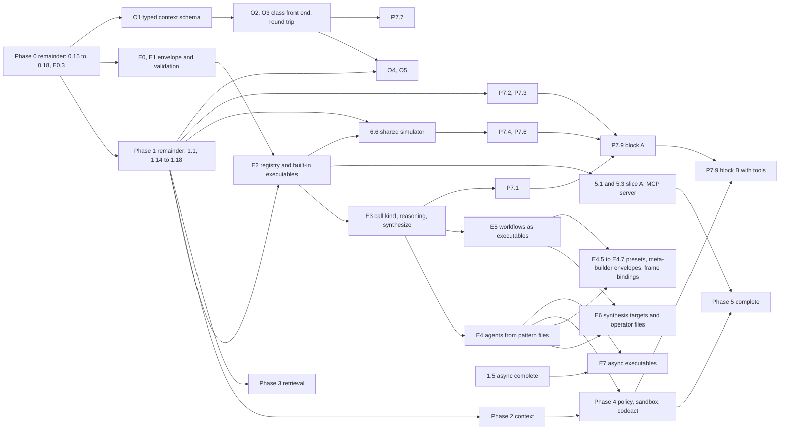

# fsm_llm Roadmap: A Verifiable, Durable Harness Framework

| | |
|---|---|
| Document version | 4.1 (v4.0 re-verified against main; changes in Section 16) |
| Date | 2026-11-20 |
| Baseline | fsm_llm `0fb72162` (v0.13.0 released 2026-11-17; main carries the unreleased changes listed in Section 4); txtai `fecd114` (PyPI 9.14.0, master 9.15.0 unreleased, 2026-11-19); deepseek-harness `2e39e70496` (tag `dsh-v0.2.2-rc.5`, 2026-11-18); NVIDIA-NeMo/labs-OO-Agents (NOOA) `a3aabc5b` (v0.0.12, 2026-11-20) |
| Method | Clones of all four repositories and the package indexes. Every number is a dated measurement from a command in Appendix A. Standards are checked against their own repositories (Appendix B) |
| Planning basis | Dependency order only. No effort or calendar estimates |
| Row identifiers | Stable. Code and import contracts cite them (`# retired by: roadmap 6.6`), so a row is marked done or superseded, never renumbered |
| Status cells | Measured at the baseline commit. Keeping a status cell, a count or the baseline row true is a routine edit; changing a row's scope, dependencies or done-when is an owner decision |

## Contents

1. [Executive summary](#1-executive-summary)
2. [Principles](#2-principles)
3. [Core contracts](#3-core-contracts)
4. [Baseline: fsm_llm today](#4-baseline-fsm_llm-today)
5. [Reference projects and standards](#5-reference-projects-and-standards)
6. [Target architecture](#6-target-architecture)
7. [Roadmap: Phases 0 to 6, Workstreams E and O](#7-roadmap-phases-0-to-6-workstreams-e-and-o)
8. [Phase 7: Runtime FSM synthesis](#8-phase-7-runtime-fsm-synthesis)
9. [Novelty assessment](#9-novelty-assessment)
10. [Sequencing and dependencies](#10-sequencing-and-dependencies)
11. [Success metrics](#11-success-metrics)
12. [Risks and mitigations](#12-risks-and-mitigations)
13. [Compatibility and release policy](#13-compatibility-and-release-policy)
14. [Out of scope](#14-out-of-scope)
15. [Open decisions](#15-open-decisions)
16. [Change log: v4.0 to v4.1](#16-change-log-v40-to-v41)
- [Appendix A: Evidence](#appendix-a-evidence)
- [Appendix B: References](#appendix-b-references)

---

## 1. Executive summary

**Positioning.** fsm_llm is the framework for deterministic, durable, auditable conversational state machines with grounded retrieval. txtai is a retrieval and pipeline platform whose agents run a smolagents loop. deepseek-harness is a durable, plugin-first agent runtime whose control flow is an open model loop or a model-written program. NOOA makes an agent a Python object whose `...` methods an LLM completes, with control flow in ordinary Python. None of the three offers rule-based, statically checkable, replayable dialogue control. That is the moat. Every item below widens it or removes a reason not to adopt the library.

**In one line:** NOOA makes an agent a Python object; fsm_llm makes every agent, reasoning strategy, workflow and generated procedure a verifiable, durable executable that runs on one engine, writes one log and returns one result.

**State of play.** Release 0.13.0 delivered the foundation: distribution on PyPI as `llm-fsm`, Python 3.11 to 3.15, layer packages held by import contracts and an 800-line module cap, a schema registry for definition fields, a closed reason-code vocabulary, a state-kind registry and public test doubles. Main adds the first slice of the durable runtime (an opt-in event log, fork and resume, core turn budgets, usage and privacy levels derived from events, an async LLM layer and async core turns), one definition identity recipe in core, and text fixtures of all 49 built-in agent and reasoning FSM cases, the safety net for converting them (E0.1). Runtime FSM synthesis ships with gates G1 to G7, a content-addressed library, a runner and a repair loop; its three pre-registered benchmark blocks are INCONCLUSIVE because one model played every role.

**The problem now is consistency, not capability.** Three of the four runtime packages already run on core's step driver, yet the codebase keeps seven definition formats, nine private name tables and as many result shapes:

| Where | Definition format | Selection or name table | Result shape |
|---|---|---|---|
| agents | Python builders `build_<x>_fsm(...)`; constructor arguments that are Python objects (`evaluation_fn`, `worker_factory`, `ChainStep.validation_fn`, swarm members); handlers attached in Python | `_PATTERNS` | `AgentResult` (`success`, `stop_reason`) |
| agents, SOPs | YAML or JSON task templates naming a pattern, tools, an output schema and config overrides | `SOPRegistry`, `load_builtin_sops` | none of its own |
| agents, meta-builder | Three artifact specs with hand-written schemas; the FSM spec has its own shape (`state_id`, `from_state`); nothing loads the workflow or agent artifact | `_SPEC_MODELS`, `_ARTIFACT_SCHEMAS` | `MetaBuildOutcome` |
| reasoning | Module-level dicts plus `StrategySpec` | Classifier FSM, `ReasoningType`, `STRATEGIES`, `_TYPE_MAP` | `SolutionResult` |
| synthesis | `FSMDefinition` JSON, content-addressed | Library search by goal | `synthesis_result` dict |
| workflows | Pydantic steps holding Python callables; `serialize()` writes a dict that nothing reads | A `WorkflowDefinition` object by id | `WorkflowInstance` status |
| monitor | `static/flows.json`: hand-drawn graphs of 12 agents and 5 workflows, missing `native_fc`, `parallel_react` and the meta-builder | `_AGENT_CLASSES` (7 patterns, keyed by class name), `_WORKFLOW_PRESETS` | none |

So every cross-cutting capability (budgets, approval, durable resume, replay, serving, simulation, synthesis, visualization) is wired up once per format or not at all, the monitor launches only 7 of the 18 patterns (decisions D-001 and D-058 record why), and results do not compose. This roadmap replaces the seven formats with one of each: one executable format, one registry of names, one run context, one result envelope and one event log. A capability added once to the engine, the registry or a state kind then works for every kind of executable, and every executable becomes servable, simulatable, resumable, drawable and synthesizable.

**Ten moves, in order of leverage:**

| # | Move | Where |
|---|---|---|
| 1 | Finish the foundation: one model resolver, one result envelope, one name registry, module headroom, macOS CI, upgrade guides; close the bench-pin freeze that protects no live block | Phase 0 (0.2, 0.5, 0.15 to 0.18), E0.3 |
| 2 | Make the event log complete, cheap and the default: a producer for every event type in product code (tool calls included), group commit off the event loop, message provenance, a run context for every runner, coded LLM and tool failures | Phase 1 (1.1, 1.14 to 1.18) |
| 3 | Unify executables: one envelope that replaces all seven formats (FSMs, strategies, patterns and their presets, procedures, workflows, meta-builder artifacts); template and instance identity; a registry with hot reload and weighted routes; a `call` state kind with closed selection; validation before any model call | Workstream E |
| 4 | Engineer the context window: references with bounded previews, a cache-stable prompt layout, compaction as a logged epoch | Phase 2 |
| 5 | Ground conversations in calibrated evidence that routing reads only as handler-only facts | Phase 3 |
| 6 | Author FSMs as typed Python classes that compile to the same IR | Workstream O |
| 7 | Run every side effect under one policy, one sandbox seam and one audit trail | Phase 4 |
| 8 | Serve the registry: an MCP server first, then Open Responses, A2A and AG-UI | Phase 5 |
| 9 | Prove quality with one simulator that drives any executable, on three models | Phase 6 |
| 10 | Harden runtime synthesis and run the experiment that can falsify it | Phase 7 |

---

## 2. Principles

1. **Model-visible means logged.** Every input a model sees is an event; every prompt can be rebuilt from the log.
2. **Fail closed.** A missing approver, an unknown tool outcome, an unresolved variable or name, an unverified generated definition: stop and report a code; never guess.
3. **Verify the world, not the self-report.** Tests and evals check end state: FSM state, extracted context, side effects and result codes.
4. **Integrate, do not reimplement.** Retrieval comes from txtai; protocols come from their official SDKs; fsm_llm owns control flow.
5. **Optional heavy dependencies.** Core installs with pydantic, loguru and pyyaml; providers, retrieval, serving and telemetry are extras.
6. **Model proposes, Python disposes.** Every model-produced value (extraction, decision, generated definition, code result) is typed and checked by deterministic code before it takes effect.
7. **Pass by reference, keep prefixes stable.** Large values stay out of prompts; prompts grow only at the end.
8. **One canonical IR, one file format.** `FSMDefinition` is the one FSM program. The executable envelope is the one file format for everything that runs.
9. **JSON names, Python implements.** A definition names handlers, tools, callables, generators and executables; each name resolves to code that Python registered. A new combination of registered blocks needs no code change; a new block does.
10. **Security boundaries stay in code.** The approval grant check, the mandatory gates and the untrusted labels hold whatever a definition, a policy file or a caller says.
11. **One contract per concept.** One event log, one verifier, one simulator, one policy object, one code vocabulary, one result envelope, one name registry, one run context (Section 3).
12. **Registries are values.** Each API, agent factory, engine, synthesizer and server takes the registry it uses; the module default is built once and can be frozen.
13. **Shape by default, values by opt-in.** Shared stores keep names, types, codes and counts; values need an explicit setting.
14. **Caller input is data, never definition text.** What a caller, a user or a parent run supplies enters as a declared input; it never fills instruction or persona text and never changes the identity a run records for its template.
15. **Provenance travels with every message.** Each message records whether a human, a parent run, a remote client or the simulator sent it; only a policy approver answers an approval.

---
## 3. Core contracts

Every phase builds on these thirteen contracts. A feature that needs something outside them extends a contract, with a recorded schema or format version, or it is out of scope. Status is measured at the baseline.

| ID | Contract | Definition | Status | Built by | Consumed by |
|---|---|---|---|---|---|
| C1 | Definition IR | `FSMDefinition` is the one FSM program. Every FSM inside an executable (C11) is an `FSMDefinition` that loads exactly as `API` loads it. JSON files, Python builders, Python classes (Workstream O), the meta-builder and synthesizer output are front ends. A schema registry records the version that introduced every FSM field and every envelope field. The identity of a definition is `definition_digest`, the 64-hex sha256 of its canonical dump; `fsm_id` (`fsm_<name>_<8 hex>`) is a cache key and a display name, never an identity | Partial: FSM fields versioned (definition version 4.2); one identity recipe in core (`definition_canonical`, `definition_digest`, `fsm_id_of`) used by `API` and `FSMLibrary`; envelope fields open | 0.12, E1.1, O1 | Verifier, visualizer, engine, synthesis, `oo`, registry |
| C2 | State kinds and executors | A state has exactly one kind, derived from the config it carries: `conversation`, `completion`, `synthesize` (exist), `call` (E3), `reply` (O2), `codeact` (4.4). A kind declares its config model, the handler-only result key it writes, its read and write sets for G3, its liveness rule for G4, its sample values for G6a, and an executor. The executor protocol lives in `core`, the registry in `engine`. `synthesize` is a `call` whose target the synthesizer supplies | Partial: registry and `executors=` internal; `synthesize` needs a second driver | 0.14, E3.1, E3.5, O2, 4.4 | Engine, verifier, `oo`, synthesis |
| C3 | Context namespaces | Public keys: extractable, typed by `context_schema`. Handler-only keys: written only by executors and handlers, never by extraction or classification. Internal keys: prefixes `_`, `system_`, `internal_`, `__`, never shown to a model. Every fact routing reads is a handler-only `<kind>_result` dict shaped by C13: a completion state's `result_key`, `synthesis_result`, `call_result`, `retrieval_result`, `decision_result`, `codeact_result` | Partial: handler-only names enforced; framework result keys closed to every channel | 0.16, E3.1, 3.4, 3.9, 4.4 | JsonLogic routing, G3 |
| C4 | Event log | Append-only, versioned, one log per conversation tree. Every model-visible input is an event; large payloads are content-addressed blobs that also back value references. Every message event records its `source` (`user`, `run`, `remote_client`, `simulator`). Two privacy levels: `shape` (names, types, codes, counts) and `values` (opt-in, secrets filtered at write); a value filtered at write restores as absent, never as its placeholder. Writes commit in groups at checkpoint boundaries, off the event loop. Sessions, monitor, token meter, usage, OTel, ATIF, synthesis traces, library counters and serve jobs are projections. Every run of every executable writes to it through C12 | Partial: opt-in through `API(event_log=)`; product code emits 12 of 21 types (`tool/call` and `tool/result` only through the `EventLog.tool_call` helper, which no tool path calls); about 29 fsyncs and 76 ms of blocking I/O per logged turn on the loop thread | 1.1 to 1.13, 1.17, 1.18, E2.1 | Everything above `runtime` |
| C5 | LLM interface | One `LLMInterface` with sync methods and async twins. Native providers speak Open Responses and Anthropic Messages; litellm is an optional provider. Retry and admission wrap the interface. Every request declares a purpose; every failure carries a closed code. Usage is a projection of events | Partial: async twins, native async litellm provider and usage projection ship | 1.5, 1.6, 1.13, 1.15, 5.4 | Engine, every runner |
| C6 | Verifier | One module runs G1 (loads), G2 (structure), G3 (data flow), G4 (liveness), G5 (policy), G6a (dead edges) and the executable load sequence V1 to V7 (Section 6.5), returning one `GateReport` type | Partial: G1 to G6a in `core/verify`; executable checks open | E1.3 | CLI, engine, registry, `oo`, synthesis |
| C7 | Simulator | One goal- and persona-driven user simulator, with a judge model distinct from the executor and the compiler, that drives any executable through the Executable protocol (C11). G6b, evaluation, trace-to-eval, repair admission and benchmarks use it | Open: synthesis owns a private simulator that imports `eval` | 6.6 | Synthesis, eval |
| C8 | Codes | Closed `str` enums: `Status` (`ok`, `failed`, `aborted`, `running`, `abstained`), `Reason`, `LlmFailureCode`, `ToolErrorCode`, `CompletionKind`. Wire values never change without a recorded breaking change. Callers branch on codes, never on message text | Partial: `Status`, `Reason` and `CompletionKind` exist; only `fsm_llm.testing` imports them | 0.13, 0.16, 1.15, 1.16 | Every result, event and tool outcome |
| C9 | Policy | One policy object: approval mode (`ask`, `never`, `auto`), tool allow-list, sandbox profile, budgets (`max_steps`, `max_seconds`, tokens). `SynthesisPolicy` composes into it. Approvers are callables returning a coded outcome; a missing or failing approver fails closed; every request and outcome is an event. Approvals are answered only by policy approvers, never by a parent run, a delegating model or a remote client (C4 `source`). Operator files may tighten limits, never exceed the ceilings in code. The grant check stays in the tool executor | Partial: `policy` package holds approval and HITL; no single object, no approval events | 4.1, 4.2, E6.1 | Agents, executors, synthesis, serve |
| C10 | Names and extension points | One `NameRegistry` primitive: namespaced names (`agents.tool_executor`), register, resolve, list, freeze, collisions refused unless a source is declared an override, lazy loading from entry-point groups `fsm_llm.<namespace>`. Namespaces: `executable_kinds`, `executable_sources`, `state_kinds`, `handlers`, `tools`, `callables`, `generators`, `gates`, `providers`, `stores`, `approvers`. Definitions reference names only, which keeps G5's "no code in a definition" true and makes every round trip exact | Open: nine private tables (`_PATTERNS`, `SOPRegistry`, monitor `_AGENT_CLASSES` and `_WORKFLOW_PRESETS`, reasoning `STRATEGIES` and `_TYPE_MAP`, meta-builder `_ARTIFACT_SCHEMAS`, `ToolRegistry`, the internal state-kind `_EXECUTORS`), plus handler wiring per class and callables inside workflow steps | 0.17, E2.3, 5.5 | Engine, registry, `oo`, synthesis, serve, monitor |
| C11 | Executable | One JSON envelope for `fsm`, `strategy`, `pattern` (presets included), `procedure` and `workflow`; one protocol (`instantiate`, `run`, `arun`, `resume`); one `ExecutableRegistry` with sources, atomic reload, template retention and weighted aliases (Section 6.5). Two identities: the template identity (digest of the canonical envelope) and the instance identity (`definition_digest` of the instantiated body, or the digest of a workflow body) | Open; its safety net exists: the E0.1 fixtures and the core identity recipe | E1, E2 | Agents, reasoning, workflows, synthesis, serve, eval, monitor |
| C12 | Run context | One frozen value given to every run: LLM interface or factory, event log, policy, budget, registry, cancellation token, parent run reference and privacy level. Every runner accepts it; constructor keywords that set the same things build one. A child run derives its context from its parent: same log, narrowed budget, parent reference set | Open | 1.14 | Every runner, every executor, serve jobs |
| C13 | Result envelope | `RunResult`: `status` and `reason` (C8), `outputs` (declared keys only), `answer`, `detail` (kind-specific), `identity` (template and instance digests of what ran), `handle` (to resume or inspect). `success` is derived from `status`. `AgentResult`, `SolutionResult`, workflow outcomes, procedure runs and serve jobs expose it; every `<kind>_result` is a projection of it | Open | 0.16, E2.1 | Callers, routing, eval, serve, synthesis |

**Rules that follow from the contracts:**

1. Routing reads only public keys and handler-only `<kind>_result` facts. A routing input that extraction can write is a defect (C3).
2. A new state behaviour is a new kind with an executor and verifier hooks, never a branch inside the turn pipeline (C2).
3. A new runtime signal is an event first and a projection second; no subsystem keeps a private counter (C4).
4. A new result type is a C13 envelope with C8 codes, never a free-text status or a bare boolean.
5. A new definition or envelope field is registered with its schema version before it can load (C1).
6. A new named building block is registered in a C10 namespace; no package keeps a private name table.
7. A new runner takes a C12 context; it opens no log, policy or budget of its own.
8. No parallel runner, loader or registry: a capability plugs into the engine, the registry or a state kind.
9. Caller input never becomes definition text and never changes a template identity (Principle 14).
10. A row that would push a module over 800 lines splits it first in a pure-move commit (`ast.dump` equal), as `synthesis/reply.py` was split (0.18).

---
## 4. Baseline: fsm_llm today

### 4.1 Release and distribution

| Item | State |
|---|---|
| Released | v0.13.0, on PyPI as `llm-fsm` (2026-11-17), Apache-2.0; import package `fsm_llm`; console scripts `fsm-llm*` |
| Main, unreleased | Opt-in event log (`fsm_llm.runtime`), `API.fork` and `API.resume`, per-conversation and per-frame turn budgets, usage folded from events, privacy levels and retention, `fsm_llm.aio` (`run_sync`, `aoffload`), async `LLMInterface` twins, native async litellm provider, async core turn surface (`aconverse`, `aadvance`, `astart_conversation`, async stream drivers), streaming `ProcedureRunner`, the core identity recipe, the E0.1 fixtures |
| Python | `requires-python >=3.11`; 3.11 to 3.15 classified. CI legs: Linux 3.11 to 3.15, Windows 3.11 and 3.15; macOS untested |
| Core dependencies | loguru, litellm (`>=1.109.0,<2.0`), pydantic, python-dotenv, tenacity (litellm's sync retries import it), pyyaml |
| Pins against the index | litellm 1.109.1 (index 1.110.2); mcp 2.2.0 (index 2.3.0 since 2026-10-02) |
| Release process | Tag-triggered build, `twine check --strict`, SBOM, trusted publishing with attestations; docs built strict on every pull request and deployed per version |
| Engineering gates | Import contracts (`.importlinter`), module-size guard, decision-anchor gate and index, Keep a Changelog check, public API snapshot, branch-coverage ratchet, doc-count and em-dash ratchets, `pip-audit`, `.pth` audit, weekly pin refresh with a cooldown |

### 4.2 Architecture snapshot

Layer packages as held by `.importlinter`. A row may import every row below it; `|` joins independent siblings.

| Layer | Package | Lines | Holds |
|---|---|---|---|
| L7 | `monitor` | 6,540 | FastAPI dashboard, event-log browse, builder |
| L7 | `eval` | 2,650 | Live runs, cases, statistics |
| L6 | `agents` | 22,770 | Agent patterns, tools glue, HITL wiring, MCP client, A2A client, meta-builder, skills, semantic memory |
| L6 | `synthesis` | 6,375 | Synthesizer, gates, library, runner, simulation, repair |
| L6 | `workflows` | 5,242 | Async workflow engine, steps, DSL |
| L6 | `reasoning` | 4,950 | Reasoning engine, strategies, classifier |
| L4 | `engine` | 12,787 | `API`, FSM manager, turn pipeline, state kinds, stack, fork and resume, budgets, sessions |
| L4 (below engine) | `handlers` | 1,352 | Handler system, `HandlerErrorMode` |
| L3 (above tools) | `policy` | 291 | Approval, HITL |
| L3 | `context` | 2,679 | Prompt layout modules, compactor, filtering |
| L3 | `okf` | 1,914 | Open Knowledge Format bundles |
| L3 | `skills` | 919 | Agent Skills catalog |
| L3 | `tools` | 1,983 | `ToolRegistry`, schemas, limits, truncation |
| L2 | `runtime` | 3,903 | Event log, blobs, privacy, retention, checkpoint, stores, usage fold |
| L1 | `llm` | 4,317 | `LLMInterface`, litellm provider, parsing, usage records |
| L0 | `core` | 10,255 | Definitions and schema registry, JsonLogic, transition evaluation, state-kind specs, verifier, codes, redaction, visualizers |
| Kernel | `security`, `constants`, `logging`, `text`, `env`, `frontmatter`, `memory`, `cli_support`, `aio` | 2,053 in `security` | Read by every layer; import no layer |
| Entry | `runner`, `__main__` | | The `fsm-llm` REPL and `python -m fsm_llm`; nothing imports them |
| None | `testing` | 1,431 | Public doubles, scripted user, assertions; never imported by the library |

Totals: `src` 96,108 lines; `tests` 228,882 lines; `examples` 22,123 lines. Largest module 799 lines (`reasoning/engine.py`); four more sit within 23 lines of the cap (`synthesis/library.py` 785, `memory.py` 785, `workflows/dsl.py` 783, `llm/providers/litellm.py` 777), and open rows edit all five (0.18). 814 in-code `# DECISION` lines; `plans/ANCHORS.md` 473 lines. Absent layer packages reserved by the contracts: `serve`, `simulation`, `oo`, `retrieval`.

Import debts named in the contracts: `synthesis.simulation` and `synthesis.repair` read `eval` (retired by 6.6 and P7.6); `synthesis.library` and `synthesis.synthesizer` read `agents.semantic_tools` (retired by 3.2); `agents.reasoning_react` reads `reasoning` (recorded as permanent, retirable by E4.2 once a pattern state can call a strategy by id).

### 4.3 How the runtime packages run

| Package | Driver | Child frames | Selection | Definitions | Result |
|---|---|---|---|---|---|
| agents | `BaseAgent._standard_run` on `API.run_until_terminal` | None of their own; `ReasoningReactAgent` reaches reasoning | `_PATTERNS` dict in `agents/__init__.py` | Python builders `build_<x>_fsm(...)` in `agents/fsm_definitions/`, parametrised by tools, flags and task text; handlers attached in Python (`agents/handlers/`) | `AgentResult` (`success: bool`, `stop_reason: str \| None`) |
| reasoning | `ReasoningEngine.solve_problem` on `run_until_terminal(..., before_step=_StrategyStack)` | `_StrategyStack` pushes a strategy FSM, force-pops after `MAX_SUB_FSM_STEPS` (30), merges through `merge_reasoning_results` | Classifier FSM, then the `ReasoningType` enum | Module-level dicts in `reasoning/reasoning_modes/`; `StrategySpec` and `STRATEGIES` hold aliases, result mapping and solution key | `SolutionResult` |
| synthesis | `ProcedureRunner.run` on `run_until_terminal(..., before_step=hook)` | Pushes the compiled child with declared inputs under `push_fsm(max_steps=policy.max_turns)`, merges return keys on success | Library search by goal | `FSMDefinition` JSON stored content-addressed by `FSMLibrary`; `SynthesisPolicy` a frozen, validated dataclass | `synthesis_result` dict |
| workflows | Own async loop (`workflows/engine/driver.py`) | None: `ConversationStep` builds a fresh `API` and loops `converse`; `AgentStep` calls `agent.run(task)` | `WorkflowDefinition` by id | Pydantic step models holding Python callables; `serialize()` writes a dict with type tags, nothing reads it back | `WorkflowInstance` status |

What core already provides and every later item builds on: the step driver (`advance`, `run_until_terminal`, `run_until_terminal_stream`, async twins), per-frame budgets (`push_fsm(max_steps=, max_seconds=)`), the state-kind registry (`core/state_kinds.py` specs, `engine/kinds/` executors), the definition cache keyed by `fsm_id` (a changed definition is a new cache entry, which makes hot reload safe), and `fork` and `resume` on the event log.

Around the four runners, three more definition formats and five more name tables grew (Section 1): SOP files (`agents/sop.py`, read with `yaml.safe_load` instead of the one YAML loader `frontmatter.load_yaml`), the meta-builder's artifact specs (only the FSM artifact runs; nothing loads the workflow or the agent artifact) and the monitor's `flows.json` with `_AGENT_CLASSES`. The monitor launches 7 of the 18 patterns; decisions D-001 [STALE] and D-058 record that the rest need constructor arguments a form cannot supply.

### 4.4 Strengths to preserve

- **Deterministic control.** Rules decide transitions; the model extracts and talks. Every refactor keeps this.
- **Verification in core.** G3 and G4 run over any `FSMDefinition`, not only generated ones.
- **One LLM layer.** Core, reasoning, workflows, agents and synthesis call models through `LLMInterface`.
- **Security posture.** Internal prefixes and secret-looking values stay out of prompts; approval grants cannot be forged by the model; handler-only keys cannot be written by extraction; a restored session seeds only public keys; OKF, skill and generated text carry untrusted labels; event-log paths refuse symbolic links.
- **Evaluation honesty.** Pre-registered blocks pinned to source hashes, Wilson intervals, inconclusive verdicts reported as such.
- **Engineering gates.** Import contracts, the module-size cap, decision anchors, the API snapshot and the coverage ratchet make every change visible.
- **A conversion safety net.** The E0.1 fixtures hold the insertion-order text, `fsm_id` and digest of all 49 built-in FSM cases, so a conversion that changes one character fails.
- **Offline test depth.** The suite runs without a model; public doubles let user projects do the same.

### 4.5 Gaps

| Area | Finding | Evidence | Addressed by |
|---|---|---|---|
| Event coverage | Product code emits 12 of 21 event types. `tool/call` and `tool/result` exist only through the `EventLog.tool_call` helper: no tool path (`ToolRegistry` execution, completion-state tools, the agent tool executor, `native_fc`) calls it, so tool calls are neither logged nor checkpointed. `extraction`, `extraction/miss`, `intent/out_of_scope`, `handler`, `approval/request`, `approval/outcome` and `compaction/epoch` have no producer at all, so approvals leave no audit record and synthesis diagnosis has no source for misses | `runtime/events.py` `PRODUCED_TYPES`; no caller of `EventLog.tool_call` in `src` | 1.1, 1.3, 4.1 |
| Log cost | With the log on, writes and fsyncs run inline on the loop thread: about 29 fsyncs and 76 ms of blocking I/O per logged turn, against 0.5 ms with the log off; every appended conversation holds two descriptors and a lock until it ends | `CHANGELOG.md` (Unreleased, known limits) | 1.18 |
| Log restore | A value redacted at write restores as the placeholder `<redacted>`, so a `missing` gate or `has_context` sees a fake value; the greeting of a new conversation is not logged as a request | `CHANGELOG.md` (Unreleased, known limits) | 1.1, 1.11 |
| Provenance | Nothing records who sent a message: a delegated task, an MCP client's text and a simulated user all look like a human turn | `runtime/events.py` | 1.17 |
| Identity | Builders write the task text into the FSM `description`, so every task mints a new `fsm_id`, which keeps 8 hex characters of the digest. A registry that retained every identity it served would grow without bound in a long-running server, and eval could not group runs by what ran | `agents/fsm_definitions/_common.py`, `core/definitions/fsm.py` | E2.1 |
| Bench pins | Every s0 to s2 manifest pins 35 paths under the pre-0.3 layout (`src/agents/...`); none exists today, so no block can be re-reported, yet tool-event production is still held back to protect a recorded bench | `scripts/bench_data/synthesis/s*/manifest_*.json` | E0.3 |
| Module headroom | Five modules within 23 lines of the cap, each edited by an open row | Section 4.2 | 0.18 |
| Log as default | The log is opt-in (`API(event_log=)`); `fork` and `resume` raise without it | `engine/api/conversation.py` | 1.1 |
| Run context | Agents and workflows take no event log, policy or budget object; `ReasoningEngine(**kwargs)` passes keywords through to its `API` | `reasoning/engine.py` `__init__` | 1.14 |
| Result shapes | Four result shapes; `Status` and `Reason` are imported only by `fsm_llm.testing`; `StopReason` is a plain class of strings with no cancellation value | `agents/definitions.py`, `agents/constants/outcomes.py`, `core/codes.py` | 0.16 |
| Model resolution | `llm.resolve_model` raises when no model is set, but `resolve_tool_model` falls back to `DEFAULT_TOOL_MODEL = "ollama_chat/bonsai-2:27b"` for eval and the monitor; a second `resolve_model` lives in `eval/config.py` | `constants.py:276`, `llm/interface.py`, `eval/config.py` | 0.15 |
| Name tables | Nine private tables (C10); handlers wired in Python per class; workflow callables inside step models | `agents/__init__.py:154`, `agents/sop.py`, `monitor/instance_manager/` | 0.17, Workstream E |
| Definitions | Seven formats (Section 1); two of the meta-builder's three artifacts have no loader; `flows.json` has drifted from the builders | Section 1 | Workstream E |
| Pattern arguments | `evaluation_fn`, `worker_factory`, `ChainStep.validation_fn` and swarm members are Python objects, so neither the monitor nor a server can launch those patterns | `agents/evaluator_optimizer.py`, `agents/orchestrator.py`, `monitor/instance_manager/agent.py` (D-001, D-058) | E4.2 |
| Meta-builder output | Model-written definitions are checked for shape and completeness only, not against a name allow-list, and the files it writes load later as operator configuration | `agents/meta_builder/assembly.py` | E4.6 |
| Reasoning stack | A private forced pop duplicates core frame budgets | `reasoning/engine.py:674`, `reasoning/constants.py:457` | E3.3 |
| Synthesize kind | A bare `API` leaves a `synthesize` state blocked; `ProcedureRunner` is a second driver with its own `end_conversation` | `synthesis/runner.py` | E3.5 |
| Workflows | `serialize()` has no loader; instances live in memory and write no events | `workflows/definitions.py:326` | E5 |
| Async | LLM layer and core turns are async; `Agent.run`, `ReasoningEngine.solve_problem`, `FSMSynthesizer.obtain` and `ProcedureRunner` are sync; parallel agents use threads | grep, Appendix A | 1.5, E7 |
| Cancellation | No stop seam on agents or the reasoning engine | grep, Appendix A | 4.8 |
| Context | Observations capped at 2,000 characters; the 5-message sliding window changes the prompt prefix on every turn once full | `tools/constants.py:128`, `engine/api/conversation.py:181` | 2.2, 2.4 |
| Retrieval | `SemanticMemoryStore` is a JSON file searched by linear scan inside `agents` | `agents/semantic_memory.py` | 3.2 |
| Simulator | The simulator is private to synthesis and reads `eval` | `.importlinter` | 6.6 |
| Retry and admission | Only the provider SDK retry count; no shared pacing across coroutines or processes | `llm/providers/litellm.py` | 1.6 |
| Interop | MCP client over stdio and legacy SSE inside `agents/mcp.py`; no MCP server; A2A is a custom httpx client; no Open Responses endpoint | `agents/mcp.py:126-143` | 5.2, 5.3, 5.6, 5.9 |
| Pins | `mcp` and `litellm` pins trail the index despite the weekly refresh job | `constraints.txt` | 0.10 |
| CI | No macOS leg | `CHANGELOG.md` (0.13.0 notes) | 0.2 |
| Upgrade guides | `**BREAKING:**` entries link no migration guide; `docs/` has no upgrade-guide tree | `docs/`, `CHANGELOG.md` | 0.5 |
| Evaluation | Every run log uses local models; the synthesis bench used one model for every role | `EVALUATE.md`, `docs/synthesis.md` | 6.1, P7.9 |

---
## 5. Reference projects and standards

All three repositories and every standard below were re-checked on 2026-11-20 at the commits in the baseline row; none moved since v4.0. The one new adoption is message provenance from the harness (Section 5.2).

### 5.1 txtai

Master `fecd114` declares 9.15.0, which is unreleased; the latest PyPI release is 9.14.0 (2026-10-06). 34,290 `src` lines, Python 3.11 or later. An embeddings database with pipelines, workflows, agents and an API, configured from one YAML file, with heavy dependencies behind extras. Recent work is corrective: SQL parsing, a search limit of 0 returning no results on dense and hybrid indexes, and a capability check (upsert, delete) on subindex ANN backends before any data changes.

| Feature | Where in txtai | Decision | Item |
|---|---|---|---|
| Embeddings database: dense, sparse and hybrid scoring, SQL over results, graph | `embeddings/`, `database/`, `scoring/`, `graph/` | Integrate as an optional backend; do not reimplement | 3.1 to 3.3 |
| 12 dense ANN backends (annoy, faiss, ggml, hnsw, milvus, numpy, pgvector, rabitq, sqlite, torch, turbovec, zvec) and 4 sparse (ivfsparse, milvus, pg, zvec) | `ann/dense`, `ann/sparse` | Inherit through the integration | 3.1 |
| Backend capability check before any write, subindexes included | `ann/base.py`, `embeddings/` | Capabilities are part of the `VectorStore` protocol | 3.2 |
| Edge semantics: a limit of 0 returns nothing on every index type | `embeddings/search/` | Same rule in the protocol, tested per backend | 3.2 |
| Calibrated scores: Bayesian sparse normalization to [0, 1]; hybrid fusion in log-odds space with per-query dense calibration | `scoring/sparse.py`, `scoring/normalize.py`, `embeddings/search/hybrid.py` | Evidence thresholds apply only to calibrated scores | 3.5 |
| Late interaction and MUVERA pooling | `models/pooling/` | Inherit through the integration | 3.1 |
| RAG pipeline (similarity plus LLM, minimum score, context limits) | `pipeline/llm/rag.py` | Adopt the pattern as the retrieval attribute | 3.4 |
| Textractor, segmentation, reranker | `pipeline/data`, `pipeline/text` | Adopt for ingestion and reranking | 3.6, 3.7 |
| Agent on smolagents; tools bash, edit, glob, grep, read, write, todo, skill, embeddings; `agents.md` and `skill.md` instruction files | `agent/` | Adopt the toolset and instruction loading, not the loop | 2.7, 4.3 |
| YAML `Application`; FastAPI with an OpenAI-compatible router; MCP exposure | `app/`, `api/` | Adopt the single-file app; build MCP on the official SDK | 5.1 to 5.3 |
| Workflow tasks with cron scheduling | `workflow/` | Adopt scheduling only | 5.7 |
| LLM backends, audio, image, translation, training, ONNX export, cloud index sync | various | Skip | none |

**Lesson to copy:** one configuration file builds the whole application, every heavy capability is an extra that fails with a clear install hint, and scores that drive decisions are calibrated.

### 5.2 deepseek-harness

TypeScript monorepo of 400 packages plus a Python SDK, release line `dsh-v0.2.2-rc.5`. A plugin-first agent runtime (Cordis microkernel) with durable sessions, subagents, sandboxing and several clients. Its recent upgrade guides show three directions that matter here: closed failure identities everywhere (tool results, LLM finishes, provider refusals), precise fork semantics, and a programmatic tool-calling runtime that is now TypeScript only.

| Feature | Where in the harness | Decision | Item |
|---|---|---|---|
| Append-only session log; "model-visible means logged" | `docs/architecture.md`, `packages/session/*` | Adopt as C4 | 1.1 |
| Session format with adjacent migrations; JSONL persistence; projections; SQLite query; single and batch append | `packages/session/*`, `packages/session-query`, `docs/persistence-catalog.md` | Adopt | 1.1, 1.2 |
| Projection frames list every key one committed event changed | upgrade guide `projection-event-frames` | Adopt for monitor and AG-UI streams | 1.10, 5.8 |
| Fork names its parent source (session id and exclusive prefix length); later parent events never extend the child | upgrade guide `session-fork-source` | Adopt in fork records | 1.4 |
| A delegated task is recorded as a message from the parent agent, not a user message, so consumers that treat human input specially skip it | upgrade guide `subagent-initial-task-source` | Adopt as the `source` of message events | 1.17 |
| Checkpoint policy | `packages/session/session-checkpoint-policy` | Adopt | 1.3 |
| Retry with logged policy; explicit turn cancellation | `packages/llm/llm-retry` | Adopt | 1.5, 1.6 |
| Closed LLM failure codes (built-in codes or `HTTP_<status>`); a provider refusal (`CONTENT_REFUSED`) distinct from a malformed response | upgrade guides `llm-error-builtin-codes`, `deepseek-refusal-code` | Adopt as `LlmFailureCode` | 1.15 |
| Every auxiliary request declares its purpose (compaction, title, ...) | upgrade guide `llm-request-purpose-declarations` | Adopt as the request purpose vocabulary | 1.15 |
| Every tool failure records `error: {name, code}` on `tool/result`; argument failures share one `INVALID_ARGS` identity | upgrade guides `experimental-tool-error-codes`, `shell-fs-tool-error-codes` | Adopt as `ToolErrorCode` | 1.16 |
| OTel session telemetry | `packages/session/session-telemetry-otel` | Adopt over the event log | 1.10 |
| Replay and mock testing; "verify the world, not the self-report" | `packages/test-support/*`, `docs/testing.md` | Adopt | 0.9, 1.9, 6.2 |
| Token meter | `packages/llm/token-meter` | Adopt | 2.1 |
| Runtime-context records appended as reminders, so the request prefix is never rewritten | upgrade guide `runtime-context-reminders` | Adopt for transitions, stack frames and compaction epochs | 2.4 |
| Compaction: basic, tool-result pruner | `packages/compaction/*` | Adopt as the fallback | 2.5 |
| Spill store with policy | `packages/spill/*` | Adopt as the storage side of value references | 2.2 |
| Repeat-tool reminder (3, 5, 8), timeout policy | `packages/guard/*` | Adopt | 2.6 |
| System prompt sections; agent instruction chain with budgets | `packages/core/system-prompt`, `packages/context` | Adopt | 2.3, 2.7 |
| User approval (`ask`, `never`), permission presets, auto-review, coded denials | `packages/interaction/*`, `packages/experimental/auto-review` | Adopt in C9 with C8 codes | 4.1 |
| Sandbox seam: local, policy, Windows ACL, session-scoped writable directories; the write boundary follows the session's working directory | `packages/sandbox/*`, upgrade guide `workspace-write-boundary-follows-root` | Adopt the seam and the boundary rule | 4.2, 4.3 |
| Read-only tools declared concurrency-safe | `packages/core/tools` | Adopt as a tool annotation | 4.3 |
| Programmatic tool calling: SDK generated from the scoped registry, per-program call limit, persistent `scoped-repl` format; bootstrap protocol revision 5, older revisions rejected before dispatch; display output over budget truncated while execution continues (`outputTruncated` separate from `error`); required completion values lossless. The Python runtime was removed: Node only | `packages/core/tool-executor-ptc`, `packages/ptc-runtime/*`, upgrade guides `python-ptc-removal`, `ptc-output-limit`, `ptc-tool-result-inspection` | Adopt the protocol design; own the Python runtime | 4.4 |
| Model-written workflow scripts | `packages/workflow` | Superseded by verified FSM synthesis | Phase 7 |
| Subagents, team, goal, plan mode, todo, jobs, schedule | `packages/subagent`, `team`, `goal`, `plan`, `todo`, `jobs`, `schedule` | Adopt a subset | 4.5, 4.6 |
| Skill registry | `packages/skill` | Adopt | 4.7 |
| Upgrade guide per breaking change: change, who observes it, migration steps, verification | `docs/upgrade-guide/<version>/<change>/guide.md` | Adopt | 0.5 |
| MCP manager, ACP server, SDK over JSON-RPC | `packages/mcp`, `acp`, `sdk` | Partial | 5.3, 5.9 |
| Cordis microkernel, web, desktop, terminal and forge clients, browser and computer use, LSP, voice | various | Skip; take only entry-point plugins | 5.5 |

**Lesson to copy:** durability and auditability are architectural rules enforced everywhere, every failure has a closed identity, and every breaking change ships with a migration guide.

### 5.3 NVIDIA Object-Oriented Agents (NOOA)

Release v0.0.12 at `a3aabc5b`. Paper arXiv:2607.20709 (22 July 2026); repository alpha, Apache-2.0, `requires-python >=3.12,<3.14`, no native Windows; 109,123 `src` lines plus 52,507 in five sub-packages (acp, atom, bench, cli, memory). An agent is a Python class: methods are actions, fields are state, docstrings are prompts, type annotations are contracts. A method whose body is `...` is completed by an LLM loop. NVIDIA reports, from its own comparisons, 82.2% on SWE-bench Verified with GPT-5.5 at about 1.1M tokens and 29 calls per task, against 2.2M tokens and 66 calls for comparison harnesses reaching 78.2%, with median sessions peaking at 22k to 72k prompt tokens and no compaction. NOOA has no conversation state machine and no static verification of control flow.

| Feature | Where in NOOA | Decision | Item |
|---|---|---|---|
| `...` body delegates a method to an LLM; docstrings are prompts | `metaclass.py`, `ellipsis_detection.py` | Adopt as an authoring surface compiling to C1 | O2 |
| Type annotations as contracts, validated with retry | `strategies/`, `strategy_validation.py` | Adopt as `context_schema` | O1 |
| One snapshot model for values, output streams and overflow: a frozen node tree (`Scalar`, `Text`, `Sequence`, `Mapping`, `Object`, `Unavailable`, `Ref`), head and tail kept in the value's own unit, original length and omitted count, a pointer to the full content; capture never runs code on the value | `nooa.snapshot`, `docs/snapshot-model.md` | Adopt as the preview format of value references | 2.2 |
| Bounded private spill folder with explicit file lifetimes | `nooa.overflow`, `docs/overflow.md` | Adopt the bounds; spill into the content-addressed blob store instead of temporary files | 2.2 |
| Event ranges collapse into one summary event; the collapsed events stay addressable by tag | `events.py` | Adopt for compaction epochs over the append-only log | 2.5 |
| Context blocks with a cache-stable prefix; append-only history | `context_blocks/` | Adopt in the prompt layout | 2.3, 2.4 |
| CodeAct REPL with persistent locals and typed `return_result` | `strategies/codeact.py`, `codeact_v2.py` | Adopt as the `codeact` state kind, sandboxed only | 4.4 |
| Decision models: probabilities, thresholds, abstain | `decisions/` | Adopt as `decision_result` | 3.9 |
| Events distinct from context; model-callable history queries | `events.py`, `runtime/` | Adopt read-only history queries over C4 | 1.1 |
| ATIF v1.7 trajectory export | `atif/` | Adopt, targeting v1.8 | 1.12 |
| LLM admission control | `unifiedllm/` | Adopt | 1.6 |
| Capability tests per model | Paper, Section 4 | Adopt | 6.7 |
| Memory recall by recency and importance, with consolidation | `packages/nooa-memory` | Borrow scoring and consolidation | 3.2 |
| Evidence gate: the model judges, deterministic code verifies | `docs/concepts/orchestration.md` | Already the synthesizer's shape | Phase 7 |
| Containment by OS-level isolation (container, VM, NVIDIA OpenShell); AST checks only as defense in depth | `README.md`, `docs/concepts/safety.md` | Adopt; OpenShell as an optional sandbox backend | 4.2 |
| Python methods as the routing layer | Core programming model | Reject: loses static verification, synthesis and diagrams | Section 14 |
| Durability through explicit snapshots | `storage/` | Keep C4 instead | Phase 1 |

**Lesson to copy:** token savings come from keeping large values out of the prompt behind one honest preview model, and from keeping the transcript append-only and cache-valid.

### 5.4 External standards

| Standard | State on 2026-11-20 | Decision | Item |
|---|---|---|---|
| Python | 3.15.0 released 2026-10-09; 3.10 reached end of life 2026-10-01; 3.11 receives security fixes until October 2027 | Support 3.11 to 3.15; drop 3.11 at its end of life, which also matches NOOA's 3.12 floor | 0.2 |
| MCP | Specification 2026-07-28, stable: stateless core (no `initialize`, no `Mcp-Session-Id`), state carried by explicit handles that tools mint; Multi Round-Trip Requests (`input_required`, retried with `inputResponses`) replace server-initiated elicitation, sampling and roots; `Mcp-Method` and `Mcp-Name` headers; cacheable list results; W3C trace context in `_meta`; MCP Apps and Tasks as versioned extensions; authorization aligned with OAuth 2.0 and OIDC; legacy HTTP+SSE deprecated with a twelve-month minimum window. Python SDK `mcp` 2.3.0 | Target 2026-07-28 for server and client; conversations and jobs are handles; slot filling uses MRTR; long runs use the Tasks extension | 5.3, 5.9 |
| A2A | v1.0.1 stable; v1.1.0-rc tagged (task history, event filtering, bidirectional streaming, structured elicitation); signed agent cards; project in the Agentic AI Foundation; `a2a-sdk` 1.3.1 (2026-11-17) | Move to `a2a-sdk` on v1.0.1; adopt v1.1 behind an upgrade guide once final | 5.6 |
| Open Responses | Dated releases 2026-01-15 and 2026-04-24. The 2026-04-24 release adds a WebSocket transport, `POST /v1/responses/compact`, `store=false` continuation rules and the assistant-message `phase` field. Compliance suite for HTTP and WebSocket | Pin 2026-04-24; serve the HTTP subset first, WebSocket and compaction after Phase 2 | 5.2, 5.4 |
| Anthropic Messages | Separate dialect, not covered by Open Responses | Native client provider | 5.4 |
| OTel GenAI semantic conventions | Development status in the dedicated `semantic-conventions-genai` repository, which has no tagged release (main `622b2b6`, 2026-11-20) | Pin a commit; spans are a projection of events | 1.10 |
| ATIF | Harbor 0.26.0 defaults to v1.8 and reads v1.0 to v1.8; Harbor requires Python 3.12 or later; NOOA exports v1.7 | Export v1.8; validate on a 3.12+ CI leg | 1.12 |
| AG-UI | `ag-ui-protocol` 1.0.0 | Target 1.0 | 5.8 |
| PyPI name | `llm-fsm` 0.13.0 is this project; `fsm-llm` belongs to another project | Keep `llm-fsm` | 0.1 |
| litellm | 1.110.2 on the index; pin 1.109.1 | Refresh through 0.10; optional after 5.4 | 0.10, 5.4 |

---
## 6. Target architecture

### 6.1 Package layout

The existing layer packages stay; four reserved packages are added; new modules land where their layer allows.

```text
src/fsm_llm/
├── __init__.py          # public API re-exports
├── core/                # L0: definitions and schema registry (C1); executable envelope models, generated JSON Schema
│                        #   and RFC 6902 patch applier (C11); JsonLogic; transition evaluation; state-kind specs (C2);
│                        #   verifier G1 to G6a and V1 to V7 (C6); codes (C8); RunResult (C13); NameRegistry (C10)
├── llm/                 # L1: LLMInterface and async twins (C5); providers/ (open_responses, anthropic, litellm);
│                        #   parsing; usage records; request purposes and failure codes
├── runtime/             # L2: event log and blobs (C4); privacy; retention; checkpoint; stores; usage fold;
│                        #   retry; admission; exporters (otel, atif)
├── context/             # L3: value references and previews; prompt layout; runtime-context records; compaction
├── retrieval/           # L3: VectorStore protocol, memory, txtai backend, retrieval executor, rerank
├── okf/  skills/        # L3: knowledge bundles, Agent Skills
├── tools/               # L3: ToolRegistry on NameRegistry; workspace toolset; MCP client
├── policy/              # L3 above tools: Policy (C9); approval; HITL; sandbox seam and backends; operator files
├── handlers/            # L4 below engine: handler system
├── engine/              # L4: API; turn pipeline; kinds/ (conversation, completion, call, synthesize, reply, codeact);
│                        #   RunContext (C12); executables/ (protocol, registry, resolver, FSM-kind adapters)
├── simulation/          # L5: user simulator and judge (C7)
├── oo/                  # L5: Python class front end
├── agents/              # L6: patterns/*.json and presets (former SOPs); handler library; PatternAgent;
│                        #   pattern adapter; a2a; meta-builder emitting envelopes
├── reasoning/           # L6: strategies/*.json; strategy handlers; classifier over the registry
├── synthesis/           # L6: synthesizer; library (a registry source); compile targets; gate pipeline; repair
├── workflows/           # L6: engine; loader; callables; ExecutableStep; workflow adapter; schedules
├── serve/               # L7: app.yml; job service; MCP server; Open Responses and Chat Completions; AG-UI
├── monitor/  eval/      # L7: dashboard (launches and draws by executable id) and evaluation, both reading the log
├── testing/             # outside the layers: doubles, replay, simulator helpers
└── (kernel)             # security/, constants, logging, text, env, frontmatter, memory, cli_support, aio
```

### 6.2 Layering rules

Enforced by `.importlinter`. Peers in one row import nothing from each other; shared code moves down a row.

| Layer | Packages | May import |
|---|---|---|
| L7 | `serve`, `monitor`, `eval` | Every row below |
| L6 | `agents`, `synthesis`, `workflows`, `reasoning` | L0 to L5 |
| L5 | `simulation`, `oo` | L0 to L4 |
| L4 | `engine` | `handlers` and every row below |
| L4 (below engine) | `handlers` | L0 to L3 |
| L3 (above tools) | `policy` | `tools`, L0 to L2 |
| L3 | `context`, `retrieval`, `okf`, `skills`, `tools` | L0 to L2 (`okf`, `skills`, `tools` read no `llm`) |
| L2 | `runtime` | `core`, `llm`, kernel |
| L1 | `llm` | `core`, kernel |
| L0 | `core` | kernel |
| Kernel | `security`, `constants`, `logging`, `text`, `env`, `frontmatter`, `memory`, `cli_support`, `aio` | standard library and other kernel modules (`security`: standard library only) |
| None | `testing` | Everything; never imported by the library |

Consequences:

- The L6 packages never import each other. They meet through executable ids, the registry and the adapters each package registers in the `executable_kinds` namespace.
- The engine never imports an L6 package to find its built-ins: each package declares a source in the `executable_sources` namespace (package data or an in-memory list), loaded on first registry use.
- `serve` imports `engine` (registry, run context) and the MCP SDK, never `agents` or `reasoning`: a profile resolves to an executable by id, so serving adds no cross-package edge.
- The named debts retire with 3.2 (`VectorStore` moves to `retrieval`) and 6.6 (the simulator moves to `simulation`). The edge `agents.reasoning_react -> reasoning` retires when the pattern becomes a file whose state calls a strategy by id (E4.2).

### 6.3 Run and turn lifecycle

Every executable runs the same way, whoever starts it (a caller, a `call` state, a workflow step, a serve job):

```text
registry.resolve(id, conversation_id)     → event executable/resolve (id, version label, template identity)
executable.instantiate(options, variables) → variants applied, variables filled; the document passed V1 to V7 at load
executable.run(inputs, context=RunContext) → event run/start (handle, template and instance identity,
                                             instantiation record and inputs by reference, source)
    frame mode (fsm, strategy, procedure): push a stack frame on the caller's conversation; turns as below; pop at the end
    delegated mode (pattern, workflow): start an agent conversation or a workflow instance under a derived context
→ RunResult (C13)                          → event run/end; outputs copied by declared returns only
```

A resumed run reads both identities from the log: it never re-resolves an alias, and it refuses a rebuilt instance whose digest differs from the logged one.

Within a conversation, each user message is one turn:

```text
event turn/start (source)
→ engine resolves the state kind and its executor (C2)
→ conversation kind:
    Pass 1: llm/request (purpose extract) → llm/response → extraction, or extraction/miss and intent/out_of_scope
    transition evaluation (rules, winner, tie-break with decision_result when needed) → transition, decision
    handlers and tool calls → handler, tool/call, approval/request, approval/outcome, tool/result (checkpoint first)
    large results stored as blobs; prompts see bounded previews
    Pass 2: llm/request (purpose reply) → llm/response
  other kinds: executor/start → executor events → executor/result (<kind>_result written, handler-only)
→ event turn/end
projections: session view, monitor, token meter, usage by purpose, OTel, ATIF, eval traces, synthesis traces, serve jobs
```

### 6.4 Prompt layout

Pass 1 and Pass 2 share the prefix. Within a conversation the prefix never changes and the history only grows; everything that changes per turn sits after the history.

| Segment | Content | Changes when |
|---|---|---|
| Prefix | Root persona, policy text, tool schemas (union across states, sorted deterministically; per-state availability enforced by the executor, not by editing the list) | Never within a conversation |
| History | User and assistant turns; runtime-context records for transitions, stack push and pop, and compaction epochs | Appended only |
| Suffix | Pass task (extract fields or write the reply), current state instructions, a pushed child's persona, current context, value previews | Every request |

The sliding history window (`max_history_size`) is replaced by epochs: history grows until the token meter crosses a threshold, then one compaction starts a new epoch (2.5).

### 6.5 Executable model

#### 6.5.1 Envelope

Every executable is one JSON document with a common header and a body discriminated by `kind`. It is an envelope around `FSMDefinition`, not a second FSM format.

```json
{
  "schema": "fsm-llm/executable",
  "schema_version": "1.0",
  "kind": "pattern",
  "id": "react",
  "version": "2",
  "name": "ReAct",
  "description": "Think, act with a tool, observe, conclude",
  "contract": {"inputs": ["task"], "outputs": ["final_answer"], "handler_only_keys": []},
  "requires": {
    "tools": "some",
    "handlers": ["agents.tool_executor", "agents.think_turn_limiter"],
    "callables": [],
    "executables": []
  },
  "capabilities": ["tools", "hitl"],
  "lifecycle": "builtin",
  "variables": ["task_description"],
  "body": {},
  "metadata": {}
}
```

| Field | Meaning |
|---|---|
| `schema`, `schema_version` | Envelope format and version, registered like FSM fields, so a newer field in an older document warns or refuses exactly as FSM fields do |
| `kind` | `fsm`, `strategy`, `pattern`, `procedure` or `workflow` |
| `id`, `version` | Registry name and the author's version label. The log records two identities: the template identity (digest of the canonical envelope) and the instance identity (`definition_digest` of the instantiated FSM body, or the digest of the canonical workflow body); `fsm_id` stays a cache key |
| `contract` | Keys the executable reads and writes; checked at load against the data-flow analysis, so it cannot drift from the body |
| `requires` | Every name the body uses, resolved at load |
| `capabilities` | Closed vocabulary: `tools`, `hitl`, `streaming`, `strategy` (selectable by reasoning), `conversational` (talks to a user) |
| `lifecycle` | `builtin`, `draft`, `verified`, `trusted`, `deprecated` |
| `variables` | Text placeholders `{{name}}` filled at instantiation from operator values (options, profile settings); an unresolved variable fails. A caller's task or message is never a variable value (Principle 14) |
| `contract.input_templates` | `{"task": "Review {{file}} against {{criteria}}"}`: rendered from caller arguments into an input value, never into instruction text; the form SOP task templates take |

| Kind | Body | Owner of the adapter |
|---|---|---|
| `fsm` | `{"fsm": FSMDefinition}` | `engine` |
| `strategy` | `{"fsm": FSMDefinition, "strategy": {"aliases": [...], "results": {...}, "solution_key": "..."}}` | `engine` (FSM body); handlers from `reasoning` by name |
| `pattern` | `{"fsm": FSMDefinition, "handlers": [{"handler": "...", "timing": "...", "states": [...], "priority": 0}], "answer_key": "...", "options_schema": {...}, "options": {...}, "variants": {"name": [patch ops]}}`; or `{"generator": "agents.prompt_chain", "options": {...}}` for a topology that depends on input; or a preset `{"extends": "<pattern id>", "options": {...}, "tools": [...]}` (former SOPs and the meta-builder's agent artifact) | `agents` |
| `procedure` | `{"fsm": FSMDefinition, "provenance": {...}}` | `engine`; produced by `synthesis` |
| `workflow` | `{"initial_step_id": "...", "steps": {...}}`, the form `WorkflowDefinition.serialize()` writes, with callables as registered names | `workflows` |

`variants` are RFC 6902 patch lists selected by options at instantiation (`react` with `approval: true` applies the `approval` variant). A `generator` names a registered Python function whose output must be an `FSMDefinition` and is validated like any body. FSM states and workflow steps are never mixed in one graph: kinds compose through calls (an FSM state calls a workflow; a workflow step calls an FSM). The JSON Schema is generated from the Pydantic models, shipped as package data, held equal to the models by a test, and never edited by hand.

Every constructor argument of today's agent classes maps onto the envelope, so every pattern becomes launchable by id:

| Argument today | Envelope form |
|---|---|
| Plain data: `max_revisions`, `quality_threshold`, maker and checker instructions, debate personas, `num_rounds`, `max_depth` | `options`, validated by the pattern's `options_schema` |
| A tool registry | `requires.tools` plus the run's tool sources |
| `output_schema` (a Pydantic type) | A JSON Schema in `options` (O1) |
| `evaluation_fn` (evaluator-optimizer) | A `callables` name, or an executable id whose result supplies the evaluation |
| `worker_factory` (orchestrator), swarm members | Executable ids, run through `call` in delegated mode |
| `ChainStep.validation_fn` (prompt chain) | A JsonLogic `valid_when` over the step's context; a `callables` name only where JsonLogic cannot express it |

#### 6.5.2 Protocol

| Member | Meaning |
|---|---|
| `id`, `kind`, `contract`, `template_identity` | From the envelope |
| `instantiate(options, variables) -> Instance` | Applies variants and variables, validates the result and fixes its `instance_identity` |
| `run(inputs, *, context) -> RunResult` | Runs to the end under a C12 context and returns a C13 result |
| `arun(inputs, *, context)` | The async twin |
| `resume(handle, *, context)` | Continues a run after a crash, from the log |

Kind adapters implement it: `engine` owns `fsm`, `strategy` and `procedure`; `agents` owns `pattern`; `workflows` owns `workflow`. `engine` cannot import an L6 package, so adapters are found through the `executable_kinds` namespace (C10), loaded on first use of that kind. `import fsm_llm` loads no adapter.

#### 6.5.3 Registry

| Feature | Behaviour |
|---|---|
| Sources | Built-ins shipped as package data (`agents/patterns/*.json`, `reasoning/strategies/*.json`) or registered in memory by a package's adapter, each found through the `executable_sources` namespace; user directories (`ExecutableRegistry.from_paths([...])`, `--executables DIR`); in-memory documents; the synthesis library |
| Lookup | `get(id)` for the current version; `get(id, version=...)`; `list(kind=..., capability=...)`; `metadata(id)` |
| Reload | `reload()` re-reads every source, validates everything first, then swaps atomically; a file that fails is reported and its previous version stays served. Documents reload; Python code (handlers, tools, callables, generators) does not, so a changed implementation behind a name needs a restart |
| Retention | Template identities ever served stay resolvable: in memory under an LRU bound, on disk when a retention directory is set; a template referenced by a run with a `run/start` and no `run/end` is pinned. Instances are never retained: they are rebuilt from the template and the logged instantiation record, and the rebuilt digest must equal the logged instance identity |
| Aliases | `{"id": "react", "route": {"react_v1": 0.5, "react_v2": 0.5}, "key": "conversation"}` assigns deterministically from a hash of the experiment name and the conversation id; the served identity is logged, so eval groups results by identity; a resumed conversation reads its identity from the log and never re-rolls the route |
| Collisions | A duplicate id from two sources is refused unless a source is declared an override |
| Location | User directories, never the installed package directory (read-only in many installs and lost on upgrade) |

#### 6.5.4 The `call` state kind

A state with a `call` config runs any registered executable from inside an FSM.

| Field | Meaning |
|---|---|
| `target` | One executable id |
| `choose` | Instead of `target`: `{"key": "<public key>", "targets": [...]}` or `"targets_from": {"capability": "strategy"}`, plus an optional `"fallback": "<id>"`. A classification extraction writes `key`; `targets_from` is resolved at instantiation into a closed list, so verification sees the list; a value outside it takes `fallback`, or fails with reason `unknown_target` when there is none; the id chosen lands in the result's `target` |
| `inputs` | Parent keys passed in; nothing else is |
| `returns` | `{parent_key: child_output}`; copied on success, non-`None` values only |
| `on_failure` | The state an edge must reach for `failed` and `aborted` (a loader rule) |
| `result_key` | Default `call_result`, handler-only, a C13 projection: `{status, reason, target, template_identity, instance_identity}` |
| `max_steps`, `max_seconds` | The child's budget, narrowed from the parent's context |

Two modes, chosen by the target's kind:

- **Frame mode** for FSM bodies (`fsm`, `strategy`, `procedure`): the child is pushed as a stack frame, driven by core's step driver and popped at its end. It is in the event log and resumes with the conversation.
- **Delegated mode** for `pattern` and `workflow`: the adapter starts a child run whose handle is written to the log before it starts. The child never receives a user message: a target with the `conversational` capability is refused for delegated mode at load (conversational patterns run as frames once E4.7 lands). The child's first input is recorded with source `run` and the parent's handle. On each turn the executor polls the handle and never waits inside the turn lock; while the child is `running` the parent stays in the state and replies from its response instructions; the result lands on the first turn after the child ends; `max_seconds` bounds the wait. A resumed parent resumes the child by its handle.

`synthesize` is a `call` whose target comes from the synthesizer and the library. The two share one executor body; `synthesize` keeps its fields and `synthesis_result`, which are wire contracts. The executor requests a push or pop that the turn's stack module applies, so the lock order, the rollback snapshot and the `stack/push` and `stack/pop` events stay where they are.

#### 6.5.5 Agents, reasoning and workflows on the model

- **Agents.** A handler library registers the existing handlers by name in the `handlers` namespace; each name maps to a factory that receives the run's tools, config and HITL objects. `PatternAgent` runs any `pattern` on `_standard_run`. `ReactAgent` and the other classes keep their names as thin subclasses bound to their id. Presets (`extends`) replace SOP files (E4.5). A pattern whose tools need approval must bind `agents.approval_gate` or it is refused at creation; the grant check itself stays in the tool executor.
- **Reasoning.** Strategies, the classifier and the orchestrator are files. The orchestrator pushes through a `call` state whose `choose` reads the classifier's key, takes `targets_from` the `strategy` capability and falls back to `analytical`, which supersedes the D-009 handler. The classifier's intents are built from the same resolved list (entries with the `strategy` capability whose contract reads only the problem keys and writes a solution key), so the model can choose only among them. `ReasoningType` stays the vocabulary of the built-ins; functions that return a strategy return `str` for user strategies.
- **Workflows.** The workflow keeps its own engine (parallel branches, timers and external events have no FSM counterpart). An `ExecutableStep` runs any registered executable and maps its outputs back into the workflow context.
- **Meta-builder.** It authors envelopes like any other front end: its FSM artifact is an `fsm`, its agent artifact a `pattern` preset, its workflow artifact a `workflow` body. The schemas it shows the model are generated from the envelope models. Its output is model-written, so it enters the registry as `draft` and passes V7 before promotion.

#### 6.5.6 Validation before any model call

A document passes, in order:

| Step | Check |
|---|---|
| V1 | JSON Schema (the generated file) and the Pydantic models |
| V2 | The body loader of its kind: `FSMDefinition` load and `FSMValidator` for FSM bodies; the workflow loader and structure checks for workflows |
| V3 | Name resolution: every handler, tool, callable, generator and executable in `requires` resolves, and every name the body uses is in `requires` |
| V4 | Variants, variables and input templates: every variant applies to the base and the result validates; every placeholder is declared; no input template renders into instruction or persona text |
| V5 | Contract: declared inputs and outputs agree with the flow analysis of the FSM body; a delegated `call` target lacks the `conversational` capability |
| V6 | Optional strict mode for registry loads: G3, G4 and G6a |
| V7 | Model-written documents (synthesis and meta-builder output): every handler, tool, callable and executable name is on the policy allow-list; handler bindings and variants come from a template, never from the model |

`fsm-llm-validate` reports every failure of a file at once. A registry load reports per file and keeps serving the rest.

#### 6.5.7 Placement

| Piece | Where |
|---|---|
| Envelope models, generated JSON Schema, envelope version table, patch applier, `call` spec and verifier hooks, `RunResult`, `NameRegistry` | `core/` |
| `Executable` protocol, `ExecutableRegistry`, resolver, FSM-kind adapters, `call` executor, `RunContext`, entry-point loading | `engine/` |
| Handler library, `PatternAgent`, pattern adapter, pattern files, presets, the `executable_sources` entries | `agents/` |
| Envelope emission of meta-builder artifacts | `agents/meta_builder/` |
| Launch and drawing by executable id | `monitor/` |
| Strategy files, strategy handlers, classifier over the registry | `reasoning/` |
| Workflow loader, callables, `ExecutableStep`, workflow adapter | `workflows/` |
| Compile targets, policy and gate pipeline files, library as a registry source | `synthesis/` |

---
## 7. Roadmap: Phases 0 to 6, Workstreams E and O

Every item has the same shape: what changes, where it lands, which contract (Section 3) or item it builds on, its status at the baseline, and a test that proves it is done. Status values: **Done**, **Partial** (what remains is stated), **Open**. Phase 7 (runtime synthesis) is in Section 8.

### Phase 0: Foundation and contracts

**Goal:** the library installs everywhere, is cheap to change, and has the shared vocabularies every later item extends.

| # | Change | Where | Builds on | Status | Done when |
|---|---|---|---|---|---|
| 0.1 | Publish as `llm-fsm` (import name `fsm_llm`); release on tag with trusted publishing, PEP 740 attestations and a CycloneDX SBOM | `pyproject.toml`, `.github/workflows/release.yml` | none | Done | Met: `pip install llm-fsm` (0.13.0) |
| 0.2 | Python 3.11 to 3.15. Linux runs all five; Windows and macOS run 3.11 and 3.15. 3.11 is dropped at its end of life (October 2027) | `pyproject.toml`, CI matrix | none | Partial: Linux (5) and Windows (2) legs run; no macOS leg | 9 green CI legs |
| 0.3 | Standard `src/fsm_llm/` layout with `packages.find` | repository root | none | Done | Met |
| 0.4 | Layer packages held by import contracts; no module over 800 lines | `src/fsm_llm/`, `.importlinter` | Section 6.2 | Done; the named debts retire with 3.2, 6.6 and E4.2 | Met: largest module 799 lines; contracts green |
| 0.5 | Decision index generated from `plans/ANCHORS.md` and the in-code anchors; Keep a Changelog check; every `**BREAKING:**` entry links `docs/upgrade-guide/<version>/<change>.md` stating the change, who observes it, migration steps and how to verify | `docs/`, `CHANGELOG.md`, CI | anchor manifest | Partial: index and changelog check gate CI; no upgrade guides | CI fails on a breaking entry without a guide |
| 0.6 | Feature-named test suites; branch-coverage ratchet | `tests/`, CI | none | Done | Met: no dated audit files; `scripts/coverage_ratchet.py` gates |
| 0.7 | Documentation site (mkdocs-material, versioned) | `docs/`, `mkdocs.yml` | none | Done | Met: strict build on every pull request; versioned deploy on tag |
| 0.8 | Safe defaults: no silent default model; `.env` read only on request | `constants.py`, `llm/`, CLIs | none | Partial: core raises `ModelNotConfiguredError` and reads no `.env` at import; eval and the monitor still fall back (0.15) | See 0.15 |
| 0.9 | Public `fsm_llm.testing`: doubles, scripted user, assertions | `testing/` | C8 | Done | Met |
| 0.10 | Supply chain: `pip-audit`, Actions pinned by SHA, `.pth` audit, declared ranges equal to tested pins, weekly pin refresh with a cooldown | CI, `pyproject.toml`, `constraints.txt` | none | Partial: every check runs; the proposals for `mcp` 2.3.0 and `litellm` 1.110.2 have not landed | Each refresh proposal is merged or refused with a recorded reason within one cycle |
| 0.11 | Public API snapshot diffed in CI | `tests/fixtures/api_snapshot.txt` | none | Done | Met |
| 0.12 | Schema registry for FSM fields (`FIELD_VERSIONS`), default version 4.2, `fsm-llm-validate --upgrade` | `core/definitions/schema.py` | C1 | Done; envelope fields join it in E1.1 | Met |
| 0.13 | Closed vocabularies `Status`, `Reason`, `CompletionKind` with values equal to the existing wire strings | `core/codes.py` | C8 | Partial: defined and drift-tested; adopted by results in 0.16 | See 0.16 |
| 0.14 | State-kind registry: the engine dispatches each state to the executor of its kind; `State.kind` derived from the config | `core/state_kinds.py`, `engine/kinds/` | C2, C6 | Partial: registry and `executors=` are internal | A third-party kind registers through the `state_kinds` namespace (0.17, 5.5) |
| 0.15 | One model resolver: `llm.resolve_model(model)` is the only resolver; `resolve_tool_model`, `DEFAULT_TOOL_MODEL` and the copy in `eval/config.py` are removed; `fsm-llm-eval`, the monitor and every launch route take `--model` or `LLM_MODEL` and otherwise exit with the `ModelNotConfiguredError` message | `llm/interface.py`, `eval/config.py`, `monitor/` | C5 | Open | A test over every entry point finds no path that names a model the caller did not set |
| 0.16 | One result envelope (C13): `core/results.py` defines `RunResult`; `AgentResult`, `SolutionResult`, workflow outcomes and synthesis runs expose it; `success` derives from `status`; `StopReason` becomes a `str` enum whose values keep their wire strings and map onto `Reason`; `Reason` gains `cancelled` | `core/`, `agents/`, `reasoning/`, `workflows/`, `synthesis/` | C8, C13 | Open | A test reads every public result type and finds the envelope; no library code branches on message text |
| 0.17 | One name registry primitive (C10): `core/names.py` `NameRegistry[T]` with namespaces, freezing, override declarations and lazy entry-point loading. `ToolRegistry` is rebuilt on it; the handler library (E4.1), callables (E5.1), generators (E4.2), host gates (E6.1), state kinds, executable kinds and executable sources (E2.3) use it | `core/names.py`, `tools/registry.py` | C10 | Open | One test lists every namespace and its sources; the other eight private tables retire with E2.4, E3.3, E4.5, E4.6 and E5.1, and no new one is added |
| 0.18 | Module headroom: before a row adds code to a module within 50 lines of the cap, a pure-move commit splits it (`ast.dump` equal, no behaviour change). Known now: `reasoning/engine.py` (E3.3, mostly deletions), `synthesis/library.py` (P7.2, E6.2), `memory.py`, `workflows/dsl.py` (E5.1), `llm/providers/litellm.py` (1.6, 1.15) | `src/fsm_llm/` | 0.4 | Partial: `synthesis/reply.py` split out of the synthesizer for its async twins | The module-size guard never fails on a feature commit |

**Exit criteria:** nine CI legs on three operating systems; every result type on C13; every name table on C10; one model resolver; upgrade guides gated; no feature commit fails the size guard.

### Phase 1: Durable, async runtime

**Goal:** every run is an append-only sequence of events; sessions, monitor, metrics, usage, traces, jobs and evals are projections of it (C4), and every runner receives the same run context (C12).

Example event:

```json
{"v": 1, "seq": 57, "ts": "2026-11-20T10:42:03.112Z", "conversation_id": "c_8f2", "frame": 1,
 "type": "llm/request", "purpose": "extract", "pass": 1, "state": "collect_email", "model": "provider/model",
 "layout": {"prefix": "sha256:...", "history": "sha256:...", "suffix": "sha256:..."},
 "prompt_ref": "blob:sha256:..."}
```

| # | Change | Where | Builds on | Status | Done when |
|---|---|---|---|---|---|
| 1.1 | Append-only event log: content-addressed blobs, single and batch append, a read-only history query API for handlers and agents, a producer for every type in product code, then the log as the source of truth for sessions. Every tool path (`ToolRegistry` execution, completion-state tools, the agent tool executor, `native_fc`) emits `tool/call` and `tool/result` through one wrapper; the greeting is logged as a request. Types: `turn/start`, `llm/request`, `llm/response`, `provider/error`, `extraction`, `extraction/miss`, `intent/out_of_scope`, `transition`, `decision`, `handler`, `tool/call`, `tool/result`, `approval/request`, `approval/outcome`, `executor/start`, `executor/result`, `stack/push`, `stack/pop`, `context/record`, `compaction/epoch`, `turn/end`, plus `executable/resolve`, `run/start` and `run/end` (E2.1) | `runtime/events.py`; `engine`, `tools` and executors emit | C4, E0.3 | Partial: log, blobs, privacy and batch append ship opt-in; product code emits 12 of 21 types; tool calls and the greeting are not logged | Every type has a producer test in product code; any past prompt, the greeting included, rebuilds byte-identical; parity tests pass, then the log is the default |
| 1.2 | Session persistence as projections: JSONL (optional zstd) and SQLite; versioned format with adjacent migrations; a reader for `FileSessionStore` snapshots; completion transcripts included | `runtime/stores/` | 1.1 | Partial: JSONL log and `EventLogSessionStore` ship; SQLite query projection open | A migration test across log format versions passes; old snapshots load |
| 1.3 | Checkpoint before every LLM call and every side-effecting tool call; a tool in flight during a crash recovers as `unknown` and is never retried automatically | `runtime/checkpoint.py` | 1.1 | Partial: the rule exists for `tool/call` events, which no real tool call emits yet | `kill -9` mid-turn and mid-tool, restart, the conversation resumes with consistent history and the tool reported `unknown` |
| 1.4 | `API.fork(conversation_id, at_turn)` and `API.resume(conversation_id)`. A fork records its parent source (`conversation_id` and exclusive `end_seq`); later parent events never extend the child. Time-travel view in the monitor | `engine/api/forks.py`, `monitor/` | 1.1 | Partial: fork, resume and stack restore ship (they need a log); parent source and monitor view open | A fork reproduces history up to the chosen turn and stays unchanged when the parent continues |
| 1.5 | Async-first: async twins keep the sync names; sync methods are wrappers; cancellation through the C12 token | `llm/`, `engine/api`, `agents/`, `reasoning/`, `synthesis/`, `workflows/` | C5, C12 | Partial: `fsm_llm.aio`, async `LLMInterface` twins, native async litellm provider and the async core turn surface ship; `Agent.arun`, `ReasoningEngine.asolve_problem`, `FSMSynthesizer.aobtain` and `ProcedureRunner` twins are open (E7.1) | FastAPI serving without thread pools; concurrent calls on one conversation serialize; cancellation leaves a consistent log |
| 1.6 | Retry policy per provider, each attempt logged before backoff; admission control with shared pacing and overload cooldown across coroutines and processes | `runtime/retry.py`, `runtime/admission.py` | C5, 0.18 | Open | Retries and throttling visible in the log; a load test against a rate-limited mock stays within limits |
| 1.7 | Core turn budgets: `max_steps` and `max_seconds` per conversation and per pushed frame, reported as `budget_spent` | `engine/` | C8, C9 | Done | Met: `API(max_steps=, max_seconds=)`, `push_fsm(max_steps=, max_seconds=)`; the synthesis runner's own counter is gone |
| 1.8 | Workflow instances persisted on the log; a declarative step subset with a JSON loader | `workflows/` | 1.1 | Open; delivered by E5.1 and E5.3 | See E5 |
| 1.9 | Record and replay: fixtures keyed by a canonical request hash over the layout segments (timestamps and ids excluded); replay fails on any unmatched request | `testing/replay.py` | 1.1, 2.3 | Open | The replay suite runs keyless in default CI |
| 1.10 | OpenTelemetry spans generated from events, GenAI conventions pinned to a commit of `semantic-conventions-genai`; W3C trace context propagated into MCP `_meta` and A2A calls; the monitor reads the log; live frames list every key one event changed | `runtime/exporters/otel.py`, `monitor/` | 1.1 | Partial: the monitor browses a log; its OTel exporter still reads its own collector | One trace per turn with LLM spans and token counts; a call into an MCP server joins the trace |
| 1.11 | Privacy levels `shape` and `values`, a redaction hook, explicit retention; a value redacted at write restores as absent, with a `redacted` marker in the history query, never as the placeholder, so a gate that needs it asks again | `runtime/privacy.py`, `runtime/retention.py`, `runtime/stores/` | C4 | Partial: `PrivacyLevel`, `EventLog(privacy=, redact=)` and `EventLog.prune` ship; a redacted value restores as `<redacted>` | A `missing` gate after resume sees a redacted key as missing |
| 1.12 | ATIF v1.8 trajectory export from events | `runtime/exporters/atif.py` | 1.1 | Open | Exports validate with Harbor's validator on a Python 3.12+ leg |
| 1.13 | Usage as a projection of `llm/response` and `provider/error`; `reset_usage()` moves a marker | `runtime/usage.py`, `llm/usage.py` | C4, C5 | Done | Met |
| 1.14 | Run context (C12): `engine/context.py` `RunContext`, frozen, holding the LLM interface or a factory, event log, policy, budget, registry, cancellation token, parent run reference and privacy level. `API`, `BaseAgent`, `ReasoningEngine`, `ProcedureRunner`, the workflow engine and serve jobs accept `context=`; their existing keywords build one; `derive(...)` narrows the budget and sets the parent for a child run | `engine/context.py`, every runner | C4, C9, C12 | Open | An agent run, a reasoning solve and a workflow instance started under one context write to one log, stop on one cancellation and share one budget (one test per runner) |
| 1.15 | Request purpose and LLM failure codes: every `llm/request` carries a `purpose` (`extract`, `classify`, `tie_break`, `reply`, `complete`, `summarize`, `compile`, `simulate`, `judge`, `embed`); every `provider/error` carries an `LlmFailureCode` (`timeout`, `rate_limited`, `auth`, `context_overflow`, `content_refused`, `malformed_response`, `transport`, `http_<status>`); usage folds by purpose | `llm/`, `runtime/usage.py`, `core/codes.py` | C5, C8, 0.18 | Open | Cost per purpose reported from the log; a refusal and a malformed reply are distinct codes in a recorded fixture |
| 1.16 | Tool outcome codes: every `tool/result` carries a C8 `status`; a failure carries `error: {name, code}` with a `ToolErrorCode` (`invalid_args`, `unknown_tool`, `denied`, `timeout`, `sandbox_violation`, `execution_failed`); a cut observation carries `truncated: true` independent of `error` | `tools/`, `policy/`, `agents/` | C8, C9 | Open | Analytics and synthesis diagnosis read codes only; a truncated successful call is `ok` with `truncated` |
| 1.17 | Message provenance: every user-message event and every input to a run carries `source` (`user`; `run` with the parent handle; `remote_client` with the client id; `simulator`). Delegated tasks are `run`; MCP and HTTP messages are `remote_client`. Consumers: trace-to-eval simulates only `user` turns (6.4); an approval answer from anything but a policy approver is refused (4.1); `run` and `remote_client` text carries the untrusted label | `runtime/events.py`, `engine/`, `serve/` | C4, C9 | Open | A delegated child's first message, an MCP message and a simulated turn are distinct in the log; a parent model cannot answer a child's approval |
| 1.18 | Log I/O off the event loop: appends go to one writer task per log; fsync in groups at checkpoint boundaries (before an LLM call, before a side-effecting tool call, at turn end) instead of per event; writer handles released at turn end under an LRU bound instead of held until the conversation ends | `runtime/log.py`, `runtime/stores/` | 1.3, 1.5 | Open: about 29 fsyncs and 76 ms of blocking I/O per logged turn on the loop thread | Blocking I/O per logged turn on the loop stays within the 6.5 budget; the `kill -9` test of 1.3 still passes; open descriptors stay bounded with 1,000 idle conversations |

**Exit criteria:** the log is the default with a producer for every type; crash-safe resume, fork and keyless replay in CI; every runner takes a run context; usage, failures and costs come from events; a logged turn does not stall the loop; every message names its source.

### Workstream E: One executable model

E0.1 is done; E1 starts once Phase 0 lands 0.16 and 0.17. E0 and E1 change no runtime behaviour.

**Goal:** one format and one substrate for agents, reasoning, synthesis and workflows (Section 6.5), so any capability added to the engine, the registry or a state kind works for every kind of executable.

| Target | Statement | Delivered by |
|---|---|---|
| T0 | One schema for FSMs, agent patterns, reasoning strategies, synthesized procedures and workflows | E1.1 |
| T1 | A `my_pattern.json` in a user directory makes `create_agent("my_pattern")` work with no code change | E4.3 |
| T2 | Edit a file, reload the registry, new conversations use the new definition, running ones finish on the old | E2.1 |
| T3 | A workflow step runs a strategy, a pattern or a procedure; an FSM state runs a workflow; outputs merge back by contract | E3.2, E5.2 |
| T4 | The reasoning classifier chooses among every registered executable that fits the strategy contract | E3.4 |
| T5 | Synthesis compiles to `fsm`, `pattern:<id>` and `workflow` targets | E6.3, E6.4 |
| T6 | Operators edit the allow-list and the gate pipeline as data | E6.1 |
| T7 | Every kind runs under one event loop | E7 |
| T8 | A running executable, its stack and its delegated children resume after a crash | E3.2, E5.3 |
| T9 | The registry serves `react_v1` or `react_v2` behind one name, deterministically per conversation | E2.2 |
| T10 | Every definition is validated and every name resolved before any model call | E1.3 |
| T11 | One format replaces seven: SOP files become presets, meta-builder artifacts are envelopes, the monitor launches and draws by id | E2.4, E4.5, E4.6, E5.1 |
| T12 | Every run records what ran (template and instance identity) and who asked (provenance) | E2.1, 1.17 |

| # | Change | Where | Builds on | Status | Done when |
|---|---|---|---|---|---|
| E0.1 | Snapshot the canonical JSON and `fsm_id` of every built-in pattern (over a parameter matrix per builder) and every reasoning FSM | `tests/executables_corpus.py`, `tests/fixtures/executables/` | none | Done | Met: 49 cases (38 agent, 11 reasoning) as insertion-order text fixtures; `index.json` holds the golden hash, `fsm_id` and digest; regenerated only by `python -m tests.executables_corpus --write`; the identity recipe moved to core first |
| E0.2 | Inventory the decision anchors in every module E touches: each travels with its code, is superseded by a named new decision in the same commit, or is unaffected | `plans/ANCHORS.md` | 0.5 | Open | Every anchor has a disposition |
| E0.3 | Close the bench-pin freeze: archive s0 to s2 as reported; record that no live block pins the current layout; delete the reasons that hold product changes back for a recorded bench (tool events in `ToolRegistry` and `native_fc`); `scripts/bench_data/` is not edited | `scripts/`, `CHANGELOG.md` | 6.8 | Open; the evidence is in: every s0 to s2 manifest pins 35 paths under `src/agents/...` and `src/synthesis/...`, none of which exists | A test fails when a registered block pins a path that is missing or no longer matches; open decision 3 is closed |
| E1.1 | Envelope and body models (a discriminated union on `kind`), the envelope version table beside `FIELD_VERSIONS`, a JSON Schema generated from the models and held equal to them by a test | `core/definitions/executable.py`, `core/definitions/schemas/` | C1, C11, 0.12 | Open | Every E0.1 definition wrapped in an envelope round-trips; a newer field in an older document warns or refuses like an FSM field |
| E1.2 | The RFC 6902 patch applier moves to `core/definitions/patch.py`; synthesis repair and pattern variants share it | `core/definitions/patch.py` | none | Open | Synthesis repair tests unchanged |
| E1.3 | The load sequence V1 to V7; `fsm-llm-validate` reads executables and reports every failure of a file at once | `core/verify/` | C6 | Open | One test per step refuses a bad document before any model call |
| E2.1 | `Executable` protocol, FSM-kind adapters, `ExecutableRegistry` (sources, lookup, atomic reload, template retention with pins for unfinished runs); event types `executable/resolve` (id, version label, template identity), `run/start` (handle, template and instance identity, instantiation record and inputs by reference, source) and `run/end` (the C13 result) | `engine/executables/` | C11, C12, C13, 1.14 | Open | A reload serves the new identity to new conversations while a running one finishes on the old; a failing file keeps its previous version; 10,000 runs with distinct tasks retain one template; a resumed run rebuilds its instance and matches the logged digest |
| E2.2 | Aliases with weighted routes, deterministic per experiment name and conversation id; the served identity logged | `engine/executables/registry.py` | E2.1 | Open | Assignment is reproducible; eval groups results by identity |
| E2.3 | The `executable_kinds` and `executable_sources` namespaces loaded lazily through entry points | `pyproject.toml`, `engine/` | 0.17 | Open | The import-laziness test is unchanged; a kind with no installed adapter fails with a named error |
| E2.4 | Built-in executables on today's runners, declared through `executable_sources`: `agents` registers one `pattern` per built-in pattern, `reasoning` one `strategy` per strategy and the `reasoning.solve` entry, the meta-builder a `conversational` pattern, each in memory with lifecycle `builtin`. Patterns whose constructors still need Python objects declare them in `requires.callables` and are refused by serve and the monitor until E4.2. The monitor launches and draws agents by executable id; `_AGENT_CLASSES` and the agent half of `flows.json` are removed. E3 and E4 later replace the bodies with files under the same ids | `agents/`, `reasoning/`, `monitor/` | E2.1, E2.3 | Open | `registry.get("react").run(...)` and `registry.get("reasoning.solve").run(...)` return C13 results; the monitor draws every registered pattern from its instantiated FSM; the MCP server (5.3) runs on them |
| E3.1 | `call` kind spec with `target` and `choose`, loader rule (a failure edge must exist; a delegated target lacks `conversational`) and G3, G4 and G6a hooks | `core/state_kinds.py`, `core/verify/` | C2, C6 | Open | A missing failure edge, a `choose` that resolves to no closed list and a conversational delegated target are each refused; the flow analysis sees inputs and returns |
| E3.2 | Executor stack requests applied by the turn's stack module; the frame-mode `call` executor; the delegated-mode executor with the polling semantics of Section 6.5.4, active once a kind's adapter is registered (patterns E4.1, workflows E5.2) | `engine/kinds/call.py`, `engine/turn/` | E3.1 | Open | A parent branches on `call_result.status`; the lock-order test is unchanged; a fork in the middle of a child resumes it; a delegated child past `max_seconds` ends `aborted` and the parent takes its failure edge |
| E3.3 | Strategies, classifier and orchestrator as files under `reasoning/strategies/`; the orchestrator's push is a `call` with `choose` and fallback `analytical`, superseding the D-009 handler in a recorded decision; `_StrategyStack`, `MAX_SUB_FSM_STEPS`, `merge_reasoning_results` and `_TYPE_MAP` are deleted | `reasoning/` | E3.2, E0.1 | Open | Every E0.1 reasoning fixture reproduced byte for byte; replies in the same order; a strategy over budget ends `aborted` and the solve still answers |
| E3.4 | Selection over the registry (Section 6.5.5); streaming `solve_problem` on `run_until_terminal_stream` | `reasoning/` | E2.1, E3.3 | Open | A registered user strategy is chosen by the classifier and by `--type`; a stream yields strategy replies before the solve ends |
| E3.5 | `synthesize` on the shared `call` executor body (P7.1): the target comes from the synthesizer and library; fields and `synthesis_result` unchanged; a definition with a `synthesize` state and no synthesizer registered fails to load with a named error | `synthesis/`, `engine/kinds/` | E3.2 | Open | The concierge example runs on a bare `API`; the runner's bookkeeping and its `end_conversation` are removed |
| E4.1 | Handler library: `agents.tool_executor`, `agents.think_turn_limiter`, `agents.forced_conclusion`, `agents.approval_gate`, `agents.trace_recorder`, `agents.run_guard` and the rest of `agents/handlers/` registered by name; `PatternAgent` runs any `pattern` on `_standard_run` and registers the pattern adapter | `agents/handlers/library.py`, `agents/pattern_agent.py` | 0.17 | Open | A pattern file using only library handlers runs a tool loop end to end |
| E4.2 | Built-in patterns as files with variants and one generator (`agents.prompt_chain`); each `build_<x>_fsm` becomes `instantiate` on its file and returns the same dict; every constructor argument maps per Section 6.5.1 (data to `options`, `evaluation_fn` to a callable name or an executable id, `worker_factory` and swarm members to executable ids, `ChainStep.validation_fn` to JsonLogic); `ReasoningReactAgent` becomes a pattern whose state calls a strategy by id; D-001 [STALE] and D-058 are superseded | `agents/patterns/`, `agents/fsm_definitions/` | E1, E3.2, E4.1, E0.1 | Open | Every E0.1 agent fixture reproduced byte for byte; all 18 entries of `_PATTERNS` launch by id from the monitor and from `fsm-llm-serve`; the `agents -> reasoning` edge is gone |
| E4.3 | `create_agent(pattern, tools=, registry=)` resolves through the registry; user directories (`ExecutableRegistry.from_paths`, `--executables DIR`); a pattern whose tools need approval and that does not bind `agents.approval_gate` is refused at creation | `agents/` | E2.1, E4.2 | Open | `create_agent("my_pattern")` works from a user directory; the refusal is tested |
| E4.4 | Composition hooks (`before_run`, `on_iteration`, `after_run`) bindable by name; `VerifiedReactAgent` and `AutoMemoryReactAgent` become presets | `agents/` | E4.1 | Open | Their tests and the HITL suite pass unchanged |
| E4.5 | SOPs as presets: an SOP becomes a `pattern` preset (`extends`, `options`, `tools`, `input_templates` from `task_template`, `config_overrides` as options); `SOPRegistry` and `load_builtin_sops` become a registry source; files read through `frontmatter.load_yaml`; a converting reader keeps SOP files loadable for one minor release, with an upgrade guide | `agents/sop.py`, `agents/presets/` | E1.1, E2.1, E4.2 | Open | Every built-in SOP runs by id with the same rendered task; an SOP whose template would render into instruction text is refused |
| E4.6 | The meta-builder emits envelopes: the FSM artifact as `fsm`, the agent artifact as a `pattern` preset, the workflow artifact as a `workflow` body (after E5.1); the schemas shown to the model are generated from the envelope models, replacing `_FSM_SCHEMA`, `_WORKFLOW_SCHEMA` and `_AGENT_SCHEMA`; output enters as `draft` through V1 to V7; `fsm-llm-meta` writes envelope files | `agents/meta_builder/`, `agents/meta_builders/`, `agents/meta_prompts.py` | E1.3, E4.5, E5.1 | Open | Each artifact type loads into the registry and runs; an unknown name or a handler binding in model output is refused |
| E4.7 | Frame-scoped handler bindings: a pattern pushed in frame mode attaches its handlers on push and detaches them on pop, so `conversational` patterns such as the meta-builder run as frames under a `call` | `engine/`, `agents/` | E3.2, E4.1 | Open | A parent FSM calls the meta-builder by id, the user talks to it, and its artifact returns through `returns` |
| E5.1 | Workflow loader and the `callables` namespace; the declarative step subset of 1.8; the monitor's `_WORKFLOW_PRESETS` and the workflow half of `flows.json` become registered `workflow` documents | `workflows/loader.py`, `workflows/callables.py`, `monitor/` | 0.17, 0.18, E1.1 | Open | `load(serialize(w)) == w` for every step type with named callables; the monitor draws every registered workflow; `flows.json` is gone |
| E5.2 | `ExecutableStep` (`target`, `inputs`, `returns`, `success_step_id`, `error_step_id`); `target` by name on `AgentStep` and `ConversationStep`; the workflow adapter, which lets a delegated `call` (E3.2) run a workflow | `workflows/steps/executable.py`, `workflows/adapter.py` | E2.1, E3.2 | Open | A JSON workflow runs a strategy, a pattern and a library procedure and merges their outputs; an FSM `call` runs a workflow |
| E5.3 | Delegated-run handles written before start; `Executable.resume(handle)`; workflow instances persisted on the log (1.8) | `workflows/`, `engine/executables/` | 1.1, E5.2 | Open | A killed process resumes a parent conversation and its child workflow from the log |
| E6.1 | `SynthesisPolicy.from_json` and `to_json` (ceilings stay in `synthesis/constants.py`; a file may tighten, never exceed); a gate pipeline file: G1 to G5 and G6a present and in order, host gates by name after G6a, G6b and G7 by policy; files loaded through `security.resolve_within`, never written by a model | `synthesis/policy.py`, `synthesis/gates.py` | C9, 0.17 | Open | A file that drops or reorders a mandatory gate or exceeds a ceiling is refused; a host gate's failure enters the repair message |
| E6.2 | Library entries as `procedure` executables; the library is a registry source (with P7.2) | `synthesis/library.py` | E2.1 | Open | A verified procedure is callable by id from a `call` state and a workflow step |
| E6.3 | `pattern:<id>` compile target: the model writes the FSM body inside the slots the template declares (state ids with roles, required transitions); handler bindings, variants and options are copied from the template, never generated; a role check confirms every bound handler still finds its state | `synthesis/targets.py` | E4.2 | Open | A compiled ReAct variant passes its gates and runs through `create_agent`; a generated handler binding is refused |
| E6.4 | `workflow` compile target: `executable` and routing steps only; W1 loads, W2 structure (no dangling ids, every step reachable, an end reachable from every step), W5 policy, W6 dry run with stubbed executables; G6b once 6.6 drives workflows, `draft` without human approval until then | `synthesis/targets.py` | E5.2, 6.6 | Open | A compiled workflow of executable steps passes; one naming a disallowed callable is refused |
| E7.1 | `arun` on every adapter | `engine/`, `agents/`, `workflows/` | 1.5 | Open | Each kind runs under one event loop with no worker threads |
| E7.2 | Parallel agents and the swarm on asyncio tasks | `agents/` | E7.1 | Open | No `ThreadPoolExecutor` in `agents`; cancellation reaches every branch |
| E7.3 | Concurrent G6b trials under admission control | `synthesis/` | E7.1, 1.6 | Open | Trials overlap and respect the admission limit |

**Exit criteria:** every built-in pattern, strategy and procedure is a file in one envelope, validated before any model call, served by one registry; a workflow, an FSM and an agent call each other by id; no package keeps a private driver for child runs; no definition format outside the envelope remains; every run records its template and instance identity.

### Phase 2: Context engineering

**Goal:** the library knows what fills the context window, keeps large values out of it, and keeps prompts cache-valid so compaction is rare. Prevention (2.2 to 2.4) comes before cure (2.5).

| # | Change | Where | Builds on | Status | Done when |
|---|---|---|---|---|---|
| 2.1 | Token meter computed from events: pressure per layout segment and section, per purpose; model catalog with context window, output limit, pricing (cached input included) and reasoning-effort support | `llm/token_meter.py`, `llm/catalog.py` | C4, 1.15 | Open | `api.measure(conversation_id)` returns a deterministic breakdown |
| 2.2 | Value references replace the fixed 2,000-character observation cap. A value over a size threshold (tool output, document, passage, large context value) is a blob held in context as a typed reference. Prompts render a bounded preview: a frozen node tree (scalar, text, sequence, mapping, object, unavailable, cycle reference) keeping head and tail in the value's own unit, the original length, the omitted count and the blob reference, captured without running code on the value. A `read_ref` tool pages through it; handlers, extraction and `codeact` receive the full value | `context/refs.py` | C4 | Open | The 50 KB skill is readable in 5 calls or fewer; a 1 MB tool result never enters a prompt in full; capturing a hostile object runs none of its code |
| 2.3 | Prompt layout registry implementing Section 6.4: ordered sections in prefix, history and suffix; scoped overrides; variables, where an unresolved variable fails the call; tool schemas in deterministic order. User, tool and retrieved text never enter instruction sections | `context/layout/` | C1, C2 | Open | Prompt diffs reviewable per section; injection test passes; Pass 1 and Pass 2 share a byte-identical prefix |
| 2.4 | Cache-valid transcripts: history is append-only; transitions, stack push and pop, and compaction epochs are appended as runtime-context records; epochs replace the sliding `max_history_size` window; provider cache hints where supported | `context/layout/`, `llm/providers/` | 2.3 | Open | The prefix hash is constant across a 20-turn conversation with transitions and a push and pop; cached-token share is reported per turn and gated against its first baseline |
| 2.5 | Compaction as a fallback and a cache epoch: triggered only when the meter still shows pressure after 2.2 to 2.4. A `compaction/epoch` record names the collapsed `seq` range and carries the summary (purpose `summarize`); the collapsed events stay in the log and remain readable through the history query and `read_ref`. A provider that implements Open Responses `/v1/responses/compact` may compact server side, logged as the same epoch. `ContextCompactor` keeps key-level pruning | `context/compaction.py` | 2.1, 2.4 | Open | A long-conversation test survives at 90% of the window; at most one epoch per threshold crossing; every collapsed event is still readable |
| 2.6 | Advisory repeat-tool-call reminder at 3, 5 and 8 identical consecutive calls, before the existing `stalled` stop | `agents/handlers/` | none | Open | A loop test escapes without a forced stop |
| 2.7 | Opt-in `AGENTS.md` instruction handler with a byte budget and the untrusted label used for OKF | `context/instructions.py` | 2.3 | Open | Budget and labelling tested |

**Exit criteria:** no silent truncation; no value above the reference threshold enters a prompt in full; the prefix is stable within an epoch.

### Phase 3: Knowledge and retrieval

**Goal:** conversations ground replies and routing in evidence, and routing reads evidence only as handler-only facts.

| # | Change | Where | Builds on | Status | Done when |
|---|---|---|---|---|---|
| 3.1 | `fsm_llm[txtai]` extra on the latest txtai release, with a canary job against txtai master: `TxtaiMemoryBackend`, `create_txtai_tools(embeddings)` | `retrieval/txtai.py` | 3.2 | Open | Agents search a txtai index with no glue code |
| 3.2 | `VectorStore` protocol with declared capabilities (`upsert`, `delete`, `hybrid`, `calibrated_scores`, `metadata_filters`), checked before any write; a limit of 0 returns nothing on every backend; `SemanticMemoryStore`, `EmbedTextsFn` and `cosine_similarity` move to `retrieval`; a dependency-free default; recall scored by similarity, recency and importance, with consolidation | `retrieval/store.py`, `retrieval/memory.py` | C10 | Open | 100k-entry search benchmarked and gated; a write the backend cannot perform is refused before any change; the `synthesis -> agents.semantic_tools` debt is retired |
| 3.3 | Hybrid (BM25 plus dense) search and metadata filters for OKF bundles | `okf/` | 3.2 | Open | `okf_search` returns hybrid ranks |
| 3.4 | Retrieval as a state attribute of conversation states: before Pass 2 the retrieval executor writes the handler-only `retrieval_result` (C13 shape: `status`, `top_score`, `coverage`, `calibrated`, `passages_ref`); capped, labelled passages enter the suffix | `core/definitions/`, `retrieval/executor.py` | C1, C2, C3 | Open | An example FSM answers from a bundle with citations |
| 3.5 | Evidence-aware routing on calibrated scores only, for example `{">=": [{"var": "retrieval_result.top_score"}, 0.7]}`; the verifier refuses a numeric threshold on `top_score` when the store does not declare `calibrated_scores` | `core/verify/`, `retrieval/` | 3.2, 3.4, C6 | Open | Routing tests without an LLM; the refusal is tested |
| 3.6 | `fsm-llm-okf ingest <files>` using txtai Textractor and Segmentation | `okf/ingest.py` | 3.1 | Open | PDFs and HTML become valid OKF bundles |
| 3.7 | Optional reranker; a retrieval eval (recall@k, MRR) per bundle | `retrieval/rerank.py`, `eval/` | 3.1 | Open | Measured lift reported |
| 3.8 | Retrieval hygiene: provenance and optional TTL on memory entries; retrieved text always carries the untrusted label | `retrieval/`, `security/` | 2.3 | Open | Injection test: retrieved instructions are not followed |
| 3.9 | Decisions with confidence: tie-breaks and classifications write the handler-only `decision_result` (`status` `ok` or `abstained`, `choice`, `confidence`); a state may declare `on_low_confidence` and a threshold, and G4 checks the abstain edge exists | `engine/turn/transitions.py`, `engine/classification.py`, `core/verify/` | C1, C3, C6 | Open | A low-confidence tie-break routes to clarification; calibration reported by 6.7 |

**Exit criteria:** a grounded FSM example with evidence- and confidence-gated routing passes offline tests and a live eval.

### Workstream O: FSMs as Python objects

O1 starts after Phase 0; O4 and O5 need Phase 1.

**Goal:** developers write FSMs the way NOOA writes agents (typed fields, docstrings, `...` bodies) and get the same JSON definition, inside the same envelope, so the verifier, visualizer, registry, monitor and synthesis keep working unchanged.

**The rule that separates this from NOOA:** routing compiles to JsonLogic. A guard outside the translatable subset is a compile error, never a runtime fallback.

```python
from typing import Literal
from fsm_llm import API
from fsm_llm.oo import ConversationFSM, state, transition

class VisaIntake(ConversationFSM):
    """You are a concise visa intake assistant."""                  # persona

    passport_no: str | None = None                                  # context_schema (O1)
    purpose: Literal["tourism", "business", "study"] | None = None

    @state(initial=True, extracts=["passport_no"])
    def ask_passport(self) -> None:
        """Ask for the passport number and nothing else."""          # response_instructions
        ...                                                          # conversation kind: the LLM replies

    @transition(source="ask_passport", target="ask_purpose")
    def passport_given(self) -> bool:
        return self.passport_no is not None                          # {"!==": [{"var": "passport_no"}, null]}

    @state(extracts=["purpose"])
    def ask_purpose(self) -> None:
        """Ask the purpose of the trip."""
        ...

    @transition(source="ask_purpose", target="done")
    def purpose_given(self) -> bool:
        return self.purpose is not None

    @state(terminal=True)
    def done(self) -> str:
        return f"Recorded your {self.purpose} trip."                 # reply kind: template, no LLM call

definition = VisaIntake.compile()           # FSMDefinition; the verifier (C6) runs here
document = VisaIntake.executable(id="visa_intake", version="1")   # envelope, kind fsm (C11)
api = API(definition, model="<small-model>")
conversation = await VisaIntake.start(api)  # O4: the conversation as a typed object
await conversation.converse("My passport number is X1234567")
conversation.passport_no                    # typed read of extracted context
```

| Python construct | Compiles to |
|---|---|
| Class docstring | `persona` |
| Typed field (`Optional[str]`, `Literal[...]`, enum, Pydantic model, `Field` constraints) | An entry in `context_schema` (JSON Schema) and an extraction target |
| Typed fields without a default that a caller must supply; fields read after the terminal state | The envelope `contract` (`inputs`, `outputs`) |
| `@state` method with a `...` body | A `conversation` state; the docstring becomes `response_instructions` |
| `@state` method returning a string literal or an f-string over fields | A `reply` state with a template; no LLM call |
| `@state(extracts=[...])` | `required_context_keys` and field extractions for Pass 1 |
| `@state(call="<executable id>", inputs=[...], returns={...})` | A `call` state (E3) |
| `@transition(source, target, priority=...)` guard | A transition with JsonLogic `logic`; every key the guard reads is added to `requires_context_keys` |
| `@state(terminal=True)` | A terminal state |
| `@handler("name")` or `@tool("name")` on a method with a real body | A handler or tool registered by name (C10); the definition references the name |

**Translatable guard subset:** reads of `self.<field>`; literals; comparisons (`==`, `!=`, `<`, `<=`, `>`, `>=`); `is None` and `is not None` (strict `===` and `!==`); `and`, `or`, `not`, `bool()`; `in` against literal collections or list fields; arithmetic; `min`, `max`; `len(self.<field>)` (mapped to `context_length`); and the helpers `self.has(key)`, `self.missing(*keys)`, `self.missing_some(n, *keys)` (mapped to `has_context`, `missing`, `missing_some`). Calls, loops, assignments and attribute access beyond fields fail to compile with the offending line named.

| # | Change | Where | Builds on | Status | Done when |
|---|---|---|---|---|---|
| O1 | Typed context schema: a `context_schema` field (JSON Schema) registered in the schema registry; extraction validated against it with bounded retry; existing `field_type` values map onto it; types feed G3 | `core/definitions/`, `engine/turn/pass1.py` | 0.12, C1 | Open | An invalid extraction is retried, then logged as `extraction/miss`; old definitions load unchanged |
| O2 | `fsm_llm.oo` compiler implementing the mapping and guard subset; `compile()` returns an `FSMDefinition` and `executable()` an envelope; annotations read with `annotationlib` (deferred evaluation, PEP 649 and 749) on 3.14 and later, `typing.get_type_hints` on 3.11 to 3.13; the `reply` kind registered with its verifier hooks | `oo/`, `engine/kinds/reply.py` | O1, 0.14, C10, E1.1 | Open | Ten representative examples rewritten as classes compile to definitions equal to their JSON |
| O3 | Round trip: `fsm_llm.oo.render(definition)` and `fsm-llm-meta --emit python` produce a reviewable class from any definition or envelope, including library procedures; an operator without a Python rendering renders as a verbatim `jsonlogic({...})` guard, which O2 accepts unchanged | `oo/render.py` | O2 | Open | Property test: JSON to class to JSON is identical for every example and every stored procedure in the synthesis test corpus |
| O4 | Conversation as an object: `start`, `resume`, `converse`, `advance`, typed attribute reads, all backed by the event log | `oo/conversation.py` | O2, Phase 1 | Open | Kill the process, `VisaIntake.resume(api, conversation_id)`, typed state intact |
| O5 | Optional `fsm_llm[nooa]` extra: NOOA agent methods callable from handlers and tools; an fsm_llm conversation exposed as an object a NOOA CodeAct method can drive; environment markers restrict it to NOOA's Python versions and platforms (3.12 to 3.13, POSIX) | `agents/integrations/nooa.py` | O4 | Open | The interop example passes on a Linux leg; importing core never pulls in NOOA |

**Exit criteria:** a class-authored FSM and its JSON twin produce identical event logs on the replay suite.

### Phase 4: Agent harness capabilities

**Goal:** agents and executors that touch the outside world do so under one explicit, audited policy (C9).

| # | Change | Where | Builds on | Status | Done when |
|---|---|---|---|---|---|
| 4.1 | Policy and approval: modes `ask` (human or machine answerers), `never` (reject; CI and unattended runs) and `auto` (a machine answerer such as an LLM reviewer); permission presets; coded outcomes; every request and outcome an `approval/request` and `approval/outcome` event; real HITL for REWOO, PlanExecute, ParallelReact and native_fc; `synthesis.reviewer_from_hitl` becomes a policy approver; an answer whose source is not a policy approver (a parent run, a delegating model, a remote client) is refused with reason `untrusted_source` | `policy/`, `agents/` | C8, C9, 1.1, 1.17 | Partial: `policy` holds approval and HITL; no single object, no approval events | Every gated call has an audited request and a coded outcome; a missing answerer fails closed |
| 4.2 | Sandbox seam with subprocess and container backends and an optional NVIDIA OpenShell backend; session-scoped writable directories; profiles referenced by the policy; `PythonToolLoader` runs tool files out of process | `policy/sandbox/` | C9 | Open | Tool files run outside the host process; escape tests pass |
| 4.3 | Opt-in workspace toolset (read, write, edit, glob, grep, bash). Read-only tools annotated concurrency-safe so executors may run them in parallel; writes gated by 4.1; paths confined by `security.resolve_within`; the write boundary is the run's working directory, so a nested working directory or worktree narrows it and the enclosing repository needs an explicit grant | `tools/workspace.py` | 4.1, 1.16 | Open | Path-escape, boundary, policy and parallel-read tests pass |
| 4.4 | Code as action on one sandboxed Python runtime with two program formats: `program` (one-shot; SDK generated from `ToolRegistry`; per-run call allowance; parallel-safe subcalls) and `scoped-repl` (persistent bindings; arguments by reference with previews; typed `return_result` validated against the declared output). A versioned bootstrap handshake: the host refuses an older revision before any program runs. Environment initializers run before model code. Output over budget is truncated while execution continues (`truncated` separate from `error`); required completion values are never truncated. Exposed as the `codeact` state kind writing `codeact_result` and as a `codeact` pattern. AST checks are defense in depth, never the boundary | `policy/sandbox/`, `engine/kinds/codeact.py`, `agents/patterns/codeact.json` | 2.2, 4.2, C2, C3, E4.1 | Open | On a multi-tool suite `codeact` beats `react` and `native_fc` on success, or on tokens at equal success; a failing initializer prevents every program effect; a stale bootstrap is refused |
| 4.5 | Subagent tree: identity, depth limit, cancellation propagation through C12, delivery to caller or parent; `AgentGraph` failure routing; the Orchestrator counts dropped subtasks | `agents/agent_graph.py`, `agents/orchestrator.py` | 1.14, C13 | Open | A fallback branch can be built; cancel reaches all children; dropped subtasks lower the result status |
| 4.6 | Durable goal (one objective, round cap, compare-and-set updates), todo tool, plan mode as an FSM state with a human review gate | `agents/goal.py` | 1.1, 4.1 | Open | A goal survives restart |
| 4.7 | Layered skill registry: several providers with precedence; read-only, untrusted model kept | `skills/` | C10 | Open | Duplicate skill names resolve predictably |
| 4.8 | Cancellation: `request_stop()` on agents and the reasoning engine sets the C12 token; core's between-step check ends the run with status `aborted`, reason `cancelled`; a model call in flight is not interrupted and its reply is discarded; patterns without a between-step seam report the cancellation at their end | `agents/base/`, `reasoning/engine.py`, `engine/` | 1.14, 0.16 | Open | Each pattern stops at its next step or reports a late cancellation; the session stays usable after a cancelled turn |

**Exit criteria:** no agent or executor performs a side effect without a logged policy decision.

### Phase 5: Interop and serving

**Goal:** any registered executable is one config file away from a service that any current client can call.

| # | Change | Where | Builds on | Status | Done when |
|---|---|---|---|---|---|
| 5.1 | `app.yml`, Pydantic-validated with unknown keys refused: `server`, `llm`, `registry` (executable directories, library), `tools` (named sources: a Python directory through `PythonToolLoader`, skills, OKF bundles, an upstream MCP server), `policy` and `profiles`. A profile binds an executable id, its options, tool sources, budgets and an approval allow-list. Secrets only by environment-variable name (`*_env` fields), never inline and never echoed back; paths confined by `security.resolve_within` relative to the file; YAML read by `frontmatter.load_yaml`; every profile built and checked at startup | `serve/config.py`, `serve/profiles.py` | C9, C10, C11, 0.15 | Open | One file boots the server; an unknown key, a path escape, a missing executable and an approval-required tool without an allow-list and an inline secret each fail startup |
| 5.2 | HTTP surfaces. Primary: Open Responses 2026-04-24 `POST /v1/responses`, stateful through `previous_response_id`, `model` naming a profile; HTTP streaming first, then the WebSocket transport and `/v1/responses/compact` (after 2.5). Compatibility: `/v1/chat/completions` with a stated contract (conversation id in `metadata`, only the final user message consumed, a request whose earlier messages disagree with the log refused with a code) | `serve/responses.py`, `serve/chat.py` | 1.1, 1.5, 5.1 | Open | The Open Responses compliance suite passes for the supported subset; an OpenAI client drives an FSM through both routes |
| 5.3 | MCP server on the 2026-07-28 specification, in two slices (detail below). Slice A: streamable HTTP; profile tools over the registry; every run and every turn a job handle; bearer token; loopback by default; Origin allow-list. Slice B: Tasks extension for runs; MRTR slot filling for conversational profiles; stdio; OAuth 2.0 and OIDC authorization; jobs as projections of the log | `serve/service.py`, `serve/jobs.py`, `serve/mcp.py`, `serve/cli.py` | 5.1, E2.4, 4.8, 1.17, C12, C13 | Open | Slice A: an MCP host lists profiles, starts a run, polls it, holds a three-turn conversation and cancels a long run (`aborted`, `cancelled`); no token gives 401, a foreign Origin 403, a non-loopback bind without a key exits 1. Slice B: a host fills a multi-slot FSM through MRTR with no session; any instance behind a round-robin balancer answers |
| 5.4 | Native providers: an Open Responses client (OpenAI, Ollama, vLLM, OpenRouter, LM Studio, Hugging Face) and an Anthropic Messages client; litellm becomes an extra and tenacity leaves core with it | `llm/providers/` | C5, 1.15 | Open | Core installs and runs without litellm; conformance tests pass on recorded fixtures |
| 5.5 | Entry-point plugins for every C10 namespace (`executable_kinds` ships first with E2.3) | `core/names.py`, `engine/` | 0.17 | Open | A third-party package adds a provider, a state kind and an executable kind with no core edit |
| 5.6 | A2A on `a2a-sdk`, protocol v1.0.1: parts identified by their field, agent card with `supportedInterfaces`, signed agent cards verified, version header, trace context; v1.1 (task history, event filtering, bidirectional streaming, structured elicitation) adopted behind an upgrade guide once final; ACP later | `agents/a2a/` | 1.10, C11 | Open | Interop test against the A2A CLI or reference implementation |
| 5.7 | Cron schedules for persisted workflows | `workflows/schedule.py` | E5.3 | Open | A scheduled workflow survives restart |
| 5.8 | AG-UI 1.0 event stream projected from the log; one frame per committed event listing every key it changed | `serve/agui.py` | 1.1 | Open | A reference UI renders a live FSM turn |
| 5.9 | MCP client on 2026-07-28: moves to `tools/mcp.py`; streamable HTTP; explicit handles; MRTR answers; tool lists cached for their TTL; legacy SSE removed before its deprecation window closes; `mcp` 2.x at the newest refreshed pin | `tools/mcp.py` | 0.10, C10 | Partial: stdio and legacy SSE in `agents/mcp.py` | A 2026-07-28 server is driven over streamable HTTP; an `input_required` result is answered and retried |

#### Phase 5 detail: the MCP server

Every tool call returns at once; nothing blocks on a model. State lives in handles that tools mint, so the design needs no `Mcp-Session-Id` and fits the stateless specification.

| Tool | Arguments | Returns |
|---|---|---|
| `list_profiles` | none | Name, executable kind, capabilities, description; sorted |
| `start_run` | `profile`, `task`, `context?` | `job_id` (profiles without the `conversational` capability) |
| `start_conversation` | `profile` | `conversation_id` and the `job_id` of the opening turn (`conversational` profiles) |
| `send_message` | `conversation_id`, `message` | `job_id` of the turn; refused with `busy` while a turn is pending |
| `get_job` | `job_id` | Job state, live progress (iteration, last tool) and, when finished, the C13 result |
| `cancel_job` | `job_id` | New job state |
| `list_jobs` | `state?` | A page of jobs |
| `end_conversation` | `conversation_id` | Final state; for the meta-builder, the artifact |

| Topic | Rule |
|---|---|
| Job model | Job state (`queued`, `running`, `cancelling`, `finished`) is separate from the outcome. A finished job carries a C13 result: a run gives `answer`, `status`, `reason`, iterations, tool calls passed through `redact_secret_entries` and outputs passed through `redact_context`; a conversational turn gives `reply`, `state`, `is_terminal` and `truncated`; the meta-builder adds `artifact_json`, `is_valid` and `validation_errors` once complete |
| Storage | Slice A keeps jobs in a registry under one lock with a TTL sweep for finished jobs and idle conversations; Slice B derives them from `run/start` and `run/end`, so a restarted server lists them |
| Capacity | `max_concurrent_jobs`, `max_conversations`, `max_input_chars`; over capacity is refused with a code, never queued without bound; ids from `secrets.token_urlsafe` |
| Concurrency | Slice A runs sync runners on a bounded worker pool, one fresh runner per job so a stop reaches exactly one run; after E7 jobs are `arun` tasks and the pool is removed |
| Caller control | The caller picks a profile and gives a task or a message. It never sets the model, tools, budgets, instructions or code. Caller context passes `strip_caller_context(drop_internal=True)` and the size cap; every caller message is logged with source `remote_client` |
| Launchable profiles | A profile names a registered executable id. Before E4.2, a pattern that declares `requires.callables` with no registered callable is refused at startup; after E4.2 every pattern is servable |
| Approval | Operator policy only: a profile's allow-list becomes its approval policy; an approval-required tool with no allow-list fails startup; the calling model approves nothing |
| Errors | A failure returns a generic message and an `error_id`; provider text is never returned |
| Transport security | Binds 127.0.0.1 by default; a non-loopback bind without a key is refused; bearer token checked with `security.api_key_matches`; `Origin` allow-list against DNS rebinding |
| Layering | `serve/mcp.py` is the only module that imports the MCP SDK (an internal import contract); every other `serve` module imports without it; `serve` reaches agents and reasoning only through the registry |
| CLI | `fsm-llm-serve APP_YML [--host] [--port] [--model] [--env-file] [--api-key-env]`; exit codes 0, 1, 2 and 130 |

### Phase 6: Evaluation as the headline

**Goal:** every quality claim is backed by a pre-registered, reproducible run on more than one model.

| # | Change | Where | Builds on | Status | Done when |
|---|---|---|---|---|---|
| 6.1 | Nightly live matrix: a hosted frontier model, a hosted mid-tier model and a small local model; budget cap; small subset nightly, full matrix weekly; models always explicit | CI, `eval/` | 5.4, 0.15 | Open | Results published per run |
| 6.2 | Verify end state, not text: final state, extracted context, transition path, C13 codes, side effects; retire the 0 to 4 regex scorer | `eval/` | C8, C13, 1.1 | Open | Scores agree with manual review on a sampled set |
| 6.3 | Public FSM-conformance benchmark: scripted conversations, expected state paths, pass@k and pass^k with Wilson intervals through `run_cases`; hidden test split; per-model leaderboard | `eval/benchmark/` | 6.2 | Open | Dataset and table published |
| 6.4 | Trace-to-eval: any `values`-level logged session becomes a regression case (deterministic parts replayed, `user`-source turns simulated, `run` and `remote_client` turns replayed as recorded) | `eval/`, `testing/` | 1.11, 1.17, 6.6 | Open | One CLI command |
| 6.5 | CI budgets on replay fixtures: LLM calls per turn, tokens per turn, cached-token share, framework overhead per turn (provider time excluded), blocking log I/O per turn on the event loop | CI | 1.9, 1.18, 2.4 | Open | A regression fails the build |
| 6.6 | One simulator (C7) in `simulation/`: personas; goals seeded from logged sessions; paired, repeated comparisons; a judge distinct from executor and compiler; it drives any executable through the protocol (C11), so FSMs, patterns, strategies and workflows are all simulatable. G6b, repair admission and trace-to-eval use it | `simulation/` | C7, C11, E2.1 | Open | Simulated runs reproduce logged outcome rates within interval; the `synthesis -> eval` debt is retired |
| 6.7 | Per-model capability tests: typed extraction per field type, tie-break choice and calibration, Pass 2 instruction following, typed `return_result`, synthesis compile success | `eval/capabilities/` | 6.1 | Open | Capability table published per model |
| 6.8 | Benchmark discipline: pre-registration with sha256 source pins for every published number; each claim names its block; held-out tasks never used to fix defects; results grouped by template identity and options | `scripts/bench_data/`, `EVALUATE.md` | E2.2 | Partial: pre-registration and pins are practice | README quality claims cite a registered block run on at least three models |

**Exit criteria:** README quality claims cite registered blocks on at least three models.

---
## 8. Phase 7: Runtime FSM synthesis

### 8.1 Concept

An agent acts as a compiler and the FSM is a verified program. When a conversation needs a structured sub-flow that no registered executable covers, a strong model writes one, gates check it, and the host's model runs it as a pushed child. Successful procedures go into a library and are reused, so the expensive step is paid once per kind of task. A declarative FSM can be checked before it runs, drawn for approval, versioned, cached by content hash and replayed on logged extractions, none of which a model-written script allows. With Workstream E, a procedure is one more executable: callable by id from a `call` state, a workflow step or the reasoning classifier.

### 8.2 What exists

`fsm_llm.synthesis`: 6,375 lines, documented in `src/fsm_llm/synthesis/README.md` and `docs/synthesis.md`.

| Component | State | Where |
|---|---|---|
| Synthesizer: `FSMSynthesizer.compile` and `obtain`; one request per round; gate failures returned as text for up to `max_repair_rounds`; a reply cut at `max_tokens` is a failed round; near-miss hints from the library; optional classification rule | Shipped, sync; reply judging split into `reply.py` for the async twins | `synthesizer.py`, `prompts.py`, `reply.py` |
| Data flow and liveness (G3, G4) for every FSM | Shipped in core | `core/verify/flow.py` |
| Policy (G5 allow-list) and an injected `abort` terminal gated on a handler-only key | Shipped | `policy.py` |
| Library: content-addressed by `definition_digest`, the core identity recipe; lifecycle `draft`, `verified`, `trusted`, `deprecated`; signature filter, then exact goal match or cosine at or above `reuse_min_score`; hits re-verified; a deprecated digest refused | Shipped; last writer wins across processes | `library.py` |
| Runner: pushes the child with declared inputs under engine budgets; merges return keys on success only; `run_stream` and `converse_stream`; `provider_error` decided from the log position | Shipped as a second driver | `runner.py` |
| Agent tools `obtain_procedure` and `run_procedure` (stops a procedure that waits for a user) | Shipped | `tools.py` |
| G6a dead edges (dry run through the real evaluator) and G6b simulation (happy path plus model-written scenarios) | Shipped; simulator private to synthesis | `dryrun.py`, `simulation.py` |
| Repair: value-free traces, diagnosis rules, RFC 6902 patches scoped to diagnosed states, admission that re-runs the gates and replays stored failing scenarios; propose-only by default; a repaired child is never `trusted` | Shipped | `traces.py`, `diagnose.py`, `patch.py`, `repair.py` |
| Benchmark: blocks s0, s1, s2, pre-registered and pinned to source hashes | Run; all INCONCLUSIVE | `scripts/synthesis_bench.py`, `scripts/bench_data/synthesis/` |

### 8.3 Results to date

Model `ollama_chat/bonsai-2:27b` for every role and arm; 16 judge-free tasks in four families (collect, route, branch, retry); 3 trials each; the primary unit is the first trial. S = synthesized FSM, H = hand-written FSM, R = ReAct.

| Block | S first trial (Wilson 95%) | H first trial | R first trial | pass^3 S / H / R | S tokens (prompt + completion) | R tokens | Verdict |
|---|---|---|---|---|---|---|---|
| s0 | 6 of 16 (0.18 to 0.61) | 8 of 16 | 14 of 16 | 6 / 8 / 12 | 826,182 + 186,111 | 536,759 + 92,680 | INCONCLUSIVE (H below 10 of 16) |
| s1 | 15 of 16 (0.72 to 0.99) | 15 of 16 | 16 of 16 | 14 / 15 / 14 | 616,130 + 133,987 | 536,759 + 93,411 | INCONCLUSIVE (ceiling) |
| s2 | 15 of 16 (0.72 to 0.99) | 16 of 16 | 16 of 16 | 15 / 15 / 15 | 613,642 + 130,506 | 536,759 + 92,601 | INCONCLUSIVE (ceiling) |

What this does and does not show:

- No block shows a synthesized FSM beating ReAct. In s1 and s2 the arms are within one task on a saturated set.
- With one model there is no strong and cheap split, so no cost saving could appear; S was the most expensive arm (compile plus more than 1,000 simulation calls per block). Reuse worked: 31 of 48 S rows in s1 and s2 made no compile call.
- s1 and s2 ran on the same tasks after fixes made from earlier failures, so the gain from 6 to 15 of 16 is in-sample.
- Every s0 to s2 manifest pins 35 paths under the pre-0.3 layout (`src/agents/...`, `src/synthesis/...`); none exists today, so no block can be re-reported, and no registered block pins the current layout (E0.3). The next registered block pins the layout it runs (P7.9).

### 8.4 Gates

| Gate | Check | Notes |
|---|---|---|
| G1 Loads | The JSON loads as `FSMDefinition`, exactly as `API` loads it | Typed output (`context_schema`) added by P7.7 |
| G2 Structure | `FSMValidator` reports no error; warnings never fail | Never stricter than the loader |
| G3 Data flow | Every key an edge reads is extracted earlier on every path or is a declared input; every return key is guaranteed at the end | Documented blind spot for bulk-pass extraction |
| G4 Liveness | No trap, no loop without a firing exit, no hidden edge, no permanent tie, no path over `max_turns` | In core |
| G5 Policy | Limits (states, transitions per state, fields per state, text length); reserved names; no persona; no secret-looking or internal keys; no model settings; no regex; completion tools only from the allow-list; no nested `synthesize` at depth 1 | Allow-list; unknown fields refused |
| G6a Dead edges | A small pool of values per key through the real evaluator; an edge no assignment can fire is reported | Coarse by design; never rejects what it cannot read |
| G6b Simulation | Happy path and overall pass rate at or above `min_pass_rate`, and the happy path moves past the first state | Weak while the simulator shares the compiler's model (P7.6) |
| G7 Approval | Required by policy or when a `completion` state lists tools; the reviewer must return exactly `True`; fails closed | `trusted` needs a separate `library.approve` |

G1 to G5 and G6a are mandatory and ordered. An operator's gate pipeline file (E6.1) may insert host gates after G6a and configure G6b and G7, never drop or reorder a mandatory gate.

### 8.5 Interfaces today and target

Today (two drivers):

```python
from fsm_llm import API
from fsm_llm.synthesis import FSMLibrary, FSMSynthesizer, ProcedureRunner, SynthesisPolicy

synth = FSMSynthesizer(
    model="<strong-model>",
    library=FSMLibrary("~/.fsm_llm/library"),
    policy=SynthesisPolicy(require_approval=True),
    reviewer=reviewer,                          # callable(ProcedureApprovalRequest) -> bool
)
api = API.from_file("concierge.json", model="<small-model>")
runner = ProcedureRunner(api, host_definition, synth)
conversation_id, _ = api.start_conversation({"venue": "Luna"})
runner.converse(conversation_id, "four people, Friday")
runner.end_conversation(conversation_id)        # not API.end_conversation
```

Target (one driver; the synthesizer resolves `synthesize` targets, the library is a registry source):

```python
registry = ExecutableRegistry.from_paths(["executables/"], sources=[synth.library])
context = RunContext(registry=registry, policy=Policy(synthesis=synth.policy), event_log="logs/")
api = API.from_file("concierge.json", model="<small-model>", context=context,
                    executors=[SynthesizeExecutor(synth)])
conversation_id, _ = api.start_conversation({"venue": "Luna"})
api.converse("four people, Friday", conversation_id)
api.end_conversation(conversation_id)
```

The `synthesize` state keeps its fields and its `synthesis_result`; a host may instead name a known procedure with a plain `call`:

```json
"gather": {
  "id": "gather", "description": "run the procedure", "purpose": "collect", "response_instructions": "",
  "synthesize": {"goal": "Book a table: ask the party size and the date.",
                 "inputs": ["venue"], "return_keys": ["party_size", "visit_date"],
                 "on_failure": "sorry", "min_lifecycle": "verified"},
  "transitions": [
    {"target_state": "done", "description": "ok", "priority": 1,
     "conditions": [{"description": "ok", "requires_context_keys": ["synthesis_result"],
       "logic": {"==": [{"var": "synthesis_result.status"}, "ok"]}}]},
    {"target_state": "sorry", "description": "failed", "priority": 2,
     "conditions": [{"description": "failed", "requires_context_keys": ["synthesis_result"],
       "logic": {"in": [{"var": "synthesis_result.status"}, ["failed", "aborted"]]}}]}
  ]
}
```

### 8.6 Remaining work

| # | Change | Where | Builds on | Status | Done when |
|---|---|---|---|---|---|
| P7.1 | `synthesize` driven by the engine through the `call` executor body | `synthesis/`, `engine/kinds/` | E3.5 | Open; delivered by E3.5 | The concierge example runs on a bare `API` |
| P7.2 | Library on the runtime store: records, run counters, traces, scenarios and patches become events and SQLite projections; counters update atomically across processes; a corrupt record is quarantined and reported; the library is a registry source (E6.2) | `synthesis/library.py`, `runtime/stores/` | 1.1, 1.2, E6.2, 0.18 | Open | Two processes on one library keep exact counters; a corrupt record leaves every other procedure retrievable |
| P7.3 | Signals from events: `provider/error` codes replace usage heuristics; diagnosis gains rules for `extraction/miss` and `intent/out_of_scope` | `synthesis/diagnose.py` | 1.1, 1.15 | Partial: `provider_error` decided from the log position; miss and out-of-scope events have no producer | An outage is never diagnosed as a procedure fault; seeded out-of-scope and malformed-extraction defects are diagnosed |
| P7.4 | Lean imports: `synthesis` imports only L0 to L5 | `synthesis/` | 3.2, 6.6 | Open | No ignore line names `synthesis`; `import fsm_llm.synthesis` loads no agent pattern |
| P7.5 | Tool-using procedures: `completion` states inside procedures run through the tool executor under the policy and sandbox; G5's allow-list and G7 stay mandatory | `synthesis/`, `engine/kinds/completion.py` | 4.1, 4.2, 1.16 | Open | `completion_unsupported` is retired; a procedure that calls an allow-listed tool runs with an audited approval |
| P7.6 | Shared simulator and an independent judge for G6b and repair admission | `simulation/` | 6.6 | Open | A gate report names the compiler, executor and judge models; same-model judging is refused unless explicitly allowed |
| P7.7 | Typed procedures: compile output carries `context_schema`; G3 checks types; approval requests show the definition rendered as a Python class | `synthesis/prompts.py`, `synthesis/synthesizer.py` | O1, O3 | Open | Compiled procedures validate extractions against their schema; the approval text includes the class rendering |
| P7.8 | Counterfactual routing replay, opt-in: on `values`-level logs, logged Pass 1 extractions are fed through the patched rules with no LLM call, exact up to the first divergence; the result joins the repair evidence | `synthesis/repair.py` | 1.11 | Open | A seeded routing defect is detected by replay before any simulation runs |
| P7.9 | Experiment v2 (Section 8.9) | `scripts/synthesis_bench.py` | P7.1 to P7.6, 6.1, 6.8 | Open | A registered block reports SUPPORTED or the falsifier fires |

The compile targets `pattern:<id>` and `workflow` are E6.3 and E6.4.

### 8.7 Trace-driven repair

| Signal | Likely defect | Patch |
|---|---|---|
| Dwell in one state for more than k turns | Unsatisfiable or missing transition | Add a transition or relax a condition |
| High `extraction/miss` rate on one field | Vague extraction instructions | Rewrite instructions or split the field |
| Frequent tie-breaks or low `decision_result.confidence` | Ambiguous priorities | Reorder priorities or add an abstain edge |
| Abandonment concentrated in one state | Poor step design | Split the state or add a help path |
| Frequent `intent/out_of_scope` | Missing branch | Add a state or route to a library procedure |
| Repeated `call_result` failures from one target | Wrong target or contract | Change the target or its inputs |

Admission requires, in order: G1 to G6b on the patched child; replay of the parent's stored failing scenarios on parent and child; counterfactual routing replay when `values` logs exist (P7.8); a paired simulated comparison on the shared simulator (P7.6) in which the child must not lower the success rate and must improve the targeted failure. Whole-transcript replay is never used: once the bot's reply changes, recorded user turns no longer fit.

### 8.8 Security

- The goal is untrusted caller text. It reaches the strong model only inside a fenced block, cut to 2,000 characters, control characters stripped, and `[ ] < >` replaced so it cannot spell a marker.
- Model-written text never becomes a setting. G5 is an allow-list; persona, model, prompt settings and regular expressions are refused. Generated text shown to a model or a person carries a fixed untrusted label.
- A model-written definition may name only handlers, tools, callables and executables on the policy allow-list; handler bindings and variants of a pattern target are copied from the template, never generated.
- The meta-builder's output is model-written too: it enters as `draft` and passes the same name allow-list (V7, E4.6).
- A goal, task or message never becomes definition text, so it never changes a template identity (Principle 14).
- Return keys are the only way data leaves a child, and only on success. No goal, compile text, reply or provider text enters an exception, finding, result or trace.
- The abort path hangs on a key no extraction can write.
- Synthesis depth defaults to 1.
- Repair needs positive evidence and a replay, and is propose-only by default.
- Every executed definition is recorded by identity in the event log, so any conversation replays against the exact FSM it ran.

### 8.9 Experiment v2

| Item | Design |
|---|---|
| Hypothesis | A small model running a frontier-compiled, verified FSM matches frontier ReAct on structured conversational tasks at a fraction of the cost |
| Roles | Compiler: hosted frontier model. Executor: small local model. Scenario writer and judge: a third model. Logged per row |
| Tasks | A fresh held-out set never used for fixes, in the four existing families plus harder ones: long slot sets, user corrections, multi-branch routing, tool use after P7.5; τ-bench-style domains with a user simulator and policy |
| Arms | Small ReAct; small model with the hand-written FSM; small model with an offline task-level FSM (MetaAgent-style); small model with a runtime-synthesized FSM; frontier ReAct |
| Metrics | pass^k, policy violations, stuck conversations, turns, total cost including compile cost amortized over library reuse, synthesis latency, library hit rate, all from the event log by purpose |
| Ablations | G3, G4, G6a, G6b on and off; library on and off; repair on and off |
| Discipline | Pre-registered with source pins (6.8); the verdict rule is fixed before the first row |
| Falsifier | If the runtime-synthesized arm does not beat the offline task-level arm on cost at equal success, the feature is scoped down to the verifier and library as developer tools |

---

## 9. Novelty assessment

**Verdict:** runtime FSM synthesis is not novel as a concept; every component has published prior art from 2024 to 2026. A narrow combination appears open. fsm_llm has a working implementation of it, but its own benchmark has not separated it from ReAct, so it is a contribution only if experiment v2 supports it. As a library feature it is already distinctive: neither txtai, deepseek-harness nor NOOA offers it.

### 9.1 Prior art by component

| Component | Closest prior art | Status |
|---|---|---|
| LLM designs an FSM from a task description | MetaAgent [1]: designs an FSM-based multi-agent system from a task description and lets the FSM control actions at deployment | Done, per task |
| FSM as the control structure for LLM task solving | StateFlow [2]: higher success than ReAct at lower cost on InterCode SQL and ALFWorld; hand-designed machines | Done, hand-designed |
| One generated system per query at inference time | FlowReasoner [3]: a reasoning meta-agent trained with execution feedback produces a system per query | Done, for code |
| Static verification of a generated workflow before it runs | Lean4Agent [4]; Guardians [5]: plans with symbolic references verified against a security policy before any tool runs | Done |
| Plan library reused by a cheaper model | Agentic Plan Caching [6] | Done |
| Workflows induced from traces and composed | Agent Workflow Memory [7]; WISE-Flow [8] for conversational service agents | Done |
| Gated self-repair with regression budget and lifecycle | GRASP [9]; Self-Healing Harness [10] | Done |
| Executable dialogue logic from a flow description | CoDial [11]: dialogue flow graph to Colang guardrail code | Done, at design time |
| Agent as a typed Python object whose `...` methods an LLM completes | NOOA [14] | Prior art for Workstream O's authoring style |
| Replaying logged dialogues against a changed system | Shown invalid for production dialogue agents [12] | Constraint adopted in Section 8.7 |

Workstream O and Workstream E claim no novelty: class-based state machine declarations, unified definition formats and registries are common engineering. Their value is one canonical IR, one envelope and one registry under every authoring surface. MCP slot filling through MRTR (5.3) applies the 2026-07-28 specification.

### 9.2 The open slice

No work found combines all four:

1. Synthesis inside a live multi-turn conversation with a human, pushed onto a stack with a typed return contract, rather than per task or per code query.
2. A rule-driven executor in which JsonLogic decides transitions and the LLM only extracts data and breaks ties.
3. Slot-level static guarantees: data flow and liveness over extracted keys, including extraction failure.
4. A frontier model compiles and a small model executes, measured on dialogue with a user simulator.

Items 1 to 3 are implemented. Item 4 has not been measured. Before any public claim, run a related-work pass over forward citations of [1], [4] and [6].

### 9.3 Claims

| Avoid | Defensible only if experiment v2 reports SUPPORTED |
|---|---|
| "First agent that builds FSMs" | "Runtime synthesis of verified dialogue state machines inside live conversations" |
| "First verified workflow generation" | "Slot-level liveness guarantees for LLM-driven dialogue FSMs" |
| "First workflow caching" or "first self-improving workflows" | "Frontier compiles, small model runs: X% of frontier success at Y% of cost on conversational tasks" |

---
## 10. Sequencing and dependencies

### 10.1 Dependency graph



### 10.2 Critical path

E0.3 → 0.16 and 0.17 → 1.1 (tool events included), 1.14 and 1.18 → E1 → E2 → E3 → 6.6 → P7.6 → P7.9 block A. The event log (1.1 with 1.18) and the registry (E2.1) gate more items than anything else; protect both from scope creep. E0.3 is the cheapest unblock: the freeze it closes protects no live block, yet it keeps tool calls out of the log. E2.4 is the cheapest leverage point: it makes every existing runner an executable under the ids that the files of E3 and E4 later fill, so serving, the monitor, evaluation by identity and the run context land before the conversions finish.

### 10.3 Tracks

| Track | Scope | Entry |
|---|---|---|
| A Platform | Phases 0 to 6 | Now |
| E Executables | Workstream E | E0.1 done; E0.2 and E0.3 now; E1 after 0.16 and 0.17; E2 after 1.14 |
| O Authoring | Workstream O | O1 after Phase 0; O4 and O5 after Phase 1 |
| S Synthesis hardening | P7.1 to P7.9 | Per the graph |

O3 lands before P7.7 so that approvers review generated FSMs as classes. E0.1 lands before any builder or strategy dict is converted.

### 10.4 Cut order

If capacity is short, defer in this order: 5.6 to 5.8, 4.6, 4.7, O5, P7.8, 3.7, 1.12, E6.4, E7.3, E4.7. Never defer E0.3, 1.1, 1.14, 1.18, 0.16, 0.17, E1, E2, 6.6 or 6.8: every later claim depends on them.

---

## 11. Success metrics

| Metric | Today | Target | Measured by |
|---|---|---|---|
| Install path | `pip install llm-fsm` | Same, tested on three operating systems | Release CI |
| Python versions in CI | 5 on Linux, 2 on Windows, 0 on macOS | 5 on Linux, 2 each on Windows and macOS; 4 after October 2027 | CI matrix |
| Largest module | 799 lines | 800 or fewer | Module-size guard |
| Modules within 25 lines of the cap | 5 | Split before a feature lands in them | 0.18 |
| Import debts | 3 named groups plus 1 permanent edge | 0 | `.importlinter` |
| Model resolvers | 2, one with a silent default | 1, no default | Test (0.15) |
| Public result types on C13 | 0 of 4 | All | Test (0.16) |
| Private name tables | 9 | 0 (one `NameRegistry`) | Test (0.17, E2.4, E4.5, E4.6, E5.1) |
| Event types emitted by product code | 12 of 21 (tool calls only through a helper no tool path calls) | All, plus `executable/resolve`, `run/start`, `run/end` | Producer tests (1.1) |
| Event log | Opt-in, core `API` only | Default for every runner through C12 | 1.1, 1.14 |
| Blocking log I/O per logged turn on the loop | About 76 ms, 29 fsyncs | Within the 6.5 budget | 1.18 |
| Messages with a recorded source | 0 | All | 1.17 |
| Approval decisions logged | 0 | All | 4.1 |
| LLM requests with a purpose; failures with a code | 0 | All | 1.15 |
| Async surface | LLM layer and core turns | Every runner and every adapter | API snapshot, E7.1 |
| Definition formats | 7 | 1 envelope (FSM JSON inside it) | E1.1, E4.5, E4.6, E5.1 |
| Patterns launchable by id from the monitor and serve | 7 of 18 (monitor) | 18 of 18 | E2.4, E4.2 |
| Identity recorded per run | None | Template and instance identity on every `run/start` | E2.1 |
| Built-ins defined as files | FSM examples only | Every built-in pattern and strategy; procedures and declarative workflows | E3.3, E4.2, E5.1, E6.2 |
| Byte equality of converted definitions | Fixtures for 49 cases committed; no conversion yet | 100% of E0.1 fixtures | E0.1 test |
| Validation before model calls | FSM loader and validator | Every executable, every name resolved | E1.3 |
| Prompt reconstructability | Partial (opt-in log) | 100% of `llm/request` events rebuild byte-identical prompts | Log test |
| Observation cap | 2,000 characters | References with bounded previews | 2.2 |
| Prompt prefix stability | Changes every turn once the 5-message window is full | Constant within an epoch | Layout test (2.4) |
| Cached-token share per turn | Not measured | Gated against its first baseline | Token meter |
| Typed context | Primitive field types | JSON Schema through `context_schema` | O1 |
| Authoring surfaces | JSON and Python builders | Plus Python classes with an exact round trip | O3 |
| Memory search at 100k entries | Linear scan over a JSON file | Backend with declared capabilities; latency gated | Benchmark (3.2) |
| Models in live evaluation | One local model per run | Three nightly | Eval CI |
| Synthesis evidence | 3 blocks, one model for every role, all INCONCLUSIVE | A registered v2 block with a role split: SUPPORTED, or falsified and scoped down | P7.9 |
| Interop | MCP client over stdio and legacy SSE; custom A2A client; no server | MCP 2026-07-28 server and client; Open Responses and Chat Completions; A2A 1.0.1 on the SDK; AG-UI 1.0 | Interop tests |
| litellm | Required | Optional extra | Install test |

---

## 12. Risks and mitigations

| Risk | Likelihood | Impact | Mitigation |
|---|---|---|---|
| Making the event log the default destabilizes the core or costs latency and disk | Medium | High | Strangler approach: producers first, parity tests against session snapshots, then the switch; `shape` privacy for shared stores; retention policy; overhead budget in 6.5 |
| A logged turn stalls an async server for tens of milliseconds | High | High | 1.18 before the log becomes the default; the 6.5 budget gates it |
| Per-task identities exhaust memory in a long-running server | High | Medium | Retain templates, rebuild instances (E2.1); a test runs 10,000 distinct tasks against one template |
| A delegated child blocks or deadlocks its parent's turns | Medium | High | Poll per turn, never wait inside the turn lock; `max_seconds` on every delegated call; conversational targets refused for delegated mode |
| Executor stack requests (E3.2) break the lock order, rollback or the log fold | Medium | High | The stack module applies the requests; lock-order, fork, resume and fold tests gate E3.2 |
| A converted definition changes a prompt by one character | High | Medium | Byte equality with the committed E0.1 fixtures (49 cases) before any builder or dict is deleted |
| Pattern files weaken HITL | Low | High | The grant check stays in the tool executor; a missing approval gate is refused at creation; the HITL suite runs unchanged |
| Reload breaks a running or resumed conversation | Medium | High | Identity-keyed cache and retention; resume checks the recomputed identity |
| A user strategy or pattern returns keys the caller does not expect | Medium | Medium | The contract is checked against the flow analysis at load; `returns` copies only declared keys |
| The name-registry migration touches every package | Medium | Medium | One namespace per release; lazy entry-point loading; the import-laziness test |
| The MCP server exposes agents on a network | Medium | High | Loopback default; a key required for any other bind; Origin allow-list; operator-only approval; generic errors; caller never sets model, tools or budgets |
| The new prompt layout changes model behaviour (state instructions move after the history) | Medium | Medium | Run the examples matrix (6.1) before and after 2.3 and 2.4; keep the old layout behind a flag for one minor release |
| The async conversion breaks sync users | Medium | Medium | Sync wrappers over async bodies; the sync suite runs unchanged |
| txtai master and releases drift | Medium | Low | The extra pins releases; a canary job runs against master |
| Making litellm optional loses provider coverage | Medium | Medium | litellm stays an extra; native adapters only for Open Responses and Anthropic Messages |
| Session-dependent MCP hosts during the stateless migration | Medium | Medium | The client speaks both protocol eras during the deprecation window; the server targets 2026-07-28 |
| OTel GenAI attribute renames | High | Low | Spans are a projection; pinned commit; one mapping module |
| The harness's programmatic tool runtime is Node only, so there is no Python reference for `codeact` | High | Medium | Adopt its protocol design (handshake, truncation, lossless completion) and own a Python runtime tested by the 4.2 escape suite |
| Phase 7 does not beat the offline baseline in experiment v2 | Medium | Medium | Falsifier in Section 8.9; ship the verifier and library as developer tools |
| Same-model judging inflates gate results | High | Medium | Independent judge required (P7.6); gate reports name every model |
| Generated definitions behave unsafely | Low | High | G5 allow-list, G7, depth 1, untrusted labels, abort key, return-key-only merge, template-copied handler bindings, full logging |
| Folding SOP files and meta-builder artifacts breaks user files | Medium | Medium | A converting reader for one minor release and an upgrade guide (E4.5, E4.6) |
| Meta-builder output names arbitrary handlers or tools | Medium | High | Enters as `draft`; V7 name allow-list; promotion needs approval (E4.6) |
| Nightly hosted-model evals are expensive | High | Low | Budget cap; small nightly subset, full matrix weekly |
| Benchmark overfitting | Medium | Medium | Hidden split; held-out tasks never used for fixes (6.8) |
| The Python front end invites arbitrary code in routing | Medium | High | Guards compile to JsonLogic or fail to compile; no runtime fallback |
| Code as action executes model-written code | Medium | High | Sandbox only (4.2); per-run budgets; policy approval for side effects; AST checks only as defense in depth |
| NOOA is alpha and its API churns | High | Low | Interop isolated in an optional extra pinned to tested versions; ideas borrowed, not code |
| Developers pick NOOA's imperative orchestration over FSMs | Medium | Medium | Visible differentiators (verification report, diagrams, durable resume, synthesis, one registry served over MCP); interop (O5) |
| Scope: Workstream E spans several releases | High | Medium | Each item ships alone; E0 to E2 change no package behaviour; E2.4 delivers serving and identity before any conversion |
| Maintainer bandwidth | High | High | Tracks are independent after Phase 1; cut order in 10.4 |

---

## 13. Compatibility and release policy

| Topic | Policy |
|---|---|
| Versioning | Semantic versioning. Mapping by content: 0.14 = the unreleased runtime slice on main plus 0.15 to 0.18, 1.14 to 1.17, E0 and E1; 0.15 = 1.1 and 1.18 complete with the log as default, E2, E3 (P7.1), 4.8, 5.1, 5.3 slice A, 5.9; 0.16 = E4 (E4.5 to E4.7 included), E5, 1.5 complete, 1.6, 1.9, P7.2 to P7.4; 0.17 = Phases 2 and 3, O1 to O3, E6, 6.6; 0.18 = Phase 4, E7, O4, O5, P7.5 to P7.8, 5.3 slice B; 1.0 = Phase 5 complete plus a registered Phase 6 benchmark on three models. `fsm_llm.synthesis` stays experimental until experiment v2 reports |
| Breaking changes | Clean breaks per the repository's renaming procedure; every `**BREAKING:**` changelog entry links an upgrade guide (0.5) |
| No shims | Moves are recorded in `tests/fixtures/module_path_map.json`. Paths the examples import stay packages that re-export their names: `fsm_llm.agents.fsm_definitions`, `fsm_llm.agents.definitions`, `fsm_llm.agents.tools`, `fsm_llm.agents.python_tools`, and the public names of `fsm_llm.agents`, `fsm_llm.reasoning` and `fsm_llm.workflows`. `build_<x>_fsm` keeps returning the same dict |
| Deprecation | Before 1.0, at least one minor release of warnings; after 1.0, one full minor cycle |
| FSM definition schema | Versioned through `version`; each field registered with the version that introduced it; additive fields bump the minor; the validator accepts every 4.x; `fsm-llm-validate --upgrade` rewrites old definitions; 5.0 is reserved for the first breaking change and none is planned |
| Executable envelope schema | `schema_version` 1.x, additive only; the generated JSON Schema ships as package data |
| SOP files | Loaded through a converting reader for one minor release after E4.5, then only as presets; the upgrade guide shows the conversion |
| Event and session formats | Versioned with adjacent migrations; readers keep old formats loadable |
| Wire strings | Context-key values, reason and status codes, `StopReason` values, `ReasoningType` values, `fsm_id`, `synthesis_result`, REST and WebSocket fields and serialized tags change only as a recorded breaking change. New: `call_result`, `executable/resolve`, `run/start`, `run/end`, the message `source` values, `template_identity`, `instance_identity`, reasons `unknown_target` and `untrusted_source`, request purposes, `LlmFailureCode`, `ToolErrorCode` |
| Python support | Add a new CPython version within one month of its release; drop a version at its end of life (3.11 in October 2027) |
| Release cadence | Minor release roughly monthly; patches as needed; SBOM and attestations on every release |
| Authoring surfaces | FSM JSON is the canonical IR inside the envelope; Python classes and synthesized procedures compile to it; the schema versions govern all three |
| Optional integrations | `fsm_llm[nooa]` and `fsm_llm[txtai]` declare their own markers and never constrain core support |
| Protocol targets | MCP 2026-07-28; A2A v1.0.1; Open Responses 2026-04-24; AG-UI 1.0; ATIF v1.8; OTel GenAI conventions at a pinned commit. A newer target is adopted with an upgrade guide |
| Benchmark pins | A change to a pinned file voids re-reporting of the blocks that pin it. s0 to s2 are void already (they pin the pre-0.3 layout), so no live block constrains code today; the next registered block pins the layout it runs, and a test refuses a block whose pins name missing paths |

---

## 14. Out of scope

| Item | Why |
|---|---|
| GUI, desktop, terminal and voice clients; browser and computer use; LSP; forge review UI | Product scope of deepseek-harness, not library scope |
| A microkernel where everything is a plugin | Entry-point namespaces (0.17, 5.5) give extensibility at a fraction of the cost |
| Own vector database or ANN implementations | txtai provides them (3.1) |
| Audio, image, translation, training and ONNX export pipelines | txtai scope; unrelated to dialogue control |
| Multi-tenant hosting, user management, billing | Belongs to applications built on the library |
| A TypeScript port | HTTP and MCP surfaces (Phase 5) cover non-Python callers |
| Python methods as the routing layer | Routing stays JsonLogic so it can be verified, drawn and synthesized |
| Python inside JSON (inline code, expressions beyond JsonLogic) | Principle 9 and G5's "no code in a definition" |
| One graph mixing FSM states and workflow steps | Calls across kinds give the same composition without a new execution model |
| A delegated child that talks to the user | Conversational executables run in frame mode (E4.7); a delegated child takes its input from the parent only |
| Gate code as JSON | Gates are code; their order, parameters and host gates are data (E6.1) |
| A model choosing handler bindings | Bindings come from templates and operator files only |
| Definition files dropped into the installed package | User directories instead (Section 6.5.3) |
| In-process execution of model-written code | AST checks are not containment; code runs only in the 4.2 sandbox |
| NOOA as a core dependency | Python 3.12 to 3.13 only and no native Windows |
| MCP Sampling, Roots and Logging; the legacy HTTP+SSE transport after its deprecation window | Deprecated by the 2026-07-28 specification |
| `fastapi_mcp` | The official MCP SDK covers the server role |
| A native Google Interactions provider | Reachable through the litellm extra |

---

## 15. Open decisions

| # | Decision | Options | Default if undecided |
|---|---|---|---|
| 1 | Name of the FSM state kind that runs an executable | `call`, `invoke`, `subroutine` | `call` |
| 2 | Strategy-returning functions return `str` for user strategies, changing their annotated return type | Accept as a recorded breaking change; or keep `ReasoningType` and wrap user strategies | Accept |
| 3 | Blocks s0 to s2 can no longer be re-reported once E changes pinned files | Accept; or freeze the pinned files | Closed by evidence: they pin the pre-0.3 layout and are void already (E0.3) |
| 4 | Whether the `workflow` compile target (E6.4) ships before 6.6 drives workflows | Ship capped at `draft`; or wait | Wait |
| 5 | When the event log becomes the default | 0.15 with `shape` privacy for shared stores; or 1.0 | 0.15 |
| 6 | MCP server authorization beyond a bearer token | OAuth 2.0 and OIDC in slice B; or bearer only behind a gateway | Slice B |
| 7 | Whether the meta-builder becomes a `conversational` pattern file or stays a class behind an in-memory executable | File; or class | Class until E4.7 lands, then a file |
| 8 | Fsync policy of the event log | Group commit at checkpoint boundaries and turn end; or every event | Group commit, every event as a strict opt-in |
| 9 | Where caller task text lives in a pattern instance | Only in a declared input (it leaves the FSM `description`: a recorded re-id of every agent `fsm_id` and a reviewed regeneration of the E0.1 fixtures); or in `description`, with grouping by template identity | Template identity now; move the text with E4.2 |
| 10 | Whether `fallback` in `choose` is open to every selector or only to reasoning | Every selector; or reasoning only | Every selector |

---

## 16. Change log: v4.0 to v4.1

### 16.1 Baseline

| Item | v4.0 | v4.1 |
|---|---|---|
| fsm_llm | `e53a796a`; `src` 96,084 lines; `tests` 228,479 | `0fb72162`; 96,108 and 228,882; core identity recipe, `aio.aoffload`, `synthesis/reply.py`, E0.1 fixtures |
| txtai, deepseek-harness, NOOA, package indexes, standards | As listed | Re-checked on 2026-11-20; unchanged |

### 16.2 Corrections

| v4.0 statement | Verified | Change |
|---|---|---|
| Four definition formats | Seven: SOP files, the meta-builder's artifact specs and the monitor's `flows.json` were missed | Section 1, 4.3, E2.4, E4.5, E4.6, E5.1 |
| Name tables are `ToolRegistry`, `_PATTERNS`, handler wiring and workflow callables | Nine private tables, including two in the monitor | C10, 0.17 |
| 14 of 21 event types produced | 12 in product code; tool calls only through a helper no tool path calls | C4, 1.1, 1.3 |
| `fsm_id` is the identity the log records | 8 hex characters, and it changes per task because the task text sits in `description` | C1, C11, 6.5, E2.1 |
| Every identity ever served is retained for the process lifetime | Unbounded with per-task identities | Template retention, derived instances (6.5.3) |
| `target_key` is a handler-only key | A classification writes the choice; the mapping sits in a reasoning-only handler | `choose` (6.5.4) |
| Delegated mode: the parent state waits | No turn semantics; a conversational child cannot receive user messages | 6.5.4, E3.2, E4.7 |
| s0 to s2 become void once E edits pinned files | Void since 0.3; the freeze protects nothing | E0.3, decision 3 |
| Privacy levels done | A redacted value restores as its placeholder | 1.11 Partial |
| Built-ins registered by the L6 packages | The engine had no import-free way to find them | `executable_sources` |

### 16.3 Additions

| Kind | Items |
|---|---|
| Rows | 0.18, 1.17, 1.18, E4.5, E4.6, E4.7 |
| Targets and checks | T11, T12, V7 |
| Rules | Principles 14 and 15; contract rules 9 and 10 |
| Decisions | 8, 9, 10 |
| Adopted from references | Message provenance (harness `subagent-initial-task-source`) |

### 16.4 Status changes

| Row | v4.0 | v4.1 |
|---|---|---|
| E0.1 | Open | Done |
| 1.11 | Done | Partial |
| 1.3 | Partial | Partial, with the remaining work named |
| 0.18 | none | Partial |

---

## Appendix A: Evidence

Commands run from the root of each clone on 2026-11-20.

```bash
# fsm_llm
git log -1 --format='%h %cd' --date=short                          # 0fb72162 2026-11-20
git describe --tags --abbrev=0                                     # v0.13.0
find src -name '*.py' | xargs cat | wc -l                          # 96,108
find tests -name '*.py' | xargs cat | wc -l                        # 228,882
find examples -name '*.py' | xargs cat | wc -l                     # 22,123
for d in src/fsm_llm/*/; do echo $d $(find $d -name '*.py' | xargs cat | wc -l); done   # Section 4.2
find src -name '*.py' | xargs wc -l | sort -rn | sed -n 2,6p      # 799 reasoning/engine.py; 785 synthesis/library.py; 785 memory.py; 783 workflows/dsl.py; 777 llm/providers/litellm.py
grep -rn "# DECISION" src --include=*.py | wc -l                   # 814
wc -l plans/ANCHORS.md                                             # 473
grep -n "^requires-python\|Programming Language :: Python :: 3\." pyproject.toml
grep -n "macOS is not tested" CHANGELOG.md                         # CI legs
grep -n "^mcp\|^litellm" constraints.txt                           # mcp==2.2.0, litellm==1.109.1
sed -n '/^PRODUCED_TYPES/,/^)/p' src/fsm_llm/runtime/events.py     # 14 of the 21 EventType members
grep -rn "\.tool_call(" src/fsm_llm --include=*.py                 # none: no tool path calls the helper
sed -n '/## \[Unreleased\]/,/## \[0.13.0\]/p' CHANGELOG.md | grep -n "nown limit"   # 29 fsyncs and 76 ms; <redacted> restore; greeting
python -c "import json; print(len(json.load(open('tests/fixtures/executables/index.json'))))"   # 49 (38 agents, 11 reasoning)
grep -n "^def definition_canonical\|^def definition_digest\|^def fsm_id_of" src/fsm_llm/core/definitions/fsm.py
grep -n "task_description\[:_MAX_DESC\]" src/fsm_llm/agents/fsm_definitions/_common.py   # task text in description
grep -n "class SOPRegistry\|yaml.safe_load" src/fsm_llm/agents/sop.py
grep -n "^_AGENT_CLASSES\|D-001\|D-058" src/fsm_llm/monitor/instance_manager/agent.py   # 7 classes
python -c "import json; d=json.load(open('src/fsm_llm/monitor/static/flows.json')); print({k: len(v) for k, v in d.items()})"   # agents 12, workflows 5
grep -n "^_FSM_SCHEMA\|^_WORKFLOW_SCHEMA\|^_AGENT_SCHEMA\|^_ARTIFACT_SCHEMAS" src/fsm_llm/agents/meta_prompts.py
grep -rn "agent_type" src/fsm_llm --include=*.py | grep -v meta_         # no loader of the agent artifact
grep -c '"src/agents/\|"src/synthesis/' scripts/bench_data/synthesis/s*/manifest_*.json   # pre-0.3 paths in every manifest
grep -rln "core.codes" src/fsm_llm --include=*.py                  # codes.py and testing/ only
grep -n "^DEFAULT_TOOL_MODEL" src/fsm_llm/constants.py             # line 276
grep -rn "def resolve_model\|def resolve_tool_model" src/fsm_llm   # llm/interface.py, eval/config.py
grep -n "class StopReason" -A 3 src/fsm_llm/agents/constants/outcomes.py
grep -n "^_PATTERNS" src/fsm_llm/agents/__init__.py                # line 154
grep -n "class _StrategyStack" src/fsm_llm/reasoning/engine.py     # line 674
grep -n "MAX_SUB_FSM_STEPS = " src/fsm_llm/reasoning/constants.py  # 30
grep -n "def merge_reasoning_results" src/fsm_llm/reasoning/handlers.py
grep -n "def serialize" src/fsm_llm/workflows/definitions.py       # line 326; no loader exists
grep -n "MAX_OBSERVATION_LENGTH = " src/fsm_llm/tools/constants.py # 2000
grep -n "max_history_size" src/fsm_llm/engine/api/conversation.py  # default 5
grep -n "stdio\|sse" src/fsm_llm/agents/mcp.py                     # stdio and legacy SSE only
grep -rn "async def" src/fsm_llm/agents/base src/fsm_llm/reasoning src/fsm_llm/synthesis | wc -l   # 0
grep -rn "def request_stop" src/fsm_llm | wc -l                    # 0
grep -rln "event_log" src/fsm_llm/agents src/fsm_llm/workflows | wc -l                            # 0
find tests -iname '*audit*' | wc -l                                # 0
ls docs                                                            # no upgrade-guide directory
sed -n '/contract:layers-section-5-2/,/^# 2\./p' .importlinter      # layers and named debts

# txtai
git log -1 --format='%h %cd' --date=short                          # fecd114 2026-11-19
grep -n 'version=\|python_requires' setup.py                       # 9.15.0, >=3.11
find src -name '*.py' | xargs cat | wc -l                          # 34,290
ls src/python/txtai/ann/dense src/python/txtai/ann/sparse
git show --stat 4138c96                                            # subindex upsert and delete capability check
git show --stat 1f7cb49                                            # limit 0 returns no results

# deepseek-harness
git log -1 --format='%h %cd' --date=short                          # 2e39e70496 2026-11-18
git tag --sort=-creatordate | head -1                              # dsh-v0.2.2-rc.5
find packages -name package.json -not -path '*/node_modules/*' | wc -l   # 400
ls docs/upgrade-guide/v0.2.2-rc.2 docs/upgrade-guide/v0.2.2-rc.3 docs/upgrade-guide/v0.2.2-rc.4
#   python-ptc-removal, experimental-tool-error-codes, shell-fs-tool-error-codes, ptc-output-limit,
#   ptc-tool-result-inspection, session-fork-source, deepseek-refusal-code,
#   workspace-write-boundary-follows-root
ls docs/upgrade-guide/v0.2.2-alpha.2                               # llm-error-builtin-codes,
#   llm-request-purpose-declarations, projection-event-frames
ls docs/upgrade-guide/v0.2.2-rc.3                                   # subagent-initial-task-source

# NVIDIA-NeMo/labs-OO-Agents (NOOA)
git log -1 --format='%h %cd' --date=short                          # a3aabc5b 2026-11-20
git tag --sort=-creatordate | grep '^v' | head -1                  # v0.0.12
grep -n "requires-python\|Development Status\|license" pyproject.toml
find src -name '*.py' -not -path '*/tests/*' | xargs cat | wc -l       # 109,123
find packages -name '*.py' -not -path '*/tests/*' | xargs cat | wc -l  # 52,507
ls src/nooa/snapshot src/nooa/overflow docs/snapshot-model.md docs/overflow.md
grep -n "SCHEMA_VERSION" src/nooa/atif/schema.py                   # ATIF-v1.7
grep -n "collapse" src/nooa/events.py                              # summary events over a collapsed range

# Package indexes and standards
curl -s https://pypi.org/pypi/llm-fsm/json          # 0.13.0, 2026-11-17
curl -s https://pypi.org/pypi/txtai/json            # 9.14.0, 2026-10-06
curl -s https://pypi.org/pypi/mcp/json              # 2.3.0, 2026-10-02
curl -s https://pypi.org/pypi/a2a-sdk/json          # 1.3.1, 2026-11-17
curl -s https://pypi.org/pypi/ag-ui-protocol/json   # 1.0.0
curl -s https://pypi.org/pypi/litellm/json          # 1.110.2, 2026-11-20
curl -s https://pypi.org/pypi/harbor/json           # 0.26.0, requires Python >=3.12
pip download harbor==0.26.0 --no-deps && grep -rn 'default="ATIF' .    # ATIF-v1.8
git ls-remote --tags https://github.com/a2aproject/A2A.git              # v1.0.1, v1.1.0-rc
git ls-remote --tags https://github.com/open-telemetry/semantic-conventions-genai.git   # no tags
git clone --depth 1 https://github.com/open-telemetry/semantic-conventions-genai.git    # main 622b2b6, 2026-11-20
git clone --depth 1 https://github.com/openresponses/openresponses.git && head CHANGELOG.md   # 2026-04-24
```

---

## Appendix B: References

**Repositories**

- fsm_llm: https://github.com/NikolasMarkou/fsm_llm (`docs/synthesis.md`, `src/fsm_llm/synthesis/README.md`, `plans/ANCHORS.md`, `.importlinter`)
- txtai: https://github.com/neuml/txtai
- deepseek-harness: https://github.com/deepseek-ai/deepseek-harness (`docs/upgrade-guide/`, `docs/persistence-catalog.md`, `docs/capability-seams.md`)
- NOOA: https://github.com/NVIDIA-NeMo/labs-OO-Agents (`docs/snapshot-model.md`, `docs/overflow.md`)
- NVIDIA Technical Blog, *Six Agent Harness Capabilities for Higher Model Performance*: https://developer.nvidia.com/blog/six-agent-harness-capabilities-for-higher-model-performance/

**Standards and releases**

- Python 3.15.0 final, 2026-10-09: https://blog.python.org/2026/10/python-3150-final-is-here/
- PEP 790, Python 3.15 release schedule: https://peps.python.org/pep-0790/
- Python 3.10.22, final 3.10 release: https://www.python.org/downloads/release/python-31022/
- MCP 2026-07-28 announcement: https://blog.modelcontextprotocol.io/posts/2026-07-28/
- MCP specification 2026-07-28: https://modelcontextprotocol.io/specification/2026-07-28
- MCP specification release: https://github.com/modelcontextprotocol/specification/releases/tag/2026-07-28
- A2A specification: https://a2a-protocol.org/latest/specification/
- A2A releases: https://github.com/a2aproject/A2A/releases
- Open Responses specification 2026-04-24: https://www.openresponses.org/specification/2026-04-24
- Open Responses compliance suite: https://www.openresponses.org/compliance
- OpenTelemetry GenAI semantic conventions: https://github.com/open-telemetry/semantic-conventions-genai
- ATIF in Harbor: https://github.com/laude-institute/harbor (package `harbor`, `harbor.models.trajectories`)
- AG-UI protocol: https://pypi.org/project/ag-ui-protocol/
- PEP 541, package index name retention: https://peps.python.org/pep-0541/
- PEP 649 and PEP 749, deferred evaluation of annotations: https://peps.python.org/pep-0649/, https://peps.python.org/pep-0749/
- PEP 740, index support for digital attestations: https://peps.python.org/pep-0740/
- RFC 6902, JSON Patch: https://www.rfc-editor.org/rfc/rfc6902

**Prior art (Section 9)**

1. Zhang, Liu, Xiao. *MetaAgent: Automatically Constructing Multi-Agent Systems Based on Finite State Machines.* ICML 2025, PMLR 267. https://proceedings.mlr.press/v267/zhang25bc.html
2. Wu et al. *StateFlow: Enhancing LLM Task-Solving through State-Driven Workflows.* NeurIPS 2024 Workshops. https://mlanthology.org/neuripsw/2024/wu2024neuripsw-stateflow
3. Gao et al. *FlowReasoner: Reinforcing Query-Level Meta-Agents.* arXiv, April 2025. https://github.com/sail-sg/FlowReasoner
4. *Lean4Agent: Formal Modeling and Verification for Agent Workflow and Trajectory.* arXiv 2606.06523. https://arxiv.org/html/2606.06523v1
5. *Guardians: static verification for AI agent workflows*, implementing Meijer, *Guardians of the Agents: Formal Verification of AI Workflows*, Communications of the ACM, January 2026. https://github.com/metareflection/guardians
6. Zhang, Wornow, Wan, Olukotun. *Agentic Plan Caching: Test-Time Memory for Fast and Cost-Efficient LLM Agents.* NeurIPS 2025. https://arxiv.org/pdf/2506.14852v2
7. Wang, Mao, Fried, Neubig. *Agent Workflow Memory.* ICML 2025. https://arxiv.org/pdf/2409.07429
8. *WISE-Flow: Workflow-Induced Structured Experience for Self-Evolving Conversational Service Agents.* arXiv 2601.08158. https://arxiv.org/html/2601.08158
9. *GRASP: Gated Regression-Aware Skill Proposer for Self-Improving LLM Agents.* arXiv 2605.29668. https://arxiv.org/pdf/2605.29668
10. *Self-Healing Harness for Runtime Oversight of Agent Self-Modification.* arXiv 2609.24130. https://arxiv.org/pdf/2609.24130
11. *CoDial: Interpretable Task-Oriented Dialogue Systems Through Dialogue Flow Alignment.* arXiv 2506.02264. https://arxiv.org/pdf/2506.02264
12. *On Evaluating and Improving Conversational Agents in Production.* arXiv 2609.32092. https://arxiv.org/html/2609.32092
13. *Toward Safe LLM Agents: A Survey of Specification, Verification, and Enforcement.* arXiv 2608.14590. https://arxiv.org/html/2608.14590
14. Furgale et al. (NVIDIA). *NVIDIA-labs OO Agents: Native Python Object-Oriented Agents.* arXiv 2607.20709, 22 July 2026. https://arxiv.org/pdf/2607.20709