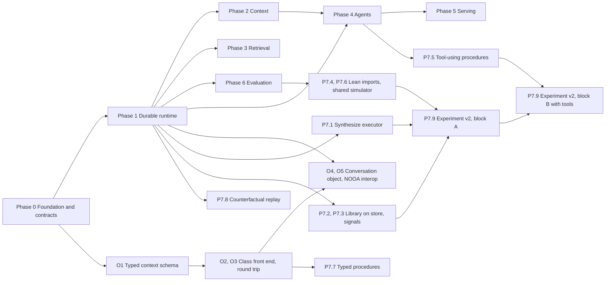

# fsm_llm Roadmap: From Mature Library to State-of-the-Art Framework

| | |
|---|---|
| Document version | 3.0 (v2.1 re-verified against current repositories and standards; changes in Section 14) |
| Date | 2026-11-12 |
| Baseline | fsm_llm `7a0aa42` (v0.12.0, 2026-11-12); txtai `af8f0b0` (master 9.15.0 unreleased, PyPI 9.14.0, 2026-11-11); deepseek-harness `e8f7b93a3` (release 0.2.2-rc.2, 2026-11-11); NVIDIA-NeMo/labs-OO-Agents (NOOA) `fd62a60` (2026-11-11) |
| Method | Clones of all four repositories; every number comes from a command in Appendix A. External standards and prior art are listed in Appendix B |
| Planning basis | Dependency order only. No effort or calendar estimates |

## Contents

1. [Executive summary](#1-executive-summary)
2. [Core contracts](#2-core-contracts)
3. [Baseline: fsm_llm today](#3-baseline-fsm_llm-today)
4. [Reference projects and standards](#4-reference-projects-and-standards)
5. [Target architecture](#5-target-architecture)
6. [Roadmap: Phases 0 to 6 and Workstream O](#6-roadmap-phases-0-to-6-and-workstream-o)
7. [Phase 7: Runtime FSM synthesis, status and remaining work](#7-phase-7-runtime-fsm-synthesis-status-and-remaining-work)
8. [Novelty assessment](#8-novelty-assessment)
9. [Sequencing and dependencies](#9-sequencing-and-dependencies)
10. [Success metrics](#10-success-metrics)
11. [Risks and mitigations](#11-risks-and-mitigations)
12. [Compatibility and release policy](#12-compatibility-and-release-policy)
13. [Out of scope](#13-out-of-scope)
14. [Change log: v2.1 to v3.0](#14-change-log-v21-to-v30)
- [Appendix A: Evidence](#appendix-a-evidence)
- [Appendix B: References](#appendix-b-references)

---

## 1. Executive summary

**Positioning.** fsm_llm is the framework for deterministic, durable, auditable conversational state machines with grounded retrieval. txtai is a retrieval and pipeline platform whose agents run a smolagents loop. deepseek-harness is a durable, plugin-first agent runtime whose control flow is an open model loop or a model-written program. NOOA makes an agent a Python object whose `...` methods an LLM completes, with control flow in ordinary Python. None of the three offers rule-based, statically checkable, replayable dialogue control. That is the moat. Every item below widens it or removes a reason not to adopt the library.

**In one line:** NOOA makes an agent a Python object; fsm_llm makes a conversation a verifiable, durable state machine, which can also be written as a Python object that compiles to one, or be compiled at runtime from a goal.

**State of play.** Runtime FSM synthesis, the v2.1 flagship, shipped in v0.12.0 as `fsm_llm.synthesis` with gates G1 to G7, a content-addressed library, a runner and a repair loop. Its pre-registered benchmark ran three blocks, all INCONCLUSIVE: one model played every role, so the central claim (a frontier model compiles, a small model executes) is still untested. The platform under it (event log, async core, context engineering, serving) is still the v2.1 gap list.

**Nine moves, in order of leverage:**

| # | Move | Where |
|---|---|---|
| 1 | Make it installable and consistent: PyPI, Python 3.11 to 3.15, standard layout, small modules, public test doubles, a versioned schema registry, one reason-code vocabulary | Phase 0 |
| 2 | Make execution durable: an append-only event log as the single source of truth, async core, crash-safe resume, fork, core turn budgets | Phase 1 |
| 3 | Engineer the context window: values by reference, a cache-stable prompt layout, a token meter; compaction only as a logged fallback | Phase 2 |
| 4 | Ground conversations in evidence: txtai retrieval, calibrated evidence and decision confidence as handler-only routing facts | Phase 3 |
| 5 | Make authoring Pythonic without losing verification: typed context schema, FSM classes that compile to the JSON IR | Workstream O |
| 6 | Harden agents: one policy object, a sandbox, code as action as a state kind | Phase 4 |
| 7 | Serve and interoperate on current standards: Open Responses, MCP 2026-07-28 with stateless slot filling, A2A v1.0.1, AG-UI 1.0 | Phase 5 |
| 8 | Prove quality: three-model nightly matrix, one shared simulator, pre-registered benchmarks | Phase 6 |
| 9 | Harden runtime synthesis and run the experiment that can support or falsify it | Phase 7 |

**What changed in v3.0** (full list in Section 14):

- Section 2 is new: ten contracts every phase builds on, so features compose instead of accumulating.
- Phase 7 is rewritten from a build plan into a status report plus remaining work (P7.1 to P7.9).
- Five design defects in v2.1 are fixed: the cache layout, the layering rules, spoofable routing facts, uncalibrated score thresholds, and compaction versus append-only history.
- External targets are updated: MCP 2026-07-28 (stateless, MRTR), A2A v1.0.1, Open Responses, OTel GenAI conventions in their new repository, ATIF v1.8, AG-UI 1.0, Python 3.11 end of life in October 2027.
- All effort and calendar estimates are removed.

---

## 2. Core contracts

Every phase builds on these ten contracts. A feature that needs something outside them extends a contract (with a recorded schema or format version) or is out of scope. Each row names the items that build the contract and the items that consume it.

| ID | Contract | Definition | Built by | Consumed by |
|---|---|---|---|---|
| C1 | FSM definition IR | FSM JSON (`FSMDefinition`) is the one canonical program. JSON files, Python builders, Python classes (Workstream O) and synthesizer output are front ends that compile to it. A schema registry records the version that introduced every field | 0.12, O1 | Verifier, visualizer, engine, synthesis, `oo` |
| C2 | State kinds and executors | A state has exactly one kind, derived from which config it carries: `conversation` (default, Pass 1 and Pass 2), `completion` (exists), `synthesize` (exists), `reply` (new, deterministic template), `codeact` (new). Each kind declares its config model, the handler-only result key it writes, its read and write sets for G3, its liveness rule for G4, its sample values for G6a, and an executor. The executor protocol lives in `core`, so executors at any layer can implement it; the registry lives in `engine` | 0.14, P7.1, O2, 3.4, 4.4 | Engine, verifier, `oo`, synthesis |
| C3 | Context namespaces | Three key classes. Public keys: extractable, typed by `context_schema`. Handler-only keys: written only by executors and handlers, never by extraction (exists as `handler_only_names()`). Internal keys: prefixes `_`, `system_`, `internal_`, `__`, never shown to a model. Every runtime fact that routing reads is a handler-only `<kind>_result` dict with a `status`: `completion` result (exists), `synthesis_result` (exists), `retrieval_result`, `decision_result`, `codeact_result` | 3.4, 3.9, 4.4 | JsonLogic routing, verifier G3 |
| C4 | Event log | Append-only, versioned, one log per conversation tree. Every model-visible input is an event; large payloads are content-addressed blobs; value references point into blobs. Two privacy levels: `shape` (names, types, codes, counts; today's synthesis trace contract) and `values` (opt-in, secrets filtered at write). Sessions, monitor, token meter, OTel, ATIF, usage, synthesis traces and library counters are projections | 1.1 to 1.13 | Everything above `runtime` |
| C5 | LLM interface | One `LLMInterface` with sync methods and async mirrors. Native providers speak Open Responses and Anthropic Messages; litellm is an optional provider. Retry and admission control wrap the interface, not individual providers. Usage is a projection of events, not a counter | 1.5, 1.6, 1.13, 5.4 | Engine, agents, synthesis |
| C6 | Verifier | One module runs G1 (loads), G2 (structure), G3 (data flow), G4 (liveness), G5 (policy) and G6a (dead edges) and returns one `GateReport` type. Used by `fsm-llm-validate`, `API` load, `oo` compile, the synthesizer and repair | 0.4, M2 (shipped) | CLI, engine, `oo`, synthesis |
| C7 | Simulator | One goal- and persona-driven user simulator with a judge model separate from the executor. Used by G6b, evaluation, trace-to-eval, repair admission and benchmarks | 6.6 | Synthesis, eval |
| C8 | Reason codes | One closed vocabulary of statuses (`ok`, `failed`, `aborted`, `running`, `abstained`) and reasons. Synthesis codes keep their wire values; agent stop reasons and approval outcomes map into it. Branch on codes, never on message text | 0.13 | Every `*_result`, `AgentResult`, approval, tools |
| C9 | Policy | One policy object: approval mode (`ask`, `never`, `auto`), tool allowlist, sandbox profile, budgets (`max_steps`, `max_seconds`, tokens). `SynthesisPolicy` (kept by repo decision) is composed into it. Approvers are callables returning a coded outcome; a missing or failing approver fails closed; every request and outcome is an event | 4.1, 4.2 | Agents, engine executors, synthesis |
| C10 | Extension points | Entry-point groups `fsm_llm.providers`, `fsm_llm.stores`, `fsm_llm.state_kinds`, `fsm_llm.tools`, `fsm_llm.handlers`. JSON references handlers and tools by registered name, which keeps G5's "no code in a definition" true and makes a JSON to class to JSON round trip exact | 5.5, O2 | Engine, `oo`, synthesis |

**Rules that follow from the contracts:**

1. Routing reads only public keys and handler-only `<kind>_result` facts. A routing input that extraction can write is a defect (C3).
2. A new state behaviour is a new kind with an executor and verifier hooks, never a branch inside the turn pipeline (C2).
3. A new runtime signal is an event first and a projection second; no subsystem keeps a private counter (C4).
4. A new result type carries a C8 status and reason, not free text.
5. A new definition field is registered with its schema version before it can load (C1).

---

## 3. Baseline: fsm_llm today

### 3.1 Architecture snapshot

| Layer | What exists |
|---|---|
| Core turn | Two passes per user message. Pass 1 extracts data; JsonLogic rules pick the transition in plain Python (lowest `priority` wins; the LLM is asked only when two or more rules tie at that priority; no passing rule means the conversation stays put). Pass 2 writes the reply from the resulting state. `required_context_keys` guides extraction but never blocks a transition. The prompt shows the last `max_history_size` messages (default 5) |
| State kinds | A state is a conversation state, a `completion` state (one `complete` call with tools or a response format, result in a handler-only key, skip-if-set) or a `synthesize` state (left BLOCKED by core; driven by `fsm_llm.synthesis.ProcedureRunner`) |
| Verification | `FSMValidator` (structure) and `flow_analysis.py` (G3 data flow, G4 liveness) in core; `handler_only_names()` shared by the pipeline and the analysis |
| Composition | `API.push_fsm` / `API.pop_fsm` with context passing and merge strategies; `DEFAULT_MAX_STACK_DEPTH = 10` |
| State | `SessionStore` ABC with `FileSessionStore` (snapshots); context compaction by key (`ContextCompactor`) |
| Subpackages | `reasoning`; `workflows` (async, in memory, Python DSL, no JSON loader); `agents` (18 patterns plus `AgentGraph`, tools, HITL, MCP client, A2A, meta-builder, Agent Skills); `monitor` (FastAPI dashboard, OTel exporter); `eval`; `synthesis` (new in v0.12) |
| Knowledge | OKF bundles (`okf.py`), `okf_bridge`; `SemanticMemoryStore` |
| CLIs | 8 entry points: `fsm-llm`, `-visualize`, `-validate`, `-monitor`, `-meta`, `-eval`, `-okf`, `-skills` |
| Core dependencies | loguru, litellm (`>=1.83.0,<2.0`, pinned 1.102.1), pydantic, python-dotenv, tenacity (declared because litellm's sync retries import it), pyyaml |
| Engineering practice | Naming conventions for new code in `AGENTS.md`; `# DECISION` anchors resolved through an append-only manifest (`plans/ANCHORS.md`); benchmarks pre-registered with sha256 pins of the source they ran against (`scripts/bench_data/`) |

### 3.2 Size and shape

| Metric | Value |
|---|---|
| `src/` Python lines | 78,327 (v2.1: 71,496) |
| Comment lines in `src/` | 10,096 (12.9%) |
| Triple-quoted string lines in `src/` | 15,681 (20.0%; includes prompt templates) |
| In-code `# DECISION` anchors | 756 (750 `DECISION plan`) |
| Tests | 13,777 (core 5,998; agents 3,194; synthesis 2,037), 158,781 lines |
| Audit-named test files | 14 files, 18,055 lines; largest `test_audit_2026_09_21.py` (4,305) |
| Examples | 22,134 lines in 8 categories |
| Largest modules | `pipeline.py` 3,180; `definitions.py` 2,882; `llm.py` 2,672; `agents/fsm_definitions.py` 2,492; `api.py` 2,311; `monitor/instance_manager.py` 1,972; `security.py` 1,933; `agents/base.py` 1,840 |
| `fsm_llm.synthesis` | 5,881 lines in 16 modules |
| `CHANGELOG.md` | 4,021 lines |

### 3.3 Strengths to preserve

- **Deterministic control.** Rules decide transitions; the model extracts and talks. This must survive every refactor.
- **Verification in core.** G3 and G4 already run over any `FSMDefinition`, not only generated ones.
- **One LLM layer.** Core, reasoning, workflows, agents and synthesis all call models through `LLMInterface`.
- **Security posture.** Internal key prefixes and secret-looking values stay out of prompts; approval grants cannot be forged by the model; handler-only keys cannot be written by extraction; OKF, skill and generated text carry untrusted labels; `constraints.txt` excludes the compromised litellm 1.82.7 and 1.82.8.
- **Evaluation honesty.** Pre-registered blocks pinned to source hashes, Wilson intervals, inconclusive verdicts reported as such.
- **Offline test depth.** 13,777 tests run without a model.

### 3.4 Gaps

| Area | Finding | Evidence | Addressed by |
|---|---|---|---|
| Concurrency | 0 `async def` in `api.py`, `fsm.py`, `pipeline.py`, `llm.py`, `agents/base.py` | grep, Appendix A | 1.5 |
| Durability | Sessions are snapshots; a completion state's transcript is an internal key that session files do not carry; workflows live in memory; the synthesis library is last-writer-wins across processes | `src/session.py`; `definitions.py` (`CompletionStateConfig`); `docs/synthesis.md` | 1.1, 1.2, P7.2 |
| Turn bounds | Core has no per-conversation turn bound; the synthesis runner counts child steps itself | `docs/synthesis.md` | 1.7 |
| Context | Observations capped at 2,000 characters; a 50 KB skill takes 37 `skill_load` pages; the 5-message sliding history window changes the prompt prefix on every turn once full, which defeats provider prompt caching | `agents/constants.py:614`; `docs/api_reference.md:865`; `api.py:617` | 2.2, 2.4 |
| Retrieval | `SemanticMemoryStore` is a JSON file searched by linear cosine scan; OKF search and links are lexical | `agents/semantic_memory.py`; `okf.py` | Phase 3 |
| Schema versioning | The `synthesize` state field shipped while the default definition version stayed `"4.1"`; nothing records which version introduced which field | `definitions.py:1976` | 0.12 |
| State kinds | Conversation and completion states run inside the pipeline; synthesize states need a second driver (`ProcedureRunner`) with its own `end_conversation`; a bare `API.converse` leaves them BLOCKED | `SynthesizeConfig` docstring | P7.1 |
| Interop | MCP client over stdio or legacy SSE only; `mcp>=1.0.0` declared while `constraints.txt` pins 2.2.0 and PyPI is at 2.3.0; A2A is a custom httpx client; no MCP server, no OpenAI-compatible or Open Responses endpoint; no entry-point plugins | `agents/mcp.py:126-143`; `pyproject.toml`; `constraints.txt:53` | 0.10, Phase 5 |
| Distribution | `requires-python >= 3.10`, classifiers 3.10 to 3.12; CI on `ubuntu-latest` only; installed from a clone because `fsm-llm` on PyPI belongs to another project; `constraints.txt` records that litellm 1.100.1 and 1.100.2 fail to import on 3.10 | `pyproject.toml`; `.github/workflows/python-package.yml`; `constraints.txt` | 0.1, 0.2 |
| Layout | `package-dir = {"fsm_llm" = "src"}` with a hand-kept list of 7 packages; mypy needs a symlink workaround; `src/logging.py` shadows the stdlib when `src/` is on `sys.path` | `pyproject.toml` | 0.3 |
| Defaults | `DEFAULT_LLM_MODEL = "ollama_chat/bonsai-2:27b"` (26.9B at Q2_0); litellm loads `.env` at import | `constants.py:51` | 0.8 |
| Usage accounting | The synthesis runner detects provider outages from `usage().errors`; a host that calls `reset_usage()` mid-run, or an interface without a meter, turns an outage into `budget_spent`, which diagnosis reads as a procedure fault | `docs/synthesis.md` (Known limits) | 1.13 |
| Missing signals | Core records neither out-of-scope intents nor raw malformed extractions, so synthesis diagnosis cannot use them | `docs/synthesis.md` | 1.1, P7.3 |
| Imports | `import fsm_llm.synthesis` loads `agents`, `reasoning` and `eval` | `docs/synthesis.md` | Section 5.2, P7.4 |
| Evaluation | Examples runs used `qwen3.5:4b` (001 to 009) and `bonsai-2:27b` (010); the synthesis bench used `bonsai-2:27b` for every role; no hosted model in any run log | `EVALUATE.md`; `docs/synthesis.md` | 6.1, P7.9 |
| Test utilities | `MockLLM2Interface` and `PromptGroundedLLM` live in `tests/conftest.py` | `tests/conftest.py:122,199` | 0.9 |
| Typing | Field extraction types are `str`, `int`, `float`, `bool`, `list`, `dict`, `any` (`FieldType`), with a narrower `TypedFieldType` for builders; no `Literal`, enums or nested models | `definitions.py:99,577` | O1 |
| Open items (repo list) | No failure routing in `AgentGraph`; Orchestrator subtasks dropped over `max_workers` do not affect `success`; several truncation cases unflagged; no real HITL for REWOO, PlanExecute, ParallelReact, native_fc; MCP v2; A2A v1.0 | `README.md:595` | 4.1, 4.5, 5.3, 5.6 |

---

## 4. Reference projects and standards

### 4.1 txtai

Master `af8f0b0` declares 9.15.0, which is unreleased; the latest PyPI release is 9.14.0 (2026-10-06). 34,167 `src` lines, Python 3.11 or later. An embeddings database with pipelines, workflows, agents and an API, configured from one YAML file, with heavy dependencies behind extras. Since the v2.1 baseline: bug fixes, plus a check that an ANN backend supports upserts and deletes before data changes.

| Feature | Where in txtai | Decision | Item |
|---|---|---|---|
| Embeddings database: dense, sparse and hybrid scoring, SQL over results, graph | `embeddings/`, `database/`, `scoring/`, `graph/` | Integrate as an optional backend; do not reimplement | 3.1 to 3.3 |
| 12 dense ANN backends (annoy, faiss, ggml, hnsw, milvus, numpy, pgvector, rabitq, sqlite, torch, turbovec, zvec) and 4 sparse (ivfsparse, milvus, pg, zvec) | `ann/dense`, `ann/sparse` | Inherit through the integration | 3.1 |
| Backend capability check (upsert, delete) before any write | `ann/base.py`, `embeddings/base.py` | Make capabilities part of the `VectorStore` protocol | 3.2 |
| Calibrated scores: Bayesian (BB25) sparse normalization to [0, 1]; hybrid fusion in log-odds space with per-query dense calibration | `scoring/sparse.py`, `scoring/normalize.py`, `embeddings/search/hybrid.py` | Evidence thresholds apply only to calibrated scores | 3.5 |
| Late interaction and MUVERA pooling | `models/pooling/` | Inherit through the integration | 3.1 |
| RAG pipeline (similarity plus LLM, minimum score, context limits) | `pipeline/llm/rag.py` | Adopt the pattern as the retrieval attribute | 3.4 |
| Textractor, segmentation, reranker | `pipeline/data`, `pipeline/text` | Adopt for ingestion and reranking | 3.6, 3.7 |
| Agent on smolagents (`CodeAgent`, `ToolCallingAgent`); tools bash, edit, glob, grep, read, write, todo, skill, embeddings; `agents.md` and `skill.md` instruction files | `agent/` | Adopt the toolset and instruction loading, not the loop | 2.7, 4.3 |
| YAML `Application`; FastAPI with an OpenAI-compatible router; MCP exposure through `fastapi_mcp` | `app/`, `api/` | Adopt the single-file app; build MCP on the official SDK instead of `fastapi_mcp` | 5.1 to 5.3 |
| Workflow tasks with cron scheduling | `workflow/` | Adopt scheduling only | 5.7 |
| LLM backends: Hugging Face, llama.cpp, LiteLLM, LiteRT, OpenCode | `pipeline/llm/` | Skip; providers follow 5.4 | none |
| Audio, image, translation, training, ONNX export, cloud index sync | various | Skip | none |

**Lesson to copy:** one configuration file builds the whole application, every heavy capability is an extra that fails with a clear install hint, and scores that drive decisions are calibrated.

### 4.2 deepseek-harness

TypeScript monorepo of 383 packages (379 at the v2.1 baseline) plus a Python SDK; release line 0.2.2-rc.2. A plugin-first agent runtime (Cordis microkernel) with durable sessions, subagents, sandboxing and several clients. Since the v2.1 baseline (857 commits): PTC bootstrap protocol 3 with a persistent `scoped-repl` program format as the default for persistent execution; runtime-context reminders that append to the transcript instead of rewriting the request prefix; coded approval denials; read-only tools declared concurrency-safe; batch `Session.append`; session-scoped writable directories in the sandbox; an upgrade guide for every breaking change.

| Feature | Where in the harness | Decision | Item |
|---|---|---|---|
| Append-only session log; "model-visible means logged" | `docs/architecture.md`, `packages/session/*` | Adopt as C4 | 1.1 |
| Session format with adjacent migrations; JSONL persistence; projections; SQLite query; single and batch append | `packages/session/*`, `packages/session-query` | Adopt | 1.1, 1.2 |
| Checkpoint policy | `packages/session/session-checkpoint-policy` | Adopt | 1.3 |
| Retry with logged policy; explicit turn cancellation | `packages/llm/llm-retry` | Adopt | 1.5, 1.6 |
| OTel session telemetry | `packages/session/session-telemetry-otel` | Adopt over the event log | 1.10 |
| Replay and mock testing; "verify the world, not the self-report" | `packages/test-support/*`, `docs/testing.md` | Adopt | 0.9, 1.9, 6.2 |
| Token meter | `packages/llm/token-meter` | Adopt | 2.1 |
| Runtime-context records appended as reminders, so the existing request prefix is never rewritten | `docs/upgrade-guide/v0.2.2-rc.1/runtime-context-reminders` | Adopt for state changes, stack frames and compaction epochs | 2.4 |
| Compaction: basic, tool-result pruner | `packages/compaction/*` | Adopt as the fallback | 2.5 |
| Spill store with policy | `packages/spill/*` | Adopt as the storage side of value references | 2.2 |
| Repeat-tool reminder (3, 5, 8), timeout policy | `packages/guard/*` | Adopt | 2.6 |
| System prompt sections; agent instruction chain | `packages/core/system-prompt`, `packages/context` | Adopt | 2.3, 2.7 |
| User approval (`ask`, `never`), permission presets, auto-review, coded denials | `packages/interaction/*`, `packages/experimental/auto-review` | Adopt in C9 with C8 codes | 4.1 |
| Sandbox seam: local, policy, Windows ACL, session-scoped writable directories; SSH | `packages/sandbox/*`, `packages/ssh` | Adopt the seam | 4.2 |
| Read-only tools declared concurrency-safe | `packages/core/tools` | Adopt as a tool annotation the executor uses to parallelize | 4.3 |
| Programmatic tool calling: SDK generated from the scoped registry, per-program call limit; protocol 3 adds environment initializers, a hash-pinned bootstrap and the persistent `scoped-repl` format | `packages/core/tool-executor-ptc`, `packages/ptc-runtime/*` | Adopt one runtime with two program formats | 4.4 |
| Model-written workflow scripts | `packages/workflow` | Already superseded by FSM synthesis | Phase 7 |
| Subagents, team, goal, plan mode, todo, jobs, schedule | `packages/subagent`, `team`, `goal`, `plan`, `todo`, `jobs`, `schedule` | Adopt a subset | 4.5, 4.6 |
| Skill registry | `packages/skill` | Adopt | 4.7 |
| Upgrade guide per breaking change, with migration steps | `docs/upgrade-guide/<version>/<change>/guide.md` | Adopt | Section 12 |
| MCP manager, ACP server, SDK over JSON-RPC | `packages/mcp`, `acp`, `sdk` | Partial | 5.3 |
| Cordis microkernel, web, desktop, terminal and forge clients, browser use, computer use, LSP, voice | various | Skip; take only entry-point plugins | 5.5 |

**Lesson to copy:** durability and auditability are architectural rules enforced everywhere, and every breaking change ships with a migration guide.

### 4.3 NVIDIA Object-Oriented Agents (NOOA)

Unchanged since v2.1 at `fd62a60`. Paper arXiv:2607.20709 (22 July 2026); repository alpha, Apache-2.0, `requires-python >=3.12,<3.14`, no native Windows; 100,721 `src` lines plus 52,146 in sub-packages (cli, atom, memory, bench, acp). An agent is a Python class: methods are actions, fields are state, docstrings are prompts, type annotations are contracts. A method whose body is `...` is completed by an LLM loop. NVIDIA reports, from its own comparisons, 82.2% on SWE-bench Verified with GPT-5.5 at about 1.1M tokens and 29 calls per task, against 2.2M tokens and 66 calls for comparison harnesses reaching 78.2%, with median sessions peaking at 22k to 72k prompt tokens and no compaction. NOOA has no conversation state machine and no static verification of control flow.

| Feature | Where in NOOA | Decision | Item |
|---|---|---|---|
| `...` body delegates a method to an LLM; docstrings are prompts | `metaclass.py`, `ellipsis_detection.py` | Adopt as an authoring surface compiling to C1 | O2 |
| Type annotations as contracts, validated with retry | `strategies/`, `strategy_validation.py` | Adopt as `context_schema` | O1 |
| Pass by reference with bounded previews (2,000 characters per string, 25 items per container, depth 4) | `runtime/`, `docs/concepts/prompts-and-context.md` | Adopt as value references over C4 blobs | 2.2 |
| Context blocks with a cache-stable prefix; append-only history | `context_blocks/` | Adopt in the prompt layout | 2.3, 2.4 |
| CodeAct REPL with persistent locals and typed `return_result` | `strategies/codeact.py`, `codeact_v2.py` | Adopt as the `codeact` state kind, sandboxed only | 4.4 |
| Decision models: probabilities, thresholds, abstain | `decisions/` | Adopt as `decision_result` | 3.9 |
| Events distinct from context; model-callable history queries | `runtime/event_manager.py`, `event_query.py` | Adopt read-only history queries over C4 | 1.1 |
| ATIF v1.7 trajectory export | `atif/` | Adopt, but target v1.8 (Harbor's current default) | 1.12 |
| LLM admission control | `unifiedllm/broker_admission.py` | Adopt | 1.6 |
| Capability tests per model | Paper, Section 4 | Adopt | 6.7 |
| MemoryManager: recall by recency and importance, consolidation | `packages/nooa-memory` | Borrow scoring and consolidation | 3.2 |
| Evidence gate: the model judges, deterministic code verifies | `docs/concepts/orchestration.md` | Already the synthesizer's shape | Phase 7 |
| Containment by OS-level isolation (container, VM, NVIDIA OpenShell); AST checks only as defense in depth | `README.md`, `docs/concepts/safety.md` | Adopt; OpenShell as an optional sandbox backend | 4.2 |
| Python methods as the routing layer | Core programming model | Reject: loses static verification, synthesis and diagrams | Section 13 |
| Durability through explicit snapshots | `storage/manager.py` | Keep C4 instead | Phase 1 |

**Lesson to copy:** token savings come from keeping large values out of the prompt and keeping the transcript append-only and cache-valid.

### 4.4 External standards

| Standard | State on 2026-11-12 | Decision | Item |
|---|---|---|---|
| Python | 3.15.0 released 2026-10-09; 3.10 reached end of life on 2026-10-01 (3.10.22 final); 3.11 receives security fixes until October 2027 | Support 3.11 to 3.15 now; drop 3.11 at its end of life, which also aligns with NOOA's 3.12 floor | 0.2 |
| MCP | Specification 2026-07-28: stateless core (no `initialize`, no `Mcp-Session-Id`), state carried by explicit handles that tools mint; Multi Round-Trip Requests (`resultType: "input_required"`, client retries with `inputResponses`) replace server-initiated elicitation, sampling and roots; `Mcp-Method` and `Mcp-Name` headers; cacheable list results with deterministic order; Tasks as an extension; Roots, Sampling, Logging and the legacy HTTP+SSE transport deprecated with a twelve-month minimum window. Python SDK `mcp` 2.3.0 | Target 2026-07-28 for client and server; conversations are handles; slot filling uses MRTR; drop SSE before the window closes | 5.3 |
| A2A | v1.0 shipped 2026-03-12, v1.0.1 current; parts are identified by their field (no `kind`); agent cards list `supportedInterfaces`; `a2a-sdk` 1.3.0 | Move from the custom httpx client to `a2a-sdk` | 5.6 |
| Open Responses | Open specification derived from the OpenAI Responses API (January 2026), stewarded by the Agentic AI Foundation, implemented by OpenAI, Ollama, vLLM, OpenRouter, LM Studio, Hugging Face and Vercel, with a compliance suite | Native client provider and stateful server endpoint | 5.2, 5.4 |
| Anthropic Messages | Separate dialect, not covered by Open Responses | Native client provider | 5.4 |
| OTel GenAI semantic conventions | Every `gen_ai.*` attribute, span and metric at Development status; moved to `open-telemetry/semantic-conventions-genai` with core v1.42.0 (2026-06-12); no tagged release | Pin a commit; generate spans from events so a rename is a projection change | 1.10 |
| ATIF | Harbor's current default is v1.8 (adds audio content); NOOA exports v1.7; Harbor requires Python 3.12 or later | Export v1.8; validate on a 3.12+ CI leg | 1.12 |
| AG-UI | `ag-ui-protocol` 1.0.0 (2026-09-17) | Target 1.0 | 5.8 |
| PyPI names | `fsm-llm` belongs to another project (last release 2024-12-10); `llm-fsm` (0.1.1, 2025-05-19) is published by Nikolas Markou with the project's description, and `CHANGELOG.md` records the rename from `llm-fsm` | Publish as `llm-fsm` after confirming ownership, or file a PEP 541 request for `fsm-llm` | 0.1 |
| litellm | Latest 1.109.1; repository pin 1.102.1 | Refresh through the 0.10 process; optional after 5.4 | 0.10, 5.4 |

### 4.5 Principles

1. **Model-visible means logged.** Every input the model sees is an event; every prompt can be rebuilt from the log.
2. **Fail closed.** Missing approver, unknown tool outcome, unresolved prompt variable, unverified generated FSM: stop and report a code; never guess.
3. **Verify the world, not the self-report.** Tests and evals check end state (FSM state, extracted context, side effects).
4. **Integrate, do not reimplement.** Retrieval comes from txtai; protocols come from their official SDKs; fsm_llm owns control flow.
5. **Optional heavy dependencies.** Core installs with pydantic, loguru and pyyaml; providers, retrieval, serving and telemetry are extras.
6. **Model proposes, Python disposes.** Every model-produced value (extraction, decision, generated FSM, code result) is typed and checked by deterministic code before it takes effect.
7. **Pass by reference, keep prefixes stable.** Large values stay out of prompts; prompts only grow at the end.
8. **One canonical IR.** FSM JSON is the single input to verification, visualization, execution and synthesis.
9. **One contract per concept.** One simulator, one verifier, one reason vocabulary, one policy object, one event log (Section 2).
10. **Shape by default, values by opt-in.** Shared stores keep names, types, codes and counts; values need an explicit setting.

---

## 5. Target architecture

### 5.1 Package layout

```text
src/fsm_llm/
├── __init__.py          # public API re-exports; unchanged import paths
├── core/                # pure: definitions and schema registry (C1), JsonLogic, transition evaluation,
│                        #   executor protocol (C2), flow analysis and verifier G1 to G6a (C6), reason codes (C8)
├── llm/                 # LLMInterface sync and async (C5), providers/ (open_responses, anthropic, litellm),
│                        #   parsing, model catalog, token meter
├── runtime/             # event log and blobs (C4), projections, stores, checkpoint, retry, admission,
│                        #   cancellation, fork, usage, exporters (otel, atif)
├── context/             # value references and previews, prompt layout (prefix, history, suffix),
│                        #   runtime-context records, compaction fallback, instruction loading
├── retrieval/           # VectorStore protocol, memory, txtai backend, retrieval executor, rerank
├── okf/                 # bundles, bridge, ingest
├── skills/              # layered skill registry
├── tools/               # ToolRegistry, ToolDefinition, MCP client adapters (moved down from agents)
├── policy/              # Policy (C9), approval, sandbox seam and backends
├── engine/              # turn pipeline (Pass 1, Pass 2), state-kind registry and executors (C2),
│                        #   stack, handlers, API facade
├── simulation/          # user simulator and judge (C7)
├── oo/                  # Python class front end
├── agents/              # patterns (incl. codeact executor), a2a, meta-builder
├── synthesis/           # synthesizer, library, synthesize executor, traces, repair
├── workflows/           # engine, persisted instances, schedules
├── reasoning/
├── serve/               # app.yml loader, Open Responses and Chat Completions routers, MCP server, AG-UI
├── monitor/             # dashboard reading the event log
├── eval/                # live matrix, benchmark runner, capability tests
├── testing/             # public fakes, replay fixtures, simulator helpers
└── security.py
```

### 5.2 Layering rules

Enforced in CI with an import-linter contract. Peers in one layer do not import each other; shared code moves down a layer.

| Layer | Packages | May import |
|---|---|---|
| L0 | `core` | `security` |
| L1 | `llm` | L0 |
| L2 | `runtime` | L0, L1 |
| L3 | `context`, `retrieval`, `okf`, `skills`, `tools`, `policy` | L0 to L2 |
| L4 | `engine` | L0 to L3 |
| L5 | `simulation`, `oo` | L0 to L4 |
| L6 | `agents`, `synthesis`, `workflows`, `reasoning` | L0 to L5 |
| L7 | `serve`, `monitor`, `eval` | L0 to L6 |
| none | `testing` | everything; never imported by the library |

Consequences: the turn pipeline leaves `core`, which becomes pure and dependency-free (v2.1 let `core` import only `security` while it held a pipeline that calls models and emits events). `synthesis` stops importing `agents`, `reasoning` and `eval`, because `ToolRegistry`, approval and the simulator move to L3 and L5.

### 5.3 Turn lifecycle after Phases 1 and 2

```text
user message
  → event turn/start
  → engine resolves the state kind and its executor (C2)
  → conversation kind:
      Pass 1: llm/request → llm/response → extraction (or extraction/miss, intent/out_of_scope)
      transition evaluation (rules evaluated, winner, tie-break with decision_result if any)
      handlers and tool calls (checkpoint before side effects)
      large results stored as blobs; prompts see bounded previews (C4)
      Pass 2: llm/request → llm/response
    other kinds: executor/start → executor events → executor/result (<kind>_result written, handler-only)
  → event turn/end
projections: session view, monitor, token meter, usage, OTel, ATIF, eval traces, synthesis traces
```

### 5.4 Prompt layout

Pass 1 and Pass 2 share the prefix. Within a conversation the prefix never changes and the history only grows; everything that changes per turn sits after the history.

| Segment | Content | Changes when |
|---|---|---|
| Prefix | Root persona, policy text, tool schemas (union across states, sorted deterministically; per-state availability enforced by the executor, not by editing the list) | Never within a conversation |
| History | User and assistant turns; runtime-context records for transitions, stack push and pop, and compaction epochs | Appended only |
| Suffix | Pass task (extract fields or write the reply), current state instructions, a pushed child FSM's persona, current context, value previews | Every request |

A sliding history window (today's `max_history_size`) is replaced by epochs: history grows until the token meter crosses a threshold, then one compaction starts a new epoch (2.5).

---

## 6. Roadmap: Phases 0 to 6 and Workstream O

Every item uses the same shape: what changes, where it lands, which contract (Section 2) it builds on or extends, and a test that proves it is done. Item numbers are sequential within a phase; Section 14.4 maps v2.1 numbers to v3.0 numbers.

### Phase 0: Foundation, distribution and contracts

**Goal:** anyone can `pip install` the library, the codebase is cheap to change, and the contracts that later phases extend exist.

| # | Change | Where | Builds on | Done when |
|---|---|---|---|---|
| 0.1 | Publish to PyPI as `llm-fsm` (published by the author under the project's former name) after confirming account ownership; otherwise file a PEP 541 request for `fsm-llm`. The import name stays `fsm_llm`. Release on tag with trusted publishing, PEP 740 attestations and a CycloneDX SBOM | `pyproject.toml`, `.github/workflows/release.yml` | none | `pip install llm-fsm` works on Linux, macOS and Windows; the README no longer says "install from a clone" |
| 0.2 | Support Python 3.11 to 3.15. Linux runs all five; macOS and Windows run 3.11 and 3.15. 3.11 is dropped at its end of life (October 2027) | `pyproject.toml`, CI matrix | none | 9 green CI legs; classifiers match `requires-python` |
| 0.3 | Standard `src/fsm_llm/` layout with `packages.find`; delete `scripts/type_check.py`; remove the `logging` shadowing risk | repository root | none | `mypy -p fsm_llm` runs without symlinks; a wheel-content test passes |
| 0.4 | Split into the Section 5 layout. `pipeline.py` → `engine/turn/{pass1,pass2,transitions,stack}`; `api.py` → `engine/api/{conversation,stack,sessions,run}`; `definitions.py` → `core/definitions/{state,transition,fsm,kinds,errors,results}`; `llm.py` → `llm/{interface,providers/litellm,parsing,usage}`; `prompts.py` → `context/layout/*`; `agents/fsm_definitions.py` → one module per pattern; `validator.py` and `flow_analysis.py` → `core/verify/`; `ToolRegistry` → `tools/`; HITL → `policy/` | `src/` | Section 5 | No module over 800 lines; public API snapshot (0.11) unchanged; the import-linter contract of Section 5.2 is green |
| 0.5 | Decision records: generate `docs/decisions/index.md` from `plans/ANCHORS.md` and the in-code anchors; CI fails on an anchor that does not resolve. `CHANGELOG.md` in Keep a Changelog form; every `**BREAKING:**` entry links an upgrade guide (Section 12) | `docs/decisions/`, `CHANGELOG.md`, CI | existing anchor manifest | 100% of anchors resolve; comment share reported by CI, not gated |
| 0.6 | Fold the 14 audit-named test files (18,055 lines) into suites named after features; add a branch-coverage gate with a ratchet | `tests/`, CI | none | No dated test files; coverage enforced and never decreasing |
| 0.7 | Documentation site: mkdocs-material with mkdocstrings, versioned per release; README trimmed to install, quickstart and links | `docs/`, `mkdocs.yml` | none | Hosted docs build on every tag |
| 0.8 | Safe defaults: no silent default model (a clear error listing how to set one, or a small default); set `LITELLM_MODE=PRODUCTION` before litellm is imported and load `.env` only on explicit opt-in | `constants.py`, `llm/`, CLI | none | A fresh install gives a clear message, never a silent 27B download; a stale `.env` cannot override an explicit setting |
| 0.9 | Public `fsm_llm.testing`: promote `MockLLM2Interface` and `PromptGroundedLLM`; add a scripted LLM (the pattern in `synthesis/README.md`), a scripted user, and assertions `assert_state`, `assert_context`, `assert_path`, `assert_result(kind, status, reason)` | `testing/` | C8 | Examples' tests and user projects use the public module |
| 0.10 | Supply chain: `pip-audit` or osv-scanner, dependency review, Actions pinned by SHA, the existing `.pth` audit. Declared ranges match tested pins (`mcp>=2.2,<3`, not `>=1.0.0`). A scheduled job proposes litellm and mcp pin refreshes, gated by the full suite | CI, `pyproject.toml`, `constraints.txt` | none | A known-vulnerable dependency fails the build; no declared range admits an untested major version |
| 0.11 | Public API snapshot: generated list of public symbols and signatures, diffed in CI | CI, `docs/api.txt` | none | An accidental API break fails the build |
| 0.12 | Schema registry (C1): every `FSMDefinition` field records the schema version that introduced it. `synthesize` is registered as 4.2 and the default version becomes `"4.2"`. A definition that declares an older version but uses a newer field loads with a warning naming the field; `fsm-llm-validate --upgrade` rewrites the version | `core/definitions/schema.py` | C1 | A test fails on any field missing from the registry |
| 0.13 | Reason codes (C8): `core/codes.py` holds statuses and reasons as `str, Enum` per the repo naming rules, with values equal to the existing synthesis wire strings; `AgentResult.stop_reason`, approval outcomes and completion results map into it | `core/codes.py` | C8 | Every result type references the vocabulary; a test refuses unknown codes |
| 0.14 | State-kind registry (C2): the engine dispatches each state to the executor of its kind; `State.kind` is derived from the config the state carries, so the JSON shape does not change. `conversation` and `completion` are the first registered kinds; each kind supplies its verifier hooks | `engine/kinds/`, `core/verify/` | C2, C6 | The turn pipeline has no kind-specific branch outside executors; G3, G4 and G6a read kind hooks |

**Exit criteria:** installable from PyPI on three operating systems and five Python versions; no module over 800 lines; the layering contract, schema registry, reason codes and kind registry are in use; coverage gate active.

### Phase 1: Durable, async runtime

**Goal:** every turn is an append-only sequence of events; sessions, monitor, metrics, usage, traces and evals are projections of it (C4).

Example event:

```json
{"v": 1, "seq": 57, "ts": "2026-11-11T10:42:03.112Z", "conversation_id": "c_8f2", "frame": 1,
 "type": "llm/request", "pass": 1, "state": "collect_email", "model": "provider/model",
 "layout": {"prefix": "sha256:...", "history": "sha256:...", "suffix": "sha256:..."},
 "prompt_ref": "blob:sha256:..."}
```

| # | Change | Where | Builds on | Done when |
|---|---|---|---|---|
| 1.1 | Append-only event log. Types: `turn/start`, `llm/request`, `llm/response`, `provider/error`, `extraction`, `extraction/miss`, `intent/out_of_scope`, `transition`, `decision`, `handler`, `tool/call`, `tool/result`, `approval/request`, `approval/outcome`, `executor/start`, `executor/result`, `stack/push`, `stack/pop`, `context/record`, `compaction/epoch`, `turn/end`. Large payloads are content-addressed blobs that also back value references (2.2). Single and batch append. A read-only history query API for handlers and agents | `runtime/events.py`; `engine/` emits | C4 | Any past prompt is rebuilt byte-identical from the log |
| 1.2 | Session persistence as projections: JSONL (optional zstd) and SQLite; versioned format with adjacent migrations; a reader for old `FileSessionStore` snapshots; completion transcripts included | `runtime/stores/` | 1.1 | A v1 to v2 migration test passes; old snapshots load; a completion state restored mid tool exchange continues |
| 1.3 | Checkpoint policy: durable write before every LLM call and every side-effecting tool call; a tool in flight during a crash recovers as `unknown` and is never retried automatically | `runtime/checkpoint.py` | 1.1 | `kill -9` mid-turn, restart, the conversation resumes with consistent history |
| 1.4 | `API.fork(conversation_id, at_turn)` and `API.resume(conversation_id)`; `fork` and `resume` added to the verb list in the `AGENTS.md` naming conventions; time-travel view in the monitor | `engine/api`, `monitor/` | 1.1, 1.2 | A fork reproduces history up to the chosen turn |
| 1.5 | Async-first core. Async mirrors keep the sync names: `LLMInterface.acomplete` and the other interface methods, `API.aconverse`, `API.aadvance`, `API.aconverse_stream`, `API.aadvance_stream`, `API.arun_until_terminal`, `API.arun_until_terminal_stream`, `Agent.arun`, `FSMSynthesizer.aobtain`. Sync methods become wrappers. Per-turn cancellation token. A per-conversation lock replaces the documented "one thread per conversation" caller duty | `llm/`, `engine/api`, `agents/`, `synthesis/` | C5 | FastAPI serving without thread pools; concurrent calls on one conversation serialize; cancellation leaves a consistent log |
| 1.6 | Retry policy per provider, each attempt logged before backoff; admission control with shared pacing and overload cooldown across coroutines and processes | `runtime/retry.py`, `runtime/admission.py` | C5 | Retries and throttling visible in the log; a load test against a rate-limited mock stays within limits |
| 1.7 | Core turn budgets: `max_steps` and `max_seconds` per conversation and per stack frame, enforced by the engine and reported as `budget_spent` (C8). The synthesis runner's own child-step counter is deleted | `engine/` | C8, C9 | A pushed frame over budget aborts through one path for any FSM, generated or not |
| 1.8 | Persist workflow instances on the log; a declarative step subset with a JSON loader for steps that hold no Python function | `workflows/` | 1.1 | A restarted process resumes a waiting workflow |
| 1.9 | Record and replay: fixtures keyed by a canonical request hash over the prompt layout segments (timestamps and ids excluded); replay fails on any unmatched request. Valid for refactors with unchanged definitions; definition changes need the simulator (6.6) | `testing/replay.py` | 1.1, 2.3 | The replay suite runs keyless in default CI |
| 1.10 | OpenTelemetry spans generated from events, using the GenAI conventions pinned to a commit of `semantic-conventions-genai`; W3C trace context propagated into MCP `_meta` and A2A calls; the monitor reads the log instead of its own collector | `runtime/exporters/otel.py`, `monitor/` | 1.1 | One trace per turn with LLM spans and token counts; a call into an MCP server joins the trace |
| 1.11 | Log privacy levels: `shape` (default for shared stores: names, types, codes, counts) and `values` (opt-in); secret filters at write time; user-defined redaction; retention settings | `runtime/events.py`, `security.py` | C4 | Secret-looking values never reach disk; a `shape` log holds no user text or reply (test) |
| 1.12 | ATIF v1.8 trajectory export generated from events | `runtime/exporters/atif.py` | 1.1 | Exports validate with Harbor's trajectory validator on a Python 3.12+ CI leg |
| 1.13 | Usage as a projection: tokens, calls, cost and errors derive from `llm/response` and `provider/error` events; `usage()` reads the projection and `reset_usage()` moves a marker without dropping events | `runtime/usage.py`, `llm/` | C4, C5 | An outage during a synthesis run is reported as `provider_error`, even after `reset_usage()` or on an interface without its own meter |

**Exit criteria:** crash-safe resume, fork, keyless replay in CI, usage and outages from events.

### Phase 2: Context engineering

**Goal:** the library knows what fills the context window, keeps large values out of it, and keeps prompts cache-valid so compaction is rare. Prevention (2.2 to 2.4) comes before cure (2.5).

| # | Change | Where | Builds on | Done when |
|---|---|---|---|---|
| 2.1 | Token meter computed from events: pressure per layout segment and section; model catalog with context window, output limit, pricing (including cached input), reasoning-effort support | `llm/token_meter.py`, `llm/catalog.py` | C4 | `api.measure(conversation_id)` returns a deterministic breakdown |
| 2.2 | Value references replace the fixed 2,000-character cap: any value over a size threshold (tool output, document, passage, large context value) is a blob held in context as a typed reference. Prompts render a bounded preview (type, size, head and tail, item count, depth); a `read_ref` tool pages through it; handlers, extraction and `codeact` receive the full value | `context/refs.py` | C4 | The 50 KB skill is readable in 5 calls or fewer (now 37); a 1 MB tool result never enters a prompt in full |
| 2.3 | Prompt layout registry implementing Section 5.4: ordered sections inside prefix, history and suffix; scoped overrides; variables, where an unresolved variable fails the call; tool schemas in deterministic order. Trust rule: user, tool and retrieved text never enter the instruction sections | `context/layout/` (from `prompts.py`) | C1, C2 | Prompt diffs reviewable per section; injection test passes; Pass 1 and Pass 2 requests share a byte-identical prefix |
| 2.4 | Cache-valid transcripts: history is append-only; transitions, stack push and pop, and compaction epochs are appended as runtime-context records (harness pattern); the sliding `max_history_size` window is replaced by epochs; provider cache hints where supported | `context/layout/`, `llm/providers/*` | 2.3 | The prefix hash is constant across a 20-turn conversation with transitions and a push and pop; cached-token share is reported per turn and gated against its first baseline |
| 2.5 | Compaction as a fallback and a cache epoch: triggered only when the token meter still shows pressure after 2.2 to 2.4; summarizes the oldest turns into a `compaction/epoch` record; overflow-recovery retry; `ContextCompactor` keeps key-level pruning | `context/compaction.py` | 2.1, 2.4 | A long-conversation test survives at 90% of the window; at most one epoch per threshold crossing, each logged |
| 2.6 | Advisory repeat-tool-call reminder at 3, 5 and 8 identical consecutive calls, before the existing `stalled` stop | `agents/handlers.py` | none | A loop test escapes without a forced stop |
| 2.7 | Opt-in `AGENTS.md` instruction handler with a byte budget and the untrusted label used for OKF | `context/instructions.py` | 2.3 | Budget and labelling tested |

**Exit criteria:** no silent truncation; no value above the reference threshold enters a prompt in full; the prefix is stable within an epoch.

### Phase 3: Knowledge and retrieval

**Goal:** conversations ground replies and routing in evidence, and routing reads evidence only as handler-only facts.

| # | Change | Where | Builds on | Done when |
|---|---|---|---|---|
| 3.1 | `fsm_llm[txtai]` extra on the latest txtai release (9.14 today), with a canary job against txtai master: `TxtaiMemoryBackend`, `create_txtai_tools(embeddings)` | `retrieval/txtai.py` | 3.2 | Agents search a txtai index with no glue code |
| 3.2 | `VectorStore` protocol with declared capabilities (`upsert`, `delete`, `hybrid`, `calibrated_scores`, `metadata_filters`); port `SemanticMemoryStore`; keep a dependency-free default. Recall scored by similarity, recency and importance, with consolidation that merges duplicates and prunes decayed entries | `retrieval/store.py`, `retrieval/memory.py` | C10 | 100k-entry search benchmarked and gated; a write the backend cannot perform is refused before any change; memory stays bounded in a long-run test |
| 3.3 | Hybrid (BM25 plus dense) search and metadata filters for OKF bundles | `okf/` | 3.2 | `okf_search` returns hybrid ranks |
| 3.4 | Retrieval as a state attribute of conversation states: before Pass 2 the retrieval executor writes the handler-only `retrieval_result` (`status`, `top_score`, `coverage`, `calibrated`, `passages_ref`); capped, labelled passages enter the suffix | `core/definitions`, `retrieval/executor.py` | C1, C2, C3 | An example FSM answers from a bundle with citations |
| 3.5 | Evidence-aware routing on calibrated scores only, for example `{">=": [{"var": "retrieval_result.top_score"}, 0.7]}`. The verifier refuses a numeric threshold on `top_score` when the store does not declare `calibrated_scores` | `core/verify`, `retrieval/` | 3.2, 3.4, C6 | Routing tests without an LLM; the uncalibrated-threshold refusal is tested |
| 3.6 | `fsm-llm-okf ingest <files>` using txtai Textractor and Segmentation | `okf/ingest.py` | 3.1 | PDFs and HTML become valid OKF bundles |
| 3.7 | Optional reranker step; a retrieval eval (recall@k, MRR) per bundle | `retrieval/rerank.py`, `eval/` | 3.1 | Measured lift reported |
| 3.8 | Retrieval hygiene: provenance and optional TTL on memory entries; retrieved text always carries the untrusted label | `retrieval/`, `security.py` | 2.3 | Injection test: retrieved instructions are not followed |
| 3.9 | Decisions with confidence: tie-breaks and classifications write the handler-only `decision_result` (`status` `decided` or `abstained`, `choice`, `confidence`). A state may declare `on_low_confidence` (a state id) and a threshold, mirroring `synthesize.on_failure`; G4 checks that the abstain edge exists | `engine/transitions`, `classification.py`, `core/verify` | C1, C3, C6 | A low-confidence tie-break routes to clarification in tests; calibration reported by 6.7 |

**Exit criteria:** a grounded FSM example with evidence- and confidence-gated routing passes offline tests and a live eval.

### Workstream O: FSMs as Python objects

Starts after Phase 0; O4 and O5 need Phase 1.

**Goal:** developers write FSMs the way NOOA writes agents (typed fields, docstrings, `...` bodies) and get the same JSON definition, so the verifier, visualizer, monitor and synthesis keep working unchanged.

**The rule that separates this from NOOA:** routing compiles to JsonLogic. A guard outside the translatable subset is a compile error, never a runtime fallback.

```python
from typing import Literal
from fsm_llm import API
from fsm_llm.oo import ConversationFSM, state, transition

class VisaIntake(ConversationFSM):
    """You are a concise visa intake assistant."""                  # persona

    passport_no: str | None = None                                  # context_schema (O1)
    purpose: Literal["tourism", "business", "study"] | None = None

    @state(initial=True, extracts=["passport_no"])
    def ask_passport(self) -> None:
        """Ask for the passport number and nothing else."""          # response_instructions
        ...                                                          # conversation kind: the LLM replies

    @transition(source="ask_passport", target="ask_purpose")
    def passport_given(self) -> bool:
        return self.passport_no is not None                          # {"!==": [{"var": "passport_no"}, null]}

    @state(extracts=["purpose"])
    def ask_purpose(self) -> None:
        """Ask the purpose of the trip."""
        ...

    @transition(source="ask_purpose", target="done")
    def purpose_given(self) -> bool:
        return self.purpose is not None

    @state(terminal=True)
    def done(self) -> str:
        return f"Recorded your {self.purpose} trip."                 # reply kind: template, no LLM call

definition = VisaIntake.compile()           # FSMDefinition JSON; the verifier (C6) runs here
api = API(definition, model="<small-model>")
conversation = await VisaIntake.start(api)  # O4: the conversation as a typed object
await conversation.converse("My passport number is X1234567")
conversation.passport_no                    # typed read of extracted context
```

| Python construct | Compiles to |
|---|---|
| Class docstring | `persona` |
| Typed field (`Optional[str]`, `Literal[...]`, enum, Pydantic model, `Field` constraints) | An entry in `context_schema` (JSON Schema) and an extraction target |
| `@state` method with a `...` body | A `conversation` state; the docstring becomes `response_instructions` |
| `@state` method whose body returns a string literal or an f-string over fields | A `reply` state with a template; no LLM call |
| `@state(extracts=[...])` | `required_context_keys` and field extractions for Pass 1 |
| `@transition(source, target, priority=...)` guard | A transition with JsonLogic `logic`; every key the guard reads is added to `requires_context_keys` |
| `@state(terminal=True)` | A terminal state |
| `@handler("name")` or `@tool("name")` on a method with a real body | A handler or tool registered by name (C10); the definition references the name |

**Translatable guard subset:** reads of `self.<field>`; literals; comparisons (`==`, `!=`, `<`, `<=`, `>`, `>=`); `is None` and `is not None` (strict `===` and `!==`); `and`, `or`, `not`, `bool()`; `in` against literal collections or list fields; arithmetic; `min`, `max`; `len(self.<field>)` (mapped to `context_length`); and the helpers `self.has(key)`, `self.missing(*keys)`, `self.missing_some(n, *keys)` (mapped to `has_context`, `missing`, `missing_some`). Calls, loops, assignments and attribute access beyond fields fail to compile with the offending line named.

| # | Change | Where | Builds on | Done when |
|---|---|---|---|---|
| O1 | Typed context schema: a `context_schema` field (JSON Schema) registered in the schema registry. Extraction is validated against it with bounded retry; the existing `field_type` values map onto it; types feed G3 | `core/definitions`, `engine/turn/pass1` | 0.12, C1 | An invalid extraction is retried, then logged as `extraction/miss`; old definitions load unchanged |
| O2 | `fsm_llm.oo` compiler implementing the mapping and guard subset. Annotations are read with `annotationlib` (deferred evaluation, PEP 649 and 749) on 3.14 and later and `typing.get_type_hints` on 3.11 to 3.13. The `reply` state kind is registered with its verifier hooks | `oo/`, `engine/kinds/reply.py` | O1, 0.14, C10 | Ten representative examples rewritten as classes compile to definitions equal to their JSON |
| O3 | Round trip: `fsm_llm.oo.render(definition)` and `fsm-llm-meta --emit python` produce a reviewable class from any definition, including synthesis library entries. Every JsonLogic operator the loader accepts has a Python rendering; an operator without one renders as a verbatim `jsonlogic({...})` guard, which O2 accepts unchanged | `oo/render.py` | O2 | Property test: JSON to class to JSON is identical for every example definition and every stored definition in the synthesis test corpus |
| O4 | Conversation as an object: `start`, `resume`, `converse`, `advance`, typed attribute reads, all backed by the event log | `oo/conversation.py` | O2, Phase 1 | Kill the process, `VisaIntake.resume(api, conversation_id)`, typed state intact |
| O5 | Optional `fsm_llm[nooa]` extra: NOOA agent methods callable from handlers and tools; an fsm_llm conversation exposed as an object a NOOA CodeAct method can drive. Environment markers restrict it to the Python versions and platforms NOOA supports (3.12 to 3.13, POSIX) | `agents/integrations/nooa.py` | O4 | The interop example passes on a Linux CI leg; importing core never pulls in NOOA |

**Exit criteria:** a class-authored FSM and its JSON twin produce identical event logs on the replay suite.

### Phase 4: Agent harness capabilities

**Goal:** agents and executors that touch the outside world do so under one explicit, audited policy (C9).

| # | Change | Where | Builds on | Done when |
|---|---|---|---|---|
| 4.1 | Policy and approval: modes `ask` (human or machine answerers), `never` (reject, for CI and unattended runs) and `auto` (a machine answerer such as an LLM reviewer; this roadmap's proposal). Permission presets; coded outcomes (C8); every request and outcome an event. Real HITL for REWOO, PlanExecute, ParallelReact and native_fc. `synthesis.reviewer_from_hitl` becomes a policy approver | `policy/`, `agents/` | C8, C9, 1.1 | Every gated call has an audited request and a coded outcome; a missing answerer fails closed |
| 4.2 | Sandbox seam with subprocess and container backends and an optional NVIDIA OpenShell backend; session-scoped writable directories; profiles referenced by the policy; `PythonToolLoader` runs tool files out of process | `policy/sandbox/` | C9 | Tool files run outside the host process; escape tests pass |
| 4.3 | Opt-in workspace toolset (read, write, edit, glob, grep, bash); read-only tools annotated concurrency-safe so executors may run them in parallel; writes gated by 4.1; paths confined by `security.resolve_within` | `tools/workspace.py` | 4.1 | Path-escape, policy and parallel-read tests pass |
| 4.4 | Code as action on one sandboxed runtime with two program formats, mirroring harness protocol 3: `program` (one-shot; SDK generated from `ToolRegistry`, per-run call allowance, parallel-safe subcalls) and `scoped-repl` (persistent bindings; arguments by reference with previews; typed `return_result` validated against the declared output). Exposed as the `codeact` state kind writing `codeact_result` and as a `codeact` agent pattern. Environment initializers run before any model code. AST checks are defense in depth, never the boundary | `policy/sandbox/`, `agents/patterns/codeact.py`, `engine/kinds/codeact.py` | 2.2, 4.2, C2, C3 | On a multi-tool suite `codeact` beats `react` and `native_fc` on success, or on tokens at equal success; a failing initializer prevents every program effect |
| 4.5 | Subagent tree: identity, depth limit, cancellation propagation, delivery to caller or parent; `AgentGraph` failure routing; the Orchestrator counts dropped subtasks | `agents/graph.py`, `agents/orchestrator.py` | 1.5, C8 | A fallback branch can be built; cancel reaches all children; dropped subtasks lower `success` |
| 4.6 | Durable goal (one objective, round cap, compare-and-set updates), todo tool, plan mode as an FSM state with a human review gate | `agents/goal.py` | 1.1, 4.1 | A goal survives restart |
| 4.7 | Layered skill registry: several providers with precedence; read-only, untrusted model kept | `skills/` | C10 | Duplicate skill names resolve predictably |

**Exit criteria:** no agent or executor performs a side effect without a logged policy decision.

### Phase 5: Interop and serving

**Goal:** an FSM or agent is one config file away from a service any current client can call.

| # | Change | Where | Builds on | Done when |
|---|---|---|---|---|
| 5.1 | Declarative `app.yml` (llm, fsms, agents, tools, memory, policy, api), Pydantic-validated; `fsm-llm serve app.yml` | `serve/app.py` | C9, C10 | One file boots a full service |
| 5.2 | HTTP surfaces. Primary: an Open Responses-compatible `POST /v1/responses`, stateful through `previous_response_id`, with `model` naming an FSM or agent. Compatibility: `/v1/chat/completions` with a stated contract: the conversation id travels in `metadata`, only the final user message is consumed, and a request whose earlier messages disagree with the log is refused with a code. Streaming on both | `serve/responses.py`, `serve/chat.py` | 1.1, 1.5, C8 | The Open Responses compliance suite passes for the supported subset; an OpenAI client drives an FSM through both routes |
| 5.3 | MCP 2026-07-28. Server: FSMs, agents and workflows as tools; a conversation tool returns `conversation_id` as an explicit handle; when a required key is missing, the call returns `input_required` carrying the state's question, and the host's retry with `inputResponses` becomes the next user turn (stateless slot filling); workflows and synthesis compiles run as Tasks; tool lists in deterministic order with cache hints. Client: streamable HTTP, legacy SSE removed before its deprecation window closes, `mcp` SDK 2.x | `serve/mcp.py`, `tools/mcp.py` | 1.10, 2.3, C3 | A 2026-07-28 host fills a multi-slot FSM through MRTR with no session; any server instance behind a round-robin balancer can answer |
| 5.4 | Native providers: an Open Responses client (OpenAI, Ollama, vLLM, OpenRouter, LM Studio, Hugging Face) and an Anthropic Messages client; litellm becomes an extra, and tenacity leaves core with it | `llm/providers/` | C5 | Core installs and runs without litellm; provider conformance tests pass on recorded fixtures |
| 5.5 | Entry-point plugins (C10): `fsm_llm.providers`, `fsm_llm.stores`, `fsm_llm.state_kinds`, `fsm_llm.tools`, `fsm_llm.handlers` | `core/plugins.py`, `engine/` | C10 | A third-party package adds a provider and a state kind with no core edits |
| 5.6 | A2A v1.0.1 on `a2a-sdk`: parts without `kind`, agent card with `supportedInterfaces`, version header, trace context; ACP adapter later | `agents/a2a/` | 1.10 | Interop test against the A2A compatibility kit or reference implementation |
| 5.7 | Cron schedules for persisted workflows | `workflows/schedule.py` | 1.8 | A scheduled workflow survives restart |
| 5.8 | AG-UI 1.0 event stream projected from the event log | `serve/agui.py` | 1.1 | A reference UI renders a live FSM turn |

**Exit criteria:** `fsm-llm serve app.yml` exposes one FSM over Open Responses, Chat Completions and MCP, all writing one event log.

### Phase 6: Evaluation as the headline

**Goal:** every quality claim is backed by a pre-registered, reproducible run on more than one model.

| # | Change | Where | Builds on | Done when |
|---|---|---|---|---|
| 6.1 | Nightly live matrix: a hosted frontier model, a hosted mid-tier model and a small local model; budget cap; small subset nightly, full matrix weekly | CI, `eval/` | 5.4 | Results published per run |
| 6.2 | Verify end state, not text: final state, extracted context, transition path, `<kind>_result` codes, side effects; retire the 0 to 4 regex scorer | `eval/` | C8, 1.1 | Scores agree with manual review on a sampled set |
| 6.3 | Public FSM-conformance benchmark: scripted conversations, expected state paths, pass@k and pass^k with Wilson intervals via `run_cases`; hidden test split; per-model leaderboard | `eval/benchmark/` | 6.2 | Dataset and table published |
| 6.4 | Trace-to-eval: any `values`-level logged session becomes a regression case (deterministic parts replayed, user turns simulated) | `eval/`, `testing/` | 1.11, 6.6 | One CLI command |
| 6.5 | CI budgets on replay fixtures: LLM calls per turn, tokens per turn, cached-token share, framework overhead per turn (provider time excluded) | CI | 1.9, 2.4 | A regression fails the build |
| 6.6 | One simulator (C7): promote `synthesis.Simulator` to `simulation/`; personas; goals seeded from logged sessions; paired, repeated comparisons; a judge model distinct from the executor and the compiler. G6b, repair admission and trace-to-eval use it | `simulation/` | C7, 0.4 | Simulated runs reproduce logged outcome rates within interval |
| 6.7 | Per-model capability tests: typed extraction per field type, tie-break choice and calibration, Pass 2 instruction following, typed `return_result`, synthesis compile success | `eval/capabilities/` | 6.1 | Capability table published per model |
| 6.8 | Benchmark discipline: the repo's pre-registration with sha256 source pins is required for every published number; each claim names the block that supports it; held-out tasks are never used to fix defects | `scripts/bench_data/`, `EVALUATE.md` | existing practice | README quality claims cite a registered block run on at least three models |

**Exit criteria:** README quality claims cite registered blocks on at least three models.

---

## 7. Phase 7: Runtime FSM synthesis, status and remaining work

Subsections are numbered S1 to S10; remaining work items are P7.1 to P7.9.

### S1 Concept

An agent acts as a compiler and the FSM is a verified program. When a conversation needs a structured sub-flow that no existing FSM covers, a strong model writes one, gates check it, and the host's model runs it as a pushed child. Successful FSMs go into a library and are reused, so the expensive step is paid once per kind of task. A declarative FSM can be checked before it runs, drawn for approval, versioned, cached by content hash and replayed on logged extractions, none of which a model-written script allows.

### S2 What shipped in v0.12.0

`fsm_llm.synthesis`: 5,881 lines in 16 modules, 2,037 tests, documented in `src/synthesis/README.md` and `docs/synthesis.md`.

| v2.1 step | Status | Where |
|---|---|---|
| M1 Synthesizer | Shipped. `FSMSynthesizer.compile` and `obtain` (sync); one request per round; gate failures returned to the model as text for up to `max_repair_rounds` (3); a reply cut at `max_tokens` is a failed round; outages raise `SynthesisError` without retry | `synthesizer.py`, `prompts.py` |
| M2 Data flow and liveness | Shipped in core, so every FSM can use them: G3 data flow; G4 traps, loops without a firing exit, edges hidden behind lower-priority unconditional edges, permanent ties, paths longer than `max_turns` | `src/flow_analysis.py` |
| M3 Policy and abort | Shipped. G5 is an allow-list (unknown fields refused); injected `abort` terminal with a priority 0 edge from every non-terminal state, gated on the handler-only key `procedure_abort` | `policy.py` |
| M4 Library | Shipped. Content-addressed by the sha256 of the canonical definition; lifecycle `draft`, `verified`, `trusted`, `deprecated`; signature filter, then exact goal match (no embedder) or cosine at or above `reuse_min_score` 0.8 (embedder); a hit is re-verified before it runs; atomic writes; symlinks refused | `library.py` |
| M5 Runtime integration | Shipped. `synthesize` state field in the core schema; `ProcedureRunner` pushes the child with only the declared inputs, pops it, merges only the return keys and only on success; agent tools `obtain_procedure` and `run_procedure` | `runner.py`, `tools.py`, `definitions.py` |
| M6 Simulation gate | Shipped as two gates: G6a (dead edges, dry run through the real evaluator, no model call) and G6b (scripted happy path plus model-written scenarios of four kinds) | `dryrun.py`, `simulation.py` |
| M7 Repair | Shipped differently. Value-free run traces; nine diagnosis rules; RFC 6902 subset (`add`, `remove`, `replace`, `test`) scoped to diagnosed states; admission re-runs G1 to G6b and replays the parent's stored failing scenarios on parent and child; propose-only by default; a repaired child is never `trusted` | `traces.py`, `diagnose.py`, `patch.py`, `repair.py` |
| M8 Experiment | Run: blocks s0, s1, s2, pre-registered and pinned to source hashes; all INCONCLUSIVE | `scripts/synthesis_bench.py`, `scripts/bench_data/synthesis/` |

### S3 Results to date

Model `ollama_chat/bonsai-2:27b` for every role and arm; 16 judge-free tasks in four families (collect, route, branch, retry); 3 trials each; primary unit is the first trial. S = synthesized FSM, H = hand-written FSM, R = ReAct.

| Block | S first trial (Wilson 95%) | H first trial | R first trial | pass^3 S / H / R | S tokens (prompt + completion) | R tokens | Verdict |
|---|---|---|---|---|---|---|---|
| s0 | 6 of 16 (0.18 to 0.61) | 8 of 16 | 14 of 16 | 6 / 8 / 12 | 826,182 + 186,111 | 536,759 + 92,680 | INCONCLUSIVE (H below 10 of 16) |
| s1 | 15 of 16 (0.72 to 0.99) | 15 of 16 | 16 of 16 | 14 / 15 / 14 | 616,130 + 133,987 | 536,759 + 93,411 | INCONCLUSIVE (ceiling) |
| s2 | 15 of 16 (0.72 to 0.99) | 16 of 16 | 16 of 16 | 15 / 15 / 15 | 613,642 + 130,506 | 536,759 + 92,601 | INCONCLUSIVE (ceiling) |

What this does and does not show:

- No block shows a synthesized FSM beating ReAct. In s1 and s2 the arms are within one task on a saturated set.
- With one model there is no strong and cheap split, so no cost saving could appear; S was the most expensive arm (compile plus more than 1,000 simulation calls per block). Reuse worked: 31 of 48 S rows in s1 and s2 made no compile call.
- s1 and s2 ran on the same tasks after fixes made from earlier failures, so the gain from 6 to 15 of 16 is in-sample.
- Two later fixes (D-108, D-109) have no registered block behind them.

### S4 Gates as shipped

| Gate | Check | Notes |
|---|---|---|
| G1 Loads | The JSON loads as `FSMDefinition`, exactly as `API` loads it | Typed output (`context_schema`) added by P7.7 |
| G2 Structure | `FSMValidator` reports no error; warnings never fail | Never stricter than the loader |
| G3 Data flow | Every key an edge reads is extracted earlier on every path or is a declared input; every return key is guaranteed at the end | In core; documented blind spot for bulk-pass extraction |
| G4 Liveness | No trap, no loop without a firing exit, no hidden edge, no permanent tie, no path over `max_turns` | In core |
| G5 Policy | Limits (12 states, 6 transitions per state, 10 fields per state, 600 characters per text); reserved names; no persona; no secret-looking or internal keys; no model settings; no regex; completion tools only from the allowlist; no nested `synthesize` at depth 1 | Allow-list |
| G6a Dead edges | A small pool of values per key through the real evaluator; an edge no assignment can fire is reported | Coarse by design; never rejects what it cannot read |
| G6b Simulation | Happy path and overall pass rate both at or above `min_pass_rate` (0.5), and the happy path moves past the first state | Optional unless `require_simulation`; weak when the simulator shares the compiler's model |
| G7 Approval | Required by policy or when a `completion` state lists tools; the reviewer must return exactly `True`; fails closed | Approval records provenance; `trusted` needs a separate `library.approve` |

### S5 Interfaces as shipped, and the v3.0 target

As shipped:

```python
from fsm_llm import API
from fsm_llm.synthesis import FSMLibrary, FSMSynthesizer, ProcedureRunner, SynthesisPolicy

synth = FSMSynthesizer(
    model="<strong-model>",
    library=FSMLibrary("~/.fsm_llm/library"),
    policy=SynthesisPolicy(require_approval=True),
    reviewer=reviewer,                          # callable(ProcedureApprovalRequest) -> bool
)
api = API.from_file("concierge.json", model="<small-model>")
runner = ProcedureRunner(api, host_definition, synth)
conversation_id, _ = api.start_conversation({"venue": "Luna"})
runner.converse(conversation_id, "four people, Friday")
runner.end_conversation(conversation_id)        # not API.end_conversation
```

```json
"gather": {
  "id": "gather", "description": "run the procedure", "purpose": "collect", "response_instructions": "",
  "synthesize": {"goal": "Book a table: ask the party size and the date.",
                 "inputs": ["venue"], "return_keys": ["party_size", "visit_date"],
                 "on_failure": "sorry", "min_lifecycle": "verified"},
  "transitions": [
    {"target_state": "done", "description": "ok", "priority": 1,
     "conditions": [{"description": "ok", "requires_context_keys": ["synthesis_result"],
       "logic": {"==": [{"var": "synthesis_result.status"}, "ok"]}}]},
    {"target_state": "sorry", "description": "failed", "priority": 2,
     "conditions": [{"description": "failed", "requires_context_keys": ["synthesis_result"],
       "logic": {"in": [{"var": "synthesis_result.status"}, ["failed", "aborted"]]}}]}
  ]
}
```

Target after P7.1 (one driver, one API):

```python
from fsm_llm.synthesis import SynthesizeExecutor

api = API.from_file("concierge.json", model="<small-model>", executors=[SynthesizeExecutor(synth)])
conversation_id, _ = api.start_conversation({"venue": "Luna"})
api.converse("four people, Friday", conversation_id)
api.end_conversation(conversation_id)
```

### S6 Divergences from the v2.1 design, resolved

| v2.1 design | Shipped | v3.0 decision |
|---|---|---|
| Namespace `fsm_llm.meta` | `fsm_llm.synthesis` | Keep `fsm_llm.synthesis`; documented as experimental until S10 reports |
| `obtain(inputs=<data>)` | `inputs` are key names; values come from host context | Keep names: the signature stays value-free and cacheable |
| `synthesize` with `goal_key`, `allowed_tools`, `library` | `goal`, `inputs`, `return_keys`, `on_failure`, `result_key`, `min_lifecycle` | Keep shipped fields; tools stay in the policy, not the definition |
| Async `obtain` | Sync | Add `aobtain` with 1.5 |
| Counterfactual routing replay over logged extractions | Impossible: traces hold no values by design | Default stays scenario replay; counterfactual replay only on `values`-level logs (P7.8) |
| G6 on the planned 6.6 user simulator | Own `Simulator` in synthesis | One simulator (C7, 6.6, P7.6) |
| Synthesis runs inside the live conversation | Separate `ProcedureRunner` driver; core leaves the state BLOCKED | `synthesize` becomes a C2 executor (P7.1) |

### S7 Remaining work

| # | Change | Where | Builds on | Done when |
|---|---|---|---|---|
| P7.1 | `SynthesizeExecutor`: `ProcedureRunner` becomes the executor of the `synthesize` kind in the engine registry; `API.converse`, `advance` and `end_conversation` drive it; without the executor registered, a definition with a `synthesize` state fails to load with a named error instead of blocking at run time | `synthesis/executor.py`, `engine/kinds/` | 0.14, 1.7 | The concierge example runs on bare `API`; the runner's own bookkeeping and `end_conversation` are removed |
| P7.2 | Library on the runtime store: records, run counters, traces, scenarios and patches become events and SQLite projections; counters update atomically across processes; a corrupt record is quarantined and reported instead of blocking retrieval for the whole library | `synthesis/library.py`, `runtime/stores/` | 1.1, 1.2 | Two processes on one library keep exact counters; a corrupted record leaves every other procedure retrievable |
| P7.3 | Signals from events: `provider_error` events replace the `usage().errors` heuristic; core emits `extraction/miss` and `intent/out_of_scope`; diagnosis gains rules for both | `synthesis/diagnose.py` | 1.1, 1.13 | An outage is never diagnosed as a procedure fault; seeded out-of-scope and malformed-extraction defects are diagnosed |
| P7.4 | Lean imports: `synthesis` imports only L0 to L5 (`tools`, `policy`, `simulation`, `engine`); no import of `agents`, `reasoning` or `eval` | `synthesis/` | 0.4, 6.6 | The import-linter contract passes; `import fsm_llm.synthesis` loads no agent pattern |
| P7.5 | Tool-using procedures: `completion` states inside procedures run through the tool executor under the policy and sandbox; G5's allowlist and G7 stay mandatory | `synthesis/runner.py`, `engine/kinds/completion.py` | 4.1, 4.2 | `completion_unsupported` is retired; a procedure that calls an allowlisted tool runs with an audited approval |
| P7.6 | Shared simulator and an independent judge: G6b and repair admission use `simulation/` with a judge model different from the compiler | `synthesis/simulation.py` → `simulation/` | 6.6 | A gate report names the compiler, executor and judge models; same-model judging is refused unless explicitly allowed |
| P7.7 | Typed procedures: compile output carries `context_schema`; G3 checks types; approval requests show the definition rendered as a Python class | `synthesis/prompts.py`, `synthesis/synthesizer.py` | O1, O3 | Compiled procedures validate extractions against their schema; the approval text includes the class rendering |
| P7.8 | Counterfactual routing replay, opt-in: on `values`-level logs, logged Pass 1 extractions are fed through the patched rules with no LLM call, exact up to the first divergence; the result is added to repair evidence | `synthesis/repair.py` | 1.11 | A seeded routing defect is detected by replay before any simulation runs |
| P7.9 | Experiment v2 (S10) | `scripts/synthesis_bench.py` | P7.1 to P7.6, 6.1, 6.8 | A registered block reports SUPPORTED or the falsifier fires |

### S8 Trace-driven repair

| Signal | Likely defect | Patch |
|---|---|---|
| Dwell in one state for more than k turns | Unsatisfiable or missing transition | Add a transition or relax a condition |
| High `extraction/miss` rate on one field | Vague extraction instructions | Rewrite instructions or split the field |
| Frequent tie-breaks or low `decision_result.confidence` | Ambiguous priorities | Reorder priorities or add an abstain edge |
| Abandonment concentrated in one state | Poor step design | Split the state or add a help path |
| Frequent `intent/out_of_scope` | Missing branch | Add a state or route to a library FSM |

Admission requires, in order: G1 to G6b on the patched child; replay of the parent's stored failing scenarios on parent and child (shipped); counterfactual routing replay when `values` logs exist (P7.8); a paired simulated comparison on the shared simulator (P7.6) in which the child must not lower the success rate and must improve the targeted failure. Whole-transcript replay is never used: once the bot's reply changes, recorded user turns no longer fit.

### S9 Security

As shipped, and kept:

- The goal is untrusted caller text. It reaches the strong model only inside a fenced block, cut to 2,000 characters, control characters stripped, and `[ ] < >` replaced so it cannot spell a marker.
- Model-written text never becomes a setting. G5 is an allow-list; persona, model, prompt settings and regular expressions are refused. Generated text shown to a model or a person carries a fixed untrusted label.
- Return keys are the only way data leaves a child, and only on success. No goal, compile text, reply or provider text enters an exception, finding, result or trace.
- The abort path hangs on a key no extraction can write.
- Synthesis depth defaults to 1.
- Repair needs positive evidence and a replay, and is propose-only by default.

Added in v3.0: every executed definition is recorded by hash in the event log (P7.2), so any conversation replays against the exact FSM it ran.

### S10 Experiment v2

| Item | Design |
|---|---|
| Hypothesis | A small model running a frontier-compiled, verified FSM matches frontier ReAct on structured conversational tasks at a fraction of the cost |
| Roles | Compiler: hosted frontier model. Executor: small local model. Scenario writer and judge: a third model. Logged per row |
| Tasks | A fresh held-out set never used for fixes, in the four existing families plus harder ones: long slot sets, user corrections, multi-branch routing, tool use after P7.5; τ-bench-style domains with a user simulator and policy |
| Arms | Small ReAct; small model with the hand-written FSM; small model with an offline task-level FSM (MetaAgent-style); small model with a runtime-synthesized FSM; frontier ReAct |
| Metrics | pass^k, policy violations, stuck conversations, turns, total cost including compile cost amortized over library reuse, synthesis latency, library hit rate |
| Ablations | G3, G4, G6a, G6b on and off; library on and off; repair on and off |
| Discipline | Pre-registered with source pins (6.8); the verdict rule is fixed before the first row |
| Falsifier | If the runtime-synthesized arm does not beat the offline task-level arm on cost at equal success, the feature is scoped down to the verifier and library as developer tools |

---

## 8. Novelty assessment

**Verdict:** runtime FSM synthesis is not novel as a concept; every component has published prior art from 2024 to 2026. A narrow combination appears open. fsm_llm now has a working implementation of it, but its own benchmark has not separated it from ReAct, so it is a contribution only if experiment v2 (S10) supports it. As a library feature it is already distinctive: neither txtai, deepseek-harness nor NOOA offers it.

### 8.1 Prior art by component

| Component | Closest prior art | Status |
|---|---|---|
| LLM designs an FSM from a task description | MetaAgent [1]: designs an FSM-based multi-agent system from a task description and lets the FSM control actions at deployment | Done, per task |
| FSM as the control structure for LLM task solving | StateFlow [2]: higher success than ReAct at lower cost on InterCode SQL and ALFWorld; hand-designed machines | Done, hand-designed |
| One generated system per query at inference time | FlowReasoner [3]: a reasoning meta-agent trained with execution feedback produces a system per query; code benchmarks | Done, for code |
| Static verification of a generated workflow before it runs | Lean4Agent [4]: structural, semantic and trajectory verification in Lean4; Guardians [5]: plans with symbolic references verified against a security policy before any tool runs | Done |
| Plan library reused by a cheaper model | Agentic Plan Caching [6]: plan templates extracted from past runs and adapted by a lightweight model | Done |
| Workflows induced from traces and composed | Agent Workflow Memory [7]; WISE-Flow [8] for conversational service agents | Done |
| Gated self-repair with regression budget and lifecycle | GRASP [9]; Self-Healing Harness [10] | Done |
| Executable dialogue logic from a flow description | CoDial [11]: dialogue flow graph to Colang guardrail code | Done, at design time |
| Agent as a typed Python object whose `...` methods an LLM completes | NOOA [14] | Prior art for Workstream O's authoring style, not for Phase 7 |
| Replaying logged dialogues against a changed system | Shown invalid for production dialogue agents [12] | Constraint adopted in S8 |

Workstream O claims no novelty: class-based state machine declarations are common in Python FSM libraries, and the `...` convention comes from NOOA. Its value is one canonical IR with two authoring surfaces. MCP slot filling through MRTR (5.3) is an application of the 2026-07-28 specification, not a research claim.

### 8.2 The open slice

No work found combines all four:

1. Synthesis inside a live multi-turn conversation with a human, pushed onto a stack with a typed return contract, rather than per task or per code query.
2. A rule-driven executor in which JsonLogic decides transitions and the LLM only extracts data and breaks ties.
3. Slot-level static guarantees: data flow and liveness over extracted keys, including extraction failure.
4. A frontier model compiles and a small model executes, measured on dialogue with a user simulator.

Items 1 to 3 are implemented. Item 4 has not been measured. Before any public claim, run a related-work pass over forward citations of [1], [4] and [6].

### 8.3 Claims

| Avoid | Defensible only if S10 reports SUPPORTED |
|---|---|
| "First agent that builds FSMs" | "Runtime synthesis of verified dialogue state machines inside live conversations" |
| "First verified workflow generation" | "Slot-level liveness guarantees for LLM-driven dialogue FSMs" |
| "First workflow caching" or "first self-improving workflows" | "Frontier compiles, small model runs: X% of frontier success at Y% of cost on conversational tasks" |

---

## 9. Sequencing and dependencies

### 9.1 Dependency graph



### 9.2 Critical path

Phase 0 → Phase 1 → 6.1 and 6.6 → P7.4 and P7.6 → P7.9 block A. The event log (1.1) gates more items than anything else; protect it from scope creep. The kind registry (0.14) is the second gate: P7.1, O2's `reply` kind and 4.4's `codeact` kind all plug into it.

### 9.3 Tracks

Three tracks can run in parallel once their entry items land:

| Track | Scope | Entry |
|---|---|---|
| A Platform | Phases 0 to 6 | now |
| O Authoring | Workstream O | O1 after Phase 0; O4 and O5 after Phase 1 |
| S Synthesis hardening | P7.1 to P7.9 | P7.1 after 0.14 and 1.7; the rest per the graph |

O3 lands before P7.7 so that approvers review generated FSMs as classes.

### 9.4 Cut order

If capacity is short, defer in this order: 5.6 to 5.8, 4.6, 4.7, O5, P7.8, 3.7, 1.12. Never defer 1.1, 0.14, 6.6 or 6.8: every later claim depends on them.

---

## 10. Success metrics

| Metric | Today | Target | Measured by |
|---|---|---|---|
| Install path | Clone only | `pip install llm-fsm` on three operating systems | Release CI |
| Supported Python versions | 3 (3.10 to 3.12) | 5 (3.11 to 3.15); 4 after October 2027 | CI matrix |
| Largest module | 3,180 lines | 800 or fewer | CI script |
| Layering violations | Not checked | 0 | import-linter |
| Decision anchors that resolve | Not checked | 100% | CI |
| Coverage gate | None | Branch coverage with ratchet | CI |
| Schema fields with a recorded version | 0 | All | Registry test (0.12) |
| Result types on the shared reason vocabulary | Synthesis only | All | Test (0.13) |
| State kinds dispatched through the registry | 0 of 3 | All kinds | Engine test (0.14, P7.1) |
| Async API | None | Full mirror of the sync surface | API snapshot |
| Crash recovery | None | `kill -9` mid-turn resumes cleanly | Integration test |
| Prompt reconstructability | Not possible | 100% of `llm/request` events rebuild byte-identical prompts | Log test |
| Calls to read a 50 KB skill | 37 | 5 or fewer | Agent test |
| Values above the reference threshold sent in full | Not tracked | 0 | Log check (2.2) |
| Prompt prefix stability | Changes every turn once the 5-message window is full | Constant within an epoch | Layout test (2.4) |
| Cached-token share per turn | Not measured | Gated against its first baseline | Token meter |
| Typed context | Primitive field types | JSON Schema through `context_schema` | Schema tests (O1) |
| Authoring surfaces | JSON and Python builders | Plus Python classes with an exact round trip | Property test (O3) |
| Memory search at 100k entries | Linear scan over a JSON file | Backend with declared capabilities; latency budget gated | Benchmark |
| Models in live evaluation | One local model per run | Three nightly | Eval CI |
| Capability coverage | None | Capability table per model, nightly | Eval CI (6.7) |
| Synthesis evidence | 3 blocks, one model for every role, all INCONCLUSIVE | A registered v2 block with a role split: SUPPORTED, or falsified and scoped down | Benchmark (S10) |
| Interop | MCP client (stdio, legacy SSE); custom A2A client | MCP 2026-07-28 server and client; Open Responses and Chat Completions endpoints; A2A v1.0.1 on the SDK; AG-UI 1.0 | Interop tests |
| litellm | Required | Optional extra | Install test |

---

## 11. Risks and mitigations

| Risk | Likelihood | Impact | Mitigation |
|---|---|---|---|
| The event-log refactor destabilizes the core | Medium | High | Strangler approach: emit events beside the existing snapshots; switch the source of truth only after parity tests pass |
| The kind registry changes turn semantics | Medium | High | Golden event logs for every example before and after 0.14; the JSON shape does not change |
| The new prompt layout changes model behaviour (state instructions move after the history) | Medium | Medium | Run the examples matrix (6.1) before and after 2.3 and 2.4; keep the old layout behind a flag for one minor release |
| The async rewrite breaks sync users | Medium | Medium | Sync wrappers over the async core; the existing sync suite runs unchanged |
| The module split breaks imports | Medium | Medium | API snapshot (0.11), re-exports, an upgrade guide per breaking change |
| txtai master and releases drift | Medium | Low | The extra pins releases; a canary job runs against master |
| Making litellm optional loses provider coverage | Medium | Medium | litellm stays an extra; native adapters only for Open Responses and Anthropic Messages |
| The MCP stateless migration breaks session-dependent hosts | Medium | Medium | The client speaks both protocol eras during the deprecation window; the server targets 2026-07-28 |
| OTel GenAI attribute renames | High | Low | Spans are a projection; pinned commit; one mapping module |
| Phase 7 does not beat the offline baseline in experiment v2 | Medium | Medium | Falsifier in S10; fall back to shipping the verifier and library as developer tools |
| Same-model judging inflates gate results | High | Medium | Independent judge required (P7.6); gate reports name every model |
| Generated FSMs behave unsafely | Low | High | G5 allow-list, G7, depth 1, untrusted labels, abort key, return-key-only merge, full logging |
| Nightly hosted-model evals are expensive | High | Low | Budget cap; small nightly subset, full matrix weekly |
| Benchmark overfitting | Medium | Medium | Hidden split; held-out tasks never used for fixes (6.8) |
| Ownership of `llm-fsm` on PyPI cannot be confirmed | Low | Low | PEP 541 request for `fsm-llm`; the import name stays `fsm_llm` either way |
| The Python front end invites arbitrary code in routing | Medium | High | Guards compile to JsonLogic or fail to compile; no runtime fallback |
| Code as action executes model-written code | Medium | High | Sandbox only (4.2); per-run budgets; policy approval for side effects; AST checks only as defense in depth |
| NOOA is alpha and its API may churn | High | Low | Interop isolated in an optional extra pinned to tested versions; ideas borrowed, not code |
| Developers pick NOOA's imperative orchestration over FSMs | Medium | Medium | Visible differentiators (verification report, diagrams, durable resume, synthesis); interop (O5) |
| Maintainer bandwidth | High | High | Tracks are independent after Phase 1; cut order in 9.4 |

---

## 12. Compatibility and release policy

| Topic | Policy |
|---|---|
| Versioning | Semantic versioning from the next release. Mapping by content: 0.13 = Phase 0; 0.14 = event log behind a flag, 1.7, 1.13, P7.1; 0.15 = event log as default, async API, P7.2 to P7.4; 0.16 = Phases 2 and 3, O1 to O3 (`fsm_llm.oo` experimental); 0.17 = Phase 4, O4, O5, P7.5 to P7.8; 1.0 = Phase 5 plus a registered Phase 6 benchmark on three models. `fsm_llm.synthesis` stays documented as experimental until experiment v2 reports |
| Breaking changes | Clean breaks per the repo's renaming procedure; every `**BREAKING:**` changelog entry links an upgrade guide (`docs/upgrade-guide/<version>/<change>.md`) with migration steps, as deepseek-harness does |
| Deprecation | Before 1.0, at least one minor release of warnings; after 1.0, one full minor cycle |
| FSM definition schema | Versioned through `version`; each field registered with the version that introduced it (0.12); additive fields bump the minor; the validator accepts every 4.x; `fsm-llm-validate --upgrade` rewrites old definitions; 5.0 is reserved for the first breaking change, and none is planned |
| Event and session formats | Versioned with adjacent migrations; readers keep old formats loadable |
| Wire strings | Context-key values, reason codes, REST and WebSocket fields and serialized tags change only as a recorded breaking change (repo rule) |
| Python support | Add a new CPython version within one month of its release; drop a version at its end of life (3.11 in October 2027) |
| Release cadence | Minor release roughly monthly; patches as needed; SBOM and attestations on every release |
| Authoring surfaces | FSM JSON is the canonical IR; Python classes and synthesized FSMs compile to it; the schema version governs all three |
| Optional integrations | `fsm_llm[nooa]` and `fsm_llm[txtai]` declare their own markers and never constrain core support |
| Protocol targets | MCP 2026-07-28; A2A v1.0.1; Open Responses; AG-UI 1.0; ATIF v1.8; OTel GenAI conventions at a pinned commit. A newer target is adopted with an upgrade guide |

---

## 13. Out of scope

| Item | Why |
|---|---|
| GUI, desktop, terminal and voice clients; browser and computer use; LSP; forge review UI | Product scope of deepseek-harness, not library scope |
| A microkernel where everything is a plugin | Entry-point plugins (5.5) give extensibility at a fraction of the cost |
| Own vector database or ANN implementations | txtai provides them (3.1) |
| Audio, image, translation, training and ONNX export pipelines | txtai scope; unrelated to dialogue control |
| Multi-tenant hosting, user management, billing | Belongs to applications built on the library |
| A TypeScript port | HTTP and MCP surfaces (Phase 5) cover non-Python callers |
| Python methods as the routing layer (NOOA's control model) | Routing stays JsonLogic so it can be verified, drawn and synthesized |
| In-process execution of model-written code | AST checks are not containment; code runs only in the 4.2 sandbox |
| NOOA as a core dependency | Python 3.12 to 3.13 only and no native Windows |
| MCP Sampling, Roots and Logging; the legacy HTTP+SSE transport after its deprecation window | Deprecated by the 2026-07-28 specification |
| `fastapi_mcp` | The official MCP SDK covers the server role |
| A native Google Interactions provider | Reachable through the litellm extra |

---

## 14. Change log: v2.1 to v3.0

### 14.1 Baseline updates

| Item | v2.1 | v3.0 |
|---|---|---|
| fsm_llm | `4dbec67`, 71,496 `src` lines, 11,411 tests | `7a0aa42`, 78,327 lines, 13,777 tests; synthesis subpackage and naming normalization landed |
| txtai | `6d5b774`, "v9.15.0" | `af8f0b0`; 9.15.0 is unreleased master, latest release 9.14.0 |
| deepseek-harness | `fcc0ad4`, 379 packages | `e8f7b93a3`, 383 packages, release 0.2.2-rc.2, PTC protocol 3 |
| NOOA | `fd62a60` | Unchanged |
| Comment share | 13.8% | 12.9% |
| `# DECISION` anchors | 709 | 756 |

### 14.2 Corrections to v2.1

| v2.1 statement | Verified result | Change in v3.0 |
|---|---|---|
| Phase 7 "not present" (metrics) | Shipped in v0.12.0 as `fsm_llm.synthesis`; three benchmark blocks INCONCLUSIVE | Section 7 rewritten as status plus P7.1 to P7.9 |
| State instructions belong to the cache-stable prefix (2.5) | They change on every transition, and `push_fsm` changes the persona | Prompt layout in 5.4; state instructions and child personas in the suffix |
| `core` may import only `security` (4.2) while holding the turn pipeline | The pipeline calls models, emits events and builds prompts | New `engine` layer; `core` is pure (5.2) |
| `retrieval.top_score` and `decision.confidence` as context keys | Extraction could write them and steer routing | Handler-only `retrieval_result` and `decision_result` (C3) |
| Raw score thresholds such as 0.7 | BM25 and cosine scores are not comparable | Thresholds only on calibrated scores (3.5) |
| Append-only history and compaction side by side | Compaction rewrites history | Compaction is a logged cache epoch (2.5) |
| Not covered | The 5-message sliding history window changes the prefix every turn | Epochs replace the window (2.4) |
| Choose an available PyPI name | `llm-fsm` is published by the author under the project's former name | 0.1 |
| "Transitive dependency on tenacity" | Declared directly, because litellm's sync retries import it | 5.4 |
| `conv_id`, `API.astream`, `conversation.send` | The repo's naming conventions require `conversation_id`, sync-mirroring async names and the existing verbs | 1.4, 1.5, O4 |
| "Tool states" for code as action | They exist as `completion` states | C2, 4.4 |
| OpenAI-compatible `/v1/chat/completions` as the serving surface | Chat Completions is stateless; FSMs are stateful | Open Responses primary, Chat Completions with a stated contract (5.2) |
| MCP: "add streamable HTTP, resources and prompts" | Specification 2026-07-28 is stateless with MRTR; legacy SSE deprecated; `mcp>=1.0.0` declared while 2.2.0 is pinned | 0.10, 5.3 |
| A2A v1.0 as an open item | v1.0 shipped 2026-03-12; v1.0.1 current; `a2a-sdk` 1.3.0 | 5.6 |
| ATIF v1.7 | Harbor defaults to v1.8 | 1.12 |
| "Follow the OpenTelemetry GenAI semantic conventions" | Still Development status, moved to a separate repository | Pin a commit (1.10) |
| New ADR scheme (0.5) | `plans/ANCHORS.md` already holds an append-only decision manifest | Build the index from it |
| p95 turn latency budget on replay fixtures (6.5) | Replay excludes provider time | Framework overhead budget |
| Counterfactual routing replay as an admission step (S7) | Shipped traces hold no values by design | Opt-in on `values` logs (P7.8) |
| Python 3.11 floor, no end date | 3.11 security support ends October 2027 | Stated in 0.2 and Section 12 |
| Not covered | `synthesize` shipped without a schema version bump | Schema registry (0.12) |
| Appendix A: `grep -r ... \| wc -l` "counted per file and summed" | The command counts matching lines | Comment corrected |
| Reference for Python 3.10.22 from tech-insider.org | Primary source available | python.org release page |

### 14.3 Structural changes

| Where | Change |
|---|---|
| Section 2 | New: ten core contracts with builders and consumers |
| Section 4.4 | New: external standards table |
| Section 5 | New `engine`, `tools`, `policy` and `simulation` packages; eight-layer import contract; prompt layout table |
| Phase 0 | New 0.12 (schema registry), 0.13 (reason codes), 0.14 (state-kind registry) |
| Phase 1 | New 1.7 (core turn budgets) and 1.13 (usage from events); expanded event types |
| Phase 3 | Capabilities in `VectorStore`; retrieval and decisions as handler-only results; `on_low_confidence` |
| Workstream O | `reply` kind; handlers by registered name; deferred-annotation handling; verbatim JsonLogic escape for the round trip |
| Phase 4 | One policy object; OpenShell backend; concurrency-safe read-only tools; `codeact` as a state kind with protocol-3 program formats |
| Phase 5 | Open Responses, MCP 2026-07-28 with MRTR slot filling, `a2a-sdk`, AG-UI 1.0 |
| Phase 6 | New 6.8 (benchmark discipline); 6.6 promotes the shipped simulator |
| Phase 7 | Status, results, shipped interfaces, resolved divergences, P7.1 to P7.9, experiment v2 |
| Removed | All effort figures: the effort paragraph, the effort table, the quarterly calendar, phase durations, Workstream O sizes and Phase 7 sizes |

### 14.4 Item number map

| v2.1 | v3.0 | | v2.1 | v3.0 |
|---|---|---|---|---|
| 1.7 Workflows on the log | 1.8 | | 2.6 AGENTS.md handler | 2.7 |
| 1.8 Record and replay | 1.9 | | 4.5 (moved to Phase 7) | removed |
| 1.9 OpenTelemetry | 1.10 | | 4.6 Subagent tree | 4.5 |
| 1.10 Log privacy | 1.11 | | 4.7 Durable goal | 4.6 |
| 1.11 ATIF export | 1.12 | | 4.8 Skill registry | 4.7 |
| 2.3 Value references | 2.2 | | M1 to M8 | S2 status table |
| 2.5 Prompt sections | 2.3 | | S9 build plan | S7 remaining work |
| 2.7 Cache-valid transcripts | 2.4 | | S7 trace-driven repair | S8 |
| 2.2 Compaction fallback | 2.5 | | S8 security | S9 |
| 2.4 Repeat-tool reminder | 2.6 | | Sections 2 to 13 | Sections 3 to 14 (new Section 2) |

Items not listed keep their numbers.

---

## Appendix A: Evidence

Commands run from the root of each clone.

```bash
# fsm_llm
git log -1 --format='%h %cd'                                       # 7a0aa42, 2026-11-12
git log --format='%s' 4dbec67..HEAD | wc -l                        # 116 commits since the v2.1 baseline
find src -name '*.py' | xargs cat | wc -l                          # 78,327
find tests -name '*.py' | xargs cat | wc -l                        # 158,781
find examples -name '*.py' | xargs cat | wc -l                     # 22,134
grep -rn "DECISION" src --include=*.py | wc -l                     # 756 matching lines
wc -l src/pipeline.py src/llm.py src/definitions.py \
      src/agents/fsm_definitions.py src/api.py src/prompts.py CHANGELOG.md
wc -l src/synthesis/*.py | tail -1                                 # 5,881
grep -c "async def" src/api.py src/fsm.py src/pipeline.py src/llm.py src/agents/base.py   # all 0
find tests -iname '*audit*' | xargs wc -l | tail -1                # 18,055 (14 files)
grep -n "13,777\|2,037" AGENTS.md README.md                        # test counts
grep -n "MAX_OBSERVATION_LENGTH" src/agents/constants.py           # 2000
grep -n "37 \`skill_load\`" docs/api_reference.md
grep -n "max_history_size" src/api.py                              # default window of 5 messages
grep -n "DEFAULT_LLM_MODEL" src/constants.py                       # ollama_chat/bonsai-2:27b
grep -n 'default="4.1"' src/definitions.py                         # schema version unchanged
grep -n "class SynthesizeConfig\|def handler_only_names\|class CompletionStateConfig" src/definitions.py
grep -n "^FieldType\|^TypedFieldType" src/definitions.py
grep -n '^ *"[^"]*": ' src/expressions.py                          # JsonLogic operators the loader accepts
grep -n "stdio\|sse" src/agents/mcp.py
grep -n "^mcp\|^litellm" constraints.txt                           # mcp==2.2.0, litellm==1.102.1
grep -n "mcp>=" pyproject.toml                                     # mcp>=1.0.0
grep -n "NotRequired" constraints.txt                              # litellm import failure on 3.10
grep -n "renamed from" CHANGELOG.md                                # llm-fsm to fsm-llm
sed -n '/## Live results/,/## Safety model/p' docs/synthesis.md    # blocks s0 to s2
sed -n '/## Known limits/,$p' docs/synthesis.md

# txtai
grep -n 'version=\|python_requires' setup.py                       # 9.15.0, >=3.11
ls src/python/txtai/ann/dense src/python/txtai/ann/sparse
grep -rn "calibrat" src/python/txtai/scoring src/python/txtai/embeddings/search/hybrid.py
git show --stat e6f3b6b                                            # upsert and delete capability check
grep -n "smolagents" src/python/txtai/agent/factory.py

# deepseek-harness
git log -1 --format='%h %cd'                                       # e8f7b93a3, 2026-11-11
find packages -name package.json -not -path '*/node_modules/*' | wc -l   # 383
ls docs/upgrade-guide/v0.2.2-rc.1/                                 # ptc-bootstrap-protocol, runtime-context-reminders, ...
grep -n "scoped-repl" docs/upgrade-guide/v0.2.2-rc.1/ptc-bootstrap-protocol/guide.md

# NVIDIA-NeMo/labs-OO-Agents (NOOA)
git log -1 --format='%h %cd'                                       # fd62a60, 2026-11-11
grep -n "requires-python\|Development Status\|license" pyproject.toml
find src -name '*.py' -not -path '*/tests/*' | xargs cat | wc -l       # 100,721
find packages -name '*.py' -not -path '*/tests/*' | xargs cat | wc -l  # 52,146
grep -n "SCHEMA_VERSION" src/nooa/atif/schema.py                   # ATIF-v1.7

# Package indexes
curl -s https://pypi.org/pypi/llm-fsm/json      # 0.1.1, author Nikolas Markou
curl -s https://pypi.org/pypi/fsm-llm/json      # 0.1.3, another project, 2024-12-10
curl -s https://pypi.org/pypi/txtai/json        # 9.14.0
curl -s https://pypi.org/pypi/mcp/json          # 2.3.0
curl -s https://pypi.org/pypi/a2a-sdk/json      # 1.3.0
curl -s https://pypi.org/pypi/ag-ui-protocol/json   # 1.0.0
curl -s https://pypi.org/pypi/litellm/json      # 1.109.1
pip download harbor --no-deps --pre && grep -rho "ATIF-v1\.[0-9]*" .   # default ATIF-v1.8
```

Comment and docstring shares were measured with Python's `tokenize` module over every file in `src/`.

---

## Appendix B: References

**Repositories**

- fsm_llm: https://github.com/NikolasMarkou/fsm_llm (`docs/synthesis.md`, `src/synthesis/README.md`, `plans/ANCHORS.md`)
- txtai: https://github.com/neuml/txtai
- deepseek-harness: https://github.com/deepseek-ai/deepseek-harness (`docs/upgrade-guide/v0.2.2-rc.1/`)
- NOOA: https://github.com/NVIDIA-NeMo/labs-OO-Agents
- NVIDIA Technical Blog, *Six Agent Harness Capabilities for Higher Model Performance*: https://developer.nvidia.com/blog/six-agent-harness-capabilities-for-higher-model-performance/

**Standards and releases**

- Python 3.15.0 final, 2026-10-09: https://blog.python.org/2026/10/python-3150-final-is-here/
- PEP 790, Python 3.15 release schedule: https://peps.python.org/pep-0790/
- Python 3.10.22, final 3.10 release, 2026-10-01: https://www.python.org/downloads/release/python-31022/
- Python 3.10.22 to 3.14.8 release notes (3.11 security support until October 2027, PEP 664): https://blog.python.org/2026/10/python-31022-31117/
- MCP specification 2026-07-28 announcement: https://blog.modelcontextprotocol.io/posts/2026-07-28/
- MCP specification 2026-07-28: https://modelcontextprotocol.io/specification/2026-07-28
- A2A protocol specification: https://a2a-protocol.org/latest/
- Open Responses specification and compliance suite: https://www.openresponses.org/specification
- OpenTelemetry GenAI semantic conventions: https://github.com/open-telemetry/semantic-conventions-genai
- ATIF in Harbor: https://github.com/laude-institute/harbor (package `harbor`, `harbor.models.trajectories`)
- PEP 541, package index name retention: https://peps.python.org/pep-0541/
- PEP 649 and PEP 749, deferred evaluation of annotations: https://peps.python.org/pep-0649/, https://peps.python.org/pep-0749/
- PEP 740, index support for digital attestations: https://peps.python.org/pep-0740/

**Prior art (Section 8)**

1. Zhang, Liu, Xiao. *MetaAgent: Automatically Constructing Multi-Agent Systems Based on Finite State Machines.* ICML 2025, PMLR 267. https://proceedings.mlr.press/v267/zhang25bc.html
2. Wu et al. *StateFlow: Enhancing LLM Task-Solving through State-Driven Workflows.* NeurIPS 2024 Workshops. https://mlanthology.org/neuripsw/2024/wu2024neuripsw-stateflow
3. Gao et al. *FlowReasoner: Reinforcing Query-Level Meta-Agents.* arXiv, April 2025. https://github.com/sail-sg/FlowReasoner
4. *Lean4Agent: Formal Modeling and Verification for Agent Workflow and Trajectory.* arXiv 2606.06523. https://arxiv.org/html/2606.06523v1
5. *Guardians: static verification for AI agent workflows*, implementing Meijer, *Guardians of the Agents: Formal Verification of AI Workflows*, Communications of the ACM, January 2026. https://github.com/metareflection/guardians
6. Zhang, Wornow, Wan, Olukotun. *Agentic Plan Caching: Test-Time Memory for Fast and Cost-Efficient LLM Agents.* NeurIPS 2025. https://arxiv.org/pdf/2506.14852v2
7. Wang, Mao, Fried, Neubig. *Agent Workflow Memory.* ICML 2025. https://arxiv.org/pdf/2409.07429
8. *WISE-Flow: Workflow-Induced Structured Experience for Self-Evolving Conversational Service Agents.* arXiv 2601.08158. https://arxiv.org/html/2601.08158
9. *GRASP: Gated Regression-Aware Skill Proposer for Self-Improving LLM Agents.* arXiv 2605.29668. https://arxiv.org/pdf/2605.29668
10. *Self-Healing Harness for Runtime Oversight of Agent Self-Modification.* arXiv 2609.24130. https://arxiv.org/pdf/2609.24130
11. *CoDial: Interpretable Task-Oriented Dialogue Systems Through Dialogue Flow Alignment.* arXiv 2506.02264. https://arxiv.org/pdf/2506.02264
12. *On Evaluating and Improving Conversational Agents in Production.* arXiv 2609.32092. https://arxiv.org/html/2609.32092
13. *Toward Safe LLM Agents: A Survey of Specification, Verification, and Enforcement.* arXiv 2608.14590. https://arxiv.org/html/2608.14590
14. Furgale et al. (NVIDIA). *NVIDIA-labs OO Agents: Native Python Object-Oriented Agents.* arXiv 2607.20709, 22 July 2026. https://arxiv.org/pdf/2607.20709