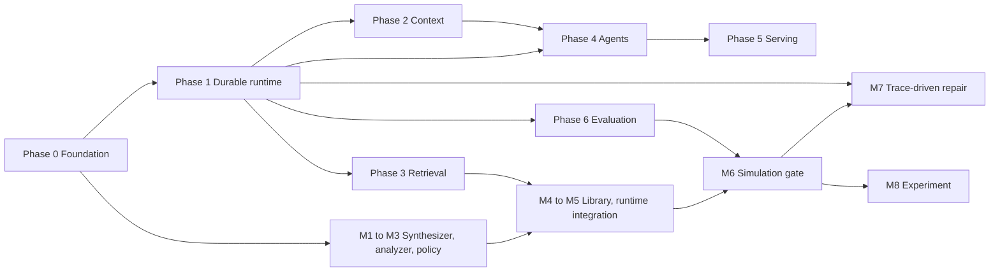

# fsm_llm Roadmap: From Mature Library to State-of-the-Art Framework

| | |
|---|---|
| Document version | 2.0 (verified revision of the v1 roadmap) |
| Date | 2026-11-11 |
| Baseline | fsm_llm `4dbec67` (v0.12.0, 2026-11-10); txtai `6d5b774` (v9.15.0, 2026-11-10); deepseek-harness `fcc0ad4` (2026-11-04) |
| Method | Shallow clones of all three repositories; every number below comes from a command listed in Appendix A. Prior art and external facts are listed in Appendix B |
| Effort basis | One maintainer working with coding agents |

## Contents

1. [Executive summary](#1-executive-summary)
2. [Baseline: fsm_llm today](#2-baseline-fsm_llm-today)
3. [Reference projects](#3-reference-projects)
4. [Target architecture](#4-target-architecture)
5. [Roadmap: Phases 0 to 6](#5-roadmap-phases-0-to-6)
6. [Phase 7: Runtime FSM synthesis](#6-phase-7-runtime-fsm-synthesis)
7. [Novelty assessment](#7-novelty-assessment)
8. [Sequencing, dependencies and effort](#8-sequencing-dependencies-and-effort)
9. [Success metrics](#9-success-metrics)
10. [Risks and mitigations](#10-risks-and-mitigations)
11. [Compatibility and release policy](#11-compatibility-and-release-policy)
12. [Out of scope](#12-out-of-scope)
13. [Verification log: changes from v1](#13-verification-log-changes-from-v1)
- [Appendix A: Evidence](#appendix-a-evidence)
- [Appendix B: References](#appendix-b-references)

---

## 1. Executive summary

**Positioning.** fsm_llm should be the framework for deterministic, durable, auditable conversational state machines with grounded retrieval. txtai is a retrieval and pipeline platform whose agents run an open smolagents loop. deepseek-harness is a durable, plugin-first agent runtime whose control flow is an open model loop or a model-written script. Neither offers rule-based, statically checkable, replayable dialogue control. That is the moat, and every phase below either widens it or removes a reason not to adopt the library.

**Seven moves, in order of leverage:**

| # | Move | Phase |
|---|---|---|
| 1 | Make it installable and maintainable: PyPI, Python 3.11 to 3.15, standard layout, smaller modules, public test doubles | 0 |
| 2 | Make execution durable: append-only event log as the single source of truth, async core, crash-safe resume, fork | 1 |
| 3 | Engineer the context window: token meter, pressure-based compaction, spill store, loop guard | 2 |
| 4 | Ground conversations in evidence: txtai-backed retrieval, evidence-aware transitions, ingestion | 3 |
| 5 | Harden agents: approval policy, sandbox, programmatic tool calls, subagent tree | 4 |
| 6 | Serve and interoperate: `app.yml`, OpenAI-compatible endpoint, MCP server, litellm optional | 5 |
| 7 | Prove it, then lead: multi-provider live evals, user simulation, public benchmark; runtime FSM synthesis as the flagship | 6, 7 |

**Effort.** 44 to 60 weeks if done strictly in sequence. Calendar time depends on parallelism: about 6 to 9 months if the platform and synthesis tracks run concurrently, about 12 to 14 months on the conservative quarterly plan in Section 8.3.

**Three corrections a reader of v1 should know about** (full list in Section 13): target Python is 3.11 to 3.15, not 3.14 (3.15.0 shipped on 2026-10-09 and 3.10 reached end of life); recorded evaluations used two local models across runs and never a hosted model; replaying recorded dialogues against a changed FSM is invalid, so repair and regression testing need a user simulator.

---

## 2. Baseline: fsm_llm today

### 2.1 Architecture snapshot

| Layer | What exists |
|---|---|
| Core turn | Two passes per user message: Pass 1 extracts data; JsonLogic rules then pick the transition in plain Python (lowest `priority` wins; the LLM is asked only when two or more rules tie at that priority; no passing rule means the conversation stays put); Pass 2 writes the reply from the state the conversation ended up in. `required_context_keys` guides extraction but never blocks a transition |
| Composition | Stacked FSMs through `API.push_fsm` / `API.pop_fsm` with context passing and merge strategies; `DEFAULT_MAX_STACK_DEPTH = 10` |
| State | `SessionStore` ABC with `FileSessionStore` (snapshots); context compaction by key (`ContextCompactor`) |
| Subpackages | `reasoning`; `workflows` (async, in-memory, 11 step types, Python DSL, no JSON loader); `agents` (18 patterns plus `AgentGraph`, tools, HITL, MCP client, A2A, meta-builder, Agent Skills); `monitor` (FastAPI dashboard, OTEL exporter); `eval` (0 to 4 examples scorer, conversation cases with Wilson intervals) |
| Knowledge | OKF bundles (`okf.py`: concepts, link graph, lexical search), `okf_bridge`; `SemanticMemoryStore` |
| CLIs | 8 entry points: `fsm-llm`, `-visualize`, `-validate`, `-monitor`, `-meta`, `-eval`, `-okf`, `-skills` |
| Core dependencies | loguru, litellm, pydantic, python-dotenv, tenacity (for litellm retries), pyyaml |

### 2.2 Size and shape

| Metric | Value |
|---|---|
| `src/` Python lines | 71,496 |
| Comment lines in `src/` | 9,849 (13.8%); txtai: 10.1% of 34,146 |
| Triple-quoted string lines in `src/` | about 14,256 (19.9%; includes prompt templates) |
| Inline `# DECISION` references | 709 |
| Test lines / tests | 143,321 / 11,411 |
| Audit-named test files | 14 files, 18,008 lines; largest `tests/test_fsm_llm/test_audit_2026_09_21.py` (4,287) |
| Examples | 22,138 lines, about 100 examples in 8 categories |
| Largest modules | `pipeline.py` 3,175; `llm.py` 2,672; `definitions.py` 2,575; `agents/fsm_definitions.py` 2,492; `api.py` 2,309; `prompts.py` 1,747 |
| `CHANGELOG.md` | 3,971 lines |

### 2.3 Strengths to preserve

- **Deterministic control.** Rules decide transitions; the model extracts and talks. This is the core differentiator and must survive every refactor.
- **One LLM layer.** Core, reasoning, workflows and agents all call models through the same interface.
- **Security posture.** Internal key prefixes (`_`, `system_`, `internal_`, `__`) and secret-looking values are kept out of prompts; approval grants cannot be forged by the model; OKF and skill content is labelled untrusted; CI audits `.pth` files; `constraints.txt` excludes the compromised litellm 1.82.7 and 1.82.8.
- **Evaluation honesty.** Pre-registered comparisons, Wilson intervals, and a README that states the scorer overstates quality.
- **Offline test depth.** 13,777 tests run without a model.

### 2.4 Gaps

| Area | Finding | Evidence |
|---|---|---|
| Concurrency | Core is synchronous: 0 `async def` in `api.py`, `fsm.py`, `pipeline.py`, `llm.py`, `agents/base.py` | grep, Appendix A |
| Durability | Sessions are snapshots; no event log, no crash-safe resume, no fork. Workflows keep everything in memory and write nothing to disk | `src/session.py:146`; `src/workflows/README.md` |
| Context | Tool observations are capped at 2,000 characters (`MAX_OBSERVATION_LENGTH`); a 50 KB skill takes 37 `skill_load` pages; no token-pressure compaction | `src/agents/constants.py:614`; `docs/api_reference.md:829` |
| Retrieval | `SemanticMemoryStore` is a JSON file searched by linear cosine scan; OKF search and links are lexical only; no RAG handler, no document ingestion | `src/agents/semantic_memory.py:231-254`; `src/okf.py:512` |
| Interop | MCP client over stdio or SSE only (SSE is the legacy transport); no MCP server; no OpenAI-compatible endpoint; no declarative app config; no entry-point plugins | `src/agents/mcp.py:126-138`; `pyproject.toml` |
| Distribution | `requires-python >= 3.10`, classifiers 3.10 to 3.12; the PyPI name `fsm-llm` belongs to an unrelated project, so users install from a clone; CI runs on `ubuntu-latest` only; coverage is a Makefile target, not a CI gate | `pyproject.toml`; `README.md:122`; `.github/workflows/python-package.yml` |
| Layout | `package-dir = {"fsm_llm" = "src"}` with a hand-kept package list; mypy needs a symlink workaround (`scripts/type_check.py`); `src/logging.py` shadows the stdlib `logging` whenever `src/` is on `sys.path` | `pyproject.toml:103-108` |
| Defaults | `DEFAULT_LLM_MODEL = "ollama_chat/bonsai-2:27b"` (26.9B at Q2_0); litellm loads `.env` at import, so a stale file silently overrides the default | `src/constants.py:51`; `docs/api_reference.md:871` |
| Evaluation | Runs 001 to 009 used `qwen3.5:4b`, Run 010 used `bonsai-2:27b`; no hosted model appears in the run log; the model matrix in `EVALUATE.md` section 7 is a template | `EVALUATE.md` |
| Test utilities | Test doubles (`MockLLM2Interface`, `PromptGroundedLLM`) live in `tests/conftest.py`, so users cannot test their own FSMs offline the same way | `tests/conftest.py:122,199` |
| Open items (repo's own list) | No failure routing in `AgentGraph`; Orchestrator subtasks dropped over `max_workers` do not affect `success`; no real HITL for REWOO, PlanExecute, ParallelReact, native_fc; MCP v2; A2A v1.0 | `README.md:587` |

---

## 3. Reference projects

### 3.1 txtai

v9.15.0, 34,146 `src` lines, Python 3.11 or later. An all-in-one embeddings database with pipelines, workflows, agents and an API, configured from one YAML file. Heavy dependencies sit behind extras.

| Feature | Where in txtai | Decision | Roadmap item |
|---|---|---|---|
| Embeddings database: dense, sparse and hybrid scoring, SQL over results, graph | `embeddings/`, `database/`, `scoring/`, `graph/` | Integrate as an optional backend; do not reimplement | 3.1 to 3.3 |
| 12 dense ANN backends (annoy, faiss, ggml, hnsw, milvus, numpy, pgvector, rabitq, sqlite, torch, turbovec, zvec) and 4 sparse (ivfsparse, milvus, pg, zvec) | `ann/dense`, `ann/sparse` | Inherit through the integration | 3.1 |
| Late interaction and MUVERA pooling | `models/pooling/` | Inherit through the integration | 3.1 |
| RAG pipeline (similarity plus LLM, minimum score, context limits) | `pipeline/llm/rag.py` | Adopt the pattern as an FSM retrieval handler | 3.4 |
| Textractor, segmentation, reranker, cross-encoder | `pipeline/data`, `pipeline/text` | Adopt for ingestion and reranking | 3.6, 3.7 |
| Agent built on smolagents; tools bash, edit, glob, grep, read, write, todo, skill, embeddings; `agents.md` and `skill.md` instruction files | `agent/` | Adopt the toolset and instruction loading, not the loop | 2.6, 4.3 |
| YAML `Application`; FastAPI with an OpenAI-compatible router; MCP exposure through `fastapi_mcp` | `app/`, `api/` | Adopt | 5.1 to 5.3 |
| Workflow tasks (template, retrieve, service, url, file, export, stream) with cron scheduling | `workflow/` | Adopt scheduling only | 5.7 |
| LLM backends: Hugging Face, llama.cpp, LiteLLM, LiteRT, OpenCode | `pipeline/llm/` | Optional, after 5.4 | 5.4 |
| Audio, image, translation, training, ONNX export, cloud index sync | `pipeline/audio`, `pipeline/image`, `pipeline/train`, `cloud/` | Skip | none |

**Lesson to copy:** one configuration file builds the whole application, and every heavy capability is an extra that fails with a clear install hint.

### 3.2 deepseek-harness

TypeScript monorepo of 379 packages plus a Python SDK. A plugin-first agent runtime (Cordis microkernel) with durable sessions, subagents, sandboxing and several clients.

| Feature | Where in the harness | Decision | Roadmap item |
|---|---|---|---|
| Append-only session log; rule "model-visible means logged" (every model request reconstructable from the log) | `docs/architecture.md`, `packages/session/*` | Adopt as the core of Phase 1 | 1.1 |
| Session format v4 with adjacent migrations (v0 to v1, ..., v3 to v4); JSONL persistence; projections and projection cache; SQLite session query | `packages/session/session-format*`, `session-persistence-jsonl`, `session-projection*`, `packages/session-query` | Adopt | 1.2 |
| Checkpoint policy | `packages/session/session-checkpoint-policy` | Adopt | 1.3 |
| Retry with logged policy; explicit turn cancellation | `packages/llm/llm-retry` | Adopt | 1.5, 1.6 |
| OTEL session telemetry | `packages/session/session-telemetry-otel` | Adopt over the event log | 1.9 |
| Replay and mock testing: `llm-replay`, `llm-mock-server`, `session-snapshot`, `loader-smoke`; testing rule "verify the world, not the self-report" | `packages/test-support/*`, `docs/testing.md` | Adopt | 0.9, 1.8, 6.2 |
| Token meter | `packages/llm/token-meter` | Adopt | 2.1 |
| Compaction: basic, tool-result pruner, image offload | `packages/compaction/*` | Adopt the first two | 2.2 |
| Spill store with policy | `packages/spill/*` | Adopt | 2.3 |
| Repeat-tool reminder (default thresholds 3, 5, 8), timeout policy | `packages/guard/*` | Adopt | 2.4 |
| System prompt sections; agent instruction chain | `packages/core/system-prompt`, `packages/context` | Adopt | 2.5, 2.6 |
| User approval: `ask` routes to human or machine answerers, `never` rejects; fails closed when no answerer; every request and outcome audited. Permission presets; experimental auto-review | `packages/interaction/*`, `packages/experimental/auto-review` | Adopt as a policy layer over existing grants | 4.1 |
| Sandbox seam: local, policy, Windows ACL; SSH | `packages/sandbox/*`, `packages/ssh` | Adopt the seam | 4.2 |
| Programmatic tool calling: only `run_code` is callable, SDK generated from the scoped tool registry, per-program call limit, parallel-safe subcalls (default 10) | `packages/core/tool-executor-ptc`, `packages/ptc-runtime` | Adopt | 4.4 |
| Model-written workflow scripts | `packages/workflow` | Adopt an FSM-native variant | Phase 7 |
| Subagents, team task board, goal, plan mode, todo, jobs, schedule | `packages/subagent`, `team`, `goal`, `plan`, `todo`, `jobs`, `schedule` | Adopt a subset | 4.6, 4.7 |
| Skill registry | `packages/skill` | Adopt | 4.8 |
| MCP manager, ACP server, SDK over JSON-RPC (TS and Python) | `packages/mcp`, `acp`, `sdk` | Partial | 5.3, 5.6 |
| Cordis microkernel, web/desktop/terminal clients, browser-use, computer-use, LSP, voice, liveshare, triplicated i18n docs | various | Skip; take only entry-point plugins | 5.5 |

**Lesson to copy:** durability and auditability are architectural rules enforced everywhere, not features added per module.

### 3.3 Principles adopted from both

1. **Model-visible means logged.** Every input the model sees is an event, and every prompt can be rebuilt from the log.
2. **Fail closed.** Missing approver, unknown tool outcome, unresolved prompt variable, unverified generated FSM: stop and report; never guess.
3. **Verify the world, not the self-report.** Tests and evals check end state (FSM state, extracted context, side effects), not the model's description of what it did.
4. **Integrate, do not reimplement.** Retrieval comes from txtai; fsm_llm owns control flow.
5. **Optional heavy dependencies.** Core installs with pydantic, loguru and pyyaml; providers, retrieval, serving and telemetry are extras.

---

## 4. Target architecture

### 4.1 Package layout after Phases 0 to 7

```text
src/fsm_llm/
├── __init__.py          # public API re-exports; unchanged import paths
├── core/                # definitions, turn pipeline (Pass 1 / Pass 2), JsonLogic, transitions, handlers, stack
├── llm/                 # LLMInterface (sync + async), providers/, parsing/, model catalog, token meter
├── runtime/             # event log, projections, session stores, checkpoint, retry, cancellation, fork
├── context/             # compaction, spill store, prompt sections, instruction loading
├── retrieval/           # VectorStore protocol, memory, txtai backend, retrieval handler, rerank
├── okf/                 # bundles, bridge, ingest
├── skills/              # layered skill registry
├── agents/              # patterns, tools, policy (approval), sandbox, mcp, a2a
├── meta/                # interactive builder, synthesizer, verifier gates, FSM library
├── workflows/           # engine, persisted instances, schedules
├── reasoning/
├── serve/               # app.yml loader, OpenAI-compatible router, MCP server
├── monitor/             # dashboard reading the event log
├── eval/                # live matrix, user simulator, benchmark runner
├── testing/             # public fakes, replay fixtures, simulator helpers
└── security.py
```

### 4.2 Layering rules

Enforced in CI with an import-linter contract:

| Layer | May import |
|---|---|
| `core` | `security` only |
| `llm` | `core` |
| `runtime` | `core`, `llm` |
| `context`, `retrieval`, `okf`, `skills` | `core`, `llm`, `runtime` |
| `agents`, `meta`, `workflows`, `reasoning` | everything above |
| `serve`, `monitor`, `eval` | everything above |
| `testing` | everything; never imported by the library itself |

### 4.3 Turn lifecycle after Phase 1

```text
user message
  → event turn/start
  → Pass 1: llm/request (logged) → llm/response (logged) → extraction (logged)
  → transition evaluation (logged: rules evaluated, winner, tie-break if any)
  → handlers (logged) and tool calls (checkpoint before side effects)
  → Pass 2: llm/request → llm/response (logged)
  → event turn/end
projections: session view, monitor view, token meter, eval traces
```

---

## 5. Roadmap: Phases 0 to 6

Each item lists where the change lands, what it borrows, and a test that proves it is done.

### Phase 0: Foundation and distribution (3 to 5 weeks)

**Goal:** anyone can `pip install` the library, and the codebase is cheap to change.

| # | Change | Where | Source | Done when |
|---|---|---|---|---|
| 0.1 | Publish to PyPI under an available name (check before choosing; `fsm-llm` is taken). Release workflow on tag with GitHub OIDC trusted publishing, build provenance attestations and a CycloneDX SBOM | `pyproject.toml`, `.github/workflows/release.yml` | Packaging practice | `pip install <name>` works on Linux, macOS, Windows; README no longer says "install from a clone" |
| 0.2 | Support Python 3.11 to 3.15. 3.10 is end of life (final release 3.10.22, 2026-10-01); 3.15.0 shipped 2026-10-09. Linux runs all five; macOS and Windows run 3.11 and 3.15 | `pyproject.toml`, CI matrix | txtai already requires 3.11 | 9 green CI legs |
| 0.3 | Standard `src/fsm_llm/` layout with `packages.find`; delete `scripts/type_check.py`; remove the `logging` shadowing risk | repository root | Packaging practice | `mypy -p fsm_llm` runs without symlinks; wheel-content test passes |
| 0.4 | Split the six largest modules. Proposed cuts: `pipeline.py` → `core/turn/{pass1,pass2,transitions,stack}`; `llm.py` → `llm/{interface,providers/litellm,parsing,embedder,usage}`; `definitions.py` → `core/definitions/{state,transition,fsm,errors,results}`; `agents/fsm_definitions.py` → one module per pattern; `api.py` → `core/api/{conversation,stack,sessions,run}`; `prompts.py` → `context/sections/*` (Phase 2.5) | `src/` | Section 4 layout | No module over 800 lines; public API snapshot (0.11) unchanged |
| 0.5 | Move the rationale behind the 709 `# DECISION` references into ADR files (`docs/decisions/NNNN-title.md`); code keeps a one-line `# ADR-NNNN` pointer. Rewrite `CHANGELOG.md` in Keep a Changelog form, one line per change, linking ADRs | `src/`, `docs/decisions/`, `CHANGELOG.md` | harness `.agents/notes` practice | Comment share of `src/` at or below 8% (now 13.8%), reported by CI; ADR index exists |
| 0.6 | Fold the 14 audit-named test files (18,008 lines) into behavior suites named after features; add a branch-coverage gate with a ratchet (never decreases) | `tests/`, CI | harness gate: per-file 100% line coverage | No dated test files; coverage enforced in CI |
| 0.7 | Documentation site: mkdocs-material with mkdocstrings API reference, versioned per release; README trimmed to install, quickstart, links | `docs/`, `mkdocs.yml` | txtai docs site | Hosted docs build on every tag |
| 0.8 | Safe defaults: no silent default model (raise a clear error that lists how to set one, or default to a small model); stop implicit `.env` loading by setting `LITELLM_MODE=PRODUCTION` before litellm is imported and loading `.env` only on explicit opt-in (`load_env=True`, CLI flag) | `src/constants.py`, `src/llm.py`, CLI | `docs/api_reference.md:871` | A fresh install on a laptop gives a clear message, never a silent 27B download; a stale `.env` cannot override an explicit setting |
| 0.9 | Public `fsm_llm.testing`: promote `MockLLM2Interface` and `PromptGroundedLLM` from `tests/conftest.py`; add a scripted user and assertions (`assert_state`, `assert_context`, `assert_path`) | `src/fsm_llm/testing/` | harness `agent-loop-testkit`, `tool-testkit` | Examples' tests and user projects use the public module |
| 0.10 | Supply-chain checks in CI: `pip-audit` or osv-scanner, dependency review on pull requests, GitHub Actions pinned by SHA; keep the `.pth` audit and `constraints.txt` | CI | Existing practice | Known-vulnerable dependency fails the build |
| 0.11 | Public API snapshot: a generated list of public symbols and signatures, diffed in CI; any change needs a changelog entry | CI, `docs/api.txt` | Library practice | Accidental API breaks fail the build |

**Exit criteria:** installable from PyPI on three operating systems and five Python versions; no module over 800 lines; coverage gate active.

### Phase 1: Durable, async runtime (6 to 10 weeks)

**Goal:** every turn is an append-only sequence of events; anything else (sessions, monitor, metrics, evals) is a projection of it.

Example event:

```json
{"v": 1, "seq": 57, "ts": "2026-11-11T10:42:03.112Z", "conv": "c_8f2", "frame": 1,
 "type": "llm/request", "pass": 1, "state": "collect_email", "model": "provider/model",
 "sections": [{"name": "system", "hash": "sha256:..."}, {"name": "history", "hash": "sha256:..."}],
 "prompt_ref": "blob:sha256:..."}
```

| # | Change | Where | Source | Done when |
|---|---|---|---|---|
| 1.1 | Append-only event log as the source of truth. Event types: `turn/start`, `llm/request`, `llm/response`, `extraction`, `transition` (rules evaluated, winner, tie-break), `handler`, `tool/call`, `tool/result`, `stack/push`, `stack/pop`, `turn/end`. Large payloads stored as content-addressed blobs | `runtime/events.py`, `core/turn/*` emits | harness "model-visible means logged" | Any past prompt is rebuilt byte-identical from the log |
| 1.2 | Session persistence as a projection of the log: JSONL (optional zstd) and SQLite backends; versioned format with adjacent migrations; `FileSessionStore` keeps a reader for old snapshots | `runtime/stores/` | harness session-format v0 to v4, session-query | v1 to v2 migration test passes; old snapshots still load |
| 1.3 | Checkpoint policy: durable write before every LLM call and every side-effecting tool call; a tool in flight during a crash recovers as `unknown` and is never retried automatically | `runtime/checkpoint.py` | harness session-checkpoint-policy | `kill -9` mid-turn, restart, conversation resumes with consistent history |
| 1.4 | `API.fork(conv_id, at_turn)` and `API.resume(conv_id)`; time-travel view in the monitor | `core/api`, `monitor/` | harness session projections | A fork reproduces history up to the chosen turn |
| 1.5 | Async-first core: `LLMInterface.acomplete`, `API.aconverse`, `API.aadvance`, `API.astream`, `Agent.arun`; sync methods become thin wrappers; per-turn cancellation token | `llm/`, `core/api`, `agents/base.py` | Python async practice | FastAPI serving without thread pools; cancellation test leaves a consistent log |
| 1.6 | Durable step retry with a per-provider retry policy, each attempt logged before backoff. Drops the transitive dependency on tenacity once litellm is optional (5.4) | `runtime/retry.py` | harness llm-retry | Retries visible in the log; no hidden retries |
| 1.7 | Persist workflow instances on the same log; add a declarative step subset with a JSON loader for steps that do not hold Python functions | `workflows/` | harness workflow persistence | A restarted process resumes a waiting workflow |
| 1.8 | Record and replay harness: record live runs as fixtures keyed by request hash; replay serves recorded responses and fails on any unmatched request. Valid for code refactors with unchanged FSMs; FSM changes need the user simulator (6.6) | `testing/replay.py` | harness llm-replay | Replay suite runs keyless in default CI |
| 1.9 | OpenTelemetry spans generated from the event log, following the OpenTelemetry GenAI semantic conventions; the monitor reads the log instead of its own collector | `runtime/otel.py`, `monitor/` | harness session-telemetry-otel | One trace per turn with LLM spans and token counts |
| 1.10 | Log privacy: apply the existing secret filters at write time; configurable redaction for user-defined keys; retention settings | `runtime/events.py`, `security.py` | Existing security model | Secret-looking values never reach disk (test) |

**Exit criteria:** crash-safe resume, fork, and keyless replay in CI.

### Phase 2: Context engineering (3 to 5 weeks)

**Goal:** the library always knows what fills the context window and degrades gracefully when it is full.

| # | Change | Where | Source | Done when |
|---|---|---|---|---|
| 2.1 | Token meter computed from the log: pressure per prompt section (system, persona, history, context keys, tool schemas); model catalog with context window, output limit, pricing, reasoning-effort support | `llm/token_meter.py`, `llm/catalog.py` | harness token-meter | `api.measure(conv_id)` returns a deterministic breakdown |
| 2.2 | Pressure-triggered history compaction (summarize oldest turns near the limit) plus overflow-recovery retry; `ContextCompactor` keeps key-level pruning | `context/compaction.py` | harness compaction-basic | A long-conversation test survives at 90% of the window |
| 2.3 | Spill store: oversized tool output becomes a head and tail preview plus a locator; a `read_spill` tool pages through it; the full text stays in the log. Replaces the fixed 2,000-character cap | `context/spill.py`, `agents/truncation.py` | harness spill, compaction-tool-result-pruner | The 50 KB skill is readable in under 5 calls (now 37) |
| 2.4 | Advisory repeat-tool-call reminder at 3, 5 and 8 identical consecutive calls, before the existing `stalled` stop | `agents/handlers.py` | harness repeat-tool-reminder | Loop test escapes without a forced stop |
| 2.5 | Prompt section registry: ordered sections, scoped overrides, variables; unresolved variable fails the call | `context/sections/` (from `prompts.py`) | harness system-prompt | Prompt diffs reviewable per section in tests |
| 2.6 | Opt-in `AGENTS.md` instruction handler with a byte budget and the untrusted label used for OKF | `context/instructions.py` | harness agent-instructions; txtai `agents.md` | Budget and labelling tested |
| 2.7 | Cache-friendly prompts: stable sections first; provider cache hints where supported; cached-token share reported by the token meter | `context/sections/`, `llm/providers/*` | Provider prompt caching | Cached-token share visible per turn |

**Exit criteria:** no silent truncation anywhere; every overflow is logged and recovered or reported.

### Phase 3: Knowledge and retrieval (4 to 6 weeks)

**Goal:** conversations can ground their replies and their routing in evidence.

| # | Change | Where | Source | Done when |
|---|---|---|---|---|
| 3.1 | `fsm_llm[txtai]` extra: `TxtaiMemoryBackend`, `create_txtai_tools(embeddings)` | `retrieval/txtai.py` | txtai Embeddings | Agents search a txtai index with no glue code |
| 3.2 | `VectorStore` protocol; port `SemanticMemoryStore` onto it; a dependency-free default remains | `retrieval/store.py` | txtai ANN abstraction | 100k-entry search benchmarked and gated in CI |
| 3.3 | Hybrid (BM25 plus dense) search and metadata filters for OKF bundles | `okf/` | txtai hybrid scoring | `okf_search` returns hybrid ranks |
| 3.4 | Per-state `retrieval` field for plain FSMs: capped, labelled passages injected into Pass 2, modelled on `okf_bridge` | `core/definitions`, `retrieval/handler.py` | txtai RAG pipeline | An example FSM answers from a bundle with citations |
| 3.5 | Evidence-aware transitions: retrieval score and citation coverage exposed to JsonLogic, for example `{">=": [{"var": "retrieval.top_score"}, 0.7]}` | `core/transitions`, `retrieval/handler.py` | New | Routing depends on evidence; unit-tested without an LLM |
| 3.6 | `fsm-llm-okf ingest <files>` using txtai Textractor and Segmentation | `okf/ingest.py` | txtai pipelines | PDFs and HTML become valid OKF bundles |
| 3.7 | Optional reranker step; a small retrieval eval (recall@k, MRR) per bundle | `retrieval/rerank.py`, `eval/` | txtai reranker | Measured lift reported |
| 3.8 | Retrieval hygiene: provenance and optional TTL on memory entries; retrieved text always carries the untrusted label | `retrieval/`, `security.py` | Existing OKF safety model | Injection test: retrieved instructions are not followed |

**Exit criteria:** a grounded FSM example with evidence-gated routing passes offline tests and a live eval.

### Phase 4: Agent harness capabilities (6 to 8 weeks)

**Goal:** agents that touch the outside world do so under an explicit, audited policy.

| # | Change | Where | Source | Done when |
|---|---|---|---|---|
| 4.1 | Approval policy over the existing per-call grants: session policy `ask` (human or machine answerers), `never` (reject, for CI and unattended runs), and `auto` (a machine answerer such as an LLM reviewer, proposed here); permission presets; every request and outcome is an audit event; extend real HITL to REWOO, PlanExecute, ParallelReact and native_fc (open item) | `agents/policy.py`, `agents/hitl.py` | harness user-approval, permission presets, auto-review | Every gated call has an audited request and outcome; missing answerer fails closed |
| 4.2 | Execution sandbox seam with subprocess and container backends for `PythonToolLoader`, which runs tool files in-process today | `agents/sandbox/` | harness sandbox | Tool files run outside the host process |
| 4.3 | Opt-in workspace toolset (read, write, edit, glob, grep, bash); writes gated by 4.1; paths confined by `security.resolve_within` | `agents/tools/workspace.py` | txtai agent tools | Path-escape and policy tests pass |
| 4.4 | Programmatic tool calling: `run_code` with an SDK generated from `ToolRegistry`, per-run call allowance, parallel-safe subcalls, executed in the 4.2 sandbox | `agents/ptc/` | harness tool-executor-ptc | Token and call reduction measured on multi-tool tasks |
| 4.5 | Model-authored orchestration | moved to Phase 7 | | |
| 4.6 | Subagent tree: identity, depth limit, cancellation propagation, delivery to caller or parent; `AgentGraph` failure routing; Orchestrator counts dropped subtasks (open items) | `agents/graph.py`, `agents/orchestrator.py` | harness subagent | A fallback branch can be built; cancel reaches all children |
| 4.7 | Durable goal (one objective, round cap, compare-and-set updates), todo tool, plan mode as an FSM state with a human review gate | `agents/goal.py` | harness goal, plan, todo | Goal survives restart |
| 4.8 | Layered skill registry: several providers with precedence; keep the read-only, untrusted model | `skills/` | harness skill | Duplicate skill names resolve predictably |

**Exit criteria:** no agent can perform a side effect without a logged policy decision.

### Phase 5: Interop and serving (4 to 6 weeks)

**Goal:** an FSM or agent is one config file away from being a service any client can call.

| # | Change | Where | Source | Done when |
|---|---|---|---|---|
| 5.1 | Declarative `app.yml` (llm, fsms, agents, tools, memory, api), Pydantic-validated; `fsm-llm serve app.yml` | `serve/app.py` | txtai Application | One file boots a full service |
| 5.2 | OpenAI-compatible `/v1/chat/completions`: `model` names an FSM or agent; conversation id in metadata; streaming | `serve/openai.py` | txtai OpenAI router | Any OpenAI client drives an FSM |
| 5.3 | MCP server exposing FSMs, agents and workflows as tools; MCP client adds streamable HTTP, resources and prompts | `serve/mcp.py`, `agents/mcp.py` | txtai `fastapi_mcp`; harness mcp | An MCP host calls an FSM as a tool |
| 5.4 | Native providers for OpenAI-compatible endpoints and Anthropic; litellm becomes an extra | `llm/providers/` | Supply-chain risk already flagged in `constraints.txt` | Core installs and runs without litellm |
| 5.5 | Entry-point plugins: `fsm_llm.tools`, `fsm_llm.providers`, `fsm_llm.stores`, `fsm_llm.handlers` | `core/plugins.py` | harness plugin model, reduced | A third-party package adds a provider with no core edits |
| 5.6 | A2A v1.0 on the official SDK (open item INT-06); ACP adapter later | `agents/a2a/` | Repo Track B | Interop test against the reference implementation |
| 5.7 | Cron schedules for persisted workflows | `workflows/schedule.py` | txtai workflow schedule | A scheduled workflow survives restart |
| 5.8 | AG-UI event stream for front ends (repo Track B item) | `serve/agui.py` | Repo Track B | A reference UI renders a live FSM turn |

**Exit criteria:** `fsm-llm serve app.yml` exposes the same FSM over OpenAI-compatible HTTP and MCP.

### Phase 6: Evaluation as the headline (3 to 4 weeks to set up, then ongoing)

**Goal:** every claim about quality is backed by a reproducible run on more than one model.

| # | Change | Where | Source | Done when |
|---|---|---|---|---|
| 6.1 | Nightly live matrix: one hosted frontier model, one mid-tier hosted model, one small local model | CI, `eval/` | Gap in run log | Results published per run |
| 6.2 | Verify end state, not text: final state, extracted context, transition path, side effects; retire the 0 to 4 regex scorer | `eval/` | harness "verify the world" | Scores agree with manual review on a sampled set |
| 6.3 | Public FSM-conformance benchmark: scripted conversations, expected state paths, pass@k and pass^k with Wilson intervals via `run_cases`; per-model leaderboard | `eval/benchmark/` | Existing `run_cases`, `wilson_ci` | Dataset and table published |
| 6.4 | Trace-to-eval: turn any logged session into a regression case (deterministic parts replayed, user turns simulated) | `eval/`, `testing/` | Phase 1 log | One CLI command |
| 6.5 | CI budgets on replay fixtures: LLM calls per turn, tokens per turn, p95 turn latency | CI | Performance-budget practice | A regression fails the build |
| 6.6 | User simulator: goal- and persona-driven, grounded in logged sessions; paired, repeated comparisons separate a real change from run-to-run variance | `eval/simulator.py` | Production dialogue evaluation work (Appendix B) | Simulated runs reproduce logged outcome rates within interval |

**Exit criteria:** README quality claims cite a benchmark run on at least three models.

---

## 6. Phase 7: Runtime FSM synthesis

### 6.1 Concept

An agent acts as a **compiler** and the FSM is a **verified program**. When a conversation needs a structured sub-flow that no existing FSM covers, a strong model writes one, a verifier checks it, and a cheap model runs it inside the live conversation. Successful FSMs go into a library and are reused, so the expensive step is paid once per kind of task, not per conversation.

A declarative FSM has properties a model-written script lacks: it can be checked statically before it runs, drawn as a diagram for a human to approve, versioned and diffed, cached by content hash, and replayed deterministically on logged extractions.

### 6.2 Building blocks that already exist

| Piece | Location | Role |
|---|---|---|
| `MetaBuilderAgent` | `src/agents/meta_builder.py` | Interactive builder; its one-shot `build` structured call becomes the compile step |
| `create_fsm_tools`, `FSMArtifactBuilder` | `src/agents/meta_tools.py`, `src/agents/meta_builders.py` | Incremental build and repair (`add_state`, `update_state`, `add_transition`, `validate_complete`) |
| `FSMValidator` | `src/validator.py` | Schema and structure gate |
| `API.push_fsm` / `API.pop_fsm` | `src/api.py` | Run the generated FSM inside the live conversation; merge results back |
| `API.run_until_terminal` | `src/api.py` | Budgeted execution |
| `run_cases`, `wilson_ci` | `src/eval/cases.py`, `src/eval/stats.py` | Simulation gate statistics |
| `to_mermaid` | `src/visualizer.py` | Diagram for the approval gate |
| Approval grants, internal-key filtering | `src/agents/hitl.py`, `src/security.py` | Policy gate |
| **Missing** | | FSM registry (today: "no FSM registry: only file paths are loadable"), data-flow and liveness analysis, provenance, user simulator, repair loop |

Workflows cannot be generated yet because their steps hold Python functions and there is no JSON loader; item 1.7 adds a declarative subset. Until then, synthesis targets FSM JSON only.

### 6.3 Lifecycle

```text
goal + current context
   │
   ├─► library lookup (I/O signature, then goal embedding) ──hit──► run
   │
   └─miss─► synthesize (strong model) ─► verify G1..G7 ─fail─► repair (at most N rounds) ─► fallback state
                                              │pass
                                              ▼
                     push_fsm(child, shared keys) ─► run (cheap model, turn budget) ─► pop_fsm(return keys)
                                              │
                                              ▼
                     log definition hash and content ─► outcome statistics ─► promote / repair / deprecate
```

### 6.4 Verification gates

| Gate | Check | Status |
|---|---|---|
| G1 Schema | Parses as `FSMDefinition`; definition version pinned | Exists |
| G2 Structure | Unknown transition targets, unreachable states, missing terminal | Exists |
| G3 Data flow | Every `var` in a transition's `logic` and every key in `requires_context_keys` is extracted by an upstream state on every path to it (`required_context_keys` of earlier states, or passed in by `push_fsm`); every terminal state produces all declared `return_keys` | New |
| G4 Liveness | Abstract interpretation over key presence (each key is present, absent or unknown): a terminal is reachable from every reachable state, including when extraction fails; every cycle has an exit condition; the longest path fits the turn budget | New |
| G5 Policy | Caps on states, transitions and text length; tool allowlist; no internal-prefix keys (`_`, `system_`, `internal_`, `__`) in extraction or logic; no handlers or code; persona inherited, not overridden; an `abort` exit auto-injected on every non-terminal state | Partly exists in `security.py` |
| G6 Simulation | The user simulator (6.6) plays generated scripts (happy path, missing information, correction, off-topic, adversarial) against the execution model; pass@k with Wilson intervals | New, builds on `eval` |
| G7 Approval | Mermaid diagram plus gate report to a human or a machine answerer (4.1); required for any FSM that uses tools | Partly exists |

### 6.5 API sketch

```python
from fsm_llm import API
from fsm_llm.meta import FSMLibrary, FSMSynthesizer, SynthesisPolicy

library = FSMLibrary("~/.fsm_llm/library")       # content-addressed, versioned, with provenance
synth = FSMSynthesizer(
    model="<strong-model>",                      # compiles
    library=library,
    policy=SynthesisPolicy(
        max_states=12,
        allowed_tools={"search_flights", "hold_booking"},
        require_approval=True,
        max_synthesis_depth=1,                   # a generated FSM cannot synthesize
    ),
)

api = API.from_file("concierge.json", model="<small-model>")   # executes
conv_id, _ = api.start_conversation()

proc = synth.obtain(
    goal="collect visa application data",
    inputs=api.get_data(conv_id),
    return_keys=["passport_no", "travel_dates", "purpose"],
)
# proc.definition, proc.report (G1..G7), proc.version, proc.provenance
api.push_fsm(conv_id, proc.definition, shared_context_keys=proc.return_keys)
```

Declarative form, so a hand-written FSM can delegate one sub-flow to synthesis (requires a definition schema version bump):

```json
"gather_requirements": {
  "id": "gather_requirements",
  "description": "Collect whatever the user's request needs",
  "synthesize": {
    "goal_key": "user_goal",
    "return_keys": ["requirements"],
    "allowed_tools": [],
    "library": "trusted_only",
    "on_failure": "fallback_state"
  }
}
```

Agent-facing form for ReAct and the other patterns: two tools, `obtain_procedure(goal, return_keys)` and `run_procedure(procedure_id, inputs)`.

### 6.6 FSM library

| Aspect | Design |
|---|---|
| Identity | Content hash of the canonical definition; semantic version per lineage |
| Signature | Typed I/O contract: required input keys, return keys, tools used |
| Retrieval | Signature match first, then goal embedding (uses 3.2) |
| Lifecycle | `draft` → `verified` (G1 to G6 pass) → `trusted` (N live successes or human approval) → `deprecated` |
| Composition | A generated FSM may push library FSMs by id; stack depth limit applies |
| Provenance | Synthesizing model, goal, parent conversation, gate report, lineage |

### 6.7 Trace-driven repair

Requires Phase 1 (event log) and 6.6 (user simulator).

| Signal in the log | Likely defect | Patch |
|---|---|---|
| Dwell in one state for more than k turns | Unsatisfiable or missing transition | Add a transition or relax a condition |
| High extraction-miss rate on one field | Vague extraction instructions | Rewrite instructions or split the field |
| Frequent LLM tie-breaks | Ambiguous priorities | Reorder priorities |
| Abandonment concentrated in one state | Poor step design | Split the state or add a help path |
| Frequent out-of-scope intents | Missing branch | Add a state or route to a library FSM |

Patches are JSON Patch (RFC 6902) documents applied to the definition, so every change is reviewable and reversible. Admission requires all of:

1. G1 to G5 pass on the patched definition.
2. **Counterfactual routing replay.** Logged Pass 1 extractions are fed through the patched transition rules without any LLM call. Transitions are pure functions of context, so this replay is exact up to the first turn where routing diverges; it shows which logged conversations would have taken a different path.
3. **Simulated comparison.** The patched and parent FSMs both run against the user simulator, seeded with goals from logged sessions, with repeated paired runs; the patch must not lower the success rate and must improve the targeted failure.

Whole-transcript replay is not used for admission: once the bot's reply changes, the recorded user turns no longer fit the conversation.

### 6.8 Security

- The user goal is untrusted input to synthesis; generated text fields carry the same untrusted label as OKF content and skills.
- Generated FSMs cannot set approval grants (driver-only already), cannot use tools outside the allowlist, cannot read or write internal keys.
- Synthesis depth defaults to 1, so generated FSMs cannot generate further FSMs.
- Every executed definition is logged by hash and content, so any conversation replays against the exact FSM it ran.

### 6.9 Build plan (15 to 16 weeks)

| # | Step | Depends on | Size | Done when |
|---|---|---|---|---|
| M1 | Non-interactive `FSMSynthesizer` extracted from `MetaBuilderAgent`; repair rounds driven by validator errors | none | 1 to 2 weeks | A goal string produces a valid definition with no human turn |
| M2 | G3 data-flow and G4 liveness analyzer in the validator | none | 2 weeks | A corpus of seeded broken FSMs is rejected with named reasons |
| M3 | `SynthesisPolicy` (G5) and auto-injected `abort` exits | M1 | 1 week | Policy violations rejected with named reasons |
| M4 | `FSMLibrary`: store, signatures, provenance, lifecycle | M1; 3.2 for embedding lookup | 2 weeks | A second request for the same goal is a cache hit |
| M5 | Runtime integration: `synthesize` state field, `obtain_procedure` and `run_procedure` tools, turn budgets, fallback | M1 to M4 | 2 weeks | The concierge example delegates an unknown sub-flow end to end |
| M6 | G6 simulation gate | M5; 6.6 | 2 weeks | Gate report shows pass@k with intervals |
| M7 | Trace-driven repair with counterfactual routing replay and simulated paired comparison | Phase 1; 6.6 | 3 weeks | A seeded defect is detected, patched, admitted, and promoted |
| M8 | Benchmark and paper-grade experiment (6.10) | M5, M6 | 2 weeks | Published results table |

### 6.10 The experiment

| Item | Design |
|---|---|
| Hypothesis | A small model running a frontier-synthesized, verified FSM matches frontier ReAct on structured conversational tasks at a fraction of the cost |
| Benchmarks | τ-bench-style domains (user simulator plus policy); the fsm_llm examples with their hand-written FSMs as gold |
| Arms | Small ReAct; small model with the hand-written FSM; small model with a task-level FSM built offline (MetaAgent-style); small model with a runtime-synthesized FSM; frontier ReAct |
| Metrics | pass^k success, policy violations, stuck conversations, turns, total cost including synthesis, synthesis latency, library hit rate |
| Ablations | Gates G3, G4, G6 on and off (does passing verification predict success for dialogue FSMs?); library on and off; repair on and off |
| Falsifier | If the runtime-synthesized arm does not beat the task-level offline arm, the feature reduces to known work plus caching and should be scoped down |

---

## 7. Novelty assessment

**Verdict:** runtime FSM synthesis is not novel as a concept; every component has published prior art from 2024 to 2026. A narrow combination appears open, and it becomes a contribution only if the experiment in 6.10 supports it. As a library feature it would still be distinctive: neither txtai nor deepseek-harness offers it.

### 7.1 Prior art by component

| Component | Closest prior art | Status |
|---|---|---|
| LLM designs an FSM from a task description | MetaAgent [1]: designs an FSM-based multi-agent system from a task description, optimizes it, and lets the FSM control actions at deployment | Done, per task |
| FSM as the control structure for LLM task solving | StateFlow [2]: higher success than ReAct at lower cost on InterCode SQL and ALFWorld; machines are designed by hand, with transitions by string matching or an LLM call | Done, hand-designed |
| One generated system per query at inference time | FlowReasoner [3]: a reasoning meta-agent trained with execution feedback produces a system per query; evaluated on code benchmarks | Done, for code |
| Static verification of a generated workflow before it runs | Lean4Agent [4]: structural, semantic and trajectory verification in Lean4, with verification-guided workflow evolution; Guardians [5]: plan with symbolic references, verified against a security policy before any tool runs | Done |
| Plan library reused by a cheaper model | Agentic Plan Caching [6]: extracts plan templates from past runs and adapts them with a lightweight model, cutting cost and latency substantially at near-optimal accuracy | Done |
| Workflows induced from traces and composed | Agent Workflow Memory [7]; WISE-Flow [8] for conversational service agents, inducing workflows under a constrained JSON schema | Done |
| Gated self-repair with regression budget and lifecycle | GRASP [9]; Self-Healing Harness [10] with candidate, active, retired lifecycle and non-regression admission | Done |
| Executable dialogue logic generated from a flow description | CoDial [11]: converts a dialogue flow graph into Colang guardrail code | Done, at design time |
| Replaying logged dialogues against a changed system | Shown invalid for production dialogue agents [12] | Constraint adopted in 6.7 |

### 7.2 The open slice

No work found in this search combines all four:

1. **Synthesis inside a live multi-turn conversation with a human**, pushed onto a stack with a typed return contract, rather than per task or per code query.
2. **A rule-driven executor** in which JsonLogic decides transitions and the LLM only extracts data and breaks ties.
3. **Slot-level static guarantees:** data flow and liveness over extracted keys, including extraction failure, so a generated conversation cannot get stuck.
4. **Frontier model compiles, small model executes**, measured on dialogue with a user simulator.

Not finding something in a search is not proof that it does not exist. Before any public claim, run a related-work pass over forward citations of [1], [4] and [6].

### 7.3 Claims

| Avoid | Defensible if 6.10 holds |
|---|---|
| "First agent that builds FSMs" | "Runtime synthesis of verified dialogue state machines inside live conversations" |
| "First verified workflow generation" | "Slot-level liveness guarantees for LLM-driven dialogue FSMs" |
| "First workflow caching" or "first self-improving workflows" | "Frontier compiles, small model runs: X% of frontier success at Y% of cost on conversational tasks" |

---

## 8. Sequencing, dependencies and effort

### 8.1 Dependency graph



### 8.2 Effort

| Phase | Weeks | Can start after |
|---|---|---|
| 0 Foundation | 3 to 5 | now |
| 1 Durable runtime | 6 to 10 | 0 |
| 2 Context | 3 to 5 | 1 |
| 3 Retrieval | 4 to 6 | 1 (3.1 and 3.6 can start after 0) |
| 4 Agents | 6 to 8 | 1, 2 |
| 5 Serving | 4 to 6 | 4 (5.4 and 5.5 can start after 1) |
| 6 Evaluation setup | 3 to 4, then ongoing | 1.8 |
| 7 Runtime FSM synthesis | 15 to 16 | M1 to M3 after 0; rest per graph |
| **Total, strictly sequential** | **44 to 60** | |

### 8.3 Suggested calendar

Two tracks: **A** is the platform (Phases 0 to 6), **B** is synthesis (Phase 7). Track B's first steps have no dependency on Track A beyond Phase 0.

| Quarter | Track A | Track B |
|---|---|---|
| Q4 2026 | Phase 0 | none |
| Q1 2027 | Phase 1 | M1, M2 |
| Q2 2027 | Phases 2 and 3; Phase 6 setup | M3, M4 |
| Q3 2027 | Phase 4 | M5, M6 |
| Q4 2027 | Phase 5 | M7, M8 |

**Critical path:** Phase 0 → Phase 1 → (Phase 6 setup, Phase 3) → M6 → M8. The event log in Phase 1 gates more items than anything else; protect it from scope creep.

---

## 9. Success metrics

| Metric | Today | Target | Measured by |
|---|---|---|---|
| Install path | Clone only | `pip install`, three operating systems | Release CI |
| Supported Python versions | 3 (3.10 to 3.12) | 5 (3.11 to 3.15) | CI matrix |
| Largest module | 3,175 lines | 800 lines or fewer | CI script |
| Comment share of `src/` | 13.8% | 8% or less | CI script |
| Coverage gate | None | Branch coverage gated with ratchet; threshold set from the first measurement | CI |
| Async API | None | Full async surface with sync wrappers | API snapshot |
| Crash recovery | None | `kill -9` mid-turn resumes cleanly | Integration test |
| Prompt reconstructability | Not possible | 100% of `llm/request` events rebuild byte-identical prompts | Log test |
| Calls to read a 50 KB skill | 37 | 5 or fewer | Agent test |
| Memory search at 100k entries | Linear scan over a JSON file | ANN-backed; latency budget gated in CI | Benchmark |
| Models in live evaluation | One local model per recorded run | Three models nightly (frontier, mid-tier, small local) | Eval CI |
| Interop | MCP client (stdio, SSE) | MCP server; streamable HTTP client; OpenAI-compatible endpoint | Interop tests |
| litellm | Required | Optional extra | Install test |
| Phase 7 | Not present | Pre-registered targets from 6.10 (small-model success relative to frontier ReAct; cost ratio; library hit rate) | Benchmark |

---

## 10. Risks and mitigations

| Risk | Likelihood | Impact | Mitigation |
|---|---|---|---|
| The event-log refactor destabilizes the core | Medium | High | Strangler approach: emit events next to the existing snapshots first; switch the source of truth only after parity tests pass |
| The async rewrite breaks sync users | Medium | Medium | Sync wrappers over the async core; run the existing sync suite unchanged against the new core |
| The module split breaks imports | Medium | Medium | Public API snapshot (0.11), re-exports, deprecation shims for at least one minor release |
| txtai integration bloats installs | Low | Medium | Extra only; lazy imports; clear install hint on first use |
| Making litellm optional loses provider coverage | Medium | Medium | Keep litellm as an extra; native adapters only for the two most used provider APIs |
| Maintainer bandwidth | High | High | Phases are independent after Phase 1; cut 5.6 to 5.8 and 4.7 first if behind |
| Phase 7 does not beat the offline baseline | Medium | Medium | Falsifier in 6.10; fall back to shipping the verifier and library as developer tools |
| Generated FSMs behave unsafely | Low | High | Gates G5 and G7, synthesis depth 1, tool allowlist, untrusted labels, full logging |
| Nightly hosted-model evals are expensive | High | Low | Budget cap; small nightly subset, full matrix weekly |
| Benchmark overfitting | Medium | Medium | Hidden test split; publish only aggregate results for it |
| PyPI name collision or confusion | Medium | Low | Check availability and similar names before 0.1; keep the import name `fsm_llm` |

---

## 11. Compatibility and release policy

| Topic | Policy |
|---|---|
| Versioning | Semantic versioning from the next release. Proposed mapping: 0.13 = Phase 0; 0.14 = event log behind a flag; 0.15 = event log as default and async API; 0.16 = Phases 2 and 3; 0.17 = Phase 4; 1.0 = Phase 5 plus a published Phase 6 benchmark; Phase 7 ships in 1.x under `fsm_llm.meta.experimental` |
| Deprecation | A deprecated symbol warns for at least one minor release before 1.0 and one full minor cycle after 1.0 before removal |
| FSM definition schema | Versioned through the `version` field (default today `"4.1"`); new fields are additive; the validator accepts the previous schema version; `fsm-llm-validate --upgrade` rewrites old definitions |
| Session and event formats | Versioned with adjacent migrations (1.2); readers keep old formats loadable |
| Python support | Add a new CPython version within one month of its release; drop a version at its end of life |
| Release cadence | Minor release roughly monthly; patch releases as needed; every release with SBOM and attestations (0.1) |

---

## 12. Out of scope

| Item | Why |
|---|---|
| GUI, desktop, terminal and voice clients; browser and computer use; LSP; liveshare | Product scope of deepseek-harness, not library scope |
| A microkernel where everything is a plugin | Entry-point plugins (5.5) give extensibility at a fraction of the cost |
| Own vector database or ANN implementations | txtai already provides them (3.1) |
| Audio, image, translation, training and ONNX export pipelines | txtai scope; unrelated to dialogue control |
| Multi-tenant hosting, user management, billing | Belongs to applications built on the library |
| A TypeScript port | The Python SDK and HTTP and MCP surfaces (Phase 5) cover non-Python callers |

---

## 13. Verification log: changes from v1

| v1 statement | Verified result | Change in v2 |
|---|---|---|
| Support Python 3.11 to 3.14 | 3.15.0 shipped 2026-10-09; 3.10.22 (2026-10-01) is the final 3.10 release | Target 3.11 to 3.15 (0.2) |
| txtai has 13 dense ANN backends | 12 dense plus 4 sparse | Corrected (3.1) |
| Every live evaluation number comes from one local model | Runs 001 to 009 used `qwen3.5:4b`; Run 010 used `bonsai-2:27b`; no hosted model in the run log | Restated (2.4, 6.1) |
| Default model is a 27B Q2 of 8.3 GB | The repo documents 26.9B at Q2_0; no file size is documented | Size claim removed (0.8) |
| Two audit-dated test files to fold | 14 audit-named files, 18,008 lines | Restated (0.6) |
| Code mass compared by raw line count | 33.7% of `src/` lines are comments or triple-quoted strings (some are prompt templates) | Target set on comment share (0.5, Section 9) |
| Harness approval policy includes `auto` | Harness has `ask` (human or machine answerers) and `never`; `auto` is this roadmap's proposal | Clarified (4.1) |
| Repair admits patches by replaying recorded traces | Recorded dialogues cannot be replayed against a changed system; only deterministic parts can | Counterfactual routing replay plus user simulator (6.6, 6.7) |
| Model-authored orchestration in Phase 4 (4.5) | Workflows have no JSON loader; FSMs do | Moved to Phase 7; workflow JSON subset added (1.7) |
| Not covered | Test doubles are private to `tests/conftest.py` | Added public `fsm_llm.testing` (0.9) |
| Not covered | litellm loads `.env` at import; `LITELLM_MODE=PRODUCTION` stops it | Concrete fix in 0.8 |
| Not covered | Prior art for runtime FSM synthesis | Section 7 |

---

## Appendix A: Evidence

Commands run from the root of each clone (`git clone --depth 1`).

```bash
# fsm_llm baseline
git log -1 --format='%h %cd'                                      # 4dbec67, 2026-11-10
find src -name '*.py' | xargs cat | wc -l                         # 71,496
find tests -name '*.py' | xargs cat | wc -l                       # 143,321
find examples -name '*.py' | xargs cat | wc -l                    # 22,138
grep -r "DECISION plan" src | wc -l                               # 709 (counted per file and summed)
wc -l src/pipeline.py src/llm.py src/definitions.py \
      src/agents/fsm_definitions.py src/api.py src/prompts.py CHANGELOG.md
grep -c "async def" src/api.py src/fsm.py src/pipeline.py src/llm.py src/agents/base.py   # all 0
find tests -name '*audit*' | xargs wc -l                          # 14 files, 18,008 lines
grep -n "MAX_OBSERVATION_LENGTH" src/agents/constants.py          # 2000
grep -n "37 \`skill_load\`" docs/api_reference.md
grep -n "DEFAULT_LLM_MODEL" src/constants.py                      # ollama_chat/bonsai-2:27b
grep -n "package-dir\|requires-python\|Python :: 3" pyproject.toml
grep -n "runs-on\|python-version" .github/workflows/python-package.yml
grep -n "Model" EVALUATE.md                                       # Runs 001 to 010
grep -n "stdio\|sse" src/agents/mcp.py
grep -n "class .*LLM" tests/conftest.py

# txtai
grep -n 'version=' setup.py                                       # 9.15.0
ls src/python/txtai/ann/dense src/python/txtai/ann/sparse
ls src/python/txtai/agent/tool src/python/txtai/pipeline/llm src/python/txtai/api/routers
grep -n "FastApiMCP" src/python/txtai/api/application.py

# deepseek-harness
find packages -name package.json -not -path '*/node_modules/*' | wc -l   # 379
grep -n "Model-visible means logged" docs/architecture.md
ls packages/session packages/test-support packages/compaction packages/spill packages/sandbox
grep -n "default(\[3, 5, 8\])" packages/guard/repeat-tool-reminder/src/*.ts
grep -n "Coverage gate" docs/testing.md                           # per-file 100%
```

The comment and docstring shares were measured with Python's `tokenize` module over every file in `src/`.

---

## Appendix B: References

**Repositories**

- fsm_llm: https://github.com/NikolasMarkou/fsm_llm
- txtai: https://github.com/neuml/txtai
- deepseek-harness: https://github.com/deepseek-ai/deepseek-harness

**Prior art (Section 7)**

1. Zhang, Liu, Xiao. *MetaAgent: Automatically Constructing Multi-Agent Systems Based on Finite State Machines.* ICML 2025, PMLR 267. https://proceedings.mlr.press/v267/zhang25bc.html
2. Wu et al. *StateFlow: Enhancing LLM Task-Solving through State-Driven Workflows.* NeurIPS 2024 Workshops. https://mlanthology.org/neuripsw/2024/wu2024neuripsw-stateflow
3. Gao et al. *FlowReasoner: Reinforcing Query-Level Meta-Agents.* arXiv, April 2025. https://github.com/sail-sg/FlowReasoner
4. *Lean4Agent: Formal Modeling and Verification for Agent Workflow and Trajectory.* arXiv 2606.06523, June 2026. https://arxiv.org/html/2606.06523v1
5. *Guardians: static verification for AI agent workflows*, implementing Meijer, *Guardians of the Agents: Formal Verification of AI Workflows*, Communications of the ACM, January 2026. https://github.com/metareflection/guardians
6. Zhang, Wornow, Wan, Olukotun. *Agentic Plan Caching: Test-Time Memory for Fast and Cost-Efficient LLM Agents.* NeurIPS 2025. https://arxiv.org/pdf/2506.14852v2
7. Wang, Mao, Fried, Neubig. *Agent Workflow Memory.* ICML 2025. https://arxiv.org/pdf/2409.07429
8. *WISE-Flow: Workflow-Induced Structured Experience for Self-Evolving Conversational Service Agents.* arXiv 2601.08158. https://arxiv.org/html/2601.08158
9. *GRASP: Gated Regression-Aware Skill Proposer for Self-Improving LLM Agents.* arXiv 2605.29668. https://arxiv.org/pdf/2605.29668
10. *Self-Healing Harness for Runtime Oversight of Agent Self-Modification.* arXiv 2609.24130. https://arxiv.org/pdf/2609.24130
11. *CoDial: Interpretable Task-Oriented Dialogue Systems Through Dialogue Flow Alignment.* arXiv 2506.02264. https://arxiv.org/pdf/2506.02264
12. *On Evaluating and Improving Conversational Agents in Production.* arXiv 2609.32092. https://arxiv.org/html/2609.32092
13. *Toward Safe LLM Agents: A Survey of Specification, Verification, and Enforcement.* arXiv 2608.14590. https://arxiv.org/html/2608.14590

**Python release status (Phase 0.2)**

- Python 3.15.0 final, 2026-10-09: https://blog.python.org/2026/10/python-3150-final-is-here/
- PEP 790, Python 3.15 release schedule: https://peps.python.org/pep-0790/
- Python 3.10.22 as the final 3.10 release, 2026-10-01: https://tech-insider.org/ie/?p=1663