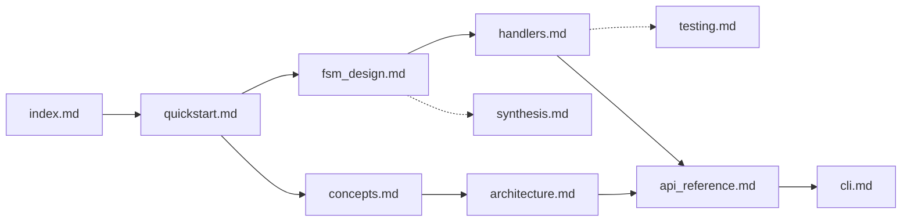

# docs

The `docs/` folder at the root of the FSM-LLM repository holds the documentation of FSM-LLM, a Python library that runs conversations as JSON-defined finite state machines (FSMs), with an LLM doing data extraction and response writing. It contains Markdown files only, no code. It is both the folder you browse on GitHub and the source of the documentation site (`mkdocs.yml` at the repository root; the site is published at `https://nikolasmarkou.github.io/fsm_llm/`).

## What is here

Eleven pages are current guides for version 0.13.0, and each starts with the line `> Covers FSM-LLM v0.13.0`. They match the code and every Python block in them is checked by a test.

| Page | What it covers |
| --- | --- |
| `index.md` | The landing page of the site: what the library is, the install, a no-model example, where to go next |
| `quickstart.md` | Install, the model setting, a first bot, a handler, streaming, sessions, the builders, an agent, a workflow, the reasoning engine |
| `concepts.md` | Why and where it fits, how a turn works, what each subpackage adds, status, references |
| `fsm_design.md` | How to design states, transitions, priorities, context, classification, `completion` and `synthesize` states |
| `handlers.md` | The eight handler timings, `HandlerBuilder`, error modes, patterns |
| `synthesis.md` | Runtime FSM synthesis: a model writes a procedure, gates judge it, a runner executes it |
| `testing.md` | `fsm_llm.testing`: test doubles, the scripted user and the assertions, with runnable examples |
| `api_reference.md` | The public API of the core and of every subpackage, hand written |
| `cli.md` | Every console script and `python -m fsm_llm.reasoning`: options, exit codes, `--model`, `--env-file` |
| `architecture.md` | The two-pass turn, the layers and the import contracts, the state kinds and executors, the extension points |
| `examples.md` | The runnable examples of the repository, by category |

Beside them:

- `contributing.md`, `security.md`, `evaluate.md` and `changelog.md` are one-line wrapper pages that include the root files `CONTRIBUTING.md`, `SECURITY.md`, `EVALUATE.md` and `CHANGELOG.md`. Edit the root file, never the wrapper.
- `2026_roadmap.md` is the project roadmap. It belongs to the maintainer and is published as written: never edit it. Other roadmap pages (`*_roadmap.md`) are published the same way.
- `AGENTS.md` is the maintainer notes for coding agents; it is not published.
- This file is the folder index on GitHub; `index.md` is the landing page of the site.

The per-package READMEs under `src/fsm_llm/<package>/README.md` hold the guide of each subpackage and are linked from the site by absolute GitHub URLs. The repository root `README.md` is the short page PyPI shows.

## How to read it



Start with `quickstart.md`. `fsm_design.md` and `handlers.md` teach the two things you write: the machine and the code that runs around it. `concepts.md` and `architecture.md` explain how it works inside. `api_reference.md` and `cli.md` are lookup pages. `synthesis.md` is optional.

## Publishing the site

The site is built and published by `.github/workflows/docs.yml`. Every pull request to `main` and every tag `v*` runs `mkdocs build --strict`; a tag then deploys the site to the `gh-pages` branch with `mike`, under the version of the tag. The workflow refuses a tag that is not `v` plus `__version__` of `src/fsm_llm/__version__.py`. A pre-release version (an `a`, `b`, `rc` or `.dev` segment) is published under its own version and never takes the `latest` alias; a final release gets `latest`. CI never runs `mike set-default`.

Owner steps, once, after the first tag deploy (they need the repository settings, so they are not in CI):

1. Settings, Pages: source "Deploy from a branch", branch `gh-pages`, folder `/ (root)`.
2. From a clone of `main` with the docs tools installed (`pip install --group docs -c constraints.txt`): `mike set-default --push latest`. Until this runs, the root of the site has no `index.html` and shows a 404; the versioned paths (`/0.13.0/`, `/latest/`) work.
3. Check the first run of the workflow on the Actions tab, then the version selector on the site.

Risk, recorded: Material for MkDocs reaches end of life on 2027-05-05, and mkdocs 1.x itself has had no release since 1.6.1 (2024-08-30). The site pins every tool exactly (`constraints.txt`, group `docs` in `pyproject.toml`), caps `mkdocs` below 2 (mkdocs 2 has no plugins and no YAML configuration) and builds with `NO_MKDOCS_2_WARNING=1`, so nothing moves by itself. When the time comes there are two escape hatches that read the same `mkdocs.yml` and `docs/`: ProperDocs (a community continuation of mkdocs 1.x) and Zensical (the successor from the Material authors). Switch one tool deliberately, with a strict build as the test, and update the pins and the tool test in `tests/test_fsm_llm/test_docs_site.py`.

## How to use it

Open the files in any Markdown viewer. Snippets assume the package is installed (`pip install llm-fsm`) and a model is configured (`LLM_MODEL`, see `quickstart.md`). The examples are not in the package: clone the repository to get them and run one against the installed package:

```bash
pip install llm-fsm
git clone https://github.com/NikolasMarkou/fsm_llm.git && cd fsm_llm
python examples/basic/form_filling/run.py
```

To build the site locally: `pip install --group docs -c constraints.txt`, then `make docs` (a strict build into `site/`) or `make docs-serve`.

After editing a page, run the docs tests:

```bash
.venv/bin/python -m pytest tests/test_fsm_llm/test_docs_snippets.py tests/test_fsm_llm/test_docs_site.py tests/test_fsm_llm/test_docs_content.py tests/test_fsm_llm/test_docs_links.py tests/test_fsm_llm_testing/test_guide.py
```

## Things to know

- Extensions are documented as subpackages of `fsm_llm`: `fsm_llm.reasoning`, `fsm_llm.workflows`, `fsm_llm.agents`, `fsm_llm.monitor`, `fsm_llm.eval`, `fsm_llm.synthesis`, `fsm_llm.testing`. This matches the code under `src/fsm_llm/`.
- Monitor documentation belongs in `api_reference.md` (the Monitor section). Do not create a separate `docs/monitor.md`.
- Pre-registered benchmark data is not documented here; see `scripts/bench_data/README.md`.
- `required_context_keys` never blocks a transition. The guides gate transitions with a condition (`requires_context_keys` plus `logic`). Keep new examples consistent with this.
- The migration record of a release is the `CHANGELOG.md`: each `**BREAKING:**` entry names the old form and the new one. There are no upgrade guides and no generated reference pages.
- Source code points to these pages by name: `src/fsm_llm/engine/fsm/manager.py` mentions `docs/architecture.md` and `src/fsm_llm/engine/fsm/turns.py` quotes `docs/handlers.md`. Renaming a page breaks those pointers and the tests above.
