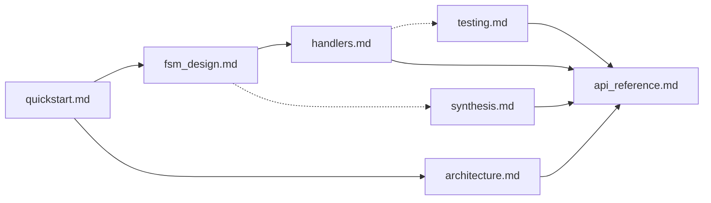

# docs

The `docs/` folder at the root of the FSM-LLM repository holds the long-form user guides for the framework. FSM-LLM is a Python library that runs conversations as JSON-defined finite state machines (FSMs), with an LLM doing data extraction and response writing. It contains Markdown files and one generated text file, no code: the guides and records listed below, plus this index, a maintainer-notes file (`AGENTS.md`, for coding agents), the generated decision index (`decisions/index.md`) and `api.txt`, the public API snapshot that `scripts/api_snapshot.py` writes (`make api-snapshot`) and `tests/test_fsm_llm_regression/test_api_snapshot.py` compares.

## What it is for

The package READMEs say what each part is. These guides go further: they teach you to build a bot, design states and transitions, write handlers, and they list the public API. Seven files are current guides for version 0.13.0, and each one starts with the line `> Covers FSM-LLM v0.13.0`. Two more are dated records and plans, kept to explain design choices, not to teach usage, and neither has a `Covers` header:

- `agents_roadmap.md` is the audit record and roadmap for `fsm_llm.agents` (dated 2026-09-29, with measured baselines added later). It describes work that shipped in 0.12.0, on top of 0.11.0.
- `2026_roadmap.md` is the project roadmap. It belongs to the maintainer and is published as written: never edit it.

The rest of the folder is the documentation site: pages that feed `mkdocs.yml` (the landing page, concepts, examples, the wrapper pages and the generated pages), listed below.

If you only want to use the library, read the seven guides. Per-package READMEs under `src/fsm_llm/` and the repo root `README.md` (the short page PyPI shows) hold the rest.

## How it works

Read the current guides in this order:



- Start with `quickstart.md` to install the package and run a first bot.
- `fsm_design.md` covers how to shape states and transitions. It ends with a link to `handlers.md`.
- `architecture.md` explains how a message moves through the system.
- `api_reference.md` is the lookup table for classes, methods, CLIs and exceptions.
- `testing.md` is the guide to testing your own bot, agent or workflow offline with `fsm_llm.testing`: the doubles, the scripted user, the assertions, `PathRecorder` and how to move off a copied `tests/conftest.py`. Its Python blocks run as tests.
- `synthesis.md` is an optional guide: read it after `fsm_design.md` when a sub-conversation has to be written at run time. It is the one guide with its own full FSM example as JSON.

Some tests read these files. `tests/test_fsm_llm/test_docs_snippets.py` finds every fenced `json` or `python` block that contains `"initial_state"` in `quickstart.md`, `api_reference.md`, `architecture.md`, `fsm_design.md`, `handlers.md`, `synthesis.md` and `testing.md` (and in the root `README.md`, root `AGENTS.md` and `src/fsm_llm/README.md`), and loads it through `FSMDefinition`. A broken full FSM example fails the test suite. `tests/test_fsm_llm_regression/test_regression_cli_and_exports.py` checks that `quickstart.md` does not mention `examples/basic/quiz`, `examples/intermediate/customer_service` or `python main.py`.

## Files

- `quickstart.md` - install, API key and environment variables (`LLM_MODEL`, `LLM_TEMPERATURE`, `LLM_MAX_TOKENS`, `FSM_PATH`), a first bot (`friendly_greeter`), a first handler, streaming and session persistence, more ways to build (the step-by-step builders, an agent, a workflow, the reasoning engine), CLI commands, troubleshooting.
- `fsm_design.md` - design guide: one purpose per state, JsonLogic transitions, patterns (Gatekeeper, Collector, Router, Confirmer), priority and ambiguity, `evaluation_priority`, `llm_description`, context scope, `handler_only_keys`, how corrections work, FSM stacking, classification routing, `completion` states (tool calling and structured turns), `synthesize` states (procedures written on demand), designing for agents, anti-patterns, testing and validation.
- `handlers.md` - the 8 handler timings, the `HandlerBuilder` methods, `handler_error_mode` (`"continue"` or `"raise"`), critical handlers, what ERROR handlers can and cannot do, common patterns, testing, how each extension uses handlers.
- `architecture.md` - the 2-pass design, core components (`engine/api/`, `engine/fsm/`, `engine/turn/`, `context/layout/`, `handlers/`, `llm/`, `core/transition_evaluator.py`), message, start and streaming flows, context handling, stacked-FSM merge rules, security, performance, how the six extension subpackages plug in, extension points.
- `api_reference.md` - `API` constructor and methods (including steps without a user message), `HandlerBuilder`, the other builders and `BuildError`, `HandlerTiming`, `LLMInterface`, `WorkingMemory`, `TransitionEvaluatorConfig`, classification, reasoning, agents, workflows, eval (CLI, `EvalConfig`, dataset schema, output files), monitor, Open Knowledge Format (core API, `fsm-llm-okf`, agents API, safety model), Agent Skills (core API, `fsm-llm-skills`, agents tools, safety model, known limits), Synthesis (compile and reuse, library, runner, agent tools, traces and repair, safety model, known limits), Testing (`fsm_llm.testing`: doubles, scripted user, assertions, `PathRecorder`), the `synthesize` state field, exception tree, constants.
- `synthesis.md` - guide to runtime FSM synthesis (`fsm_llm.synthesis`): the concierge pattern with a host FSM that has a `synthesize` state, `FSMSynthesizer`, the gates G1 to G7, `FSMLibrary` and reuse, `ProcedureRunner`, the agent tools, approval, traces and repair, limits, the safety model, and the status of the pre-registered bench `scripts/synthesis_bench.py` (blocks s0 to s2 run, all INCONCLUSIVE, with the results).
- `testing.md` - guide to `fsm_llm.testing`: install and import, a first offline test, the doubles (`ScriptedLLM`, `PromptGroundedLLM`, `MockLLM2Interface`) and when each fits, the scripted user and `advance_until_terminal`, the four assertions and when each is right, `PathRecorder` and its deep-copy caveat, the pytest notes (`register_assert_rewrite`, `python -O`), migrating from a copied `tests/conftest.py`, limits. Every Python block is run by `tests/test_fsm_llm_testing/test_guide.py`.
- `index.md` - the landing page of the mkdocs site (`make docs`); `concepts.md` (why, how it works, the five pillars, status, references) and `examples.md` (the examples table, linked on GitHub) are site pages in the same folder.
- `contributing.md`, `security.md`, `evaluate.md`, `changelog.md` - one-line wrapper pages that include the root files of the same names (`CONTRIBUTING.md`, `SECURITY.md`, `EVALUATE.md`, `CHANGELOG.md`); edit the root file.
- `2026_roadmap.md` and `agents_roadmap.md` - the roadmaps, published as written.
- `reference/`, `packages/`, `decisions/` - generated or included pages (see `docs/AGENTS.md`).
- `upgrade-guide/` - the hand-written upgrade guides of a release (`upgrade-guide/v0.13.0/<theme>.md`, with the overview `upgrade-guide/index.md`, which lists the guides in the order to migrate): what each `**BREAKING:**` entry of the changelog changes, with the code before and after. Every `**BREAKING:**` bullet of `CHANGELOG.md` links its section and `tests/test_packaging.py` enforces it. Not a user guide of the current API; read the one for the release you upgrade to.
- `agents_roadmap.md` - design record, not a guide: the `fsm_llm.agents` audit (verdict per audit id, commits, known open items, deferred Track B) and recorded baselines (G3 examples run, agent bench blocks B0 to B2). Current agents contracts live in `src/fsm_llm/agents/README.md` and the Agents section of `api_reference.md`. Source code and `scripts/agents_bench.py` point to it by name.
- `index.md` - the landing page of the published documentation site (`mkdocs.yml` at the repository root builds it; `make docs`). This `README.md` is the folder index on GitHub and is not part of the site.
- `reference/` - generated reference pages of the site: one page per module of the API snapshot (`<dotted.module>.md`, rendered by mkdocstrings from the source), `api-snapshot.md` (the full `api.txt` text) and `cli.md` (every console script, its entry point, usage and exit codes). They are stubs, not prose: the content comes from the code.
- `packages/` - one page per subpackage README (`agents`, `eval`, `monitor`, `reasoning`, `synthesis`, `testing`, `workflows`), each an include of `src/fsm_llm/<pkg>/README.md`.
- `decisions/index.md` - the generated decision index: every `# DECISION` anchor of the code, grouped by plan, with its rationale and its places. Not a guide and never edited by hand: `make decision-index` writes it and `make decision-check` fails when it is stale or an anchor has no line in `plans/ANCHORS.md`.
- `AGENTS.md` - maintainer notes for coding agents; not part of the user guides.

## Publishing the site

The site is built and published by `.github/workflows/docs.yml` (roadmap row 0.7). Every pull request to `main` and every tag `v*` runs `mkdocs build --strict`; a tag then deploys the site to the `gh-pages` branch with `mike`, under the version of the tag. The workflow refuses a tag that is not `v` plus `__version__` of `src/fsm_llm/__version__.py`. A pre-release version (an `a`, `b`, `rc` or `.dev` segment) is published under its own version and never takes the `latest` alias; a final release gets `latest`. CI never runs `mike set-default`. The site address is `https://nikolasmarkou.github.io/fsm_llm/`.

Owner steps, once, after the first tag deploy (they need the repository settings, so they are not in CI):

1. Settings, Pages: source "Deploy from a branch", branch `gh-pages`, folder `/ (root)`.
2. From a clone of `main` with the docs tools installed (`pip install --group docs -c constraints.txt`): `mike set-default --push latest` (mike fetches `gh-pages` itself; this was run against a local bare remote at step 106). Until this runs, the root of the site has no `index.html` and shows a 404; the versioned paths (`/0.13.0/`, `/latest/`) work.
3. Check the first run of the workflow on the Actions tab, then the version selector on the site.

Risk, recorded: Material for MkDocs reaches end of life on 2027-05-05, and mkdocs 1.x itself has had no release since 1.6.1 (2024-08-30). The site pins every tool exactly (`constraints.txt`, group `docs` in `pyproject.toml`), caps `mkdocs` below 2 (mkdocs 2 has no plugins and no YAML configuration) and builds with `NO_MKDOCS_2_WARNING=1`, so nothing moves by itself. When the time comes there are two escape hatches that read the same `mkdocs.yml` and `docs/`: ProperDocs (a community continuation of mkdocs 1.x) and Zensical (the successor from the Material authors). Switch one tool deliberately, with a strict build as the test, and update the pins and the tool test in `tests/test_fsm_llm/test_docs_site.py`.

## How to use it

Open the files in any Markdown viewer. Snippets assume the package is installed (`pip install llm-fsm`), and a model is configured (`LLM_MODEL`, see `quickstart.md`). The examples are not in the package: clone the repository to get them and run one against the installed package:

```bash
pip install llm-fsm
git clone https://github.com/NikolasMarkou/fsm_llm.git && cd fsm_llm
python examples/basic/form_filling/run.py
```

After editing a guide, run the snippet tests:

```bash
.venv/bin/python -m pytest tests/test_fsm_llm/test_docs_snippets.py tests/test_fsm_llm_regression/test_regression_cli_and_exports.py
```

## Things to know

- Extensions are documented as subpackages of `fsm_llm`: `fsm_llm.reasoning`, `fsm_llm.workflows`, `fsm_llm.agents`, `fsm_llm.monitor`, `fsm_llm.eval`, `fsm_llm.synthesis`, `fsm_llm.testing`. This matches the code under `src/fsm_llm/`.
- `agents_roadmap.md` is a dated record: its status lines, counts and baselines are as recorded on their dates and are not kept current.
- Monitor documentation belongs in `api_reference.md` (the Monitor section). Do not create a separate `docs/monitor.md`.
- Pre-registered benchmark data is not documented here; see `scripts/bench_data/README.md`.
- `required_context_keys` never blocks a transition. The guides gate transitions with a condition (`requires_context_keys` plus `logic`). Keep new examples consistent with this.
- Source code points to these files by name: `src/fsm_llm/engine/fsm/manager.py` mentions `docs/architecture.md` and `src/fsm_llm/engine/fsm/turns.py` quotes `docs/handlers.md`. Renaming a file breaks those pointers and the tests above.
