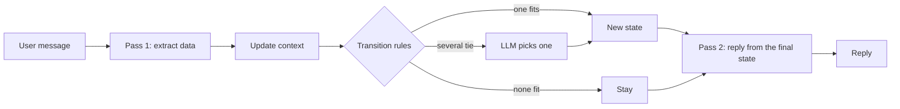
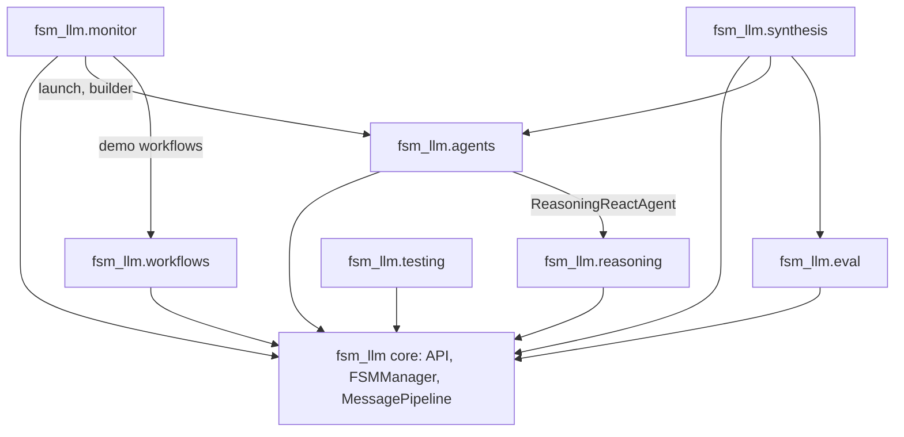

# Concepts

> Covers FSM-LLM v0.13.0

This page explains what the library is made of, where it fits, and how one message travels
through it. For a first run go to the [Quick Start](quickstart.md); for the parts in detail go
to the [FSM Design Guide](fsm_design.md) and [Architecture](architecture.md).

## Why FSM-LLM?

FSM-LLM splits the work three ways:

* **The LLM handles language**: understanding the user, pulling out facts, writing replies.
* **The state machine handles flow**: which state you are in and where you go next is a rule,
  not a mood. The LLM breaks a tie between two equal rules and nothing else.
* **The framework handles state**: what has been collected, history, your own hooks, and saving
  and restoring sessions.

Use it when the conversation has steps: forms and intake, onboarding, support triage, tutoring
flows, anything where "what must happen next" is a rule.

Do not use it for open-ended chat with no structure (a plain LLM call is simpler), or when you
need a hosted, production-hardened agent platform. The project is young, and one subpackage is
explicitly experimental (see [Status](#status)).

## How it works

Every user message goes through two LLM passes:

* The context is a dictionary of everything collected so far in one conversation.
* Transition rules use JsonLogic, for example `{">=": [{"var": "age"}, 18]}`. If several
  transitions pass, the lowest `priority` number wins outright. The LLM is asked only when two
  or more tie at that lowest priority. If none pass, the conversation stays put.
* Pass 2 runs after the transition, so the reply comes from the state the conversation is
  actually in. A state with empty `response_instructions` makes no LLM call, replies with `""`
  and adds nothing to the history.

The subpackages sit on top of the core and never the other way round:

| Subpackage | What it adds | Maturity |
|------------|--------------|----------|
| [`fsm_llm.reasoning`](packages/reasoning.md) | 9 reasoning strategies as stacked FSMs, validation, up to 3 retries | Tested offline; live behavior depends on the model |
| [`fsm_llm.workflows`](packages/workflows.md) | Async in-memory workflow engine, 11 step types, a Python DSL | Runs without an LLM unless you add LLM steps |
| [`fsm_llm.agents`](packages/agents.md) | 18 agent patterns, tools, human approval, memory, MCP, A2A, meta-builder | Documented known limits, see the [agents roadmap](agents_roadmap.md) |
| [`fsm_llm.monitor`](packages/monitor.md) | FastAPI dashboard, optional OpenTelemetry export | Needs the `monitor` extra |
| [`fsm_llm.eval`](packages/eval.md) | Examples scorer (0 to 4), conversation cases with Wilson intervals | Scores are a heuristic that overstates quality; read the logs too |
| [`fsm_llm.synthesis`](packages/synthesis.md) | A model compiles a goal into an FSM, gates judge it, a library stores it, a runner executes it; agent tools | Tested offline with scripted models. Bench status: three blocks run on one model, all INCONCLUSIVE; no result favours synthesis. |
| [`fsm_llm.testing`](packages/testing.md) | Public test doubles, a scripted user and assertions for code built on `fsm_llm` (the fake `LLMInterface` doubles `MockLLM2Interface`, `PromptGroundedLLM` and `ScriptedLLM`, the reply builders, `hash_embed`, `ScriptedUser` with `ConversationRun`, and the assertions `assert_state`, `assert_context`, `assert_path`, `assert_result` with the opt-in `PathRecorder`) | Offline; imports core only, never pytest |

**Evaluation honesty.** The examples scorer reads each run's output with simple rules and gives
0 to 4. It overstates quality, and runs from before and after the 2026-09-29 restructure are not
comparable. The method and the run log are on the [Evaluate](evaluate.md) page. Offline tests
(the default) replace the model with a fake, so they say nothing about model quality.

## Key features

The library is organized into five pillars.

### The core: finite state machines driven by an LLM

* **Two-pass turns**: every message goes through Pass 1 (extract data) and Pass 2 (write the
  reply from the state you ended up in). Transition rules are JsonLogic evaluated in plain
  Python, so they are predictable and unit-testable. The LLM is asked to choose only when two
  rules tie at the lowest priority.
* **Handlers**: your functions run at 8 points (start, before and after processing, before and
  after a transition, context update, end, error), built with `create_handler`. See
  [Handler Development](handlers.md).
* **Intent classification**: `classification_extractions` on a state, plus `Classifier`,
  `HierarchicalClassifier` and `IntentRouter`.
* **FSM stacking**: hand a conversation to a sub-FSM and come back with its results
  (`push_fsm` / `pop_fsm`).
* **Streaming**: `converse_stream()` yields reply tokens as they arrive.
* **Steps without a user message**: `advance()` runs one turn and returns an `AdvanceResult`;
  `run_until_terminal()` repeats it within a step and time budget and raises
  `RunBudgetExceededError` when the budget is spent. Agents and the reasoning engine run on
  these loops.
* **Tool calling and structured output**: a state with the optional `completion` field makes
  one native tool-calling or JSON-schema call. Core runs no tool; your handlers do.
* **Sessions and memory**: `save_session` / `restore_session` with `FileSessionStore`, and
  `WorkingMemory` buffers.
* **Diagrams**: `build_fsm_graph()`, `to_mermaid()`, `to_dot()` and the `fsm-llm-visualize`
  command.

### Reasoning, workflows and agents

* **`fsm_llm.reasoning`**: a solver that picks one of 9 reasoning strategies, runs it as
  stacked FSMs inside one message-free core run, validates the answer and retries up to 3
  times. `ReasoningEngine.solve_problem(problem)` returns the solution and a trace.
* **`fsm_llm.workflows`**: an async in-memory engine with 11 step types and a Python DSL
  (`create_workflow`, `auto_step`, `condition_step`). It runs without an LLM unless you add LLM
  steps.
* **`fsm_llm.agents`**: 18 agent patterns (`react`, `rewoo`, `reflexion`, `plan_execute`,
  `prompt_chain`, `self_consistency`, `debate`, `orchestrator`, `adapt`, `evaluator_optimizer`,
  `maker_checker`, `reasoning_react`, `parallel_react`, `verified_react`, `auto_memory`,
  `native_fc`, `swarm`, `meta_builder`) plus `AgentGraph`.
* **Tools done properly**: the `@tool` decorator, annotations, enforced timeouts, MCP and A2A
  support, tools loaded from folders of Python files, and standard operating procedures.
* **Human approval as a security boundary**: a gated tool runs only with a driver-only grant
  bound to that exact call, which a caller's initial context can never set.
* **A meta-builder** that designs FSMs, workflows and agents by chat (`fsm-llm-meta`).
* **`fsm_llm.synthesis`**: a host FSM names a goal in a `synthesize` state, a model writes a
  child FSM for it, static checks, a bounded simulation and an optional approval decide whether
  it may run, a file-backed library stores it and a runner pushes it as a child of the host
  conversation (`FSMSynthesizer`, `ProcedureRunner`, `FSMLibrary`, `create_procedure_tools`).
  `verified` means those checks passed over a model-written spec, not that the procedure is
  correct. The tests are offline. Bench status: blocks `s0`, `s1` and `s2` are registered, run
  and recorded (one model, `ollama_chat/bonsai-2:27b`, for every role and arm, no strong/cheap
  split); all three verdicts are INCONCLUSIVE and no registered block shows a compiled
  procedure beating a ReAct agent. See [Runtime FSM synthesis](synthesis.md).

### Knowledge bundles and Agent Skills

* **Open Knowledge Format (OKF)**: `fsm_llm.okf` reads, searches, validates and writes OKF
  bundles (a directory of markdown files with YAML frontmatter).
  `fsm_llm.engine.okf_bridge.create_okf_handler()` puts capped concept summaries into a plain
  FSM's context. `fsm_llm.agents` adds read-only OKF tools, a read-only memory backend and
  bundle exporters. `fsm-llm-okf` runs it from the shell. This follows OKF v0.2 (SPEC.md at
  commit ad30107, pre-1.0 and mutable).
* **Agent Skills**: `fsm_llm.skills` reads folders with a `SKILL.md` from the paths you name
  (the open standard at agentskills.io as read on 2026-10-23, unversioned and mutable).
  `fsm_llm.agents.create_skill_tools` gives an agent three read-only tools (`skill_list`,
  `skill_load`, `skill_read`), and `fsm-llm-skills` validates, lists and shows them.
* **Untrusted by design**: bundle and skill text reaches a model only as capped,
  control-stripped tool output (or labelled summaries), never as a tool description,
  instruction or persona. Nothing in a bundle or skill folder is executed, and `allowed-tools`
  is reported, not enforced.

### Monitoring and evaluation

* **`fsm_llm.monitor`**: a FastAPI dashboard (REST, WebSocket, vanilla-JS single-page app) to
  launch, watch and chat with FSMs, agents and workflows, with optional OpenTelemetry export.
* **`fsm_llm.eval`**: scores the examples 0 to 4, or runs scripted conversations N times and
  reports pass rates with Wilson confidence intervals (`EvalConfig`, `run_examples`,
  `run_cases`, `run_dataset`, `wilson_ci`).
* **Pre-registered benches**: `scripts/agents_bench.py`, `scripts/skills_bench.py` and
  `scripts/synthesis_bench.py` record blocks that are run once at a fixed n and never edited,
  so a number in the repository can be recounted from its rows.

### One LLM layer, security and reliability

* **One LLM layer**: litellm is imported in exactly one module,
  `src/fsm_llm/llm/providers/litellm.py`. `LLMInterface.complete(CompletionRequest)` is the
  single primitive for tool calling, plain and structured completion, with per-interface call
  and token counters (`usage()`) and an embedder (`LiteLLMEmbedder`). Any litellm model string
  works.
* **Cut-off replies are visible**: a reply that stops at `max_tokens` is flagged (`truncated`,
  a WARNING, a named cause in extraction errors) and never shown as an unreadable half
  envelope.
* **Context security**: internal keys (prefixes `_`, `system_`, `internal_`, `__`) and
  secret-looking entries are kept out of prompts. The compromised litellm 1.82.7 and 1.82.8 are
  below the required version, and `make audit` scans for malicious `.pth` files.
* **Assured reliability**: an offline-by-default suite (a fake model, no network) covering the
  core, every subpackage, packaging, regressions, and the examples.
* **Decisions are recorded**: `# DECISION plan-<id>/D-NNN` comments in the code say what not to
  do and why; the [Decisions](decisions/index.md) page indexes them.

## Status

* Version 0.13.0. Most tests are offline and use a fake model, so they check logic and wiring,
  not model quality.
* Evaluation scores are a heuristic and overstate quality. The recorded runs on the
  [Evaluate](evaluate.md) page used a 4B local model, and scores on other models differ.

Things to know:

* The `fsm-llm` command needs `LLM_MODEL`. The Python `API` takes `model=`, then `LLM_MODEL`,
  and raises `ModelNotConfiguredError` when neither is set (there is no built-in default
  model). Importing `fsm_llm` loads no `.env` file; read one on purpose with
  `fsm_llm.load_env()` or the `--env-file PATH` flag of a CLI.
* The library logs nothing until you call `setup_logging()` or `enable_debug_logging()`; both
  also replace loguru's default handler, so a library record prints once.
* One conversation handles one message at a time: a second `converse` on a conversation that is
  mid-turn raises `FSMError`.
* `constraints.txt` pins every direct dependency and the dev tools to exact versions so CI and
  local runs match.

## Acknowledgments

FSM-LLM stands on open-source work: [litellm](https://github.com/BerriAI/litellm) for the
provider layer, [Pydantic](https://docs.pydantic.dev) for the models,
[loguru](https://github.com/Delgan/loguru) for logging, [JsonLogic](https://jsonlogic.com) for
transition rules, and [Ollama](https://ollama.com) for the local models the evaluation runs
used. Thanks to everyone who has reported issues and run the examples against other models.

## References

The agent patterns, reasoning strategies and standards in this library follow published work
and open specifications. Each pattern's module documents how it differs from the original.

### Agent patterns and reasoning

* **ReAct: Synergizing Reasoning and Acting in Language Models**: Yao, S., et al. (2022).
  *ICLR 2023*.
* **ReWOO: Decoupling Reasoning from Observations for Efficient Augmented Language Models**:
  Xu, B., et al. (2023).
* **Reflexion: Language Agents with Verbal Reinforcement Learning**: Shinn, N., et al. (2023).
  *NeurIPS*.
* **Plan-and-Solve Prompting: Improving Zero-Shot Chain-of-Thought Reasoning by Large Language
  Models**: Wang, L., et al. (2023). *ACL*.
* **Self-Consistency Improves Chain of Thought Reasoning in Language Models**: Wang, X., et al.
  (2022). *ICLR 2023*.
* **Chain-of-Thought Prompting Elicits Reasoning in Large Language Models**: Wei, J., et al.
  (2022). *NeurIPS*.
* **Improving Factuality and Reasoning in Language Models through Multiagent Debate**: Du, Y.,
  et al. (2023).
* **Building Effective Agents** (prompt chaining, orchestrator-workers, evaluator-optimizer):
  Anthropic (2024).

### Standards and specifications

* **Model Context Protocol (MCP)**: the protocol behind the `mcp` extra.
* **Agent2Agent (A2A) Protocol**: the protocol behind the `a2a` extra.
* **Open Knowledge Format (OKF) v0.2**: SPEC.md at commit ad30107, pre-1.0 and mutable.
* **Agent Skills** (agentskills.io): the `SKILL.md` folder standard, read on 2026-10-23,
  unversioned and mutable.
* **JsonLogic**: the rule format used for transition conditions.
* **OpenTelemetry**: the telemetry format behind the `otel` extra.

### Evaluation

* **Probable Inference, the Law of Succession, and Statistical Inference**: Wilson, E. B.
  (1927). *Journal of the American Statistical Association*. The source of the Wilson
  confidence interval used by `wilson_ci`.
