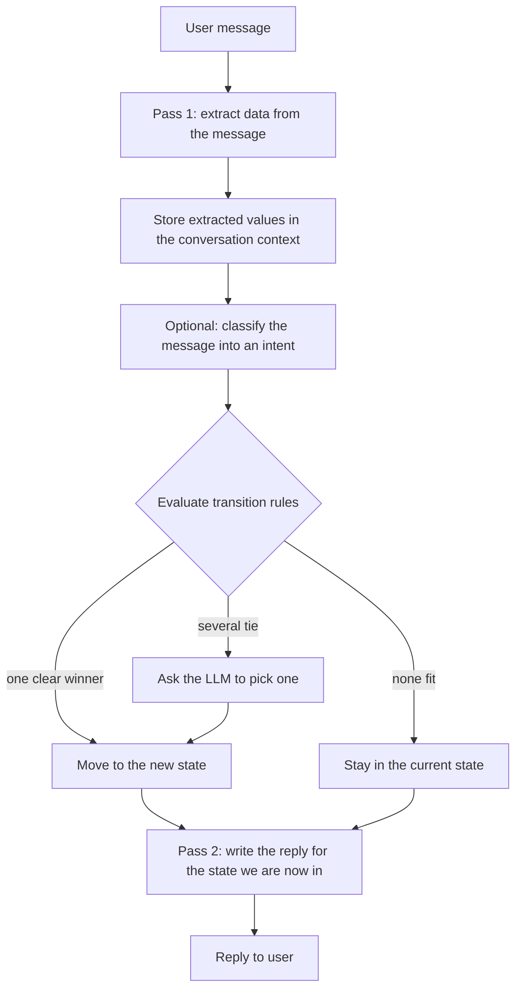
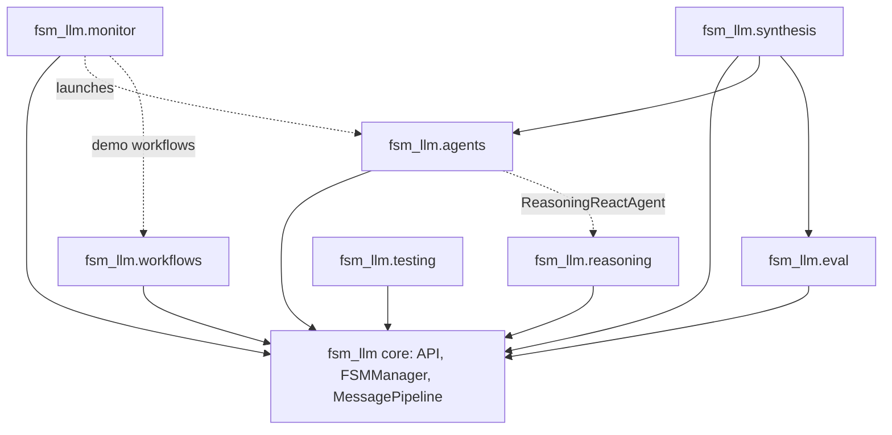

# fsm_llm

The `fsm_llm` package at `src/fsm_llm` is the whole FSM-LLM framework. Its top level is the core engine: it runs chatbots defined as finite state machines, where a large language model (LLM) reads each user message, pulls out data, and writes the reply. The subpackages built on that core add reasoning, workflows, agents, a web dashboard, evaluation tools, runtime FSM synthesis, and public test doubles.

## Where it lives

This directory is the Python package `fsm_llm` (the standard `src/` layout): `pyproject.toml` finds it with `[tool.setuptools.packages.find]`, so the file `src/fsm_llm/engine/api/conversation.py` is imported as `fsm_llm.engine.api.conversation`. Users install it with `pip install llm-fsm`; contributors use the editable install in CONTRIBUTING.md (re-run it after pulling the change that moved the package back to `src/fsm_llm/`). The generated `src/fsm_llm.egg-info/` is ignored by git and is removed by `make clean`. Do not add this directory to `sys.path` by hand: it holds modules named like standard-library ones, such as `logging.py`.

## What it is for

A plain LLM chat has no built-in structure: it can forget what it asked, skip steps, or wander off topic. A finite state machine (FSM) is a fixed set of named states, each with its own job, plus rules for moving from one state to another. This package combines the two. You describe the conversation as states in a JSON file (for example "greeting", "collect email", "confirm", "goodbye"). The LLM does the language work: pulling facts out of what the user typed and phrasing replies. Plain rules decide when to move between states, so the flow stays predictable and testable.

The subpackages reuse the same engine for bigger jobs: multi-step reasoning, agents that call tools, async pipelines, live monitoring, and measuring how well a model does.

## How it works

Each user message goes through two LLM passes:



- **Pass 1** asks the LLM to pull named values (such as `name` or `email`) out of the message and stores them in the conversation's context, a dictionary of everything collected so far.
- **Transition rules** are written in JsonLogic, a small JSON rule language (for example `{">=": [{"var": "age"}, 18]}`). They are checked in plain Python, not by the LLM. If several transitions pass, the one with the lowest `priority` number wins; the LLM is asked only when two or more tie at that lowest priority.
- **Pass 2** writes the reply from the state the conversation ends up in, so the bot never answers from a state it has already left. A state with empty `response_instructions` skips Pass 2: it makes no LLM call, replies with the empty string and adds nothing to the history.
- **Steps without a user message**: `api.advance(conv_id)` runs the same two passes with no user message and returns an `AdvanceResult` (`state_before`, `state_after`, `transition_outcome`, `response`, `ended`). `api.run_until_terminal(conv_id, max_steps=N)` repeats it until a terminal state and raises `RunBudgetExceededError` when `max_steps` or `max_seconds` runs out. The agents and the reasoning engine are driven this way.
- **Handlers** are your own Python functions that run at fixed points in this flow (start, before and after processing, before and after a transition, on context update, at the end, on error).
- **FSM stacking** lets one conversation temporarily hand control to a second FSM (for example an address form) and come back with its results.
- **Tool calling and structured output**: a state with the optional `completion` field makes its Pass 1 a single native tool-calling or JSON-schema call over a message list your handlers keep in the context. The reply (`{kind, text, calls}`) is stored under a key the transitions read; your handler runs the tools and appends the results with `tool_exchange`. The core never runs a tool itself. The `native_fc` agent and the meta-builder are built this way.
- **Synthesize states**: a state with the optional `synthesize` field (`goal`, `return_keys`, `on_failure`) names work an executor from `fsm_llm.synthesis` (`SynthesizeExecutor`, passed as `API(executors=...)`) turns into a child FSM. Core only loads the field and checks that the state's edges read the result key (`synthesis_result`); a bare `API` with no such executor refuses the state with `MissingExecutorError`. See `synthesis/README.md`.

How the subpackages sit on the core:



The core is itself layered, and a layer imports only the layers below it: `engine` (the `API`, the `FSMManager`, the turn), `handlers`, `policy` (approval and human-in-the-loop), then `context`, `okf`, `skills` and `tools` side by side, then `runtime` (the opt-in event log), then `llm`, then `core` (the models, JsonLogic, the validator); the kernel modules (`constants`, `logging`, `security`, `text`, `env`, `frontmatter`, `memory`) import no layer. The rules are in `.importlinter`.

`import fsm_llm` loads only the core layers (`core`, `engine`, `handlers`, `context`, `llm`, `runtime`, `security` and a few kernel modules); `okf`, `skills`, `tools`, `policy` and every subpackage load when you import them. Each subpackage is imported on its own, for example `from fsm_llm.agents import ReactAgent`.

## Subpackages

| Subpackage | What it does | Entry points |
| --- | --- | --- |
| `reasoning/` | Solves a problem step by step: an orchestrator FSM picks one of the reasoning strategies (calculator, deductive, analogical, ...), runs it as a pushed FSM of a `call` state, checks the answer and retries up to 3 times | `ReasoningEngine(model).solve_problem(problem) -> (solution, trace)`, `python -m fsm_llm.reasoning "problem"` |
| `workflows/` | Async, in-memory workflow engine: named steps over a shared context, with step types (Python function, API call, branch, LLM prompt, FSM conversation, agent, timer, wait for event, parallel, retry, ...) and a Python DSL | `WorkflowEngine`, `create_workflow`, `WorkflowBuilder`, `auto_step`, `condition_step`, ... |
| `agents/` | Agent patterns (ReAct, ReWOO, Reflexion, plan and execute, debate, swarm, agent graph, ...), mostly JSON pattern files (`agents/patterns/`) that one `PatternAgent` runs, with presets and a user directory for your own; tools, human approval, memory, MCP and HTTP integration, OKF knowledge-bundle tools, a memory backend and exporters, Agent Skills read tools, and a meta-builder that designs an FSM, workflow or agent from a chat | `create_agent`, `ConfiguredAgentBuilder`, `ReactAgent`, `ToolRegistry`, `@tool`, `create_okf_tools`, `create_skill_tools`, `fsm-llm-meta` |
| `monitor/` | FastAPI web dashboard to launch, watch and talk to FSMs, agents and workflows; optional OpenTelemetry export | `fsm-llm-monitor` (http://127.0.0.1:8420), `InstanceManager.attach_api`, `OTELExporter` |
| `eval/` | Runs the repository examples and scores them 0 to 4, or runs scripted conversations against any FSM over several trials and reports pass rates with confidence intervals | `fsm-llm-eval examples`, `fsm-llm-eval run cases.json`, `run_dataset` |
| `synthesis/` | Runtime FSM synthesis: a state names a goal, a model writes a child FSM for it, static checks and a bounded simulation judge it, a file-backed library stores it and a `SynthesizeExecutor` runs it as a child of the host conversation; agent tools | `FSMSynthesizer`, `SynthesizeExecutor`, `FSMLibrary`, `SynthesisPolicy`, `create_procedure_tools` |
| `testing/` | Public test helpers for code built on FSM-LLM: fake LLM interfaces (`MockLLM2Interface`, `PromptGroundedLLM`, `ScriptedLLM`), reply builders, `hash_embed`, `ScriptedUser`/`ConversationRun`/`advance_until_terminal` to drive a conversation and record its path, the assertions `assert_state`/`assert_context`/`assert_path`/`assert_result` and the opt-in `PathRecorder`; imports the core only, never pytest | `fsm_llm.testing` (import by name) |

## Files

- `engine/api/` - `API`, the class you use (the old `api.py`, split into a package at step 81): start conversations, send messages, read data, push and pop FSMs, save and restore sessions.
- `engine/fsm/` - `FSMManager`: keeps conversations, their locks, and a cache of FSM definitions (`manager.py` the class, `turns.py` the turn path, `snapshots.py` the reads and snapshots, `helpers.py`).
- `engine/turn/` - `MessagePipeline`: the two-pass processing for each message (`message_pipeline.py` the class, `driver.py` the turn drivers, `pass1.py` the Pass-1 seam, `transitions.py` the transition evaluation, `pass2.py` the reply, `records.py`, `surface.py`). The conversation kind's extraction is in `engine/kinds/conversation/` since step 80.
- `core/definitions/` - Pydantic data models (states, transitions, FSM definition, context, classification results) and the error classes, including `BuildError`.
- `engine/builders.py` - `APIBuilder` and `FSMManagerBuilder`: fluent builders over `API` and `FSMManager` (see "Builders" below).
- `core/transition_evaluator.py` - decides whether a transition is certain, ambiguous, or blocked.
- `core/expressions/` - the JsonLogic rule evaluator (a package: one module per operator group).
- `engine/classification.py` - intent classification with an LLM (`Classifier`, `HierarchicalClassifier`); `engine/intent_router.py` - `IntentRouter`. Inside a conversation the classifier uses the conversation's own LLM interface, so a custom `llm_interface` is honoured.
- `handlers/` - the handler system, its fluent builder, `BaseHandler`, the hook points and error modes (a package; `fsm_llm.handlers` is still the import path).
- `llm/` - the one place that talks to LLM providers, through litellm (OpenAI, Anthropic, Ollama, and many more), split by concern at step 73 of plan d454fd62: `interface.py`, `usage.py`, `parsing.py`, `providers/` (`litellm.py`, `request.py`, `call.py`, `embedder.py`), `ollama.py`, `text.py`, `json_extraction.py`; `from fsm_llm.llm import LiteLLMInterface` still works. It covers replies, extraction, the `complete()` call for tool calling and structured output, embeddings (`LiteLLMEmbedder`), and per-interface call and token counters (`usage()`). Only `llm/providers/litellm.py` imports litellm. Importing `fsm_llm.llm` sets `litellm.suppress_debug_info = True`, so litellm's "Give Feedback" banner does not print to your stdout when a provider call fails (set it back to False after importing `fsm_llm` if you want it). A reply the provider cut off at `max_tokens` (`finish_reason` `length`) is logged as a WARNING, named in the extraction and classification errors, and a cut JSON envelope that cannot be read is not shown as the reply (a cut reply that opens with `{` or `[` and does not parse becomes a cut-off message; a cut envelope whose `message` can be read is shipped as read, so that text may be partial); the reply models carry `truncated` (set on every cut reply, whichever rung read it) and the pipeline notes a cut turn in the internal context key `_cut_off` (`definitions.CONTEXT_KEY_CUT_OFF`), which an agent run turns into `stop_reason="truncated"`; raise `max_tokens` (or `LLM_MAX_TOKENS`) when you see it.
- `context/layout/` - builds the prompts for extraction, reply, field, and classification calls (one module per pass).
- `context/` - context cleaning and `ContextCompactor` for trimming context (`__init__.py`), plus `filtering.py`: the shared context-tree filter and the redaction walk.
- `memory.py` - `WorkingMemory`: named buffers for agent-style scratch data.
- `engine/session.py` - save and restore conversations to JSON files (the root frame only), and `EventLogSessionStore`, which restores from the event log.
- `runtime/` - the opt-in durable event log (`API(event_log=)`, off by default): one append-only file per conversation tree, plus `API.fork` (a new conversation from the state at the end of turn N), `API.resume` (the same conversation after a crash, a pushed FSM stack included), privacy levels with a redaction hook, `EventLog.prune`, and the usage fold. Read the log directory as private as the session directory.
- `core/verify/` (the validator), `core/visualize/` (the visualizer) - check an FSM file for problems (`fsm-llm-validate` is `fsm_llm.core.verify.cli:main_cli`); draw it as ASCII art, or as Mermaid or DOT through the graph data of `build_fsm_graph`.
- `core/definitions/executable.py`, `core/definitions/executable_pattern.py`, `core/definitions/executable_preset.py`, `core/verify/executable.py`, `core/verify/executable_pattern.py` - the executable envelope (a JSON document around an FSM body, with a contract, operator variables and two identities; the kind `pattern` adds typed holes, options, variants, handler bindings, hooks and presets by `extends`) and its load sequence `load_executable`; `fsm-llm-validate` reads such a document too. Imported by name. See `docs/executables.md`.
- `engine/context.py`, `engine/executables/` - running executables: `RunContext` and `CancelToken`, `FsmBodyExecutable` (a document body run on a fresh `API` with the message-free step loop), `CodeBackedExecutable`, and `ExecutableRegistry` (serve by id, reload atomically, retain templates only, weighted aliases) with the `executable_kinds`, `executable_sources`, `handlers`, `generators` and `pattern_agents` namespaces, and `load_directory_registry` (a user directory loaded beside the built-ins). Imported by name; `import fsm_llm` loads none of it. See `docs/executables.md`.
- `core/results.py`, `core/names.py`, `core/definitions/patch.py` - the `RunResult` and `Identity` envelope of a run, the `NameRegistry` primitive (the engine's state-kind table and `ToolRegistry` use it) and the generic JSON patch applier. See `docs/results_and_names.md`.
- `core/verify/flow.py` - static analysis of an FSM graph: `strongly_connected_components` (shared with `core/verify/graph.py`), and the data-flow and liveness checks `analyze_data_flow` and `analyze_liveness` that runtime synthesis uses as gates. It imports only `core.definitions` and `core.state_kinds`, never logs, and the validator does not call the two analyses.
- `core/state_kinds.py` - the registry of state kinds: one frozen `KindSpec` per kind (`conversation`, `completion`, `synthesize`) holding the rules the loader, the validator, the data-flow and liveness analyses, the dry-run gate and the pipeline read instead of testing `state.completion` or `state.synthesize`, plus `kind_of(state)`, `get_kind` and `State.kind`, a plain property that is never serialised. A leaf (standard library only) and internal: it is not exported from `fsm_llm`.
- `engine/kinds/` - what a state's kind does in Pass 1 of a turn (the old flat `executors.py`; `__init__.py` re-exports `StateExecutor`, `ConversationExecutor`, `CompletionExecutor`, `executor_for`, `register_executor`, `check_executors`): `base.py` (`StateExecutor`: `extract`, `cleans_extracted`, `after_transition`), `registry.py` (the module table and `executor_for`), `targets.py` (`TargetResolver`, `ResolvedTarget`: how a `call` state reaches a registry), `completion.py` (the completion executor: one `complete` call over a consumer-owned transcript), `conversation/` (the conversation executor, also the passive executor of `synthesize`, which owns the field, bulk, classification and post-transition extraction, bound to the services of one pipeline by `ConversationPass1`), `services.py` (`_PipelineServices`, the protocol of what an executor may ask of the pipeline) and `records.py`. The pipeline picks the executor with `executor_for(state, self._executors)` at its one Pass-1 seam (a keyword-only per-instance `executors={kind_name: StateExecutor}` on `API`, `FSMManager` and `MessagePipeline` wins over the module table); the package never imports the turn pipeline and is internal.
- `runner.py`, `__main__.py` - the interactive command-line chat.
- `llm/text.py`, `llm/json_extraction.py` - reply-text cleanup and JSON extraction from LLM text; `core/coerce.py` - number, confidence and bool-word coercion; `core/loaders.py` - FSM file loading and summaries (the old `utilities.py`, split by layer).
- `security/` - a package (`names.py`, `paths.py`, `api_keys.py`, `patterns.py`, `shape_data.py`, `shapes.py`; its `__init__` re-exports the public names). It holds the key checks every context filter uses: internal keys (`has_internal_prefix`) and secret-looking keys (`is_forbidden_context_entry`), and `resolve_within`, the shared check that a path stays inside a directory (used by the OKF loader and writer and the Agent Skills reads).
- `constants.py` - defaults, limits, environment variable names and shared key names; it also re-exports the public names from `security/`.
- `okf/` - Open Knowledge Format (OKF) support, a package of `models`, `parser`, `links`, `bundle`, `loader`, `checker`, `writer`, `reading` and `cli` behind one import surface: read a bundle (a directory of markdown files with YAML frontmatter) with `load_bundle`, look up concepts, follow links and search them through `OKFBundle`, check it with `check_bundle`, write it with `write_bundle` (it refuses what it cannot render within its size caps, so a loaded bundle is not always writable). It follows OKF v0.2 (SPEC.md at commit ad30107, pre-1.0 and mutable). Bundle text is untrusted and is never executed. Import it by name: `from fsm_llm.okf import load_bundle`.
- `engine/okf_bridge.py` - show capped concept summaries to a plain FSM with `create_okf_handler`, and re-export `bundle_from_memory_entries` (turn memory entries into a bundle), which is defined in `okf/memory_export.py` since step 95. Import it by name: `from fsm_llm.engine.okf_bridge import create_okf_handler`.
- `okf/cli.py` - the `fsm-llm-okf` command (`fsm_llm.okf.cli:main_cli`): `validate`, `list`, `show`, `search` and `export` for OKF bundles.
- `aio.py` - the async helpers of interface authors (`run_sync`, `iterate_sync`, `aiterate`, `acall`, `acall_stream`, `asteps`, `SYNC`), a kernel module `import fsm_llm` loads: an `async def` body runs from sync code with no event loop, so the sync name of a method is a thin wrapper over its async twin.
- `text.py` - the text hygiene of every output path (`strip_unsafe_text`, `capped_line`, `safe_text`, `capped_issues`, `capped_note`, `text_page`, `iso_utc`), a kernel module that `okf` re-exports.
- `frontmatter.py` - the one YAML frontmatter reader that `okf/parser.py` and `skills/catalog.py` share: split the `---` block, load it with a safe loader (no aliases or anchors, timestamps stay strings) under size and depth limits the caller passes, read a file without following a symlink.
- `skills/` - Agent Skills support, a package of `catalog` and `cli` behind a facade `__init__` (`from fsm_llm.skills import load_skills`; a folder with a `SKILL.md`: YAML frontmatter plus markdown, the open standard at agentskills.io as read on 2026-10-23, unversioned and mutable). `load_skills(paths)` reads the paths you name (a folder of skills, or one skill) into a `SkillCatalog` that keeps only names, descriptions and file lists; `read_body` and `read_resource` re-read a page from disk, and `render_catalog()` gives a labelled block for a task string. Read-only: nothing in a skill is run or imported, `allowed-tools` is reported and not enforced, and a problem is a `SkillIssue`, not an exception.
- `skills/cli.py` - the `fsm-llm-skills` command (`fsm_llm.skills.cli:main_cli`): `validate` (`--strict` checks portability against the Anthropic API rules), `list` and `show` for skill folders (`show --file DIR` lists a directory, as the agents tool `skill_read` does through `SkillCatalog.files_under`).
- `tools/` - the tool layer, a package behind a facade `__init__` (`from fsm_llm.tools import ToolRegistry`; `fsm_llm.agents` re-exports the public names): `models` (`ToolDefinition`, `ToolCall`, `ToolResult`, `ToolAnnotations`), `registry` (`ToolRegistry`), `decorator` (`@tool`), `schema` (JSON parameter schemas from type hints), `arguments` (call arguments from what a model sent, `redact_secret_entries`), `hints`, `timeouts` (per-call timeouts), `errors` (`ToolExecutionError`, `ToolNotFoundError`), `limits` (`require_int_limit`, `bounded_repr`), `truncation` (`smart_truncate`) and `constants`. It imports the kernel and core, never `agents` or the engine.
- `policy/` - the approval and human-in-the-loop layer, a package behind a facade `__init__` (`from fsm_llm.policy import HumanInTheLoop`; `fsm_llm.agents` re-exports the names): `approval` (`ApprovalRequest`, `ApprovalPolicy`, `ApprovalCallback`, `ApprovalDeniedError`), `hitl` (`HumanInTheLoop`, `EscalationCallback`) and `constants`. It imports the kernel, core and `fsm_llm.tools`, never `agents` or the engine.
- `cli_support.py` - the small skeleton `fsm-llm-okf` and `fsm-llm-skills` share: exit codes (0, 1, 130), BrokenPipe handling, escaping of text the console cannot encode, and the `--max-seconds` argument type.
- `logging.py` - loguru setup (logging is off until you turn it on; turning it on also replaces loguru's default handler so a library record prints once).
- `__init__.py`, `__version__.py`, `py.typed` - public exports, version (0.13.0, shared by all subpackages), type-hint marker.

## How to use it

Save this as `greeter.json`:

```json
{
  "name": "Greeter",
  "description": "Greets the user, learns their name, then says goodbye",
  "initial_state": "greeting",
  "persona": "A friendly assistant",
  "states": {
    "greeting": {
      "id": "greeting",
      "description": "Welcome the user and collect their name",
      "purpose": "Welcome and ask their name",
      "extraction_instructions": "Extract the user's name if provided",
      "response_instructions": "Greet warmly, ask for name if not given",
      "transitions": [
        {
          "target_state": "farewell",
          "description": "User has given their name",
          "conditions": [{"description": "Name is available", "requires_context_keys": ["name"], "logic": {"has_context": "name"}}]
        }
      ]
    },
    "farewell": {
      "id": "farewell",
      "description": "Thank the user and end the conversation",
      "purpose": "Thank the user and end conversation",
      "response_instructions": "Say a personalized goodbye using their name",
      "transitions": []
    }
  }
}
```

Run it from Python:

```python
from fsm_llm import API

api = API.from_file("greeter.json", model="ollama_chat/qwen3.5:4b")
conv_id, reply = api.start_conversation()
print(reply)
print(api.converse("Hi, I'm Alice", conv_id))
print(api.get_data(conv_id))            # {'name': 'Alice', ...}
print(api.has_conversation_ended(conv_id))
api.end_conversation(conv_id)
```

Or from the command line:

```bash
export LLM_MODEL=ollama_chat/qwen3.5:4b
fsm-llm --fsm greeter.json               # chat interactively
fsm-llm-validate --fsm greeter.json      # check for problems
fsm-llm-visualize --fsm greeter.json     # draw it
```

To try it without a model, pass your own `llm_interface=` (a subclass of `fsm_llm.LLMInterface`); the repository's tests do this with the fakes in `fsm_llm.testing` (guide: `docs/testing.md`).

Run code at a point in the flow with a handler:

```python
from fsm_llm import HandlerTiming, create_handler

api.register_handler(
    create_handler("audit")
    .at(HandlerTiming.POST_TRANSITION)
    .on_state("farewell")
    .do(lambda ctx: {"finished": True})
)
```

### Builders

`APIBuilder` and `FSMManagerBuilder` (in `fsm_llm.engine.builders`, also exported from `fsm_llm`) build the same objects as the constructors, one call at a time. Every `set_*` or `add_*` call only records a value and returns the builder; `build()` is the only place that checks anything. It hands the real constructor just the values you set, so defaults and rules stay in one place:

```python
from fsm_llm import APIBuilder, BuildError, HandlerTiming, create_handler

api = (
    APIBuilder()
    .set_definition("greeter.json")                  # a path, a dict or an FSMDefinition
    .set_model("ollama_chat/qwen3.5:4b")
    .set_max_history_size(10)
    .set_llm_option("seed", 7)                       # any other litellm keyword
    .add_handler(create_handler("audit").at(HandlerTiming.POST_TRANSITION).do(lambda ctx: {}))
    .build()
)

try:
    APIBuilder().build()                             # no definition
except BuildError as err:
    print(err.errors)
```

`build()` raises `BuildError` (a `FSMError` and a `ValueError`, with `.errors` listing the problems and the constructor's own error chained as the cause). Dictionaries, lists and definitions you pass in are copied at `build()`; interfaces, stores and handlers stay shared with you. `set_llm_option` refuses a name that is a named `API` parameter (for example `model`) and tells you which setter to use. `FSMManagerBuilder` works the same way and needs `set_llm_interface(...)`. The subpackages follow the same convention: `ConfiguredAgentBuilder` and `AgentGraphBuilder` (agents), `WorkflowBuilder` (workflows). The meta-builder's `FSMArtifactBuilder`, `WorkflowArtifactBuilder` and `AgentArtifactBuilder` are the one exception: they refuse a bad call immediately.

The subpackages have their own commands:

```bash
python -m fsm_llm.reasoning "What is 15% of 240?"
fsm-llm-meta --output my_bot.json        # design an FSM by chatting
fsm-llm-monitor                          # needs: pip install "llm-fsm[monitor]"
fsm-llm-eval examples --category basic   # run from the repository root
fsm-llm-okf validate ./my_bundle         # check an Open Knowledge Format bundle
fsm-llm-skills validate ./skills         # check Agent Skills folders (also list, show)
```

## Things to know

- Any provider litellm supports works. There is no default model anywhere: pass `model=` or set `LLM_MODEL` (without either, `ModelNotConfiguredError`; `fsm-llm-eval` exits 1 and a monitor launch answers 400). Importing `fsm_llm` loads no `.env` file (call `fsm_llm.load_env()`, or pass `--env-file PATH` to `fsm-llm`, `fsm-llm-eval`, `fsm-llm-meta`, `python -m fsm_llm.reasoning` or `fsm-llm-monitor`, to read one on purpose). API keys come from the usual provider environment variables.
- To use your own LLM client, pass `llm_interface=` to `API`. Do not pass `model`, `temperature`, `max_tokens` or other LLM settings beside it: `API` refuses them, because the interface owns them.
- Core installs need loguru, litellm, pydantic, python-dotenv and pyyaml (>=6.0, for OKF and Agent Skills frontmatter).
- Extras: `reasoning`, `workflows`, `agents`, `eval`, `synthesis` and `testing` add no packages; `monitor` adds fastapi, uvicorn and jinja2; `mcp`, `otel` and `a2a` add optional integrations for agents and the monitor.
- A state with no transitions is terminal: once reached, `converse` and `advance` raise an error.
- `required_context_keys` only says what to extract. To block a transition until data exists, add a condition with `logic`.
- Context keys starting with `_`, `system_`, `internal_`, or `__` are internal and hidden from `get_data()`. Keys that look like passwords, tokens, or API keys are filtered out of prompts.
- The library logs nothing until you call `setup_logging()` or `enable_debug_logging()`. This covers the subpackages too.
- `FileSessionStore` saves state to JSON, so values like `datetime` come back as strings.
- One conversation can only process one message at a time, whether the calls come from threads or from tasks of one event loop. A second concurrent call for the same conversation raises an error instead of waiting. From async code use `await api.aconverse(...)`, `aadvance`, `astart_conversation`, `aconverse_stream`, `aadvance_stream` and `arun_until_terminal`: the loop runs other tasks while the model call is suspended, handlers still run inline on the loop, and a task cancelled mid turn rolls the whole turn back. A read such as `get_data` made from a sibling task during an async turn raises `ConversationBusyError`; read after the turn.
- Errors from the core, reasoning, workflows, agents, eval, synthesis and monitor all derive from `FSMError`, and so does `BuildError`.

## Where to go next

- Each subpackage has its own README: `reasoning/README.md`, `workflows/README.md`, `agents/README.md`, `synthesis/README.md`, `testing/README.md` (next to this file).
- `examples/` at the repository root: the runnable examples, by category (`basic`, `intermediate`, `advanced`, `classification`, `agents`, `meta`, `reasoning`, `workflows`).
- `docs/quickstart.md`, `docs/fsm_design.md`, `docs/handlers.md` and `docs/api_reference.md`: guides and the full reference.
