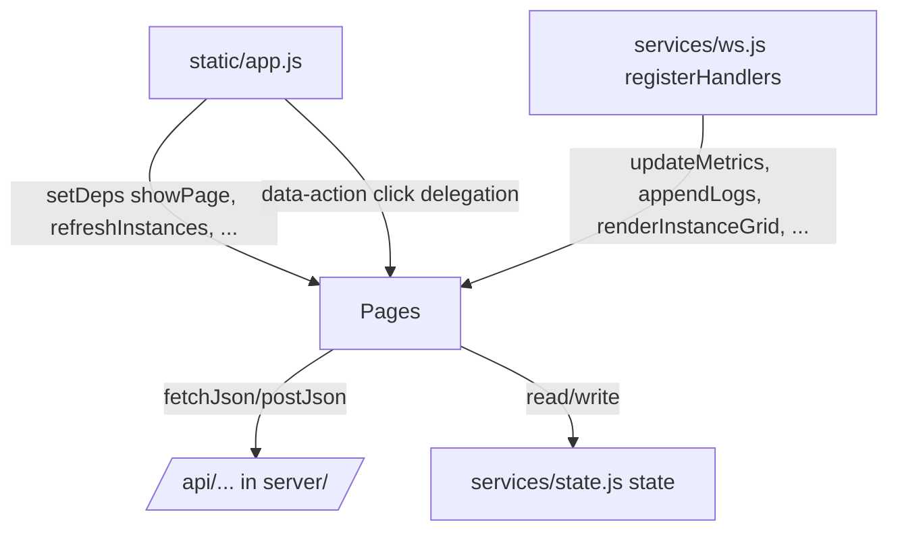

# pages

Path: `src/fsm_llm/monitor/static/pages`
Purpose: Page-level ES modules of the FSM-LLM Monitor frontend (vanilla JS, no build step); each renders one screen as HTML strings and calls the monitor REST API.

## Scope

Rendering and user actions for Dashboard, Control Center (with detail drawer), Conversations (drawer sub-view), Launch modal, Visualizer, Builder, Logs, Settings.

Not here: routing, click and keyboard delegation, dependency wiring, and the 10 s refresh timer (`src/fsm_llm/monitor/static/app.js`); HTTP, shared state, auth, WebSocket (`static/services/api.js`, `state.js`, `auth.js`, `ws.js`); escaping, formatting, markdown, graph drawing (`static/utils/dom.js`, `format.js`, `markdown.js`, `graph.js`); markup and element ids (`src/fsm_llm/monitor/templates/index.html`); styles (`static/style.css`); REST routes (`src/fsm_llm/monitor/server/`).

## Architecture

- Circular imports between pages are avoided by forward references: `builder.js`, `control.js`, `conversations.js`, `launch.js` export `setDeps(deps)`; `dashboard.js` exports `setNavigateToInstance(fn)` (app.js passes `control.navigateToInstance`). Direct page-to-page imports that do exist: `control.js` imports `showConversationInDrawer` from `conversations.js` and `refreshInstances` from `dashboard.js`; `builder.js` imports `addTypingIndicator`/`removeTypingIndicator` from `conversations.js`.
- Page-local state lives in module-level `let` variables (pagination, filters, hashes, builder session). Cross-page state lives on `state` (`currentPage`, `instances`, `selectedDetailId`, `selectedDetailType`, `selectedConvId`, `selectedConvInstanceId`, `selectedConvReadOnly`, `detailPollTimer`, `presets`, `workflowPresets`, `capabilities`, `stubToolCount`, `autoScrollLogs`, `_lastContextData`).
- Buttons in generated HTML use `data-action="..."`; `app.js` maps them to exported functions. Actions emitted here: `open-drawer`, `start-conv`, `cancel-agent`, `destroy-instance`, `ctrl-page-prev/next`, `go-to-conv`, `end-conversation`, `advance-workflow`, `cancel-workflow`, `send-workflow-event`, `navigate-instance`, `inst-page-prev/next`, `activity-row-click`, `activity-page-prev/next`, `clear-dashboard-config`, `filter-presets`, `select-preset`, `remove-stub-tool`, `copy-context`.
- Clickable non-button elements carry `tabindex="0"`; `app.js` turns Enter/Space on a focused `[data-action]` element into a click. Instance cards, activity rows and preset cards also get `role="button"`. Control-table rows and FSM conversation cards hold nested buttons, so they get `tabindex` and `aria-label` only.

## Key files

| File | Role | Notes |
| --- | --- | --- |
| `dashboard.js` | Metrics, event feed (max 50 entries), instance grid (12/page), activity table (20/page), custom panels and alerts | `refreshInstances` is shared with control, launch, builder, conversations |
| `control.js` | Unified table (25/page), drawer, per-type detail, agent tool calls, workflow Send Event form | Drawer polls every 2000 ms via `state.detailPollTimer`, skipped while the conversation sub-view is shown |
| `conversations.js` | Conversation detail and chat in the drawer, End conversation | `_detailRequestId` drops stale responses; `_sendingConvId` defers re-renders during a send and refuses a second send (toast); a render of another conversation enables the input; the owner is the explicit instance id, else the snapshot's `instance_id`, else the view is read-only (`selectedConvReadOnly`: no chat input, no End, `sendChatMessage` and `endConversation` refuse before any POST), there is no first-FSM fallback (D-010 of plan 9283c1fd); a failed send is always a toast (`Message not sent: <reason>`), and the error bubble and the typed text coming back need `selectedConvId` to still be that conversation (the text only into an empty input); a failed load returns first when a newer request or another conversation owns the view, and a current failure shows the server's reason (escaped) and hides the input; the chat input is focused after a send only while the same conversation is shown and the input is visible; the detail also shows the cut-off line and the classification and tie-classifier panels when the snapshot carries them |
| `launch.js` | Launch modal | `TOOL_TEMPLATES` (the stub tools); default FSM temperature 0.5, agent `max_iterations` 10; the agent select is filled from the launchable rows of `loadAgentTypes()`; every launch reads `_modalEpoch` at the click and the one `_afterLaunch` timer (500 ms) closes the modal and moves to Control only when the epoch is unchanged (a modal closed or reopened meanwhile navigates nowhere); the button is re-enabled after the window only by the launch that owns it (`btn._launch`, a per-button counter: an earlier window never frees the button of a newer launch); a launch that created the instance and then failed to start its first conversation says `Launched: <label>, but starting the first conversation failed: <reason>` (not `Launch failed`; also a toast) and still moves to Control; `state.capabilities` defaults to allowed and a failed `/api/capabilities` keeps the last value and shows one toast; tool template options are built with `createElement` and `textContent` |
| `visualizer.js` | Graph rendering for fsm/agent/workflow, preset dropdown, split pane | Uses `renderGraph` from `utils/graph.js`; the agent select is filled from the drawable rows of `loadAgentTypes()`; a failed request that a newer one superseded (`_vizSeq`) returns `null` and shows no toast |
| `builder.js` | Meta-builder chat and launch | posts the agent id of the artifact as it is (no map; `test_agent_selects.py` pins the builder enum against the registry ids); `_sessionToken` drops replies from abandoned sessions; `_abort` and `_elapsedTimer` belong to the send in flight |
| `eventlog.js` | Event log panel of the Logs page (`loadEventLogs`, `openEventLog`) | Read only; every id and field goes through `esc()`; shown on page show and by Refresh; the first page keeps the `the first events only` note while the server gives `next_seq`, and `Load more` (action `eventlog-more`) appends the next page by `?since_seq=<next_seq>` into the same table (never refetching the first page, ignored while a page is in flight, a failed page keeps the earlier rows and shows its reason under the table), up to `EVENTLOG_MAX_ROWS` (2000 rows) with a line saying where the log continues, and `No more events to show` at the end; a module token bumped by every open drops the reply of an older open or page |
| `logs.js` | Log stream | Pause buffer cap 5000, DOM cap 1000, de-dup key set cap 10000; `clearLogs` also keeps a copy of the seen keys (`_clearedKeys`) that `refreshLogs` filters out, so a pill toggle, a search or a page show never brings cleared records back and a later record still shows; one `GET /api/logs?limit=1&level=TRACE` at the Clear gives the newest server timestamp of ANY level (`_clearedBefore`, only moves forward) and a rebuild drops every record not newer than it, so a pill that lowers the minimum level shows no record from before the Clear; `refreshLogs` awaits that request first (`_clearCursorPending`, it never rejects), so a rebuild during it waits instead of showing the old records, for at most `_CURSOR_WAIT_MS` (a bounded timer, so a cursor request that never answers cannot freeze later refreshes; a cursor that lands later still applies from the next rebuild); the search, both filters (refresh and WebSocket append) and the highlight read one `_logText(r)` (`module:line [conversation_id] message`) |
| `settings.js` | Config form and API key field | Reset defaults 1.0 / 1000 / 5000 / INFO; client bounds in `LIMITS` |

## Public interface

Exports called by `app.js` or `ws.js`, grouped by file:

- `dashboard.js`: `loadDashboardConfig`, `clearDashboardConfig`, `updateMetrics(m)`, `updateEvents(events)`, `renderInstanceGrid`, `instPagePrev`, `instPageNext`, `onInstSearchInput`, `refreshInstances`, `toggleActivityEnded`, `onActivitySearchInput`, `activityPagePrev`, `activityPageNext`, `refreshActivityTable`, `navigateToInstance` (exported `let` binding), `setNavigateToInstance(fn)`.
- `control.js`: `setDeps({showPage})`, `filterControlInstances(filter, btn)`, `onCtrlSearchInput`, `refreshControlCenter`, `renderUnifiedTable`, `ctrlPagePrev`, `ctrlPageNext`, `openDrawer(id, type)`, `closeDrawer`, `navigateToInstance(id, type)` (shows control, opens drawer after 100 ms), `refreshDetailPanel(id, type)`, `advanceWorkflow(id, wfId)`, `cancelWorkflow(id, wfId)`, `sendWorkflowEvent(id)`, `updateRunningAgents(updates)`, `startConversationOn(id)`, `destroyInstance(id)`, `cancelAgent(id)`.
- `conversations.js`: `setDeps({showPage, refreshActivityTable, refreshDetailPanel, openDrawer, refreshInstances})`, `showConversationInDrawer(instanceId, convId)` (calls `openDrawer(instanceId, 'fsm', { fetchDetail: false })` first when that FSM is not the drawer selection, so Back works after a launch without a request for the hidden panel; an empty `instanceId`, the attached API, makes `openDrawer('')` clear `selectedDetailId`, `selectedDetailType` and the two drawer panels, so Back shows and refreshes nothing stale, clears the selected Control table row too (also before its early return), and raises the read-only flag; the title is `Conversation` with no instance prefix and the Back button is hidden, because there is no panel to go back to, while a managed conversation keeps `<label> -> Conversation` and Back), `drawerBack`, `showConversationDetail(convId)`, `endConversation(instanceId, convId)`, `copyContextData`, `sendChatMessage`, `addTypingIndicator(el)`, `removeTypingIndicator()`.
- `launch.js`: `setDeps({showPage, refreshInstances, showConversationInDrawer})`, `showLaunchModal`, `closeLaunchModal`, `toggleLaunchFSMSource`, `filterPresets(cat)`, `selectPreset(card)`, `doLaunchFSM(btn)`, `doLaunchWorkflow(btn)`, `addToolFromTemplate`, `addStubTool`, `onAgentTypeChange`, `doLaunchAgent(btn)`.
- `visualizer.js`: `visualizeGraph(type, typeValue)` (returns `true` on success, `false` on failure with a toast, `null` when there was nothing to render; an empty agent or workflow value clears the svg, info and table; a reply of an older request is dropped), `visualizeFSM`, `switchVizDetail(tab, btn)`, `useFSMPreset(id)`, `initVizDivider`, `initVizEditor` (colours the FSM source textarea through `attachJsonOverlay`).
- `builder.js`: `setDeps({showPage, refreshInstances})`, `builderJumpToLatest`, `onBuilderScroll`, `startBuilderSession`, `sendBuilderMessage`, `cancelBuilderSend`, `editBuilderResult`, `copyBuilderResult`, `downloadBuilderResult` (file `artifact.json`), `launchBuilderResult`, `resetBuilder`.
- `logs.js`: `toggleLogPill(btn)`, `onLogSearchInput`, `logJumpToLatest`, `onLogScroll`, `toggleLogPause`, `clearLogs`, `appendLogs(logs)`, `onShowLogs` (page-show hook; skipped while paused and the stream is non-empty), `syncLogs` (called by the 10 s timer in app.js; append-only catch-up), `refreshLogs` (full rebuild).
- `settings.js`: `loadSettings`, `saveSettings`, `resetSettings`, `saveApiKeySetting`, `clearApiKeySetting`.

## REST endpoints used

| Method + path | Caller |
| --- | --- |
| GET `/api/auth` (through `checkAuthRequired` in `services/auth.js`) | settings |
| GET `/api/instances`, DELETE `/api/instances/{id}`, GET `/api/instances/{id}/events?limit=100` | dashboard, control |
| GET `/api/activity` | dashboard |
| GET/DELETE `/api/dashboard/config` | dashboard |
| POST `/api/fsm/launch`, POST `/api/fsm/{id}/start`, POST `/api/fsm/{id}/converse` `{conversation_id, message}`, POST `/api/fsm/{id}/end` `{conversation_id}`, GET `/api/fsm/{id}/conversations` | launch, builder, control, conversations |
| GET `/api/conversations/{convId}` | conversations |
| GET `/api/workflow/presets`, POST `/api/workflow/launch` (presets only), GET `/api/workflow/{id}/instances`, POST `/api/workflow/{id}/advance` `{workflow_instance_id, user_input: ''}`, POST `/api/workflow/{id}/cancel` `{workflow_instance_id, reason}`, POST `/api/workflow/{id}/event` `{event_type, payload, workflow_instance_id ("" = broadcast)}` -> `{affected}` | launch, control |
| GET `/api/agent/types`, POST `/api/agent/launch`, GET `/api/agent/{id}/status`, POST `/api/agent/{id}/cancel` | launch, builder, control |
| GET `/api/capabilities` | launch |
| GET `/api/presets` | launch, visualizer |
| GET `/api/preset/fsm/{id}` | visualizer |
| POST `/api/fsm/visualize`, GET `/api/fsm/visualize/preset/{id}` (used when the value contains `/`), GET `/api/agent/visualize?agent_type=<id>`, GET `/api/workflow/visualize?workflow_id=` | visualizer, builder |
| POST `/api/builder/start` `{model, temperature}`, POST `/api/builder/send` `{session_id, message}`, DELETE `/api/builder/{sessionId}?force=true`, GET `/api/capabilities` (the `agent_types` list gates Launch) | builder |
| GET `/api/logs?limit=500&level=<min active level>`, GET/POST `/api/config`, GET `/api/info` | logs, settings |

## Data shapes

- Instance (`/api/instances`): `instance_id`, `instance_type` (`fsm|workflow|agent`), `label`, `status`, `source`, `conversation_count`, `agent_type`, `task` (optional, already truncated server side; the table shows its first 40 chars), `active_workflows`, `created_at`.
- Activity row (`/api/activity`): `item_type` (`fsm_conversation|agent_task|workflow_instance`), `item_id`, `instance_id`, `label`, `current_step`, `detail`, `status`, `is_terminal`.
- Conversation (`/api/conversations/{id}`): `conversation_id`, `instance_id`, `current_state`, `state_description`, `is_terminal`, `stack_depth`, `context_data`, `last_extraction`, `last_transition`, `last_response`, `message_history[{role, content}]`.
- Workflow instance (`/api/workflow/{id}/instances`): `workflow_instance_id`, `status`, `current_step`, `history[{step_id, message, data, error, timestamp}]`, `context`, `created_at`, `updated_at`, or an entry with `error` (skipped). Context is shown as sent: the server already drops internal-prefix and secret-looking keys, so there is no client-side key filter.
- Agent status: `status`, `agent_type`, `task` (a JSON string is reduced to its `description`, `task`, or `name`), `iteration_count`, `max_iterations`, `current_state`, `last_tool_call`, `conversation_log[]` (entry `type: start|transition|context|error|end`), `answer`, `error`, `tools_used[{tool_name, parameters}]`, `success`, `total_iterations`. The drawer of a finished agent shows the tool calls of the status answer and the result banner; the drawer does not fetch `GET /api/agent/{id}/result` (it has no per-step trace to show).
- Builder reply: `session_id`, `response`, `internal_state` (`phase|current_state`, `turn_count`, `artifact_type`, `builder_progress{percentage, missing}`, `builder_summary`, `artifact_preview`; any other key shows in the Raw JSON block when there is no progress or summary), `is_complete`, `artifact`, `artifact_json`, `artifact_type` (`fsm|workflow|agent`), `is_valid`, `validation_errors`, `error`.
- Custom dashboard config (`/api/dashboard/config` returns `{active, config}`): `name`, `description`, `panels[{panel_id, title, metric, description}]`, `alerts[{alert_id, metric, condition (> < >= <= == !=), threshold, description}]`. Metric lookup order: top-level metrics field, then `events_per_type`, then `states_visited`.
- Config (`/api/config`): `refresh_interval`, `max_events`, `max_log_lines`, `log_level`, `show_internal_keys`, `auto_scroll_logs`.
- Log record: `timestamp`, `level`, `module`, `line`, `message`, `conversation_id`.

## Invariants and constraints

- Escape every interpolated value with `esc()`. User text in chat bubbles is escaped; assistant text goes through `renderMarkdown` (which escapes first). Server enum-like values used in class attributes go through a whitelist (`levelClass`, `_INSTANCE_TYPES`), and numbers placed in `style` are coerced and clamped (builder progress 0..100, agent progress 0..95).
- Drawer refreshes (`refreshDetailPanel`): each gets a token; only the latest token for the selected instance paints. A refresh requested while one is in flight for the same `type:id` key is queued. `openDrawer`/`closeDrawer` call `_resetDetailRequests`, which bumps the token and cancels the `ctrl-detail`, `ctrl-detail-wf`, `conv-detail` refresh timers. Content repaints only when the generated HTML changed; a repaint keeps the open state of every `
` (by index), form values and focus (Send Event form), drawer scroll, and inner `.chat-container` scroll (stuck to the bottom only if the user was at the bottom).
- `closeDrawer` must clear `state.detailPollTimer`; `openDrawer` replaces any existing timer.
- `updateRunningAgents` refetches only when the pushed update for the selected agent changed (JSON signature).
- Change detection: `renderUnifiedTable` and `renderInstanceGrid` skip re-render when `hashInstances` (over `instance_id:status:conversation_count:active_workflows`) is unchanged, so a count change alone re-renders both; a change to only `label` (immutable after launch) does not until a filter, search, or page change resets the hash. `refreshInstances` carries a request id: a superseded reply assigns, toasts and clears nothing, and the latest request ends the "Loading instances..." spinner on success, an empty list and an error alike (the hash early return of an empty monitor used to leave it).
- Drawer events use a length plus first/last timestamp hash to skip redraws.
- Agent event view (`_enrichAgentEvents`): transition to `think` -> `iteration`, to `act` -> `tool_call`, to `conclude` -> `conclude`, other state changes -> `transition`; `conversation_start` -> `agent_init`, `conversation_end` -> `agent_done`, `context_update` -> `context`, `error` kept; everything else (pre/post processing) is dropped.
- Workflow Advance/Cancel buttons show for status `running|pending|active`; the Send Event target list offers only instances in `running|pending|active|waiting` (finished runs are not listed) and defaults to the first of them, else broadcast. Payload must be a JSON object.
- Logs: records are de-duplicated by `timestamp|level|module:line|message` across WS pushes, `syncLogs`, and `refreshLogs`. Pause buffers new records and resume renders only those. `clearLogs` keeps records marked as seen so sync does not bring them back and remembers them in `_clearedKeys`, so a rebuild (pill toggle, search, page show) leaves them hidden while a later record shows; the newest server timestamp of any level (one unfiltered request at the Clear) hides what the keys never saw, the records below the level shown at the Clear. A record logged between the click and that reply counts as cleared on a later rebuild; a rebuild started inside that window waits for the reply. The search matches what an entry shows, the module, the conversation id and the message, case-insensitive, on the refresh and the WebSocket append path (the regex characters of the query only reach `highlightText`, which escapes them). The sidebar badge counts ERROR/CRITICAL lines received (not the server's error metric) and shows `99+` above 99. `state.autoScrollLogs` (from Settings) gates auto-scroll.
- Activity rows: a row of `fsm_conversation` always carries `activity-row-click`, also with an empty `instance_id` (a conversation of the attached API, opened read-only); an agent or workflow row needs its instance id.
- Conversations: while a chat send is in flight for a conversation, `showConversationDetail` for it is deferred and re-run once the send finishes.
- Workflow step data in the drawer goes whole through `jsonViewHtml` up to `STEP_DATA_MAX_CHARS` (20000); beyond it the first 20000 characters are an escaped `pre` labelled `Truncated raw text, not valid JSON` with an `N more characters not shown` line, never inside a `json-view` (`.step-data` is height-bounded by CSS).
- Builder: the input area is shown by the start reply (after the token check), never before it, and stays hidden after a failed start; a send paints its `Building artifact... 0 s` status at once. Starting a session or resetting aborts the send in flight, bumps `_sessionToken` and force-DELETEs the previous unfinished server session; a late start reply is dropped and its session DELETEd; Cancel does the same for the running send and leaves the session closed. Start sends `max_tokens` from the Max Tokens field. Agent launch is two-click (the first shows the form: label, model, max iterations, timeout, stub tool responses; the second submits). The model field is pre-filled from the Builder Model field, never from `artifact.config.model` (a template value of every built agent and model-authored text); label and limits are pre-filled from the artifact and the server bounds them. Edit JSON swaps the result text for a textarea; Apply only parses it (never executes it), shows a parse error and refuses a non-object, and Launch waits while the editor is open; the launch route is the validator. Launching a built FSM opens its conversation in the drawer. Workflow artifacts are never launched (button disabled, `WORKFLOW_LAUNCH_NOTE` shown).
- A row of `loadAgentTypes()` (`services/api.js`) with `needs_tools` and no `tool_names` requires at least one tool in both launch paths (`toolsRequired(id)`; the Builder refusal names Edit JSON as the way to add one); a row that `takes_tools` shows the tools form.
- Launch FSM also starts one conversation (`initial_context: {}`) and, after 500 ms, opens it in the drawer, provided the launch modal is still the one that launched it (see the `launch.js` row). The builder's FSM and agent launches share one guard, `_launching`: one launch per click series, the button disabled for the whole flight and the 500 ms window after a success, and re-enabled at once after a failed POST. The redirect to Control (and the new conversation of an FSM launch) is one `_afterLaunch` timer that moves only while `_sessionToken` and `state.currentPage` are those of the click: a Reset, a new start or another page inside the window cancels the move, never the release.
- Settings validates `refresh_interval` 0.5..60 and `max_events`/`max_log_lines` integers 10..100000 before POST, marking bad fields `aria-invalid`. The API key is stored in sessionStorage only (via `services/auth.js`).
- Modals and the drawer open with `openDialog` (focus moves in) and close with `closeDialog` (focus restored); Tab stays inside the open one.

## Dependencies

- `../services/api.js`: `fetchJson`, `postJson`, `loadAgentTypes`, `agentRow`, `toolsRequired`.
- `../services/state.js`: `state`, `scheduleRefresh(key, fn, ms)`, `cancelRefresh(...keys)`, `DEFAULT_AGENT_TYPE`.
- `../services/auth.js`: `getApiKey`, `setApiKey`, `clearApiKey`, `checkAuthRequired` (settings only).
- `../utils/dom.js`: `$`, `esc`, `statusBadge`, `hashInstances`, `showToast`, `showError`, `showStatus`, `levelClass`, `highlightText`, `renderPagination`, `showDrawerDetailView`, `renderLLMData`, `jsonViewHtml`, `renderResultBanner`, `copyToClipboard`, `openDialog`, `closeDialog`, `numVal`, `intVal`.
- `../utils/format.js` (`formatTime`, `relativeTime`, `formatNumber`), `../utils/markdown.js` (`renderMarkdown`), `../utils/graph.js` (`renderGraph`), `../utils/json_highlight.js` (`highlightJsonIn`, `renderJson`: `eventlog.js`, `conversations.js`, `builder.js` and `control.js` mark their JSON with `jsonViewHtml` and colour it after the `innerHTML` assignment; a page that shows JSON must do the same).
- Element ids from `src/fsm_llm/monitor/templates/index.html` (for example `ctrl-drawer`, `conv-detail`, `builder-chat`, `log-stream`, `viz-svg`). Renaming an id there breaks the page silently because most lookups are null-guarded.

## Failure modes

- REST failures surface as toasts (`showToast`) or inline `showError`/`showStatus`, and are logged to `console.error`. `fetchJson` formats server `detail` into the error message; on a 401 it prompts for the API key once and retries the request once.
- Missing DOM elements are mostly guarded and skipped; `_renderInternalState` in `builder.js` warns to hard-refresh when `builder-state-content` is missing.
- Conversation detail races are dropped via `_detailRequestId` and the selected conversation id, in the success path and in the catch. A failed load of the current conversation shows "Failed to load conversation: <reason>" and hides the chat input; a failure of a superseded request touches nothing.
- Builder completion with `error` and an empty artifact shows an ERROR badge and hides launch. A failed builder graph render shows the error in `#builder-result-graph-error` and keeps `#builder-result-svg` in the DOM.
- An instance missing from the cached list triggers one `refreshInstances`; if still missing, the drawer closes.

## Working here

- New page: create `<name>.js` here, export render and action functions, add markup in `templates/index.html`, register routing and `data-action` handlers in `static/app.js`, and add WebSocket handlers in the `registerHandlers({...})` call in `app.js` if it needs pushes.
- New action button: emit `data-action="<name>"` plus `data-*` args in the HTML and add the entry to the `ACTIONS` map in `app.js`.
- New REST call: add the route in the `src/fsm_llm/monitor/server/routes_*.py` module of its group first; keep `detail` in error bodies so `fetchJson` can show it.
- Keep every new interpolation behind `esc()`, and add new server-supplied class names to a whitelist.
- Tests: `tests/test_fsm_llm_monitor/` covers the Python server, and `test_static_js.py` runs node probes (`static_probes/*.mjs`, on a DOM stand-in, skipped without node 18 or newer) for the chat switch in `conversations.js`, the Send Event targets in `control.js`, the custom panels of `dashboard.js`, the launch modal of `launch.js` and the launch, cancel, edit and start requests of `builder.js`; the other behaviour of the pages has no automated test. Verify it manually with `fsm-llm-monitor` (http://127.0.0.1:8420).
