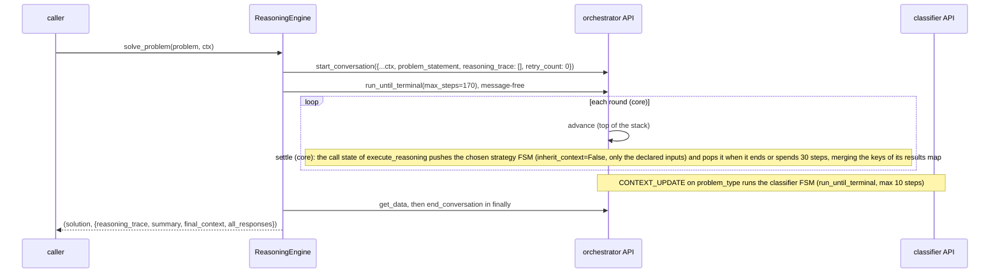

# fsm_llm.reasoning

Path: `src/fsm_llm/reasoning`
Purpose: Multi-strategy reasoning engine on top of core `fsm_llm`: an orchestrator FSM analyses a problem, a classifier FSM recommends a strategy, one of the strategy FSMs is pushed and driven, the solution is validated with up to 3 retries, and `solve_problem` returns `(solution, trace_info)`.

## Scope

Subpackage of the `llm-fsm` distribution (core package `src`, which runs JSON-style FSM definitions through a 2-pass LLM pipeline: Pass 1 extracts data and evaluates transitions, Pass 2 writes the reply). Here: the `ReasoningEngine`, the FSM definitions (one JSON envelope per FSM under `strategies/`, package data read by `strategy_files.py`), its handlers, Pydantic models, and the `python -m fsm_llm.reasoning` CLI. No third-party deps beyond core; the pyproject `reasoning` extra is empty. Version is `fsm_llm.__version__` (0.12.0), re-exported via `__version__.py`.

Not here: the FSM runtime (`API`, handlers, stacking) lives in core `fsm_llm`. Consumers: `fsm_llm.agents.reasoning_react` (`ReasoningReactAgent`, imported conditionally), `fsm_llm.has_reasoning`/`get_reasoning`, and `examples/reasoning/math_tutor`.

## Architecture

The engine sends no user message: the classifier and the orchestrator run on core `run_until_terminal` (message-free steps; the problem reaches the model through context), and one orchestrator run drives every strategy FSM, which the `call` state `execute_reasoning` pushes and pops (plan baa37f40 step 15, D-031; the `before_step` hook `_StrategyStack` of D-053 of plan 944e2692 is gone). The engine owns no loop over steps.

Orchestrator (`reasoning_orchestrator`) state flow (`execute_reasoning` is a core `call` state): `problem_analysis -> strategy_selection -> execute_reasoning -> synthesize_solution -> validate_refine -> final_answer` (terminal). `problem_analysis` leaves only once `problem_type` and `problem_components` are present (condition with `requires_context_keys`). `validate_refine` has two transitions: priority 1 to `final_answer` when `validation_result == true` or `max_retries_reached == true`; priority 2 back to `execute_reasoning` when `validation_result == false` and `max_retries_reached != true`. Other transitions are unconditional.

Classifier (`problem_classifier`): `analyze_domain -> analyze_structure -> identify_reasoning_needs -> recommend_strategy` (terminal), producing `recommended_reasoning_type`, `strategy_justification`, `alternative_approaches`, `problem_domain`. `recommended_reasoning_type` is a core classification (plan baa37f40 step 5b, D-019): `recommend_strategy` carries one `classification_extractions` entry with the nine strategies as closed intents (names are the strategy names, descriptions are `capped_line(description, 300)` of the strategy facts, `fallback_intent` `analytical`, `confidence_threshold` 0.6, `required` false, `include_entities` false), so the choice is ONE `complete` request with a closed `enum` and no per-field call. The file is written by `tests/test_fsm_llm_reasoning/classifier_file.py`, never typed (a row pins file equals derivation). A pick below 0.6 is discarded by core, an unknown intent maps to the fallback, an outage or a cut reply is a soft `ClassificationError`: the key stays unset and `_classification_from` ends on `analytical` with ONE WARNING ("No recommended reasoning type was produced"). The classifier runs as the post-transition extraction of its last state, which core logs as non-fatal for any exception, so a bug in a host's `complete` ends on `analytical` too (with the core WARNING "Post-transition extraction failed").

Handler-only keys (core `handler_only_keys`, no extraction may write them): the orchestrator lists `ORCHESTRATOR_HANDLER_ONLY_KEYS` (`validation_result`, `validation_checks`, `max_retries_reached`, `retry_count`, `solution_confidence`, `reasoning_type_selected`, `classified_problem_type`, `hybrid_loop_count`, `calculation_result`, `calculation_error_details`), so a model reply cannot open the validation gate or pick the strategy (`classified_problem_type` is the choice key of the `execute_reasoning` call: it holds the target id `reasoning.<strategy>`, written only by `_classify_problem`; the roadmap's "public key" wording is deliberately not followed, D-031 of plan baa37f40); `validate_refine` and `final_answer` ask the model for none of them. The hybrid FSM lists `hybrid_loop_count` too (the strategy frame writes it; the orchestrator list keeps a model claim out of `final_context`).

Strategy FSMs are linear chains ending in a terminal state, except `hybrid`, whose `critical_evaluation` state loops back to `identify_components` (priority 2) when `needs_refinement == true` and `hybrid_loop_count < 2`, else goes on (priority 1).

`simple_calculator` computes in Python: `extract_elements` extracts ONE arithmetic expression as `calculation_expression` (a `field_extractions` entry of `field_type: "str"`, so a bare JSON number is read as its text; the instructions translate "15% of 240" to `0.15 * 240` and "2^3" to `2 ** 3` and say not to compute) and is silent (`response_instructions: ""`, no Pass 2 call). Its edge to `perform_calculation` is UNCONDITIONAL on purpose: an edge gated on the expression costs 428 calls when the model leaves it out (3 attempts times 30 sub-steps), against 74 unconditional. `perform_calculation` is a silent terminal state with no extraction: the `CalculatorExecutor` handler writes `calculation_result` and `calculation_error` on entry, both `handler_only_keys` of the FSM (never in `required_context_keys`: FSMValidator would warn that nothing extracts them, D-054), so a model reply can claim neither. A refused expression (division by zero, text that is not arithmetic, a missing expression) is an error result: the merge copies `calculation_error` to `calculation_error_details`, there is no proposed solution, and `validate_refine` retries at most `MAX_RETRIES` times as for any attempt without a solution and a present `calculation_error_details` counts as NO solution in `validate_solution` whatever the model wrote as `proposed_solution` (D-052 of plan 51fde95b: the model's own arithmetic is never the answer). After the budget `finalize_calculation` answers with the fixed `ErrorMessages.CALCULATION_REFUSED` (reason: the calculator's fixed refusal text); `calculation_result` and `calculation_error_details` are orchestrator handler-only keys, only the merge writes them, and `RETRY_CLEARED_KEYS` clears both on every `execute_reasoning` entry, so a stale error, a stale result and a caller's claim never reach the answer. Never add a verdict flag or touch the retry clear for it (D-053, D-054).

`calculator.py` (standard library only, the model text is untrusted): `evaluate_expression(text) -> int | float` and `calculate(text) -> (value, None) | (None, reason)` are total, they raise only `ValueError` with a fixed message and never `eval` or `compile`. Bounds: the text is at most 200 characters (checked before `ast.parse`, which bounds the parse and every int literal), at most 100 expression nodes (a sum of 50 terms passes), `|exponent| <= 1000` for `**` (an integer power whose result cannot fit is refused before it is computed), integers at most 2048 bits (so `str()` never trips the int-to-string limit), only `+ - * / // % **`, unary `+ -`, parentheses and `int`/`float` constants (a `bool`, complex number, string or name is refused), finite results only. `^` is NOT a power: it parses as xor and is refused (no model output contained `^` when the prompt shows `2^3` as `2 ** 3`; a silent rewrite of model text is avoided). An integer-valued float below 2**53 is returned as an `int` (`0.15 * 240` is `36`, `10 / 2` is `5`); any other float keeps its IEEE value (`0.1 + 0.2` is `0.30000000000000004`), and a float that underflows is `0`. The adversarial table of `test_calculator.py` runs on every Python of the matrix.

Risk, not mitigated: the model now only translates the text to an expression, and a small model mis-translates. On a direct probe of 20 prompts a 2B model mis-parenthesised 6 of 20 expressions (it also wrote the computed number for some), a 9B model 0 of 20. A pre-computed number is a valid expression and is accepted silently.

Handlers registered in `ReasoningEngine._register_handlers` (the calculator and hybrid ones through `register_strategy_handlers(api)` in `handlers.py`, called last):

| Name (`HandlerNames`) | Timing | Trigger | Action |
| --- | --- | --- | --- |
| `OrchestratorProblemClassifier` | CONTEXT_UPDATE | `problem_type` updated | `_classify_problem`: skips if `classified_problem_type` set; runs classifier FSM on `problem_statement`, `problem_type`, `problem_components`; returns `classified_problem_type`, `classification_justification`, `problem_domain`, `alternative_approaches`, normalised by `_classification_from` (a missing, non-`str` or blank recommended type becomes `analytical`; a non-`str` justification or domain becomes `""`; alternatives keep their non-blank `str` items, a bare `str` becomes a one-item list; WARNING per replaced value) |
| `OrchestratorStrategySelector` | state entry | `execute_reasoning` | `_select_reasoning_type`: sets `reasoning_type_selected` (the strategy name of the target the call runs, by the call executor's own rule `chosen_target`) and defaults `constraints` to `[]` when absent (the call executor refuses an absent declared input); the `call` state itself pushes and pops the strategy FSM |
| `RetryKeyClearer` | state entry | `execute_reasoning` | core `clear_keys_on_entry`: clears `RETRY_CLEARED_KEYS` (`proposed_solution`, `key_insights`, `validation_result`, `calculation_result`, `calculation_error_details`, `call_result`): the call executor skips a record that already belongs to its state, so the clear is what makes a retry run the strategy again |
| `HybridKeyClearer` | state entry | `identify_components` (only the hybrid FSM has it; the `critical_evaluation` back edge re-enters it) | core `clear_keys_on_entry`: clears `HYBRID_CLEARED_KEYS` (the body keys plus `needs_refinement`, not `hybrid_loop_count`) so each refinement pass re-extracts |
| `OrchestratorSolutionValidator` | CONTEXT_UPDATE | `proposed_solution` updated | `ReasoningHandlers.validate_when_insights_ready`: `validate_solution`, but `{}` (no verdict, no retry spent) while `key_insights` are still missing, so an attempt whose insights arrive in a later commit is judged at `validate_refine` entry by `RetryLimiter` instead of costing a stale False and a whole strategy pass |
| `ContextPruner` | PRE_TRANSITION | always | `ReasoningHandlers.prune_context` |
| `ReasoningTracer` | POST_TRANSITION | always; orchestrator API only (the classifier's own trace was never read) | `ReasoningHandlers.update_reasoning_trace` |
| `RetryLimiter` | state entry | `validate_refine` | `_check_retry_limit`: when the attempt has no `validation_result` (no solution was proposed) it runs `validate_solution` first, so that attempt counts as failed; then `max_retries_reached = retry_count >= 3` |
| `HybridLoopCounter` | state exit | `critical_evaluation` (only the hybrid FSM has it; strategy FSMs run on the orchestrator API) | `ReasoningHandlers.count_hybrid_loop`: `hybrid_loop_count + 1` |
| `CalculatorExecutor` | state entry | `perform_calculation` (only the `simple_calculator` FSM has it; strategy FSMs run on the orchestrator API) | `ReasoningHandlers.execute_calculation`: evaluates `calculation_expression` with `calculator.calculate` (no LLM call); returns exactly `{calculation_result: value, calculation_error: None}` or `{calculation_result: None, calculation_error: reason}` |
| `CalculatorFinalizer` | state entry | `final_answer` | `ReasoningHandlers.finalize_calculation`: for a solve whose `reasoning_type_selected` is `simple_calculator` with a numeric `calculation_result` (`0` yes, `bool` no) returns `{final_solution: str(result)}`, so the model never rewrites the number (it cut `2^100` to 15 digits); with a `calculation_error_details` it returns the fixed `ErrorMessages.CALCULATION_REFUSED` text (never model text); `{}` otherwise, and core then extracts `final_solution` as before |

The classifier, strategy executor, validator, retry limiter, hybrid loop counter and calculator executor are registered `.critical()` (D-058 of plan 944e2692): their failure raises through the step even under core's default `handler_error_mode="continue"`, so `execute_calculation` never raises (`calculate` answers every value with a result or a fixed reason). `ContextPruner` and `ReasoningTracer` are best-effort (a failure is logged and skipped).

Pushed strategy FSMs run through the same orchestrator `API` (same `FSMManager` and handler system), so the unfiltered `ContextPruner` and `ReasoningTracer` also fire on strategy-FSM transitions. Trace entries written in a strategy FSM's context are not merged back; only the keys of the strategy's `results` map return (core `settle` merges every non-None one, plan baa37f40 D-030).

## Key files

| File | Role | Notes |
| --- | --- | --- |
| `engine.py` | `ReasoningEngine` | `_solve_lock` (`threading.Lock`) serializes `solve_problem` per instance |
| `executables.py` | `builtin_executables()`, `SolveExecutable`, `strategy_id` (plan ace7a8c8 step 23, D-061) | The nine strategies as `strategy` documents `reasoning.<name>` (the file `strategies/<name>.json` itself: `body.fsm` is `get_reasoning_fsm(name)`, `body.strategy` the declaration, run by the engine's `FsmBodyExecutable`; `register_strategy_handlers` is its `setup` for `simple_calculator` and `hybrid` only) and `reasoning.solve` (code-backed over `solve_problem`, one engine per run closed in `finally`, no `max_steps`/`max_seconds`). The `reasoning` source of `executable_sources`, registered lazily by `__init__`. `engine.py` is not edited |
| `strategies/*.json`, `strategy_files.py` | package data (plan baa37f40 step 1, D-009): one `fsm-llm/executable` envelope per FSM, canonical text (`indent=2`, `ensure_ascii`, LF), each state carrying its `id`; the nine strategies are `strategy` documents (`description` and `body.strategy` hold the aliases, the result map and the solution key), the classifier and the orchestrator are `fsm` documents. `strategy_files.py` reads them as UTF-8 through `importlib.resources`, never imports one, and holds `FSM_NAMES` and `STRATEGY_ORDER` (two explicit orders: `extract_final_solution` reads the solution keys in `STRATEGY_ORDER`, and a directory glob is alphabetical) | `load_fsm`/`load_document` return deep copies and refuse a name outside `FSM_NAMES`; the D-054 anchor of the orchestrator's `handler_only_keys` lives in `strategy_files.py` (JSON holds no comment); `tests/fixtures/executables/reasoning/*.json` is the byte proof (`body.fsm` of each file is its fixture as decoded text) |
| `calculator.py` | `evaluate_expression`, `calculate`, the bounds `MAX_EXPRESSION_CHARS`, `MAX_EXPRESSION_NODES`, `MAX_EXPONENT`, `MAX_RESULT_BITS` | stdlib only, imports nothing of `fsm_llm`; read by `ReasoningHandlers.execute_calculation` only |
| `handlers.py` | `ReasoningHandlers` (incl. `execute_calculation`, `finalize_calculation`), `register_strategy_handlers(api)` (the calculator and hybrid handlers), `ContextManager`, `OutputFormatter`, `_STOP_WORDS` | all static methods |
| `definitions.py` | Pydantic models on `TimestampedModel` | computed fields; `extra="ignore"`, `validate_assignment=True`, `use_enum_values=True` |
| `constants.py` | `ReasoningType`, `OrchestratorStates`, `ClassifierStates`, `ContextKeys`, `HandlerNames`, `Defaults`, `ErrorMessages`, `LogMessages` | state-name constants spell the state names of `strategies/orchestrator.json` |
| `utilities.py` | `get_reasoning_fsm`, `map_reasoning_type`, `get_available_reasoning_types` | the last two rebuild their table per call from `strategy_files.strategy_facts` (never a module dict) |
| `exceptions.py` | the exception classes | |
| `__main__.py` | CLI | `python -m fsm_llm.reasoning` (no console script) |
| `__init__.py`, `__version__.py` | exports, version | one static `__all__` |

## Public interface

`__all__`: `ReasoningEngine`, `ReasoningType`, `ReasoningStep`, `ReasoningTrace`, `ValidationResult`, `ReasoningClassificationResult`, `ProblemContext`, `ReasoningError`, `ReasoningExecutionError`, `ReasoningClassificationError`, `get_available_reasoning_types`, `__version__`.

- `ReasoningEngine(model: str | None = None, **kwargs)`. `model` goes through core `llm.resolve_model` (argument, then env `LLM_MODEL`; neither raises `ModelNotConfiguredError`; with an injected `llm_interface` no model is needed; an injected interface must implement `complete`, because the strategy choice is a core classification: core `_require_classifier_interface` refuses one that does not with a `ValueError` naming `recommend_strategy`, at construction, BREAKING since step 5b of plan baa37f40). `engine.model` reports the model the injected interface states (`interface_model`), else the `model` argument, else a fixed label; a differing `model=` beside an interface is never refused (D-038 of plan 944e2692). Builds `self.orchestrator` and `self.classifier` with `API.from_definition(fsm, **llm_settings_for(kwargs, model=model), **kwargs)`: `model` is passed only when no `llm_interface` is injected (core refuses a model beside an interface). Loads every FSM at construction (`get_reasoning_fsm`); one missing from the package is a packaging bug and raises `KeyError`.
- `solve_problem(problem: str, initial_context: dict[str, Any] | None = None) -> tuple[str, dict[str, Any]]`. Copies `initial_context`, drops the engine's strategy keys `reasoning_type_selected` and `classified_problem_type` (`SOLVE_DRIVER_KEYS`, WARNING), then sets `problem_statement`, `reasoning_trace = []`, `retry_count = 0` (these override caller values). Returned dict: `reasoning_trace` (`ReasoningTrace.model_dump()`, with `execution_time_seconds` the wall-clock seconds of the solve), `summary` (`OutputFormatter.format_reasoning_summary`), `final_context`, `all_responses` (the start greeting, then every non-None reply of a step; the greeting of a pushed strategy FSM rides on the reply of the step that pushed it). Raises `ReasoningExecutionError` chained from the run's error, with `details={"conversation_id", "responses_so_far", "partial_context"}` (`responses_so_far` is the greeting plus the replies in the history of the frame on top, best effort; `partial_context` is `get_data` of the frame on top, read before the conversation is ended; `None` if the read raises `FSMError` or `ValueError`; the conversation is ended either way), for a spent budget and for any other exception in the run.
- `close() -> None` ends every open conversation of the orchestrator and the classifier API (and closes an event log the engine opened itself); calling it twice is harmless. `ReasoningEngine` is a context manager: `with ReasoningEngine(...) as engine:` closes it on exit.
- `get_reasoning_fsm(fsm_name: str) -> dict` (deep copy; `KeyError` with `FSM definition not found: <name>` if unknown; not the core `fsm_llm.load_fsm_definition`).
- `map_reasoning_type(type_str: str) -> str`: lowercases and strips, maps the values plus aliases (`math`, `arithmetic`, `direct computation`, `logic`, `pattern`, `brainstorm`, `critique`, `mixed`, `explain`, `diagnose`, `analogy`, `compare`, ...). Unknown -> `analytical` with a WARNING.
- `get_available_reasoning_types() -> dict[str, str]`: value -> one-line description.
- CLI: `python -m fsm_llm.reasoning [PROBLEM] [--type/-t TYPE] [--context/-c JSON] [--model/-m MODEL] [--env-file PATH] [--output/-o text|json|detailed] [--save/-s FILE] [--verbose/-v] [--quiet/-q] [--list-types] [--version]`. `--type` choices are the `ReasoningType` values and set `preferred_reasoning_type`. `--context` must be a JSON object (else one stderr line `python -m fsm_llm.reasoning: error: ...` and `sys.exit(1)`). `--quiet` with `--verbose` is an error (exit 1). `--env-file PATH` (`cli_support.add_env_file`) is applied right after the arguments are validated, before the model is resolved; a missing file and a missing model are each one stderr line `python -m fsm_llm.reasoning: error: ...`, exit 1. `--verbose` calls `fsm_llm.logging.setup_cli_logging("INFO")`. `--save` creates parent dirs; `.json` suffix or `--output json` writes JSON (`problem`, `solution`, `trace_info`, `timestamp`), otherwise text; suffixes other than `.json`, `.txt`, `.md` only warn. `--list-types` prints to stdout, and every error of `main()` is one `cli_support.report_error` line on stderr, never the logger (core's `logger.disable("fsm_llm")` drops a record of `fsm_llm.reasoning.__main__` when `main()` runs in-process, runner.py D-018); the traceback of an unexpected error prints only when the parsed `--verbose` is set (an abbreviation like `--verb` counts). `main()` returns 0 on success, 1 on any error or Ctrl-C; it first calls `cli_support.escape_unencodable_output()`, so text the console cannot encode is written as `\uXXXX` and `--save` still runs. The output is `format_solution_output` printed once (`--quiet` prints the stripped solution); `detailed` and `text` show the summary's steps, types and confidence once. `--output detailed` shows at most 10 trace steps.

## Data shapes

- `ReasoningType(str, Enum)`: `simple_calculator`, `analytical`, `deductive`, `inductive`, `abductive`, `analogical`, `creative`, `critical`, `hybrid`.
- Orchestrator states (`OrchestratorStates`): `problem_analysis`, `strategy_selection`, `execute_reasoning`, `synthesize_solution`, `validate_refine`, `final_answer`. Classifier states (`ClassifierStates`): `analyze_domain`, `analyze_structure`, `identify_reasoning_needs`, `recommend_strategy`.
- Context passed to a pushed strategy FSM: non-None `problem_statement`, `problem_components`, `constraints`, `problem_type` (no size cap is passed to `extract_relevant_context`).
- What a strategy returns is the `results` map of its file (`body.strategy.results`, parent key to child key; `strategy_files.strategy_facts`): the `call` state declares no `returns`, so core `settle` merges every non-None child value of the map the pushed target carries (`ResolvedTarget.returns`, D-030), tolerant of a key the child never wrote; the `<type>_reasoning_completed` flags of the old merge are gone:

| Type | Sub-FSM key -> orchestrator key |
| --- | --- |
| `analytical` | `key_insights`, `integrated_analysis` (same names) |
| `deductive` | `conclusion` -> `deductive_conclusion`; `logical_validity` |
| `inductive` | `hypothesis` -> `inductive_hypothesis`; `generalization_strength` |
| `creative` | `best_creative_solution`, `innovation_rating` |
| `critical` | `critical_assessment`; `confidence_rating` -> `assessment_confidence` |
| `simple_calculator` | `calculation_result` -> `calculation_result` and `proposed_solution` (both written by the handler, a `0` is kept); `calculation_error` -> `calculation_error_details` |
| `hybrid` | `final_hybrid_solution`; `reasoning_synthesis` -> `hybrid_synthesis_summary` |
| `abductive` | `best_hypothesis` -> `best_explanation`; `confidence_in_explanation` -> `explanation_confidence` |
| `analogical` | `adapted_solution_or_understanding` -> `analogical_solution`; `analogy_confidence_rating` -> `analogy_confidence` |

- Trace step dict (from `update_reasoning_trace`): `{"from": previous_state, "to": current_state, "context_snapshot": {subset of problem_type, reasoning_strategy, reasoning_type_selected, validation_result, retry_count}}`, read from `_previous_state`/`_current_state`.
- Models: `ReasoningStep{step_type: ReasoningStepType, content (1-10000, stripped), confidence 0-1, evidence (max 50), context_keys_used: set (a sorted list in JSON, a set in python mode), execution_time_ms}`; `ReasoningTrace{steps: list[dict], reasoning_types_used: set[str] (dumped as a sorted list), final_confidence 0-1, execution_time_seconds, context_evolution, decision_points}` with computed `total_steps`, `unique_states_visited`, `reasoning_complexity`, `average_step_time` (a computed name in the input is ignored: `TimestampedModel` has `extra="ignore"`); `ValidationResult{is_valid, confidence, checks, issues, recommendations, validation_criteria}` with computed `passed_checks`, `total_checks`, `pass_rate`, `has_issues`, `validation_summary`; `ReasoningClassificationResult{recommended_type, justification, domain, alternatives (deduplicated), confidence, complexity_assessment, domain_indicators}`; `ProblemContext{problem_statement (3-50000 after strip), domain, constraints, initial_context, priority, expected_solution_type, user_preferences}`. All carry `timestamp` (UTC) and computed `age_seconds`. Enums: `ConfidenceLevel` (4), `ReasoningStepType` (10), `ProblemDomain` (8). The engine itself only builds `ReasoningTrace`, `ValidationResult` and `ReasoningClassificationResult`.
- `Defaults`: `TEMPERATURE 0.7`, `MAX_TOKENS 2000` (neither is passed to `API` by the engine), `MAX_RETRIES 3`, `MAX_TRACE_STEPS 50`, `TRACE_KEEP_START 5`, `CONTEXT_PRUNE_THRESHOLD 8000`, `MIN_SOLUTION_LENGTH 20`, `PRUNE_LIST_MAX_LENGTH 10`, `PRUNE_STRING_MAX_LENGTH 1000`, `MAX_CLASSIFICATION_STEPS 10`, `MAX_TOTAL_STEPS 50`, `MAX_SOLVE_STEPS 170` (= 50 + (3 + 1) * 30, D-013; the 30 is `call.max_steps` of `execute_reasoning` in the orchestrator file, a test pins it).

## Invariants and constraints

- Strategy choice: `_classify_problem` (critical, on the update of `problem_type`; skipped when `classified_problem_type` is set) maps the classifier's recommendation with `map_reasoning_type` (unknown spelling: `analytical`, WARNING), then `preferred_reasoning_type` wins when `lookup_reasoning_type` knows it (an unknown one is warned once and IGNORED, since step 15 of plan baa37f40; before it forced `analytical`), and writes the target id `reasoning.<strategy>` to `classified_problem_type`. The `call` state picks that target when it is in its closed list of nine, else `reasoning.analytical` (D-031; the old D-009 rule "never substitute another loaded type" holds by construction: a listed target the registry cannot resolve fails the call as `failed/unknown_target` and the solve goes on without it). `reasoning_strategy` (a model extraction) is never read for the choice.
- `validate_solution` (a non-`str` `problem_type` reads as `""`): "simple" when `problem_type` contains `arithmetic` or `calculation`, or `reasoning_strategy` is `simple_calculator`, or `reasoning_type_selected == simple_calculator`. Checks `has_solution` (anything but `None` or `""`: a `0` or `False` answer is a solution, the same rule as `extract_final_solution`; false whenever `calculation_error_details` is present), `has_insights` (true for simple), `sufficient_detail` (stripped length > 20, or just `has_solution` for simple), `addresses_problem` (content-word overlap after `_STOP_WORDS` removal; true if the problem has no content words; just `has_solution` for simple). On failure with `retry_count < 3` it increments `retry_count`; `max_retries_reached = retry_count >= 3` after the increment. Returns `retry_count`, `validation_checks`, `validation_result`, `solution_confidence` (fraction of checks passed), `max_retries_reached`.
- `prune_context`: no-op while `json.dumps(context, default=str)` is at most 8000 chars; above that, `logical_steps`, `observations`, `creative_ideas` lists are cut to their last 10 items and `reasoning_trace` to its first `Defaults.TRACE_KEEP_START` (5) and last 5 (`_head_and_tail`, the rule of `update_reasoning_trace` too) and strings over 1000 chars to 1000 + core's `MESSAGE_TRUNCATION_SUFFIX` (`... [truncated]`).
- `update_reasoning_trace`: over 50 entries, keeps the first `Defaults.TRACE_KEEP_START` (5) and last 45, then appends the new step.
- Strategy FSM: pushed by core `settle` at the end of the turn that entered `execute_reasoning` (the call executor writes the request on arrival, with only the declared inputs `problem_statement`, `problem_components`, `constraints` and `problem_type`, `inherit_context=False`), popped when it has ended or spent `call.max_steps` (30) of its own frame budget: a spent frame ends `aborted/budget_spent` and its partial results are dropped. The pop merges the strategy's result keys and the final `call_result` in ONE delta; `call_result` joins `RETRY_CLEARED_KEYS`, so every entry clears it and a retry runs the strategy again. A cancelled or interrupted solve ends both frames.
- `extract_final_solution` order: `final_solution`, `proposed_solution`, `calculation_result`, `integrated_analysis`, `deductive_conclusion`, `inductive_hypothesis`, `best_creative_solution`, `critical_assessment`, `final_hybrid_solution`, `best_explanation`, `analogical_solution`; the first non-None, non-empty value is returned as `str`. Else `Maximum retry attempts exceeded` if `max_retries_reached`, else `Solution process completed, but no explicit solution found.`
- Reasoning types in the trace come from `reasoning_type_selected` in the final context and in trace snapshots; empty -> `["unknown"]`. `final_confidence` is `solution_confidence` (default 0.0).
- Writers that emit context outside the process (CLI `--output json`, `--save` JSON) use `fsm_llm.context.filtering.redacting_json_default`. The `default=str` uses in `handlers.py` only measure size with `len()` and never emit. `ReasoningTrace` serializes `reasoning_types_used` (a `set[str]`) as a sorted list through a `field_serializer`, so `model_dump()`, CLI JSON output and JSON save files carry a list; do not teach `redacting_json_default` about sets (D-002 of plan 0051e159).
- The orchestrator conversation is ended in a `finally` after a successful solve; a failed solve goes through one `_failed_solve`, which reads `partial_context` from the top frame first (after `end_conversation` core answers only from its bounded ended-conversation cache), then ends the conversation and raises. The classifier conversation is ended in a `finally` as well. A `KeyboardInterrupt` or `SystemExit` during the run ends the orchestrator conversation (and a pushed strategy frame with it) and propagates unwrapped, never as `ReasoningExecutionError`.
- The engine sends no user message and owns no loop over steps: no `converse(` and no "Continue reasoning" anywhere in `src/fsm_llm/reasoning` (pinned by `test_engine.py`). It never imports `fsm_llm.agents`.
- State-name constants and the state names of `strategies/orchestrator.json` must stay in sync.

## Dependencies

- Core `fsm_llm`: `API` (`from_definition`, `start_conversation`, `run_until_terminal`, `get_data`, `update_context`, `push_fsm`, `pop_fsm`, `get_stack_depth`, `has_conversation_ended`, `end_conversation`, `register_handler`, `create_handler`), `ContextMergeStrategy`, `handlers.HandlerTiming`, `definitions.FSMError`, `logging.logger` and `setup_cli_logging`, `context.filtering.redacting_json_default`, `llm.resolve_model`.
- pydantic v2 for the models. Stdlib `argparse`, `json`, `threading`, `copy`.

## Failure modes

- Exceptions: `FSMError` -> `ReasoningError(message, details=None)` -> `ReasoningExecutionError(message, reasoning_type=None, **kwargs)`, `ReasoningClassificationError`.
- `ReasoningClassificationError`: classifier did not end within 10 steps, or any classifier exception (wrapped once). It is raised inside a critical CONTEXT_UPDATE handler, so core raises it as `HandlerExecutionError` through the orchestrator step and `solve_problem` re-wraps that as `ReasoningExecutionError` (the classification error is in the `__cause__` chain). The same holds for an exception in the strategy selector, the validator, retry limiter or hybrid loop counter: each stops the solve at once.
- A spent run budget (`Defaults.MAX_SOLVE_STEPS` = 170 steps) raises `RunBudgetExceededError` from core, which `solve_problem` wraps as `ReasoningExecutionError`; a spent classifier budget (10 steps) raises `ReasoningClassificationError` chained from it.
- Unknown reasoning type strings degrade to `analytical` with a warning (`map_reasoning_type`; an unknown `preferred_reasoning_type` is warned and ignored).

## Working here

- New strategy: add `strategies/<value>.json` (a `strategy` envelope: `description`, `contract`, `capabilities ["strategy"]`, `body.fsm` with each state's `id` written out, `body.strategy` with aliases, results and solution key), add its name to `FSM_NAMES` and `STRATEGY_ORDER` in `strategy_files.py` (the order is written, not globbed), add the `ReasoningType` member; `map_reasoning_type`, `get_available_reasoning_types`, the call state's merge and `extract_final_solution` read the file; the orchestrator's `call.choose.targets` lists the nine ids (add the new one); any new keys go to `ContextKeys`. Write the file with `json.dumps(indent=2, ensure_ascii=True)` plus one newline and regenerate the fixtures (`python -m tests.executables_corpus --write`); `test_golden_tables.py` pins the FSM definitions and the strategy tables by hash. The CLI `--type` choices pick it up from the enum.
- Use `ContextKeys` constants for context keys (`hybrid` uses `ContextKeys.NEEDS_REFINEMENT` and `HYBRID_LOOP_COUNT`). A key the model must never write goes into `handler_only_keys` of its FSM.
- Read the `# DECISION` anchors before editing nearby: D-031 of plan baa37f40 in `engine.py` (the choice is the handler-written target id; the selector defaults `constraints`), D-053 in `engine.py` (retry-key clear on `execute_reasoning` entry), D-054 (handler-only verdict and counters, `_check_retry_limit`, budget error), D-058 (critical handlers, `_failed_solve`), D-060 (`_classification_from`), D-014 in `constants.py` (do not re-add `SOLUTION_VALID`/`CONFIDENCE_LEVEL` aliases), D-016 in `__main__.py` (enable logging only on `--verbose`).
- Tests: `pytest tests/test_fsm_llm_reasoning/` (files `test_cli_logging.py`, `test_cli_output.py`, `test_constants.py`, `test_definitions.py`, `test_engine.py`, `test_engine_scripted.py`, `test_exceptions.py`, `test_handlers.py`). Tests mock the LLM; `test_engine_scripted.py` runs whole solves through core with a scripted `LLMInterface` and asserts every call; a real run needs a model, for example `python -m fsm_llm.reasoning "What is 2 + 2?" --model ollama_chat/qwen3.5:4b`.
- Lint and types: `make lint`, `make type-check` (ruff py311, line length 88; mypy).
