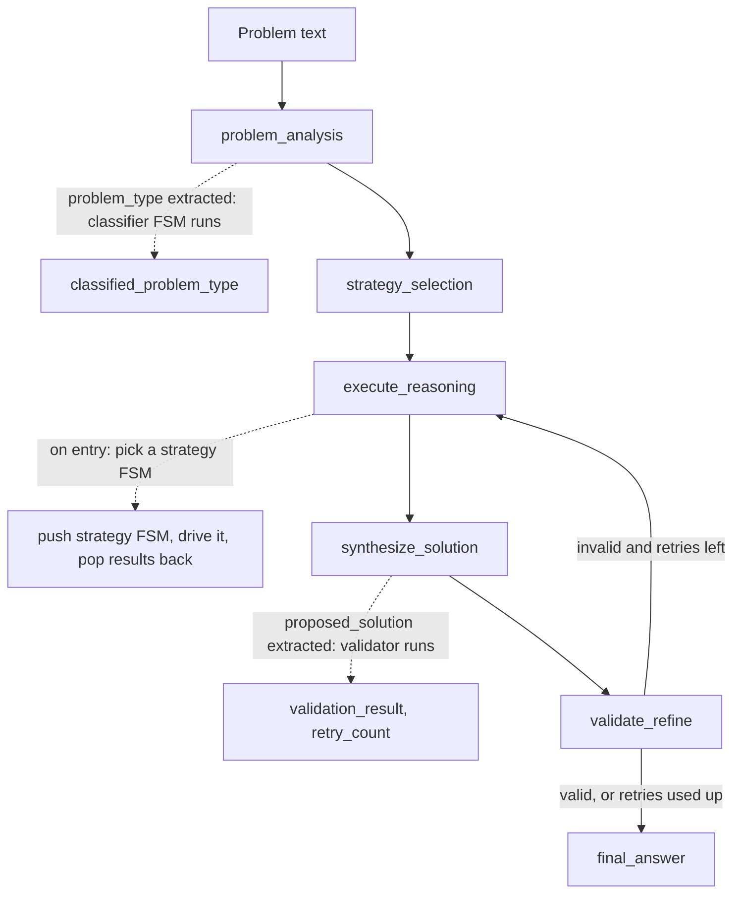

# fsm_llm.reasoning

`src/fsm_llm/reasoning` is the reasoning subpackage of FSM-LLM. It takes a problem in plain text, picks a reasoning style for it (arithmetic, deduction, analogy, and so on), walks an LLM through that style step by step, checks the answer, and returns the answer together with a trace of the steps.

## What it is for

A hard question asked of an LLM in one shot often gets a shallow or wrong answer. This package splits the work into fixed steps. FSM-LLM (the core `fsm_llm` package) runs a conversation as a finite state machine (FSM): a set of named states with rules for moving between them, where each turn the LLM extracts data and then writes a reply. Here, a top-level "orchestrator" FSM analyses the problem, picks a strategy, runs a smaller strategy FSM for it, writes a solution, and validates it. If the answer looks weak, it goes back and runs the strategy again, up to 3 retries. You get back the final answer and a trace you can inspect.

## How it works



- The engine starts an orchestrator conversation with the problem in its context and runs it with message-free steps (core `run_until_terminal`, no user message) until it reaches `final_answer`, for at most 170 steps in total (50 for the orchestrator plus 30 per strategy run, one run per attempt).
- As soon as the orchestrator extracts `problem_type`, a handler (a Python function the FSM runs at a set point) runs a second FSM, the classifier, which looks at domain, structure and needs and recommends one of the strategies. The choice is one structured model call with the nine strategies as closed intents (core classification, one `complete` request): a pick below confidence 0.6, an unknown intent, a cut reply or a failed call ends on `analytical`, with a WARNING when no value was produced. The injected `llm_interface` therefore must implement `complete`. It gets at most 10 steps.
- When the orchestrator enters `execute_reasoning`, a handler chooses the strategy FSM. The same run pushes it on top of the orchestrator (FSM stacking) by type, steps it for at most 30 steps, then pops it and copies its results back into the orchestrator. Each entry to `execute_reasoning` also clears `proposed_solution`, `key_insights` and `validation_result`, so a retry produces and validates a new answer.
- When a `proposed_solution` appears, a validator runs these checks: there is an answer, there are key insights (not needed for arithmetic), the answer is longer than 20 characters (not needed for arithmetic), and it shares at least one non-trivial word with the question (not checked for arithmetic).

The strategies and the result key each one fills:

| Strategy | Main result key |
| --- | --- |
| `simple_calculator` | `calculation_result` (computed in Python, not by the model) |
| `analytical` | `integrated_analysis`, `key_insights` |
| `deductive` | `conclusion` |
| `inductive` | `hypothesis` |
| `abductive` (best explanation) | `best_hypothesis` |
| `analogical` | `adapted_solution_or_understanding` |
| `creative` | `best_creative_solution` |
| `critical` | `critical_assessment` |
| `hybrid` | `final_hybrid_solution` |

In `simple_calculator` the model only writes the problem as a single arithmetic expression (`15% of 240` becomes `0.15 * 240`); a handler evaluates it in Python on entry to `perform_calculation`, so that state makes no model call and the answer is exact (a big integer such as `2 ** 100` keeps every digit). The evaluator takes numbers, `+ - * / // % **` and parentheses only, refuses anything else, and never runs `eval`; its text, node, exponent and integer-size bounds are listed in `AGENTS.md`. A refused expression (for example division by zero) is reported as `calculation_error_details` and retried at most 3 times like any attempt without a solution (whatever the model writes beside it is not a solution), and then the solve returns the fixed message `The calculation could not be completed: <reason>`, never the model's own arithmetic. The model only translates the problem, and a small model can mis-translate: on a direct probe a 2B model mis-parenthesised 6 of 20 expressions, a 9B model none.

## Files

- `calculator.py` - the bounded arithmetic evaluator behind `simple_calculator` (standard library only).
- `engine.py` - `ReasoningEngine`: builds the orchestrator and classifier, registers handlers, runs one solve through the hooks and handlers.
- `strategies/*.json` - the FSM definitions as package data, one `fsm-llm/executable` file per FSM (orchestrator, classifier, and the nine strategies); `strategy_files.py` reads them and holds the two explicit name orders.
- `handlers.py` - answer validation, trace recording, context pruning, mapping strategy results back, picking the final answer.
- `definitions.py` - Pydantic models for steps, traces, validation, classification, problems and solutions.
- `constants.py` - reasoning types, state names, context key names, limits, and message text.
- `executables.py` - the nine strategies as `strategy` executables (`reasoning.<name>`) and the whole engine as `reasoning.solve`, registered as the `reasoning` source of the `executable_sources` namespace when the package is imported. See `docs/executables.md`.
- `utilities.py` - load an FSM definition, map loose words like "math" to a strategy, list strategies.
- `exceptions.py` - error classes.
- `__main__.py` - command-line tool.
- `__init__.py`, `__version__.py` - public exports and version (taken from `fsm_llm.__version__`).

## How to use it

The package ships with `llm-fsm` itself; the `reasoning` extra adds no dependencies. There is no console script, so run it as a module:

```bash
python -m fsm_llm.reasoning "What is 15% of 240?"
python -m fsm_llm.reasoning "Why might sales drop in summer?" --type abductive --output detailed
python -m fsm_llm.reasoning "Compare a city to a cell" --model ollama_chat/qwen3.5:4b --save results.json
python -m fsm_llm.reasoning "Explain a rainbow" --env-file .env   # LLM_MODEL from a file
python -m fsm_llm.reasoning --list-types
```

```python
from fsm_llm.reasoning import ReasoningEngine

engine = ReasoningEngine(model="ollama_chat/qwen3.5:4b")
solution, trace = engine.solve_problem("If all cats are mammals and Tom is a cat, what is Tom?")
print(solution)
print(trace["summary"])
```

`solve_problem(problem, initial_context=None)` also takes a dictionary of extra context. `trace` has the keys `reasoning_trace`, `summary`, `final_context` and `all_responses`. The solve examples call a live model. Any litellm model name works. There is no built-in default: pass `model=` (or `--model`) or set `LLM_MODEL`; with neither, `ReasoningEngine()` raises `ModelNotConfiguredError` and the CLI exits 1 with one line.

The command line also takes `--context '{"audience": "child"}'` (extra context as a JSON object), `--quiet` (print the solution only) and `--version`. `--quiet` and `--verbose` cannot be combined.

## Where to go next

- `examples/reasoning/math_tutor/`: a runnable example that uses the engine.
- `src/fsm_llm/agents/README.md`: `ReasoningReactAgent`, a ReAct agent with a built-in `reason` tool that calls this engine.
- `src/fsm_llm/README.md`: the core engine that runs the orchestrator and strategy FSMs.

## Things to know

- The strategies and the engine can be run by id: `registry.get("reasoning.deductive")` is the strategy FSM the engine pushes, run on its own with the four context keys the engine hands it as inputs (`problem_statement`, `problem_components`, `constraints`, `problem_type`) and reporting both identities; `registry.get("reasoning.solve").run({"problem": "..."})` runs `solve_problem` on a worker thread (one engine per run, closed afterwards) and returns a `RunResult` with the solution in `outputs`. `reasoning.solve` takes no `max_steps` or `max_seconds` (the engine has its own 170-step budget), and a cancelled await leaves the worker running. See `docs/executables.md`.
- One engine solves one problem at a time. Calls to `solve_problem` on the same engine wait for each other.
- An interrupt (`KeyboardInterrupt`, `SystemExit`) during a solve ends its conversations and reaches you unchanged. `engine.close()` ends whatever is still open (safe to call twice), and `with ReasoningEngine(...) as engine:` does it on exit.
- Every step is an LLM call, so one problem can take dozens of calls. Small models may loop until a limit stops them: a strategy FSM still running after 30 steps is popped and the solve goes on; a solve that spends its 170 steps raises `ReasoningExecutionError`. Any failed solve raises that error, and its `details["partial_context"]` holds what the solve had collected (for example a validated `proposed_solution`).
- The model cannot mark its own answer as valid or change the retry counters: those keys are written only by the engine's handlers. An attempt that produces no answer counts as a failed attempt.
- `ReasoningEngine(llm_interface=my_interface)` sends every call to your interface (its `model` argument is then not used).
- `--type` (or `preferred_reasoning_type` in the starting context) overrides the automatic choice when it names a valid strategy.
- If a strategy FSM cannot be loaded, the engine falls back to `analytical` only, never to another style.
- Unknown words passed to `map_reasoning_type` fall back to `analytical` with a warning.
- `--list-types` prints its table and solutions print on stdout; an error is one line `python -m fsm_llm.reasoning: error: ...` on stderr. `--verbose` turns on the engine's own log records.
- In `--output json` and in `.json` save files, `reasoning_types_used` is a sorted list of type names.
