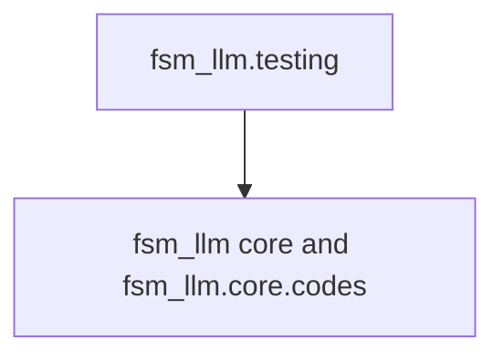

# fsm_llm.testing

Path: `src/fsm_llm/testing`
Purpose: The seventh subpackage of `fsm_llm`: public test doubles, a scripted user and assertions for code built on the package. Plan d454fd62 (roadmap row 0.9). Today `__all__` holds the two promoted doubles (`MockLLM2Interface`, `PromptGroundedLLM`, step 22), `ScriptedLLM`, `UnscriptedCallError`, `state_in_prompt`, `hash_embed` and the three reply builders (step 23), `ScriptedUser`, `ConversationRun` and `advance_until_terminal` (step 24), and `assert_state`, `assert_context`, `assert_path`, `assert_result` and `PathRecorder` (step 25).

## Scope

- In: fake `LLMInterface` implementations that need no network (the promoted `MockLLM2Interface` and `PromptGroundedLLM`, `ScriptedLLM` with its `UnscriptedCallError`), reply builders, `state_in_prompt`, a `hash_embed` embedder, `ScriptedUser` and `ConversationRun`, plain assertion functions (`assert_state`, `assert_context`, `assert_path`, `assert_result`) and an opt-in `PathRecorder` handler (all in `assertions.py`).
- Out: anything that reaches a model, a network or a clock; `unittest.mock` helpers (they stay in `tests/conftest.py`); `block_network`, `ollama_available`.

## Architecture

## Key files

| File | Role | Notes |
| --- | --- | --- |
| `__init__.py` | Module docstring, one static `__all__` | Names are added to `__all__` and to `tests/fixtures/api_snapshot.txt` in the same commit |
| `doubles.py` | `MockLLM2Interface` (fixed answers) and `PromptGroundedLLM` (a fact only when the prompt shows its evidence), moved verbatim from `tests/conftest.py`; the private `_CURRENT_STATE_TAG` regex (the one tag regex, read through `state_in_prompt`); `ScriptedLLM` (reply queue, `extraction_data`, `responses` per state, `stream_chunks`, `unexpected`, `assert_exhausted()`, metered through core's `_Metered`), `UnscriptedCallError`, `hash_embed` | Plain classes with mutable attributes, subclassed by the repo's own tests; the dead `transition_target` argument was dropped; Interface-contract docstrings |
| `user.py` | `ScriptedUser` (messages, then rules read against the last reply, then a fallback, bounded by `max_turns`), `ConversationRun` (frozen record: `api`, `conversation_id`, `greeting`, `messages`, `replies`, `states`, `ended`) and `advance_until_terminal` for message-free FSMs | `states` is the path, sampled like `fsm_llm.eval` does (after the start and after each reply; one turn makes at most one transition); exceptions propagate; same loop idea as `eval/cases.py`, which stays untouched (bench-pinned) |
| `assertions.py` | `assert_state(source, /, state_id)`, `assert_context(source, /, **expected)`, `assert_path(source, expected, /, *, exact=True)`, `assert_result(result, *, kind=None, status=None, reason=<unset>)`, `PathRecorder` | `source` is a `ConversationRun` or an `(api, conversation_id)` pair (state and data are read live from the API; a conversation closed with `end_conversation` is read from the API's snapshot at the close); explicit `raise AssertionError`, `__tracebackhide__` in every raising function, first divergence in the message; expected codes through `codes` `from_string`; `reason` default is the private `_UNSET` whose repr `<unset>` keeps `tests/fixtures/api_snapshot.txt` deterministic; `PathRecorder` records the initial state and each `POST_TRANSITION` target per `_conversation_id` and never executes, but registering it makes the pipeline deep-copy the context (D-022) |
| `builders.py` | `final_reply`, `tool_call_reply`, `malformed_reply`: the three `CompletionResponse` shapes | `kind` values from `fsm_llm.core.codes.CompletionKind`; Interface-contract docstrings |
| `__version__.py` | Re-export of `fsm_llm.__version__` | Same shape as every subpackage |

## Invariants and constraints

- Imports the core and `fsm_llm.core.codes` only; never `pytest`, `litellm` or another subpackage (`tests/test_fsm_llm_testing/test_layering.py` reads the source with `ast`).
- No library module imports it and `fsm_llm/__init__.py` never loads it; it is imported by name.
- Importing it has no side effect: no clock, no randomness, no socket.
- `ScriptedLLM` never answers an unscripted call with an invented reply: it records it in `unexpected`, counts an error and raises `UnscriptedCallError` (an `AssertionError`). The pipeline swallows a raised extraction error, so `assert_exhausted()` is what fails the test. It reuses core's private `_Metered`/`_meter_of` from `fsm_llm.llm.usage` (one meter, not a second copy); a rename there must update `doubles.py`. This is recorded debt (review gate 1 concern 12): plan step 73 split the old `llm.py` and retargeted the import to the defining module `fsm_llm.llm.usage` but left the seam private; `test_layering.py` pins that exactly these two private names are imported from that module and no third. The API snapshot prints `ScriptedLLM` with the private base until the MRO-aware snapshot (step 59) drops private mixin bases from the class line.
- Assertions raise `AssertionError` explicitly, never `assert` (stripped by `python -O`); a test scans `assertions.py` for `ast.Assert` and a `python -O` child proves it. The module does not import `pytest`; `pytest.register_assert_rewrite("fsm_llm.testing")` is optional and moot, since every message is built by hand.
- Names stay out of `src/fsm_llm/constants.py`, `src/fsm_llm/eval/cases.py` and the five files the old `utilities.py` was split into (`llm/text.py`, `llm/json_extraction.py`, `context/filtering.py`, `core/coerce.py`, `core/loaders.py`): they are bench-pinned (see the root `AGENTS.md`).
- Every public name gets a docstring with an interface contract (parameters, return shape, failure mode) and a static `__all__` entry; `tests/fixtures/api_snapshot.txt` is regenerated in the same commit.

## Testing

`tests/test_fsm_llm_testing/`. The `testing` extra is `[]`.
