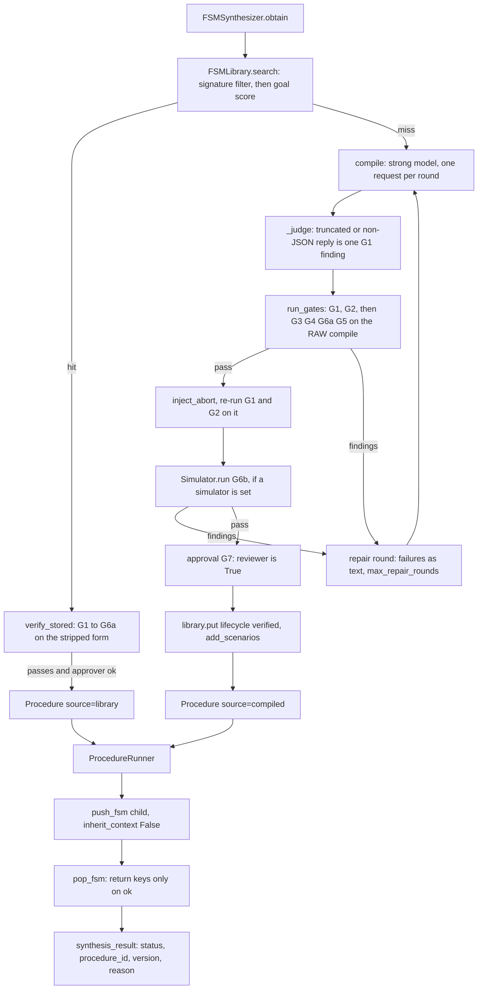
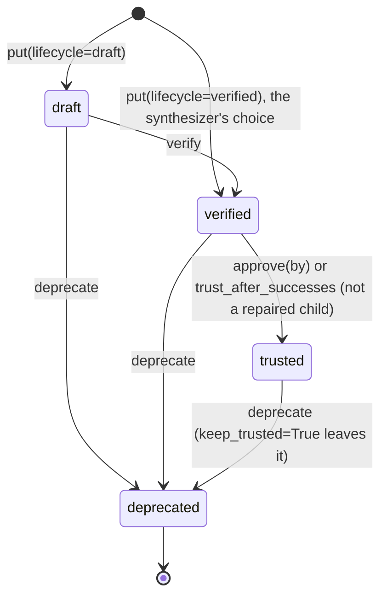

# fsm_llm.synthesis

Path: `src/synthesis`
Purpose: Runtime FSM synthesis inside the core `fsm_llm` package: a model compiles a goal into an FSM, gates G1 to G5 (static), G6a (dead edges through the real evaluator), G6b (bounded simulation) and G7 (approval) judge it, a content-addressed library with a lifecycle (`draft`, `verified`, `trusted`, `deprecated`) stores it, a runner pushes it as a child of a host conversation under a budget, and traces, `diagnose`, an RFC 6902 subset, `propose_patch` and `repair_procedure` repair it. Agent tools `obtain_procedure` and `run_procedure`. No console script.

## Scope

- All synthesis code of the `fsm-llm` distribution. Extra `synthesis = []` in `pyproject.toml` (no deps), package `fsm_llm.synthesis` in its explicit `packages` list and in `_EXPECTED_SUBPACKAGES` of `tests/test_packaging.py`. Version comes from `fsm_llm.__version__` via `__version__.py`.
- Core pieces it relies on, outside this folder: `State.synthesize` and `SynthesizeConfig` in `src/definitions.py` (core only loads and validates the field; its checks run the real evaluator on four sample results), `src/flow_analysis.py` (`analyze_data_flow` is G3, `analyze_liveness` is G4), `API.push_fsm`/`pop_fsm`/`run_until_terminal(before_step=)`, `eval.cases.run_case_trial(stop=)`. The pipeline gives a synthesize state no extraction and makes its `result_key` handler-only.
- Layering: this package imports core, `fsm_llm.agents` and `fsm_llm.eval`. None of them import it (`src/definitions.py` mentions it in a comment only). `fsm_llm/__init__.py` loads no synthesis module; import by name (`from fsm_llm.synthesis import FSMSynthesizer`).
- Not here: the bench `scripts/synthesis_bench.py` and its tests `tests/test_fsm_llm_synthesis/test_synthesis_bench.py`; no CLI; no persistence of conversations; no provider call (every request goes through an `LLMInterface`).
- Bench status: `scripts/synthesis_bench.py` (blocks `s0` to `s2`, arms `synth-fsm`, `hand-fsm`, `react`) was registered and run as blocks `s0`, `s1` and `s2` (rows in `scripts/bench_data/synthesis/`); every role and arm used `ollama_chat/bonsai-2:27b`: no strong/cheap split. All three verdicts are INCONCLUSIVE (s0: hand-written arm 8 of 16, under the 10 needed; s1 and s2: the ceiling clause, S 15 and R 16 of 16). Two fixes (D-108, D-109) came after s2 and were checked by smoke only. Results and limits: `docs/synthesis.md`. Say nothing in a doc that synthesis helps.

## Architecture

Run time (`runner.py`): the `before_step` hook (`hook(conv_id)`) or `converse` settles three things per tick: pop an ended child (`_finish`), abort a child over `policy.max_turns` steps (sets `procedure_abort`, the priority 0 edge fires), start a pending synthesize state (`_start`: write `running`, `obtain`, `runnable_reason`, `push_fsm`). Core calls the hook once for an ended pushed FSM on top of the stack, so the runner can pop it and the run continues on the parent.

Repair (`repair.py`): `repair_procedure` checks in order `parent-not-live`, `parent-not-canonical`, `lineage-limit`, `too-few-failures`, `patch-refused`, `gates-failed`, `no-op`, `child-exists`, `approval-refused`, `simulation-failed`, `no-replay-set`, `replay-incomplete`, then `decide` gives `regressed`, `no-improvement` or `promote`. Writing needs `write=True` and `promote`.

## Key files

| File | Role | Notes |
| --- | --- | --- |
| `synthesizer.py` | `FSMSynthesizer`, `Procedure`, `CompileResult`, `ProcedureApprovalRequest`, `reviewer_from_hitl` | D-005 (cut reply is a failed round, never parsed; outage raised, no retry), D-028 (approval fails closed), D-033 (reuse threshold) |
| `policy.py` | `SynthesisPolicy`, `PolicyFinding`, `check_policy` (G5), `needs_approval`, `inject_abort`, `strip_abort` | D-007 (abort path), D-032 (G5 allow-list); pure functions, no LLM, I/O or logging |
| `gates.py` | `run_gates`, `verify_stored`, `GateReport`, `GateFinding`, `GATES`, `safe_text`, `simulated` | D-027 (fixed order); `repair_text` is the only way a finding reaches a prompt |
| `dryrun.py` | `analyze_dryrun` (G6a), `edge_witnesses`, `FILLER`, `POOL_STRINGS` | D-042 (coarse fragment, no false rejects), D-059 (value pool kinds); cap `MAX_ASSIGNMENTS` |
| `simulation.py` | `Simulator`, `SimulationReport`, `happy_path` (G6b) | D-047 (gate-owned expectations), D-057 (happy path built from the definition), D-060 (bounds read between turns), D-061 |
| `prompts.py` | `system_prompt`, `compile_messages`, `repair_message`, `goal_block`, `patch_messages`, `EXAMPLE_FSM`, `REPLY_FAILURES` | D-005 (prompt text, no `response_format`); `_fence` is the one fence; `EXAMPLE_FSM` passes `run_gates` (a test pins it) |
| `library.py` | `FSMLibrary`, `LibraryRecord`, `LibraryMatch`, `digest_of` | D-008 (atomic write), D-046 (trace rewrite), D-062, D-063 |
| `runner.py` | `ProcedureRunner`, `runnable_reason`, `reason_of` | D-029, D-044, D-061, D-062 anchors |
| `tools.py` | `create_procedure_tools`, `TOOL_DESCRIPTIONS`, `TOOL_PARAMETERS` | D-030; replies carry codes, ids and defanged values only |
| `traces.py` | `RunTrace`, `TraceRecorder`, `gate_reads` | D-046 (`__post_init__` is the one value-free place), D-064 (lock not held in the sink) |
| `diagnose.py` | `diagnose`, `Diagnosis`, `RULES` | D-050 (positive evidence only) |
| `patch.py` | `apply_patch` | D-051 (scope by tokens, bounds before the walk) |
| `repair.py` | `propose_patch`, `repair_procedure`, `PromotionResult`, `decide` | D-052, D-053, D-063 |
| `constants.py` | reserved names, `STATUS_*`, `REASON_*`, `REASONS`, `DIAGNOSIS_CODES`, `PATCH_CODES`, `PROMOTION_CODES`, `LIFECYCLES`, caps, labels | Imports only `DEFAULT_SYNTHESIS_RESULT_KEY` from core `definitions` |
| `exceptions.py` | `SynthesisError`, `SynthesisRefusedError`, `PatchError`, `LibraryError` | Rooted at `FSMError` |
| `__init__.py`, `__version__.py` | static `__all__`, version | |

## Public interface

Exported (`__init__.__all__`): `CompileResult`, `Diagnosis`, `FSMLibrary`, `FSMSynthesizer`, `GateFinding`, `GateReport`, `LibraryError`, `LibraryMatch`, `LibraryRecord`, `PatchError`, `PolicyFinding`, `Procedure`, `ProcedureApprovalRequest`, `ProcedureRunner`, `PromotionResult`, `RunTrace`, `SimulationReport`, `Simulator`, `SynthesisError`, `SynthesisPolicy`, `SynthesisRefusedError`, `TraceRecorder`, `analyze_dryrun`, `apply_patch`, `check_policy`, `create_procedure_tools`, `diagnose`, `digest_of`, `inject_abort`, `needs_approval`, `propose_patch`, `repair_procedure`, `reviewer_from_hitl`, `run_gates`, `strip_abort`, `verify_stored`. Not exported (import from the module): `happy_path`, `edge_witnesses`, `runnable_reason`, `reason_of`, `safe_text`, `simulated`, `GATES`, `decide`, `goal_block`, `EXAMPLE_FSM`, every constant.

- `SynthesisPolicy(**limits)`: frozen dataclass, validated at construction (`SynthesisError`, never clamped; `dataclasses.replace` revalidates). Defaults: `max_states=12`, `max_transitions_per_state=6`, `max_fields_per_state=10`, `max_text_chars=600`, `max_synthesis_depth=1`, `max_repair_rounds=3` (min 0), `max_turns=40`, `max_compile_tokens=8192`, `max_synthesis_seconds=300`, `max_sim_turns=12`, `sim_trials=2`, `max_simulation_seconds=300`, `max_simulation_calls=400`, `max_simulation_rounds=2`, `dwell_threshold=3` (min 2), `repair_min_failures=3`, `max_patch_ops=12`, `max_patch_chars=8000`, `replay_trials=2`, `max_repairs_per_lineage=3`, `min_pass_rate=0.5` (above 0, to 1), `reuse_min_score=0.8` (0 to 1), `trust_after_successes=None`, `allowed_tools=frozenset()`, `require_approval=False`, `require_simulation=False`.
- `FSMSynthesizer(llm=None, *, model=None, policy=None, library=None, reviewer=None, embed=None, simulator=None, clock=time.monotonic)`: exactly one of `llm` (must implement `complete`) or `model` (builds a `LiteLLMInterface`), else `ValueError`. `compile(goal, *, inputs=(), return_keys) -> CompileResult` (at most `1 + max_repair_rounds` strong calls; `SynthesisError` with `details["rounds"]` failure codes). `obtain(goal, *, inputs=(), return_keys, min_lifecycle="verified") -> Procedure` (`SynthesisRefusedError`, `SynthesisError`, `LibraryError`, `ValueError` for a bad goal or name). `approval(goal, return_keys, result) -> str | None`.
- `reviewer(request: ProcedureApprovalRequest) -> bool`; approved only by `is True`. `ProcedureApprovalRequest.text()` starts with `APPROVAL_UNTRUSTED_LABEL`. `reviewer_from_hitl(hitl)` asks `hitl.request_approval` with a call named `approve_procedure`.
- `run_gates(data, policy, *, inputs=(), return_keys=()) -> GateReport`; `verify_stored(definition, policy, *, inputs=(), return_keys=()) -> GateReport`. `GateReport{findings, definition, injected, skipped}`, `.passed`, `.verdicts` (`pass|fail|skipped` per `GATES`), `.repair_text(cap=2000)`. Neither raises.
- `Simulator(llm, scenario_llm=None, *, clock=time.monotonic)`: `llm` needs a callable `usage()` and `scenario_llm` (default `llm`) must implement `complete`, else `ValueError`. `run(definition, *, goal, inputs, return_keys, policy) -> SimulationReport{findings, scenarios, overall, happy, generated, calls}`; `replay(definition, scenarios, *, inputs, return_keys, trials, policy) -> list[int] | None`. Raises `SynthesisError` when every trial errored.
- `FSMLibrary(path)`: `get_record`, `get_definition`, `put(definition, *, goal, inputs_required, return_keys, synthesizing_model="", gates_passed=(), approved_by=None, lifecycle="draft", parent=None, parent_run=None, repair=None, replay=None)`, `verify`, `approve(digest, by)`, `deprecate(digest, *, keep_trusted=False)`, `record_run(digest, success, *, trust_after_successes=None)`, `search(goal, *, inputs_available, return_keys, tools_allowed, min_lifecycle, embed=None, top_k=3) -> list[LibraryMatch]`, `read_traces(digest, limit=None) -> (traces, skipped)`, `add_trace(trace, *, max_traces=200)`, `retire_traces(digest, child)`, `add_scenarios`, `read_scenarios`, `clean_scenarios`, `add_patch`, `count_lineage`.
- `ProcedureRunner(api, definition, synthesizer, *, trace_sink=None)`: `hook(conv_id) -> before_step`, `run(conv_id, *, max_steps, max_seconds=None) -> tuple[AdvanceResult, ...]` (`RunBudgetExceededError` propagates), `converse(conv_id, message) -> str`, `end_conversation(conv_id)`. `trace_sink(event, fields)` is a plain callable (`TypeError` otherwise).
- `create_procedure_tools(synthesizer, *, runner_llm=None, registry=None, max_obtains=20) -> ToolRegistry`; `runner_llm` required (`ValueError`); `run_procedure` needs the synthesizer's library.
- `TraceRecorder(on_trace)`; `diagnose(traces, definition, policy, *, return_keys=()) -> tuple[Diagnosis, ...]`; `apply_patch(document, ops, *, scope_states, policy) -> dict`; `propose_patch(diagnoses, definition, policy, llm) -> list[dict]`; `repair_procedure(parent_digest, ops, *, library, synthesizer, simulator, replay_scripts=None, write=False) -> PromotionResult`.

## Data shapes

- Result key value (`synthesize.result_key`, default `synthesis_result`): `{status, procedure_id, version, reason}`; `status` in `ok|failed|aborted|running`; `reason` one of `constants.REASONS` or `None`. Codes and ids only, never exception text.
- `LibraryRecord{digest, name, version "major.minor", lifecycle, signature{inputs_required, return_keys, tools_used}, provenance{synthesizing_model, goal (500 chars), parent_run, gates_passed, approved_by, parent, created_at, repair, replay}, stats{runs, successes}}` (frozen, `extra="forbid"`). Digest is the sha256 of `json.dumps(definition.model_dump(exclude_defaults=True), sort_keys=True)`, the recipe of `API.process_fsm_definition`.
- Library layout: `definitions/<sha256>.json`, `records/<sha256>.json`, `traces/<sha256>.jsonl` (one `RunTrace` row per line, `"v": 1`; a repaired parent's file is renamed to `traces/<sha256>.<child>.jsonl`), `scenarios/<sha256>.json`, `patches/<child sha256>.json`.
- Scenario: `{kind, turns}`; kinds `happy` plus `missing_info`, `correction`, `off_topic`, `adversarial`; at most `MAX_SCENARIOS`=6, `MAX_SCENARIO_TURNS`=12 turns, `MAX_SCENARIO_TURN_CHARS`=300. `happy` and `correction` must end with every return key; the rest only if they ended.
- Trace events (`ProcedureRunner._emit`; every one has `conv`): `obtained` (digest, version, source, rounds, seconds, calls, prompt_tokens, completion_tokens), `pushed` (digest, step), `stepped` (digest, step, state, keys, kinds), `aborted` (digest, step, state, keys, kinds, outcome), `popped` (digest, status, reason, step), `failed` (reason, step, digest, error, rounds). Scalars only.
- Diagnosis codes (`DIAGNOSIS_CODES`, rule order): `not-procedure-fault`, `extraction-miss`, `type-mismatch`, `value-gate-unmet`, `tie-loop`, `cycle`, `path-too-long`, `return-keys-missing`, `abandonment-concentration`. Patch codes: `PATCH_CODES`. Promotion codes: `PROMOTION_CODES`.
- Finding codes by gate: G1 pydantic error types, `not-loadable`, `reply-truncated`, `reply-malformed`, `reply-not-json-object`; G2 `structure`; G3 `undeclared-read`, `unresolvable-read`, `bulk-extraction`, `return-key-undeclared`, `return-key-not-guaranteed`; G4 `trap`, `cycle-no-exit`, `shadowed-edge`, `permanent-tie`, `path-exceeds-budget`; G5 `too-many-states`, `too-many-transitions`, `too-many-fields`, `text-too-long`, `unknown-key`, `persona-set`, `reserved-state`, `reserved-key`, `internal-key`, `secret-key`, `control-text`, `priority-reserved`, `priority-type`, `model-setting`, `regex-pattern`, `completion-tool-not-allowed`, `nested-synthesize`, `bad-shape`, `abort-not-injectable`, `stored-not-canonical`, `stored-abort-mismatch`; G6a `edge-unfireable`, `terminal-unreachable`; G6b `happy-path-failing`, `pass-rate-low`, `simulation-incomplete`, `no-progress`.
- Tool replies start with `PROCEDURE_UNTRUSTED_LABEL`; failure is `failed: <code>` (`bad_arguments`, `needs_user_input` or a `REASONS` code). `obtain_procedure` receipt: `procedure_id`, `version`, `lifecycle`, `source`, `states`, `gates`.

## Invariants and constraints

- Reserved names `abort` (state id), `procedure_abort` (context key) and `synthesis_result` (result key) are never declared, read or written by a compile (G5 `reserved-state`, `reserved-key`). `procedure_abort` is in the procedure's `handler_only_keys`, so no extraction can set it; `synthesis_result` is handler-only through core. The abort edge has priority 0 and compiled edges need 1 or more. Do NOT gate the abort edge on anything a model can write, do NOT run G3 or G4 on the injected form, do NOT strip or edit the abort path by hand (`strip_abort` is its exact inverse; `verify_stored` refuses anything else) (D-007).
- G5 only gets stricter. It judges the RAW compile with an allow-list: a classification entry may use only `field_name`, `intents`, `fallback_intent`, `confidence_threshold`, `required`, `context_keys`; `model` and `prompt_config` are refused; a priority must be a real `int`; `validation_rules.pattern` is refused. `_key_names` in `policy.py` is the one table of name positions; a test pins that allowed plus refused keys equal every field of the core entry model. Do NOT turn the allow-list into a deny-list, do NOT accept a "safe" regex subset (D-032).
- Gate order is fixed: G1, G2 (only if G1 loaded), then G3, G4, G6a, G5 together on the raw compile, then the abort injection and G1 and G2 again. Do NOT stop at the first failing gate, do NOT make G2 stricter than the loader (D-027). G6a judges only the fragment in `dryrun._judge`; anything outside it is unknown, silent and counts as firing. Do NOT widen it to arithmetic or string ordering, do NOT narrow `str`, do NOT trim the value pool kinds, do NOT copy the evaluator's priority rule (D-042, D-059).
- `normalise_extraction(data, max_chars)` (synthesizer.py) runs in `_judge` on the parsed reply BEFORE `run_gates`: a state that extracts a key and gates on it (`logic` reads it) gets one `prompts.KEY_NAMING` sentence per key its state-level `extraction_instructions` does not name, appended after the model's text (the bulk pass is the only later-turn correction channel and answers under the name it is given). Untouched, byte for byte: states with no such gate, terminals, classification keys, `completion` or `synthesize` states, a result over the policy's `max_text_chars`. The stored and hashed definition is the normalised one; `repair_procedure` patches and old records are not renormalised. Do NOT touch `logic`, do NOT run it after the gates, do NOT test "mentions" as a substring (D-096).
- `_repair_brackets(text)` (synthesizer.py, D-097) runs in `_judge` only when `extract_json_from_text` found no object and the reply is not cut: the first-`{`-to-last-`}` span gets every closer of the wrong kind replaced by the expected one (the logged `]` for `}` after the last state); it never appends or drops a character, nesting is bounded at 100, the result must parse, and every gate then judges the repaired object like any reply. A slip it cannot fix keeps the D-085 parser-position finding. Do NOT repair a reply that parses or one that was cut off, and do NOT skip a gate for a repaired reply.
- `prompts.operator_line()` (D-098) is the one sentence of the compile prompt that lists the operators the loader accepts in `logic`: built at call time from `fsm_llm.constants.ALLOWED_JSONLOGIC_OPERATIONS` (sorted), followed by a fixed sentence that a condition which only needs a key present has no `logic`. Do NOT hand-copy the list into the prompt or the repair text; a test replaces the set and the prompt must follow.
- `gates._message` (D-099) is the one exception to "every repair line is defanged": a G1 finding whose loader message is the unknown-operator one (`Unsupported JsonLogic operator`) is cut before its `Allowed: [...]` tail and ends with a fixed ASCII note built from `ALLOWED_JSONLOGIC_OPERATIONS` (not model text, so not defanged; the unknown names before it stay defanged and capped). The defang had turned `<` and `>` of that list into U+2039 and U+203A, which the model copied. Do NOT defang the note, do NOT keep the loader's tail, do NOT key on `Allowed: [` alone.
- `gates._message` also ends a G3 `unresolvable-read` finding with the fixed ASCII note `_KEY_NAME_NOTE` (D-104): `var` and `missing` take plain key-name strings, never a nested expression (the model wrote `{"missing": [{"var": ...}]}` four rounds running); the compile prompt says the same in one sentence. Do NOT defang the note, do NOT edit `flow_analysis.py` for it.
- One LLM layer: no `litellm` import here, no second provider call. The compile, patch and scenario requests are `CompletionRequest`s sent through an `LLMInterface.complete` the caller supplied. `Simulator` uses THE interface it is given (metered once, never closed, refuses one without `usage()`); never build an interface from a model name there. `FSMSynthesizer(model=)` is the only place a `LiteLLMInterface` is built.
- Untrusted text: the goal reaches a model only through `prompts.goal_block` (one control-stripped line, `GOAL_CHARS` 2000, `[ ] < >` defanged with core `SKILL_DEFANG`, fixed begin and end lines). System prompts are built from the policy alone. `safe_text` and `_fence` are the one defang and the one fence; do not write a second. No goal, compile, reply, scenario turn or provider text goes into an exception message, a finding, a result or a trace. Procedure text shown to a person or agent carries `PROCEDURE_UNTRUSTED_LABEL` or `APPROVAL_UNTRUSTED_LABEL` as its first line. Never put synthesized text into a tool description, `instructions`, persona or state instruction (D-005, D-030).
- Approval fails closed: only `is True` approves; a missing, raising or truthy-but-not-`True` reviewer refuses. A stored hit the current policy needs approved but whose record has no approver is skipped. A refused compile is never stored. Do NOT re-ask the reviewer for a library hit (D-028).
- Reuse: with an embedder the score is a cosine judged by `policy.reuse_min_score`; without one the word score reuses only at 1.0 (an exact goal). Never compare one threshold to both scales (D-033). `require_simulation` binds every path that runs a stored procedure; use `gates.simulated`, do not copy the G6b test (D-062).
- Library writes: temp file in the same directory, `fsync`, `os.replace`, in the `finally`-guarded `_write` (a deliberate copy of `FileSessionStore.save`, D-008); one `threading.Lock` per `FSMLibrary` around each read-modify-write; every path through `security.resolve_within`, symlinks refused; a corrupt or mismatched file raises `LibraryError` and is never overwritten. Lifecycle edges are the table `_EDGES`; nothing leaves `deprecated`. A trace rewrite reads the valid rows, adds one and rewrites atomically (D-046).
- Runner: return keys go back only through `pop_fsm(context_to_return=...)`, only when every key is present and the child was not aborted; never pass `shared_context_keys` at push (D-029). The child's steps are the runner's own count, never core's step number. Read the outcome BEFORE writing `procedure_abort` (D-044). A run whose interface errored is `provider_error`, never `budget_spent` (D-061). The result key is never left at `running`: any failure between the `running` write and the push writes `failed` and unwinds the stack. One thread per conversation per runner; no lock.
- Traces are value-free by construction: `RunTrace.__post_init__` is the one place that enforces it; type names come only from `TRACE_KINDS` (never `type(v).__name__`); event fields are scalars; `keys` lists declared names only. `TraceRecorder` never keeps finished traces and never calls the sink under its lock (D-046, D-064).
- Repair poisoning policy (D-038): a user can drive failures on purpose, so repair is propose-only and replay-gated. `write=False` is the default; nothing is written unless `write=True` and the verdict is `promote`. Only `PROCEDURE_FAULT_REASONS` (`budget_spent`, `return_keys_missing`) can ground a patch; every other or unknown reason is `not-procedure-fault` (D-050). The child is stored `verified`, never `trusted`, never with the parent's approver; `record_run` never trusts a repaired child by run count; a `trusted` parent is never deprecated; the parent is retired last. Replay scripts come only from the parent's stored scenarios plus an explicit `replay_scripts` argument, never from production traces. A written repair retires the traces it used. The lineage limit counts every stored record below the root of the tree, deprecated ones too (D-053, D-063, D-072).
- `apply_patch` allows only `add`, `remove`, `replace`, `test` under `/states/<diagnosed state>/...`, never `abort`; scope is judged on unescaped pointer tokens; every bound is checked before the walk; the document is never mutated; it does not validate the FSM (the gates do) (D-051).
- Tools: descriptions and parameter schemas are module constants, not built from a record or goal. Do NOT flag a tool `requires_approval` (four agent patterns refuse such a registry) and do NOT set `timeout_s` (D-030).
- Synthesis names live in `src/synthesis/constants.py` or `src/definitions.py` (`DEFAULT_SYNTHESIS_RESULT_KEY`, `SynthesizeConfig`). Do NOT add them to core `src/constants.py`: the `skills-disclosure` bench manifest pins its sha256.
- The `SRC_PINS` of `scripts/synthesis_bench.py` (the script, `scripts/bench_common.py`, `src/flow_analysis.py`, `src/eval/cases.py`, `src/synthesis/{dryrun,simulation,traces,gates,policy,synthesizer,runner,library,prompts,repair,constants}.py` and the listed `src/agents` modules) are hashed at `register` and checked by `run` and `report`. Any edit to one after registration voids the block. Registration is the last source-touching commit; a block runs once and is never edited or re-run (D-067).

## Dependencies

- Core: `definitions` (`FSMDefinition`, `State`, `SynthesizeConfig`, `CompletionRequest`/`CompletionResponse`, `LLMUsage`, `LLMResponseError`, `FSMError`, `checked_key_names`, `logic_referenced_keys`, `handler_only_names`, `reachable_from`, `ASCII_IDENTIFIER_PATTERN`, `DEFAULT_SYNTHESIS_RESULT_KEY`, `SYNTHESIZE_GOAL_MAX_LENGTH`), `api.API`, `flow_analysis`, `validator.FSMValidator`, `transition_evaluator.TransitionEvaluator`, `expressions.is_missing`, `llm` (`LLMInterface`, `LiteLLMInterface`, `implements_complete`, `interface_model`), `okf` (`capped_line`, `strip_unsafe_text`, `has_lone_surrogate`, `iso_utc`), `security` (`resolve_within`, `has_internal_prefix`, `is_forbidden_context_entry`), `constants` (`RESERVED_CONTEXT_KEYS`, `CONTEXT_KEY_AGENT_TRACE`, `SKILL_DEFANG`), `utilities.extract_json_from_text`, `visualizer` (approval diagram), `logging.logger`.
- `fsm_llm.agents` (importing this package loads it): `exceptions.require_int_limit`, `definitions` (`ToolCall`, `ToolAnnotations`), `hitl.HumanInTheLoop`, `semantic_tools` (`EmbedTextsFn`, `cosine_similarity`), `tools.ToolRegistry`, `constants` (`OBSERVATION_ENTRY`, `Defaults`).
- `fsm_llm.eval`: `cases` (`ConversationCase`, `Expectations`, `TrialResult`, `run_case_trial`), `config.EvalConfig`, `stats.pass_rate`.
- External: `pydantic` (library models) and the standard library. No `litellm`, no network.

## Failure modes

- `SynthesisError(FSMError)` -> `SynthesisRefusedError(message, code, details=None)` (approval, depth; `code` in `REASONS`), `PatchError(code, op=None)` (whole patch refused; message holds the code and op index only), `LibraryError` (unreadable, corrupt, unwritable, unknown digest, illegal lifecycle edge, symlink, escape; a human fixes a corrupt file).
- Compile: no round passing the gates, a spent `max_synthesis_seconds` or spent simulation rounds raise `SynthesisError` with `details["rounds"]`. A provider outage raises it chained from `LLMResponseError`, no retry. A bad goal or name is `ValueError` before any call.
- Runner: a failure is a `failed` result with a reason from `reason_of` (`SynthesisRefusedError.code`, `library_error`, `provider_error` when the cause is an `LLMResponseError`, else `compile_failed`) or `push_failed`, `depth_refused`, `inputs_missing`, `completion_unsupported`, `lifecycle_too_low`, `not_simulated`, `unexpected_error`. `KeyboardInterrupt` and `SystemExit` write a final `failed` result, unwind, then propagate. A raising `trace_sink` is swallowed with a WARNING naming the event. `library.record_run` failing after a run is a WARNING.
- Tools: `run_procedure` closes its sub-`API` on every path; a bug propagates to `registry.execute` as a failed `ToolResult`; `obtain_procedure` is capped by `max_obtains` per registry (`failed: budget_spent`), a refused argument costs nothing.
- Library hit that fails re-verification: skipped with a WARNING, never run, and a compile follows.
- Two processes on one library directory: last writer wins on `stats`; lifecycle edges and definitions stay valid.

## Working here

- Tests: `.venv/bin/python -m pytest tests/test_fsm_llm_synthesis -q`. Files are `test_<module>.py` (plus `test_happy_path.py`, `test_concierge.py` end to end, `test_synthesis_bench.py`); `conftest.py` has `ScriptedStrongLLM`, `ScriptedRunnerLLM`, `host_fsm`, `good_fsm`, `stuck_fsm` and blocks the network (`foreign_calls` fails on any built `LiteLLMInterface` or provider call). Offline only. A behaviour change needs a test that fails on the parent commit.
- Lint and types: `.venv/bin/python -m ruff check src/synthesis tests/test_fsm_llm_synthesis`, `.venv/bin/python -m ruff format --check src/synthesis tests/test_fsm_llm_synthesis`, `make type-check`. Doc snippets: `.venv/bin/python -m pytest tests/test_fsm_llm/test_docs_snippets.py -q`.
- New gate: add its findings to `run_gates` in the fixed order, a code table entry in the docstring and `Data shapes` above, and a test where it FAILS a compile; keep it model-free unless it is G6b. New export: add it to the static `__all__`. New reason code: `constants.REASONS`, and branch on the code, never the message.
- New policy field: a minimum in `_INT_LIMITS` (or its own check in `__post_init__`) and a reader in the same change; no dead field.
- Read the `# DECISION plan-2026-11-10T194139-2cefeb61/D-NNN` anchors in `policy.py`, `gates.py`, `dryrun.py`, `simulation.py`, `synthesizer.py`, `library.py`, `runner.py`, `tools.py`, `traces.py`, `diagnose.py`, `patch.py`, `repair.py` and `prompts.py` before editing nearby.
- Bench (`scripts/synthesis_bench.py`, block `s0`): `.venv/bin/python scripts/synthesis_bench.py register s0` and `report s0` make no model call (`register` reads `/api/tags`). `smoke [--tasks c1 ...]` and `run s0` first pass a preflight (read-only `/api/ps`, the Ollama journal quiet window, three timing probes) and exit 3 with `BLOCKED` when the shared model server is busy or holds another model. Use `smoke` and `run` only when the server is free; `--confirm-exclusive` only after the user says it is. Never kill, pause or reconfigure the other job or Ollama. Raw requests and replies go to `logs/synthesis-bench/` (gitignored).
- After a gate or prompt change that touches a pinned file, say in the change that a registered block would be void; do not re-run a block to compensate.
- Do not modify `examples/` unless asked.
