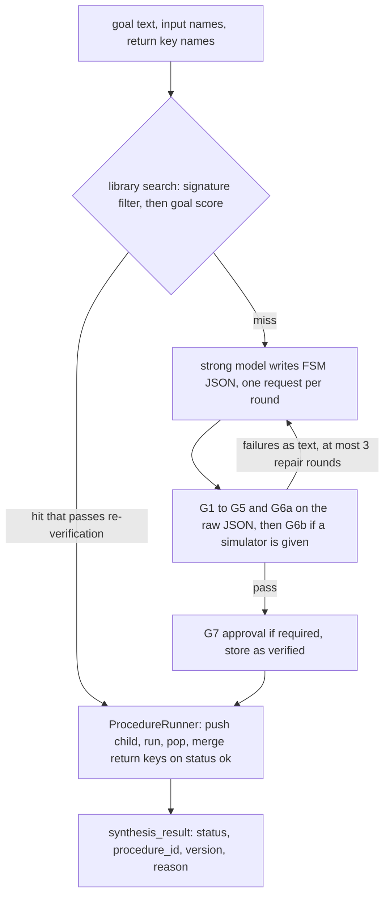

# fsm_llm.synthesis

Runtime FSM synthesis, shipped inside the `fsm-llm` package as the subpackage `fsm_llm.synthesis` (folder `src/synthesis`). A model compiles a goal into a finite state machine (FSM, a conversation described as states and transitions), a stack of checks decides whether the result may run, a file-backed library stores it, and a runner executes it as a pushed child of a host conversation.

## What it is for

Some conversations cannot be written ahead of time: "collect what this particular visa form needs" depends on a goal that only shows up at run time. This package lets a host conversation ask for a procedure by goal. A strong model writes the FSM as JSON. The package does not trust that JSON. It runs it through gates (static checks, a dead-edge check and a bounded simulation), adds a safe abort path, optionally asks a human to approve it, and stores it by content hash so the same goal is not compiled twice. Then a runner, on the host's own (usually cheaper) model, pushes the procedure as a child conversation, runs it without user messages or with them, pops it and hands back only the declared return keys.

It also covers the afterlife of a procedure: run traces that hold no values, a diagnosis of why runs failed, and a repair loop that asks the model for a small patch and promotes it only after re-checking and replaying it.

## How it works



The gates, in the order they run on a compile:

- G1: the JSON loads as a core `FSMDefinition`, the same load `API` does.
- G2: the core `FSMValidator` reports no error (its warnings never fail a compile).
- G3: data flow (`fsm_llm.flow_analysis`). A key an edge reads must be extracted earlier on every path or be an input; each return key must be guaranteed at the end.
- G4: liveness (`fsm_llm.flow_analysis`). No trap, no loop without a firing exit, no edge hidden by an unconditional edge of lower priority number, no permanent tie, no path longer than `max_turns`.
- G5: the policy (`policy.check_policy`). Limits on states, edges, fields and text, reserved names, no persona, no secret-looking or internal key names, no model settings on a classification entry, no regex in a validation rule, completion tools only from an allow-list, no nested `synthesize` at depth 1.
- G6a: dead edges (`dryrun.py`). It tries a small pool of values per key through the real `TransitionEvaluator` and reports an edge no assignment can fire. No model call.
- G6b: simulation (`simulation.py`). A `Simulator` plays scripted users against the procedure on the interface it was given: a happy path built from the definition, plus scenarios of four kinds written by one model call (missing info, correction, off topic, adversarial). It passes when the happy-path rate and the overall pass rate both reach `policy.min_pass_rate` (default 0.5) and the happy path moves past the first state.
- G7: approval. Required when `policy.require_approval` is set or a `completion` state lists tools. A reviewer callable must return exactly `True`.

When all pass, an abort path is injected: a silent `abort` terminal state and a priority 0 edge to it on every non-terminal state, gated on the handler-only key `procedure_abort`. The runner sets that key when the child spends its turn budget, so no model reply can forge or block it.

The library is a directory keyed by the sha256 of the canonical definition. Each record has a lifecycle: `draft`, `verified`, `trusted`, `deprecated`. A compile is stored `verified`. A human moves it to `trusted` (`FSMLibrary.approve`), or a run count does when `trust_after_successes` is set. Nothing leaves `deprecated`.

Reuse: the search first filters on the signature (every required input available, return keys covered, tools allowed, lifecycle high enough), then scores the survivors against the stored goal. With no embedder the score is 1.0 only for the same goal after lowercasing and whitespace normalising (punctuation counts), and at most 0.5 otherwise, so only an exact match is reused. With an embedder (a function from texts to vectors) the score is a cosine, reused at or above `policy.reuse_min_score` (default 0.8). A hit is re-verified (G1 to G6a on the stored form) before it runs.

## Files

- `synthesizer.py` - `FSMSynthesizer` (`compile`, `obtain`, `approval`), `Procedure`, `CompileResult`, `ProcedureApprovalRequest`, `reviewer_from_hitl`.
- `policy.py` - `SynthesisPolicy` (every limit), `check_policy` (G5), `needs_approval`, `inject_abort`, `strip_abort`.
- `gates.py` - `run_gates`, `verify_stored`, `GateReport`, `GateFinding`; composes G1 to G5 and G6a.
- `dryrun.py` - `analyze_dryrun` (G6a).
- `simulation.py` - `Simulator`, `SimulationReport`, `happy_path` (G6b).
- `prompts.py` - the compile and patch prompts, the goal fence, a worked example FSM.
- `library.py` - `FSMLibrary`, `LibraryRecord`, `LibraryMatch`, `digest_of`.
- `runner.py` - `ProcedureRunner`, `runnable_reason`, `reason_of`.
- `tools.py` - `create_procedure_tools`: the agent tools `obtain_procedure` and `run_procedure`.
- `traces.py` - `RunTrace`, `TraceRecorder`.
- `diagnose.py` - `diagnose`, `Diagnosis`.
- `patch.py` - `apply_patch`, an RFC 6902 subset (`add`, `remove`, `replace`, `test`).
- `repair.py` - `propose_patch`, `repair_procedure`, `PromotionResult`.
- `constants.py` - reserved names, status and reason codes, lifecycle names, caps.
- `exceptions.py` - the `SynthesisError` family.
- `__init__.py`, `__version__.py` - public exports and the version (the same as `fsm_llm`).

## How to use it

The package ships with `fsm-llm`; the `synthesis` extra adds no dependency. Import it by name, because `import fsm_llm` loads no synthesis module. Compile and reuse, offline, with a scripted strong model (a real one is `FSMSynthesizer(model="...")`):

```python
import json, tempfile
from fsm_llm.definitions import CompletionResponse
from fsm_llm.llm import LLMInterface
from fsm_llm.synthesis import FSMLibrary, FSMSynthesizer
from fsm_llm.synthesis.prompts import EXAMPLE_FSM

class ScriptedStrong(LLMInterface):
    calls = 0
    def complete(self, request):
        self.calls += 1
        return CompletionResponse(kind="final", text=json.dumps(EXAMPLE_FSM))
    def generate_response(self, request):
        raise NotImplementedError

strong = ScriptedStrong()
with tempfile.TemporaryDirectory() as root:
    synth = FSMSynthesizer(strong, library=FSMLibrary(root))
    goal = "Book a table: ask the party size and the date."
    keys = ["party_size", "visit_date"]
    first = synth.obtain(goal, inputs=["venue"], return_keys=keys)
    again = synth.obtain(goal, inputs=["venue"], return_keys=keys)
    print(first.source, first.record.lifecycle)        # compiled verified
    print(again.source, again.digest == first.digest)  # library True
    print(strong.calls)                                # 1
```

A host FSM names a procedure with the `synthesize` state field. The state is silent, and its edges read `synthesis_result.status` (`ok`, `failed`, `aborted`; `running` while it works):

```json
{
  "name": "Concierge", "description": "Books a table", "initial_state": "greet",
  "states": {
    "greet": {"id": "greet", "description": "greet", "purpose": "greet",
      "response_instructions": "Welcome the guest.",
      "transitions": [{"target_state": "gather", "description": "go"}]},
    "gather": {"id": "gather", "description": "run the procedure", "purpose": "collect",
      "response_instructions": "",
      "synthesize": {"goal": "Book a table: ask the party size and the date.",
        "inputs": ["venue"], "return_keys": ["party_size", "visit_date"],
        "on_failure": "sorry"},
      "transitions": [
        {"target_state": "done", "description": "ok", "priority": 1,
         "conditions": [{"description": "ok", "requires_context_keys": ["synthesis_result"],
           "logic": {"==": [{"var": "synthesis_result.status"}, "ok"]}}]},
        {"target_state": "sorry", "description": "failed", "priority": 2,
         "conditions": [{"description": "failed", "requires_context_keys": ["synthesis_result"],
           "logic": {"in": [{"var": "synthesis_result.status"}, ["failed", "aborted"]]}}]}]},
    "done": {"id": "done", "description": "done", "purpose": "done",
      "response_instructions": "Confirm."},
    "sorry": {"id": "sorry", "description": "sorry", "purpose": "sorry",
      "response_instructions": "Apologise."}
  }
}
```

The runner drives it. `api` is an `fsm_llm.API` built from that definition on the host's model:

```python
from fsm_llm.synthesis import ProcedureRunner

runner = ProcedureRunner(api, host_definition, synth)   # host_definition: the JSON above as a dict
conv_id, _ = api.start_conversation({"venue": "Luna"})
runner.run(conv_id, max_steps=40)                       # message-free
# or, with a user in the loop: runner.converse(conv_id, "four people, Friday")
```

Agent tools: `create_procedure_tools(synth, runner_llm=cheap_llm)` returns a `ToolRegistry` with `obtain_procedure(goal, return_keys, inputs)` and `run_procedure(procedure_id, inputs)`. Pass it to an agent such as `ReactAgent(tools=registry)`.

Traces and repair: `TraceRecorder(library.add_trace)` is a `trace_sink` for `ProcedureRunner(..., trace_sink=...)`. Later, `diagnose(traces, definition, policy, return_keys=...)` names the fault, `propose_patch(...)` asks the model for ops, and `repair_procedure(parent_digest, ops, library=..., synthesizer=..., simulator=...)` judges them and writes nothing unless you pass `write=True`.

## Things to know

- `verified` means the gates passed. G6a is a coarse check, and G6b is a model-driven simulation judged by a scripted happy path and a few generated scenarios, so a passing procedure is not proven correct, and a simulation run on the same model that wrote the procedure is a weak signal.
- The goal is untrusted caller text. It reaches the strong model only inside a fenced block (`GOAL BEGIN` and `GOAL END` lines), cut to 2000 characters, control characters stripped, and the characters `[ ] < >` replaced so it cannot spell a marker. Generated text shown to a human or an agent carries a fixed untrusted label as its first line. Key names must be plain identifiers.
- A compile may not set a persona (the host's persona is injected at push), may not use reserved names (`abort`, `procedure_abort`, `synthesis_result`) and may not write a regex. The model is told these rules, and G5 enforces them.
- Approval fails closed. A reviewer that raises, returns something other than `True`, or is missing when approval is required refuses the procedure. A compile that lists `completion` tools needs approval, but `ProcedureRunner` and `run_procedure` refuse any procedure with a `completion` state (`completion_unsupported`).
- The child runs with its own context: only the declared inputs go in, and only the return keys come back, and only when every one is present and the child was not aborted. A child that spends `policy.max_turns` steps in total is aborted and nothing merges.
- One runner serves one thread at a time per conversation, like `API.converse`. It holds no lock.
- The result key is skip-if-set: a state that should run again on re-entry must clear `synthesis_result` on entry (core `clear_keys_on_entry`).
- Failures are reported as fixed reason codes in the result (`inputs_missing`, `return_keys_missing`, `provider_error`, `library_error`, `compile_failed`, `push_failed`, `approval_required`, `approval_denied`, `reviewer_error`, `depth_refused`, `completion_unsupported`, `lifecycle_too_low`, `not_simulated`, `budget_spent`, `unexpected_error`), never exception text. The tools reply `failed: <code>` the same way, plus `bad_arguments` and `needs_user_input`.
- Library layout under its root: `definitions/<sha256>.json`, `records/<sha256>.json`, `traces/<sha256>.jsonl`, `scenarios/<sha256>.json`, `patches/<sha256>.json` (named by the child that the patch produced). Every write goes to a temp file, is synced, then replaced into place. A corrupt file raises `LibraryError` and is never overwritten. A symlink is refused. Two processes on one directory are last writer wins on the run counters.
- Traces hold names, type names, state ids, codes and counts and no value, user text or reply. Only a run that failed for the procedure's own reasons (`budget_spent`, `return_keys_missing`) can justify a patch; an outage or a refusal never does.
- Repair is propose-only by default. A repaired child is stored `verified`, never `trusted`, and only after it passes G1 to G6b and a replay against the parent. A trusted parent is never deprecated.
- A provider outage during a compile raises `SynthesisError` chained from `LLMResponseError`, with no retry and no provider text.
- Layering: this package imports core, `fsm_llm.agents` and `fsm_llm.eval`; none of them import it. It makes no provider call of its own: every request goes through an `LLMInterface`.
- Bench: `scripts/synthesis_bench.py` is the pre-registered comparison (compiled FSM against an in-context ReAct agent, with a hand-written FSM as a harness check). Blocks `s0`, `s1` and `s2` were registered and run; all three verdicts are INCONCLUSIVE. Rows, summaries and reports are in `scripts/bench_data/synthesis/`; the results and their limits are in `docs/synthesis.md`. Every role and every arm uses the same model, so there is no strong and cheap split.
