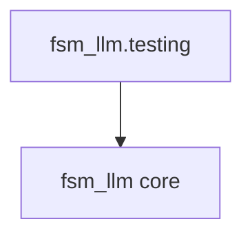

# fsm_llm.testing

Public test helpers for code built on FSM-LLM, living at `src/testing` inside the core `fsm_llm` package: fake LLM interfaces that need no network, a scripted user that drives a conversation, and assertions that name a state, a context value, a visited path or a run result in one line.

## What it is for

A test of a bot, an agent or a workflow should not call a real model: it is slow, costs money and gives a different answer each run. This package holds the doubles and assertions the FSM-LLM repository uses for its own tests, so your project can use the same ones instead of copying them from `tests/conftest.py`.

## Status

Public today (import by name from `fsm_llm.testing`):

- `MockLLM2Interface(extraction_data=None, response_text=..., cut_reply=False, cut_fields=())`: answers every field from a dict and every reply with one text; `call_history` records `(method, request)`; `cut_reply` and `cut_fields` simulate a reply cut at `max_tokens`. It implements neither `extract_bulk_data` nor `complete`.
- `PromptGroundedLLM(facts=None, responses=None, default_response="ok")`: a fact `{field: (value, evidence)}` is returned only when the evidence text is in the request, like a real model reading its prompt; replies follow the prompt's state tag; `complete` raises `LLMResponseError`; `requests` and `calls(kind)` record the rest.
- `ScriptedLLM(replies=(), *, extraction_data=None, responses=None, default_response=None, stream_chunks=(), model=None)`: script a test. `replies` is the `complete` queue (a text, a `CompletionResponse` or an exception instance to raise); `extraction_data` answers field and bulk extraction; `responses` maps a state id to the Pass-2 reply; `stream_chunks` is what a streamed reply yields. It keeps `requests` (the `complete` ones) and `call_history` (every call), and `usage()` / `reset_usage()` count calls and errors like the real interface. A call nothing scripted is recorded in `unexpected` and raises `UnscriptedCallError`; because the pipeline swallows a raised extraction error, end the test with `llm.assert_exhausted()`, which fails on an unscripted call and on a reply never used.
- `final_reply(text, finish_reason=None)`, `tool_call_reply(*(name, arguments), text=None)`, `malformed_reply(text=None)`: build the three kinds of `CompletionResponse`.
- `state_in_prompt(prompt)`: the state id a response prompt was written for, the one reader of its tag.
- `hash_embed(dim=8)`: a pure embedder (`Callable[[str], list[float]]`), same text same vector, shared words mean a closer vector.

```python
from fsm_llm.testing import ScriptedLLM, final_reply, tool_call_reply

llm = ScriptedLLM([tool_call_reply(("lookup", {"q": "rome"})), "It is sunny."])
# pass it as `llm_interface=`, run the code under test, then:
llm.assert_exhausted()
```

- `ScriptedUser(messages=(), *, rules=(), fallback=None, max_turns=25).run(api, *, initial_context=None, close=False)`: a user that sends its messages, then the answer of the first rule whose regex (or callable) fits the last reply, then the fallback, then stops (also when the conversation ended or `max_turns` is spent). It returns a frozen `ConversationRun` (`api`, `conversation_id`, `greeting`, `messages`, `replies`, `states`, `ended`). `states` is the visited path: the state after the start and after each reply. Exceptions of the API or the LLM propagate.
- `advance_until_terminal(api, *, max_steps, initial_context=None, max_seconds=None, close=False)`: the same record for an FSM that needs no user message (`API.run_until_terminal`); a spent budget raises `RunBudgetExceededError`.

```python
from fsm_llm import API
from fsm_llm.testing import ScriptedLLM, ScriptedUser

llm = ScriptedLLM(extraction_data={"mood": "happy"}, responses={"greeting": "Hi!"}, default_response="Ok.")
api = API.from_file("examples/basic/simple_greeting/fsm.json", llm_interface=llm)
run = ScriptedUser(["hello", "good, thanks"]).run(api)
assert run.states == ("greeting", "conversation", "farewell")
```

- `assert_state(source, state_id)`: the conversation is in that state now (read live, so a test that kept talking asserts the new state). `source` is the `ConversationRun` or an `(api, conversation_id)` pair.
- `assert_context(source, **expected)`: the named context keys hold those values (`==`; other keys are ignored, so it is a subset check; internal `_` keys are not visible). Failure: `context: key 'x' is missing (keys: [...])` or `context['x']: expected 1, got 2`.
- `assert_path(source, expected, *, exact=True)`: the visited states. `source` is a `ConversationRun`, a list of state ids (`PathRecorder.path(id)`) or a non-empty sequence of `AdvanceResult`. `exact=False` accepts any ordered subsequence. Failure names the first difference with its index and prints both paths.
- `assert_result(result, *, kind=None, status=None, reason=...)`: the `kind` of a completion state's `{kind, text, calls}` (or a `CompletionResponse`), the `status` and `reason` of a synthesis state's `{status, procedure_id, version, reason}`. Expected values may be `codes` members or strings; a typo raises `ValueError` listing the vocabulary. `reason=None` asserts there is no reason; leaving `reason` out checks nothing.
- `PathRecorder(*, name="PathRecorder", priority=10_000)`: an opt-in handler (`API(handlers=[recorder])`) that records the initial state and each transition target per conversation id, for code under test that drives the conversation (an agent, a runner). `recorder.path(conversation_id)`, `recorder.frames`, `recorder.clear()`. It never changes a conversation, but registering ANY handler makes the pipeline deep-copy the context at every handler timing (with none it skips the copy), so a context value that cannot be deep-copied can fail a turn that passed before. A stay is not a transition: the recorder does not repeat the state, a `ConversationRun` does.

```python
from fsm_llm.testing import assert_context, assert_path, assert_state

assert_state(run, "farewell")
assert_context(run, mood="happy")
assert_path(run, ["greeting", "conversation", "farewell"])
```

The assertions raise `AssertionError` explicitly (never `assert`, so `python -O` changes nothing), hide their own frames from the pytest traceback and do not import `pytest`.

The doubles are plain classes: their attributes are public and may change between turns, and a test may subclass them. They are not `unittest.mock` objects.

## How it fits



- Import it by name: `from fsm_llm.testing import ...`. `import fsm_llm` never loads it and no library module imports it.
- It imports the core and `fsm_llm.codes` only. It never imports `pytest` (an opt-in pytest plugin module may, later, and is imported only by name), `litellm` or another subpackage.
- The `testing` extra in `pyproject.toml` is `[]` (no third-party dependency); `all`, `make install-dev`, tox and CI request it.
- Importing it has no side effect: no clock, no randomness, no socket.

## Files

- `__init__.py` - module docstring and the static `__all__`.
- `doubles.py` - `MockLLM2Interface`, `PromptGroundedLLM`, `ScriptedLLM`, `UnscriptedCallError`, `state_in_prompt`, `hash_embed`.
- `user.py` - `ScriptedUser`, `ConversationRun`, `advance_until_terminal`.
- `assertions.py` - `assert_state`, `assert_context`, `assert_path`, `assert_result`, `PathRecorder`.
- `builders.py` - `final_reply`, `tool_call_reply`, `malformed_reply`.
- `__version__.py` - re-exports the package version.

## Tests

`tests/test_fsm_llm_testing/` (run `.venv/bin/python -m pytest tests/test_fsm_llm_testing/`). The layering checks there fail if a library module imports this package, if it imports `pytest`, `litellm` or another subpackage, or if `import fsm_llm` loads it.
