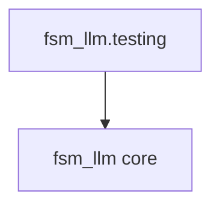

# fsm_llm.testing

Public test helpers for code built on FSM-LLM, living at `src/testing` inside the core `fsm_llm` package: fake LLM interfaces that need no network, a scripted user that drives a conversation, and assertions that name a state, a context value, a visited path or a run result in one line.

## What it is for

A test of a bot, an agent or a workflow should not call a real model: it is slow, costs money and gives a different answer each run. This package will hold the doubles and assertions the FSM-LLM repository uses for its own tests, so your project can use the same ones instead of copying them from `tests/conftest.py`.

## Status

Two names are public today, both fake `LLMInterface` implementations promoted from the repository's own `tests/conftest.py` and moved unchanged (one dead argument aside):

- `MockLLM2Interface(extraction_data=None, response_text=..., cut_reply=False, cut_fields=())`: answers every field from a dict and every reply with one text; `call_history` records `(method, request)`; `cut_reply` and `cut_fields` simulate a reply cut at `max_tokens`. It implements neither `extract_bulk_data` nor `complete`.
- `PromptGroundedLLM(facts=None, responses=None, default_response="ok")`: a fact `{field: (value, evidence)}` is returned only when the evidence text is in the request, like a real model reading its prompt; replies follow the prompt's `<current_state>` tag; `complete` raises `LLMResponseError`; `requests` and `calls(kind)` record the rest.

Both are plain classes: their attributes are public and may change between turns, and a test may subclass them. They are not `unittest.mock` objects. The rest (`ScriptedLLM`, reply builders, `ScriptedUser`, the assertions and `PathRecorder`) arrives in later steps of the plan that added the package; do not rely on it before that lands.

## How it fits

- Import it by name: `from fsm_llm.testing import ...`. `import fsm_llm` never loads it and no library module imports it.
- It imports the core and `fsm_llm.codes` only. It never imports `pytest` (an opt-in pytest plugin module may, later, and is imported only by name), `litellm` or another subpackage.
- The `testing` extra in `pyproject.toml` is `[]` (no third-party dependency); `all`, `make install-dev`, tox and CI request it.
- Importing it has no side effect: no clock, no randomness, no socket.

## Files

- `__init__.py` - module docstring and the static `__all__`.
- `doubles.py` - `MockLLM2Interface` and `PromptGroundedLLM`.
- `__version__.py` - re-exports the package version.

## Tests

`tests/test_fsm_llm_testing/` (run `.venv/bin/python -m pytest tests/test_fsm_llm_testing/`). The layering checks there fail if a library module imports this package, if it imports `pytest`, `litellm` or another subpackage, or if `import fsm_llm` loads it.
