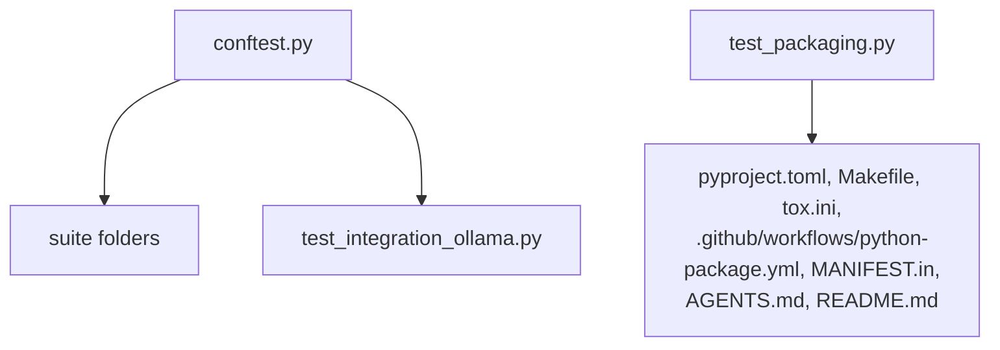

# tests

Path: `tests`
Purpose: The full pytest tree of FSM-LLM: the suite folders for the `fsm_llm` package and its subpackages, the repo-wide root test files, and the shared `conftest.py`.

## Scope

- In: `conftest.py`, `__init__.py` (empty), `test_packaging.py`, `test_coverage_ratchet.py`, `test_integration_ollama.py`, `fixtures/test_fsm_definitions/minimal_fsm.json`, `fixtures/module_path_map.json`, `fixtures/anchor_multiset.json`, `test_examples/`, and the `test_fsm_llm*` suite folders.
- Package under test: one top-level package `fsm_llm` (`src/fsm_llm/`) with subpackages `agents`, `reasoning`, `workflows`, `monitor`, `eval`, `synthesis`, `testing`. The old top-level names (`fsm_llm_agents`, ...) no longer exist (no test checks for a leftover directory any more).
- Out: the bench data under `scripts/bench_data/` and the examples themselves (`examples/`, the evaluation baselines).

## Architecture



Test styles used across suites: unit (call one module), seam (drive a public entry point such as `API.converse` with `fsm_llm.llm.providers.litellm.completion` patched), loop (run an agent end to end with a scripted fake LLM), structure (build an FSM dict and check states, edges, priorities, JsonLogic gates), source-text checks (`inspect.getsource`, `ast`, file reads), and regression classes (one class per finding id, each run failing before its fix, in the feature file that owns the behaviour).

## Key files

Suite folders and root files at this level.

| File | Role | Notes |
| --- | --- | --- |
| `conftest.py` | Shared fixtures, fakes and marker registration (see Public interface) | Holds no tests |
| `test_packaging.py` | Repo-wide wiring pins | Classes listed below |
| `test_coverage_ratchet.py` | Offline checks of `scripts/coverage_ratchet.py` (`check`, `update`, `guard` on tmp files and a throwaway git repo with an `origin/main` ref) and of the coverage config (`[tool.coverage]`, the `coverage` pin, `--cov-branch` in Makefile and tox) | No coverage run, no network |
| `test_integration_ollama.py` | Live end-to-end on `ollama_chat/qwen3.5:9b-q8_0`, plus the model-free workflow checks | Marked `integration`, `real_llm` and `slow` |
| `fixtures/test_fsm_definitions/minimal_fsm.json` | v3.0 one-state FSM behind the `sample_fsm_definition` fixture | Written by `conftest.py` if missing |
| `fixtures/api_snapshot.txt` | The public API snapshot: the static `__all__` of the packages and the named core modules, with signatures, written by `scripts/api_snapshot.py` (`make api-snapshot`); a test fixture, not documentation (it left `docs/` in step 123) | Read by `test_fsm_llm_regression/test_api_snapshot.py`; regenerate and review the diff in the same commit, never edit by hand |
| `fixtures/module_path_map.json` | The layout plan's module path map: `moved` (old dotted module to a new module, or to a table of symbol to new module) and `unmoved` (every other module, sorted) | Read by `test_fsm_llm_regression/test_module_path_map.py`; deterministic JSON (sorted keys, indent 2); `scripts/gate.sh step` rewrites it with `python -m tests.test_fsm_llm_regression.test_module_path_map --write` (hand editing of `unmoved` ends; review the diff) |
| `fixtures/anchor_multiset.json` | Baseline multiset of `plan-<id>/D-NNN` tokens over `src/` plus the `reasons` list that explains each deliberate change | Read by `test_fsm_llm_regression/test_decision_anchor_multiset.py`; the baseline is written once and never regenerated; a deliberate loss or gain of an anchor is recorded with `python -m tests.test_fsm_llm_regression.test_decision_anchor_multiset --write --reason TEXT` (one `reasons` entry per changed token, TEXT names the decision, never by hand) |
| `test_fsm_llm/` | Core: `API`, `FSMManager`, `MessagePipeline`, `TransitionEvaluator`, `core.expressions`, classification (on the conversation interface), context and the prompt builders (`context.layout`), `LiteLLMInterface` (`complete`, usage counters), `LiteLLMEmbedder`, the `completion` state, `llm.ollama`, handlers, `WorkingMemory`, sessions, the validator (`core.verify`), the visualizer (`core.visualize`), runner, logging, OKF (`fsm_llm.okf`, `okf.cli`), the shared `frontmatter` seam, Agent Skills (`fsm_llm.skills`) and `fsm-llm-skills` | Local `conftest.py` (`minimal_fsm_dict`); `fixtures/` holds labelled secret-filter corpora for `test_context_unit.py`; seam files share `_` helpers through `support.py`; `test_docs_snippets.py` loads FSM JSON from root docs; the `slow` files are `test_handler_timeout.py` and `test_live_classification_memory.py` (a live model), other files that sleep are not marked |
| `test_fsm_llm_agents/` | All agent patterns (`native_fc` as an FSM on core, pinned by a golden request fixture), `ToolRegistry` and ToolSpec, HITL grant security, memory, MCP (real stdio fixture server), `AgentServer`, `fsm-llm-meta` and `python -m fsm_llm.agents` CLIs, the OKF and Agent Skills tools (`test_okf.py`, `test_agent_skills.py`) | Local `conftest.py` autouses `block_network`; most files define their own fake `LLMInterface`, pattern loops use `PromptGroundedLLM` (`test_grounded_patterns.py`); skips without `mcp`, `fastapi`/`httpx`, OTEL SDK |
| `test_fsm_llm_meta/` | Meta-builder in `fsm_llm.agents`: `FSMArtifactBuilder`, `WorkflowArtifactBuilder`, `AgentArtifactBuilder`, `create_*_tools`, `meta_prompts`, the meta FSM and `MetaBuilderAgent` on core | Autouse `block_network`; `ScriptedMetaLLM` (local conftest) answers classifier, build and collect calls from queues; `offline_llm` makes core's send binding raise so fallback paths run without a network call |
| `test_fsm_llm_reasoning/` | `fsm_llm.reasoning` constants, models, exceptions, handlers, ANALYTICAL-only fallback, whole solves through core with a scripted `LLMInterface` (`test_engine_scripted.py`), CLI `--verbose` and JSON output | Engine built with `object.__new__` or on a scripted interface; source-string pins (no `converse(`, no "Continue reasoning") |
| `test_fsm_llm_workflows/` | `fsm_llm.workflows` steps, DSL, `WorkflowEngine`, timeouts, removed-keyword refusals | Real short sleeps; the `slow` ones are in `test_step_timeouts.py` |
| `test_fsm_llm_monitor/` | `fsm_llm.monitor` server via `TestClient`, security, `InstanceManager`, `EventCollector`, `OTELExporter` | Local autouse fixture deletes `FSM_LLM_MONITOR_API_KEY`; `TestWorkflowTracking` skips when workflows is missing |
| `test_fsm_llm_eval/` | `fsm_llm.eval` and `fsm-llm-eval`: config, records, stats, scoring golden table, examples mode, cases mode, exit codes | Reads `evaluation/` files and needs a git checkout |
| `test_fsm_llm_synthesis/` | `fsm_llm.synthesis` (policy G5, gates, G6a `dryrun`, G6b `simulation`, `synthesizer`, `library`, `runner`, `tools`, `traces`, `diagnose`, `patch`, `repair`), the concierge end to end. The synthesis bench script and its recorded blocks are frozen history, with no test (`scripts/bench_data/README.md`) | Own `conftest.py` (`ScriptedRunnerLLM`, `ByTurn`, `host_fsm`, `good_fsm`, `stuck_fsm`) that fails on any built `LiteLLMInterface` or provider call; see `test_fsm_llm_synthesis/AGENTS.md` |
| `test_fsm_llm_testing/` | `fsm_llm.testing` (a subpackage): import probes and source scans for its layering (loaded by no library module, no `pytest`, `litellm` or other subpackage), the skeleton checks | Child-process probes with the model-server variables on a closed port |
| `test_fsm_llm_regression/` | One class per fixed bug id across core, reasoning, workflows, CLI, packaging text | Many private-method and source-text pins; also the layout safety nets (`test_module_path_map.py`, `test_decision_anchor_multiset.py`, `test_module_size_guard.py`, `test_patch_targets.py`, helper `support.py`) |
| `test_examples/` | Every `examples/**/*.json` loads as JSON with `name`/`initial_state`/`states`, parses as `FSMDefinition`, passes `FSMValidator.validate()`; at least 5 files exist, so the scan is not vacuous | Marker `examples`. `test_example_scripted_paths.py` also drives shipped example FSMs offline with `fsm_llm.testing` (no example edited); `test_example_import_paths.py` scans the `examples/**/*.py` imports of `fsm_llm` and resolves each one |

`test_packaging.py` classes:

- `TestEveryPackageIsWired`: the package found by `[tool.setuptools.packages.find]` in `pyproject.toml` must be exactly `{"fsm_llm"}` (directory `src/fsm_llm/`); `src/fsm_llm/*/__init__.py` exactly the extras-backed subpackages plus the layer packages in `LAYER_PACKAGES` (`security`, `core`, `llm`, `context`, `handlers`, `engine`, `okf`, `skills` and `tools` so far; they ship with the core, need no extra, and `test_layer_packages_are_exactly_the_non_extra_packages_on_disk` pins the set to the disk); each slot names `fsm_llm` (the type-check slots by their `mypy -p fsm_llm` line, the manifest slot by `recursive-include src *.py`) (`pyproject:package-data`, `pyproject:ruff-isort-known-first-party`, `makefile:type-check`, `makefile:coverage`, `tox:testenv-coverage`, `tox:testenv-type`, `ci:mypy`, `manifest.in:recursive-include`); `src/fsm_llm/py.typed` exists; `setuptools.find_packages` over `src` with the `include` of `packages.find` returns `fsm_llm` plus `fsm_llm.<sub>` for every subpackage on disk, and `package-dir` and an explicit `packages` list are absent.
- `TestSubpackagesImport`: `fsm_llm.<sub>` importable (monitor needs `fastapi`).
- `TestMonitorPackageData`: `"fsm_llm.monitor"` package-data globs cover every file under `static/` and `templates/`.
- `TestPackageBackedExtrasAreInstalled`: each subpackage name is an extra, requested by `pyproject` `all`, `make install-dev`, tox `extras = dev,...` and the CI install line.
- `TestTheDistributionIsLlmFsm`: `[project] name` is `llm-fsm`, the file-name form is `llm_fsm`, the `all` extra extraction finds at least 10 self-references under the project name and refuses a stale one or an empty list. `TestSdistName` (`slow`): the sdist is `llm_fsm-<version>.tar.gz`. `TestSdistContent` (`slow`, step 116): an sdist built from every tracked file holds only the policy files at its top level (no `tests/`, which `MANIFEST.in` prunes), the same `src/fsm_llm` files as the wheel and the tracked example JSON files.
- `TestClassifiersMatchFloor`: the version classifiers run contiguously from the `requires-python` floor (3.11), the newest equals the evidenced version, and the build backend asks for setuptools 77 or later.
- `TestDeclaredRangesMatchPins`: every declared dependency (core, extras, dependency groups) has an upper bound and exactly one `==` pin in `constraints.txt` inside its range, the build backend is pinned inside its range, and `constraints.txt` holds exactly one litellm line. Needs no network.
- `TestWheelContent` (`slow`): builds a wheel with `python -m build --wheel --no-isolation` from a copy of the tracked `src/` tree in a temporary directory (the repository gets no `build/` or `*.egg-info`), and requires the entries to equal every module plus `py.typed`, `monitor/static/**/*` and `monitor/templates/*` under `fsm_llm/` (all relative to the package root, so it holds before and after the move to `src/fsm_llm/`), nothing from `tests`, `examples`, `scripts`, `docs`, `plans` or `src`; `.dist-info` names the `[project] name` and `entry_points.txt` equals `[project.scripts]`; the wheel file is `llm_fsm-<version>-py3-none-any.whl`, its METADATA holds the `llm-fsm[extra]` self-references of `all`, and the build prints no setuptools warning that a package is "absent from the `packages` configuration" (`include-package-data = false`). `TestWheelComparison` (not `slow`) runs that comparison on synthetic listings. `TestPackageInitImportsNoSubpackage`: the package `__init__` has no import statement naming a subpackage (import-linter cannot express it; `.importlinter` covers the rest).
- `TestExplicitEncodings`: an AST scan bans a text-mode `open(`, `os.fdopen(`, `Path.open(`, `read_text(` or `write_text(` without `encoding=` in `src/` and `scripts/` (not `scripts/bench_data/`), the scanner is checked on known good and bad shapes, and a UTF-8 session file loads in a subprocess run under the C locale with `-X utf8=0`.


`test_integration_ollama.py`: module `pytestmark` is `integration`, `real_llm`, `slow`; classes needing Ollama carry `requires_ollama` (`ollama_available("qwen3.5:9b-q8_0")`) and retry up to 3 times. It uses `examples/basic/simple_greeting/fsm.json`. `TestWorkflowUTCConsistency` and `TestParallelStepIsolation` need no model but are still `slow`.

## Public interface

From `tests/conftest.py` (import as `from tests.conftest import ...` or use as fixtures), plus the doubles below. They live in the public `fsm_llm.testing` (import them from there: `from fsm_llm.testing import MockLLM2Interface, PromptGroundedLLM`); `tests/conftest.py` does not re-export them, and a guard test in `tests/test_fsm_llm_testing/test_doubles.py` fails when a test module imports them from `tests.conftest`:

| Name | Kind | Use |
| --- | --- | --- |
| `MockLLM2Interface(extraction_data=None, response_text="Hello! How can I help you?", cut_reply=False, cut_fields=())` | `LLMInterface` subclass | `extract_field` returns `extraction_data.get(field_name)` (confidence 1.0, or 0.0 and `is_valid=False` when missing); `generate_response` returns `response_text`; `cut_reply=True` and `cut_fields=` flag the reply or a field `truncated` (a cut field has value `None`); calls appended to `call_history` as `(name, request)` |
| `PromptGroundedLLM(facts=None, responses=None, default_response="ok")` | `LLMInterface` subclass | A fact `{field_name: (value, evidence)}` comes back only when `evidence` is in the request text (`extract_field`: system prompt, user message, JSON context; `extract_bulk_data`: only fields the prompt names, evidence in prompt or message, so a prompt without the evidence yields `{}`); `generate_response` returns `responses[state]` for the prompt's `<current_state>`, else `default_response`; `requests` records `(kind, request)`, `calls(kind)` filters. Used by the agents Phase-1 loop tests |
| `block_network(monkeypatch, node)`, `network_exempt(node)` | functions | Patch `socket.socket.connect`/`connect_ex` to raise `ConnectionRefusedError` for IPv4/IPv6 (loopback included, Unix sockets untouched; on Windows the one stdlib frame of the `socketpair` fallback, which asyncio's self-pipe uses for every event loop, may connect: `socket._fallback_socketpair` on 3.12 and later and on 3.11 with the gh-122133 backport, `socket.socketpair` itself on 3.11.9; identified by the `socket` module's globals and source file plus the name, never by the name alone) unless the test is marked `real_llm` or `integration`; autoused by the agents and meta conftests only |
| `configure_mock_extract_field(mock_llm, mock_data=None)` | function | Gives a `Mock(spec=LLMInterface)` a working `extract_field`; default data `{"name": "TestUser", "email": "test@test.com", "age": "25"}` |
| `mock_llm_interface` | fixture | `Mock(spec=LLMInterface)` with that default data and a fixed reply |
| `mock_llm2_interface` | fixture | `MockLLM2Interface()` |
| `sample_fsm_definition` | fixture | v3.0 one-state FSM from `fixtures/test_fsm_definitions/minimal_fsm.json` (written if missing) |
| `sample_fsm_definition_v2` | fixture | v4.1 `greeting -> farewell`, gated on `requires_context_keys: ["user_name"]` |
| `ollama_available(model_tag=OLLAMA_MODEL_TAG) -> bool` | function | One bounded GET to `http://localhost:11434/api/tags`; True only if a pulled model name contains the tag; never raises. `OLLAMA_MODEL_TAG` is the one literal tag the live suites expect (`bonsai-2:27b`; the package has no default model) |
| `posix_only(reason) -> MarkDecorator` | function | `skipif(sys.platform == "win32")` for a test that needs POSIX mode bits, signals or a pid probe; `reason` is a required non-blank literal (checked by `TestPortabilityRules`) |
| `skip_if_root()` | function | Call in the test body (never at decorator time): skips when the process is root, where modes are not enforced |
| `symlink_or_skip(link, target, *, target_is_directory=False)` | function | The one way a test makes a symlink; skips where links are refused; a bare `symlink_to` or `os.symlink` fails `TestPortabilityRules` |
| `write_if_creatable(path, content=b"x") -> bool`, `name_refused(exc) -> bool`, `skip_if_backslash_separates(directory)` | functions | The hostile file name tests: `write_if_creatable` writes bytes (parents created) and returns `False` when the file system refuses the NAME (`EINVAL` or a Windows `winerror` 123, 161, 206 or 267: NTFS cannot hold an ESC, a newline or `<>:"|?*`), re-raising every other `OSError`; a test writes the ESC and newline names through it and counts what exists, and keeps one legal hostile name (a U+202E bidi override) so the assertion is never vacuous. `skip_if_backslash_separates(tmp_path)` skips (reason: the name cannot exist) where a backslash is a separator; it probes the file system, not the platform. |
| `timing_factor` | fixture (function) -> `float` | Multiplier for a wall-clock budget: 1.0 normally, 5.0 when `sys.gettrace()` is set, `COV_CORE_SOURCE` is in the environment (pytest-cov) or a `coverage.Coverage` is running; `FSM_LLM_TEST_TIMING_FACTOR` (a finite float above 0) raises it when larger, an invalid value is ignored and the factor never drops below 1. Write `budget * timing_factor` in a test that asserts an elapsed time, joins a thread or waits on an event, and NEVER on a ratio bound (a spread or speed-up of two measurements: a uniform slowdown cancels in a ratio, so a scaled bound only lets a quadratic pattern through; keep it fixed and retry a noisy sweep, as `_settled_spread` in `test_context_unit.py` does); when the test is about a time budget in product code, inject a fake monotonic clock instead (`test_run_until_terminal.py`, `test_advance_driver.py` `clock`). Never skip or deselect a test for being slow. `current_timing_factor()` is the same value as a plain function for shared helpers |
| `cpu_timer(*, thread=False)` | context manager -> `CpuTimer` (defined in `tests/cputime.py`, re-exported here: `conftest.py` defines no class, `test_doubles.py` pins that) | Measures the CPU time of a computation, not its wall time: `with cpu_timer() as t: work()` then `assert t.elapsed < budget * timing_factor`. Clock is `time.process_time()` (whole process, so a joined worker thread counts); `thread=True` reads `time.thread_time()` (use it inside a worker thread body). Use it for every budget about pure computation (a linear-time pin, a dry-run speed, a "completes under N seconds" check): wall time inflates on a loaded host (a local model server) while CPU time does not, and a hard wall ceiling flaked at load 30. Keep wall time only where wall time IS the property (a timeout or deadline that must fire, a sleep, a lock wait, concurrency); a ratio of two timings is scale-free and is never scaled by `timing_factor` (the spread sweeps of `test_context_unit.py` read CPU time since step 120). `tests/test_fsm_llm/support.py` `_d3_run_in_thread` / `_d3_run_bounded` apply it to a worker thread (CPU budget, wall kill switch only against a hang) |
| `bind_api_clock(monkeypatch, fake)` | plain function -> `list[str]` | Binds a fake clock as the `time` of every module of `fsm_llm.engine.api` that did `import time` (found by walking the package, undone by the monkeypatch; the global `time` module is never touched), for the budget and idle-sweep tests (`test_run_until_terminal.py`, `test_stack_lifecycle_seam.py`, `test_advance_driver.py`, `test_native_fc.py`): the old `fsm_llm.api` was one module, and a module that reads the clock and is not bound would mix real and fake readings. Fails when no module is found |
| `EveryReadLater(start=1000.0, step=1.0)` | class (defined in `tests/clocks.py`, re-exported here: `conftest.py` defines no class, `test_doubles.py` pins that) | Stand-in for the `time` of a module under test: `monotonic()` and `time()` return one shared counter that is `step` seconds later on every call, so two reads are never equal (a `1e-9` s budget is spent at the second read, an idle sweep with `max_idle_seconds=0` finds everything idle, a transition timestamp moves); `sleep`, `perf_counter` and every other attribute are the real `time`'s. Bind it with `monkeypatch.setattr(module, "time", EveryReadLater())` or `bind_api_clock`. Used by the skills catalog, `engine.api` idle sweep, `engine.turn.transitions` and `agents.base.runs` tests |
| `test_fixtures_root` | fixture (session) | `tests/fixtures/`, created if missing; requested by `sample_fsm_definition` |

Hooks: `pytest_configure` registers markers `slow`, `integration`, `examples`, `real_llm` (also declared in `pyproject.toml`) and puts `huge_operand_explanation` in front of pytest's own `util.assertrepr_compare` (a failed `==` on a string or bytes of more than 10,000 characters, on two texts whose line counts multiply to more than 100,000 (the quantity that makes `ndiff` slow: 400 by 560 lines took 5.5 s on 3.11, a 201 line text keeps pytest's normal diff), or on a list, tuple, dict or set of more than 1,000 items, is explained in linear time, returned as a list because pytest 9.0.x calls `len()` on it: `difflib.ndiff` is cubic on Python 3.11 to 3.13 and one failed assert held the Windows 3.11 leg of CI for 35 minutes; the `pytest_assertrepr_compare` hook cannot do it, pytest calls every implementation). `pytest_make_parametrize_id` gives a `str` or `bytes` parameter of more than 1,000 characters a short id (`compact_param_id`), and `pytest_collection_modifyitems` fails collection for a node id of more than 4,000 characters (Windows refuses a 32,767 character `PYTEST_CURRENT_TEST`). `fsm_llm.workflows` has no extra dependencies, so nothing is skipped for it. `faulthandler_timeout = 900` in `pyproject.toml` dumps every thread stack after 15 minutes inside one test.

## Data shapes

- Env knobs: `FSM_LLM_REAL_SKILLS` (arms the Agent Skills home-directory test in `test_agent_skills.py`), `FSM_LLM_MONITOR_API_KEY` (cleared for monitor tests), `FSM_LLM_TEST_TIMING_FACTOR` (a positive float: raises the `timing_factor` fixture, for a slow CI runner or a loaded machine; read at test time, never below 1). No test reads `SKIP_SLOW_TESTS`, `TEST_REAL_LLM` or `TEST_LLM_MODEL`.
- pytest config in `pyproject.toml`: `testpaths = ["tests"]`, `addopts = "-v --tb=short"`, `asyncio_mode = "auto"`, `asyncio_default_fixture_loop_scope = "function"`.

## Invariants and constraints

- Run from the repo root: `tests` is a package and files import `tests.conftest` and `tests.test_fsm_llm.<file>`.
- Default runs make no network call and no real LLM call; the agents and meta suites enforce it with `block_network`. Live tests self-skip: core `test_live_classification_memory.py` and `test_integration_ollama.py` on Ollama availability, so a default run without a model skips them.
- Never use `caplog` for library logs; `fsm_llm` logs through loguru and is disabled at import. Enable with `logger.enable("fsm_llm")`, add a sink, then remove it and disable again.
- Tests that change process globals (cwd, env vars, `server/` API key, `sys.modules`, logging) restore them.
- Regression classes and `DECISION plan-.../D-NNN` pins record deliberate fixes. Treat a failure as a regression in `src/` unless the cited decision was reversed; do not weaken, delete or regenerate them (secret-filter corpora, eval scoring golden table).
- No document states a count of tests, test files, modules or lines; measure one with `make test` or `.venv/bin/python -m pytest --collect-only -q | tail -1`. This is a review rule, no test counts.

## Dependencies

- Internal: every module of `src/`; `scripts/bench_common.py`; repo files `pyproject.toml`, `Makefile`, `tox.ini`, `MANIFEST.in`, `.github/workflows/python-package.yml`, root docs, `docs/*.md`, `examples/`, `evaluation/`, `scripts/bench_data/`.
- External: pytest, pytest-asyncio, `unittest.mock`, loguru, pydantic, litellm (patched, never called in offline tests). Optional: httpx (Ollama probe, remote tests), fastapi, mcp, opentelemetry, a local Ollama.

## Failure modes

- `ModuleNotFoundError: tests...`: pytest run from outside the repo root.
- Version failures after a release: `"0.13.0"` literals in `test_fsm_llm_monitor/test_app.py` and `test_fsm_llm_regression/test_regression_cli_and_exports.py`.
- A time budget that is too tight for a traced or loaded run: if it bounds computation, measure it with `cpu_timer` (CPU time) and keep `budget * timing_factor`; if it bounds a wait or a deadline (wall time is the property), use the `timing_factor` fixture (or raise `FSM_LLM_TEST_TIMING_FACTOR`); never a skip. Live Ollama tests time out under GPU load.
- A test that needs a spent deadline, an idle sweep, a timestamp that moved or a measured duration injects the clock (`EveryReadLater` as the `time` of the module under test, a stand-in of its own, or `bind_api_clock`); a real budget of `1e-9` s, `max_idle_seconds=0` or an `elapsed > 0` check depends on the clock tick: on Windows before Python 3.13 `time.time()`, `time.monotonic()` and `time.process_time()` advance every 15.6 ms (only `time.perf_counter()` is fine-grained) although `time.get_clock_info("process_time").resolution` says 1e-7, so a CPU sample must be sized from the observed tick (`_cpu_tick` in `test_context_unit.py`), never from the reported resolution.
- An OpenTelemetry "I/O operation on closed file" traceback after an agents run is shutdown noise, not a failure.

## Working here

- Put a test in the suite folder that matches the source subpackage; repo-wide checks go at this level.
- Conventions: files `test_<module>.py` / `test_<module>_elaborate.py`, classes `Test<Feature>`, helpers prefixed `_`; a regression is a class in the feature file for its behaviour, with the bug or audit id and the fixed behaviour in its docstring; never a new file named for an audit, review round, iteration or date (a review rule; no test refuses such a name any more).
- Use a double from `fsm_llm.testing` (`MockLLM2Interface`, `ScriptedLLM`, ...) or `configure_mock_extract_field` instead of a real model; patch `fsm_llm.llm.providers.litellm.completion` (core's one send binding, looked up in the one module that imports litellm; nothing else calls litellm) for seam tests, or inject a scripted `LLMInterface` with `llm_interface=` (implement `complete` when the FSM classifies or has a completion state).
- Mark anything sleeping about a second or more, or needing a model, `slow`; live tests also get `integration` and `real_llm`.
- A new suite folder or root test file gets a row in the Key files table above and in the Suites table of `tests/README.md`.
- A new subpackage under `src/` must be added to `_EXPECTED_SUBPACKAGES` in `test_packaging.py`, given an extra, and requested by every install list.
- Commands:

```bash
.venv/bin/python -m pytest tests/ -q
.venv/bin/python -m pytest tests/ -q -m "not slow"
.venv/bin/python -m pytest --collect-only -q | tail -1
.venv/bin/python -m pytest tests/test_packaging.py -q
make test
make lint
```
