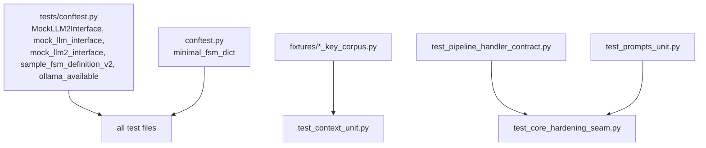

# test_fsm_llm

Path: `tests/test_fsm_llm`
Purpose: pytest suite for the core `fsm_llm` framework (API, FSMManager, 2-pass MessagePipeline, transitions, prompts, LLM wrapper, handlers, memory, validator, visualizer, logging), 72 test files, 6,237 collected tests.

## Scope

In: tests of the core modules in `src/fsm_llm/` (`api.py`, `fsm.py`, `pipeline.py`, `core/transition_evaluator.py`, `core/expressions/`, `classification.py`, `context.py`, `prompts.py`, `llm.py`, `ollama.py`, `handlers.py`, `memory.py`, `session.py`, `validator.py`, `flow_analysis.py`, `visualizer.py`, `runner.py`, `utilities.py`, `logging.py`, `constants.py`), plus `fixtures/` (labelled secret-filter corpora).

Out: the subpackages `fsm_llm.agents`, `.reasoning`, `.workflows`, `.monitor`, `.eval`, `.synthesis` have their own suites under `tests/test_fsm_llm_<name>/`. A few tests here still import from them (see Dependencies).

Core flow under test, for reference:

```
User Input -> Pass 1: extraction (LLM) -> context update -> classification extractions
           -> transition evaluation (JsonLogic rules) -> if AMBIGUOUS: classifier
           -> state transition -> Pass 2: response generation (LLM) -> output
```

Outcomes: one passing transition is DETERMINISTIC, a tie at the lowest priority is AMBIGUOUS, none is BLOCKED (stay).

## Architecture

Three test styles:

| Style | Files | How they drive code |
| --- | --- | --- |
| Unit | `*_unit.py`, `test_pipeline.py`, `test_fsm.py`, `test_expressions.py`, `test_memory.py`, ... | call one module directly |
| Seam | `*_seam.py`, `test_pipeline_handler_contract.py`, `test_turn_guard_deterministic.py` | go through `API.converse` / `converse_stream` / `push_fsm` / `pop_fsm`, or `LiteLLMInterface` with `patch("fsm_llm.llm.completion")` |
| Audit regression | classes named `TestStepNN...` and tests named after the audit id (`test_a1_*`, `test_p0_1_*`) inside the feature files | one class per plan step, each run RED before its fix; no `test_audit_*.py` file remains |



Arrows between test files mean helper imports (`_Prov`, `_PromptSpy`, `_ClassBulkProv`, `_ConnectionHarness`, `_ExplodingHandler`, ...). Renaming a `_` helper in an earlier file breaks later ones.

### fixtures/ (child package)

Pure data, no logic besides `arm_of()`. Three corpora of `(name, value, ground_truth)` rows labelled `credential` or `safe`, consumed only by `test_context_unit.py`, which runs them through `is_forbidden_context_entry` (`fsm_llm.constants`) and `clean_context_keys(..., strip_forbidden_keys=True)` (`fsm_llm.context`). The folder also holds one generated file, `kind_equality_baseline.json` (the recorded answers of the code before the state-kind refactor; written only by `python -m tests.test_fsm_llm.kind_corpus --write`, read by `test_kind_equality.py`); it is not a corpus.

Terms: fail open = a credential reaches the prompt; over-strip = a safe value is removed; arm = `key` or `token` (by name); two-sided pin = a frozenset of known-wrong entries that must match the measurement exactly, so a fix and a regression both fail a test.

| File | Role |
| --- | --- |
| `context_key_corpus.py` | regression and shape-coverage corpus: past leaks and over-strips, every value-shape carve-out has one credential and one safe instance; pinned sets such as `KNOWN_OVER_STRIPPED` |
| `holdout_key_corpus.py` | burned holdout, 181 rows, measured once, now regression only; exports `arm_of()`; pinned sets such as `HOLDOUT_KNOWN_FAIL_OPEN` |
| `census_key_corpus.py` | current independence corpus, 341 rows, 196 distinct values, 124 values in both arms; imports only `arm_of` from the holdout |

Consuming classes in `test_context_unit.py`: `TestIndependentVocabularyKeyCorpus`, `TestCryptoKeyAndTokenTriggers`, `TestValueShapeLayer`, `TestBurnedHoldoutCorpus`, `TestShippedCorpusBounds`, `TestCensusCorpusAdequacy`.

## Key files

| File | Role | Notes |
| --- | --- | --- |
| `conftest.py` | `minimal_fsm_dict` fixture | one state `only_state`, no transitions |
| `support.py` | helpers shared by several test files: FSM builders (`_correction_fsm`, `_classified_fsm`), fake provider responses (`_fake_response`, `_stream_chunk`), the `_Prov` family of scripted providers, `_PassTwoSpy`, `_mock_llm`, `_api` | not collected (no `test_` prefix); a helper used by one file stays in that file; a clashing name carries its source as a prefix (`_aiter1_ambiguous_fsm`) |
| `test_api.py`, `test_api_elaborate.py` | `API` loading, conversations, stacking | `test_api_elaborate.py` holds `TestBaseExceptionRollsBackUserMessage` |
| `test_fsm.py`, `test_fsm_elaborate.py` | `FSMManager` data filtering, stacking | nested filtering of `get_conversation_data` |
| `test_pipeline.py` | `MessagePipeline` 2-pass `process()` | Pass 2 failure is atomic (sync and stream) |
| `test_multipass_extraction.py` | field-level retry and merge | `_build_field_configs_from_state` |
| `test_transition_evaluator.py` | `TransitionEvaluator` outcomes, priority | |
| `test_classification_extractions.py`, `test_classification_transitions.py` | classification extraction, AMBIGUOUS resolution via `Classifier` | classifier cache, NaN confidence |
| `test_expressions.py` | JsonLogic evaluator | short-circuit, arity, soft equality |
| `test_context_unit.py` | context cleaning/compaction/search, secret filter | largest file; holds the strict xfail |
| `test_prompts_unit.py` | prompt builders, `sanitize`, CDATA escape, token estimate | helpers reused by `test_core_hardening_seam.py` |
| `test_llm_unit.py`, `test_ollama.py` | `LiteLLMInterface`, `fsm_llm.ollama` | stream guards, reasoning-content recovery |
| `test_llm_parse_fallback_seam.py` | parse ladder JSON -> embedded JSON -> raw text never raises | |
| `test_llm_finish_reason.py` | `CompletionResponse.finish_reason` / `truncated`, the one `length` WARNING in `_send`, cut-off text in bulk-extraction, field-extraction and classifier errors, the cut-envelope fallback message | a cut brace-opening reply is replaced, a cut prose reply and a `stop` reply are untouched; a partial `message` salvaged from a cut envelope is shipped and flagged `truncated` |
| `test_cut_off_record.py` | the turn's cut-off record `definitions.CONTEXT_KEY_CUT_OFF` (D-025) | `{"reply": True}` / `{"fields": [...]}` written from `truncated=True` responses (`MockLLM2Interface(cut_reply=, cut_fields=)`), absent when nothing was cut, cleared every turn, restored on rollback, never in `get_data`, prompts or a saved session, a completion state's `result_key`, `llm.py` setting the flag |
| `test_internal_key_seeding_log.py` | `FSMContext.update` logs no WARNING for an internal-prefix key (D-026) | seeding, `push_fsm` and `update_context` are quiet; the accidental paths (extraction, handler delta) keep their own guards |
| `test_llm_provider_banner.py` | importing `fsm_llm.llm` sets `litellm.suppress_debug_info = True`; a provider error prints no banner; a host can set it back to False | |
| `test_handlers_unit.py`, `test_handler_timeout.py` | `HandlerSystem`, `HandlerBuilder`, `LambdaHandler`, timeouts | 7 timeout tests are `slow` |
| `test_pipeline_handler_contract.py` | handler failures through `API.converse` | critical propagation, rollback |
| `test_memory.py` | `WorkingMemory` | serialization, copy under concurrency |
| `test_session.py` | `FileSessionStore` ids, soft failures, fsync before replace, file logging after a failed sink add, the default save hook | `_c5_clean_logging` snapshots and restores the global logging state |
| `test_strands_features.py` | schema output, invocation state, streaming, `save_session`/`restore_session` | imports `fsm_llm.agents.base` |
| `test_streaming_history_seam.py` | history after mid-stream error or abandonment | |
| `test_stack_lifecycle_seam.py` | `push_fsm`/`pop_fsm` races, stale cleanup | uses a fake clock |
| `test_cpu_timer.py` | the `cpu_timer` context manager of `tests/conftest.py` (CPU time, not wall time, for budgets about computation) | burns CPU in this thread, in a joined worker and in a worker timed with `thread=True`, and sleeps, to show `process_time`/`thread_time` apart from the wall clock; simulates a loaded host (`time.perf_counter` 10x fast: the old shape fails, the new one passes); an AST scan fails any other test file that calls `time.perf_counter` (only the two ratio sweeps `measure` and `per_char` of `test_context_unit.py` may) |
| `test_timing_factor.py` | the `timing_factor` fixture and `current_timing_factor()` of `tests/conftest.py` | simulates a tracer, pytest-cov, a live coverage and the env override; an AST scan (`_ScaleScan`, by value: a division of two measured values, a ratio-named variable, a bound held in a variable, an alias, `current_timing_factor()`, a same-module helper's parameter) fails any test file that scales a ratio bound by the factor; shapes proven on defeat attempts |
| `test_turn_guard_deterministic.py` | concurrent `converse` on one conversation raises `FSMError` | event-synchronised, no sleeps |
| `test_bulk_extraction.py` | bulk extraction through `API.converse`: correction overwrite, provenance, coercion and validation, rejected corrections, back-edge re-extraction, grounding, a failed bulk surfaced to Pass 2 | |
| `test_prompt_injection_seam.py` | extraction prompt sanitising at `LLMInterface.extract_field` | |
| `test_intent_entities_seam.py` | `IntentScore` keeps `None` entities | |
| `test_core_hardening_seam.py` | `FileSessionStore.save`, `setup_logging`, bounded context, locks | |
| `test_definitions.py` | `Conversation` history summary, `FSMDefinitionNotFoundError`, the shared entity coercer, version and session docs | the 2026-09-22 audit classes of those steps |
| `test_visualizer_golden.py`, `test_resolve_model.py`, `test_api_key_compare_sites.py` | golden pins of the ASCII, Mermaid and DOT renderers, the one model resolver, the API-key comparison sites | the 2026-11-05 source pass tests of one class per fixed finding live in the feature files named after what they test (`test_api.py`, `test_validator_unit.py`, `test_llm_complete.py`, `test_logging_settings.py` and others) |
| `test_validator_unit.py` | `FSMValidator`, agrees with the loader, `fsm-llm-validate` output | |
| `test_flow_analysis.py` | `fsm_llm.flow_analysis`: the component primitive (a golden table written before the validator's Tarjan moved there, a very long chain), G3 data flow and G4 liveness findings, the `minted_keys` hook against the keys the pipeline mints for, over every example and corpus state | Refactor proof; pins the D-017 minting rule |
| `test_synthesize_field.py` | The optional `State.synthesize` field: load and refusal rules, the pipeline mint change (no extraction, handler-only result key), `fsm_id` of existing FSMs unchanged, a spike of the push-from-`before_step` seam on the real `API` | No synthesis package code |
| `test_schema_registry.py` | `fsm_llm.core.definitions.schema`: the field-introduction registry proven complete by walking the models reachable from `FSMDefinition`, `newer_fields`, the loader warning, the validator warnings (never stricter than the loader), `upgrade_fsm_file` and `fsm-llm-validate --upgrade` | declared versions are explicit; only `TestDefaultVersion` reads the default; log capture through a sink, never `caplog` |
| `test_codes.py` | `fsm_llm.core.codes`: `Status`, `Reason`, `CompletionKind` equal the wire strings of the pinned synthesis, agents and `CompletionResponse` modules; the stop-reason, tool-status and approval mappers | reads the pinned modules, never edits them |
| `test_kind_equality.py` | The state-kind registry safety net (plan d454fd62, group A4): the current code's `fsm_id`, dump hashes, validator, G3, G4, G6a findings, loader refusals and the request bytes of a plain, a completion and a synthesize-host turn against `fixtures/kind_equality_baseline.json`; corpus built by `kind_corpus.py` (not collected) | Compare only; regenerate by hand on the parent of a kind change (`python -m tests.test_fsm_llm.kind_corpus --write`), never to silence a failure |
| `test_visualizer_unit.py` | ASCII visualizer, box alignment, truncation, CLI output | |
| `test_runner_unit.py`, `test_utilities_unit.py` | runner redaction, `extract_json_from_text`, FSM loading | |
| `test_logging_unit.py`, `test_logging_structured.py` | logging helpers, `setup_logging`, JSON formatter, `replace_default_handler` | `TestDefaultHandlerIsReplacedNotDoubled` runs child processes (`sys.path` from `fsm_llm.__file__`, no `-I`) |
| `test_logging_settings.py` | `setup_logging` level normalisation, JSON line identity fields, file-handler id, CLI entry points at INFO, one `enable_debug_logging` path, a bad env format or level | an autouse fixture resets the handlers and clears `FSM_LLM_LOG_LEVEL` and `FSM_LLM_LOG_FORMAT` around every test |
| `test_okf.py`, `test_okf_cli.py` | Open Knowledge Format loader, writer, `capped_note`, `okf_bridge` (memory export, handler) and `fsm-llm-okf` | imports `fsm_llm.okf` and `fsm_llm.okf_bridge`; the shared helper `resolve_within` is tested in `test_okf.py`; `TestBridgeLayering` pins the bridge's imports |
| `test_frontmatter.py` | `fsm_llm.frontmatter`: split, bounded `load_yaml`, `read_bytes`, `lone_surrogate`, layering | the one YAML loader; `TestOkfKeepsItsWiring` pins what `okf.py` keeps to it |
| `test_agent_skills.py` | `fsm_llm.agent_skills` parser, loader, catalog, render, confinement | pure ASCII file (controls built with `chr`); `TestLayering` runs `python -I` subprocesses |
| `test_agent_skills_cli.py` | `fsm-llm-skills` commands (`show --file DIR` lists a directory), exit codes, output hygiene | `TestWiring` pins the console script |
| `test_cli_support.py` | `fsm_llm.cli_support`: exit mapping, BrokenPipe parking, output escape, `positive_seconds`; both CLIs use it | structure pins: neither CLI re-inlines the skeleton or imports a private name from the other |
| `test_resolve_model.py`, `test_model_not_configured.py`, `test_model_callers.py`, `test_default_model_removed.py` | no built-in default model: `llm.resolve_model` and `ModelNotConfiguredError`, the classifier, `AgentConfig`, agent and meta callers, reasoning, eval and monitor, every CLI exits 1 with one stderr line | the child-process CLI checks run with a scrubbed environment and the model-server variables on a closed port |
| `test_no_implicit_env.py`, `test_load_env.py`, `test_env_file_flag.py` | no `.env` is read at import (`LITELLM_MODE=PRODUCTION` around the one litellm import); `fsm_llm.load_env`; `--env-file` and `--model` on the five model CLIs and its absence on the four that call no model | child interpreters, never a real model server, no test prints a `.env` content |
| `test_docs_snippets.py` | loads doc FSM snippets through `FSMDefinition` | see Invariants |
| `test_live_classification_memory.py` | live classifier and memory agent on `ollama_chat/qwen3.5:9b-q8_0` | markers `integration`, `real_llm`, `slow` |

## Public interface

A test suite exports no product API. What other files consume:

Fixtures and helpers from `tests/conftest.py` (shared by all suites), and the doubles of `fsm_llm.testing`:

| Name | Kind | Use |
| --- | --- | --- |
| `MockLLM2Interface(extraction_data=None, response_text="Hello! How can I help you?", cut_reply=False, cut_fields=())` (defined in `fsm_llm.testing`; import it from there) | `LLMInterface` subclass | 2-pass mock; `extract_field` returns `extraction_data[field_name]`, records calls in `call_history`; `cut_reply=True` flags the Pass-2 reply `truncated`, a name in `cut_fields` comes back with value `None` and `truncated=True` (plain attributes, changeable between turns) |
| `configure_mock_extract_field(mock_llm, mock_data=None)` | function | gives a `Mock(spec=LLMInterface)` a working `extract_field` side effect |
| `mock_llm_interface`, `mock_llm2_interface` | fixtures | the two mock styles above |
| `sample_fsm_definition`, `sample_fsm_definition_v2` | fixtures | v3.0 and v4.1 FSM definitions |
| `ollama_available(model_tag: str) -> bool` | function | skip guard for live tests |

Markers registered there: `slow`, `integration`, `examples`, `real_llm`.

Local `conftest.py`: fixture `minimal_fsm_dict`.

Helpers imported across files in this directory (module path `tests.test_fsm_llm.<file>`):

| Defined in | Helpers | Imported by |
| --- | --- | --- |
| `support.py` | the helpers more than one test file needs (`_fake_response(content: str) -> MagicMock`, `_correction_fsm`, `_stream_chunk`, `_Prov`, `_PassTwoSpy`, `_EdgeProv`, `_PromptSpy`, `_ConnectionHarness`, `_mock_llm`, `_api` and others) | 43 feature files |
| `test_completion_state.py` | `_tool_fsm`, `_RESULT`, `_start`, `_to_call_model` | `test_api.py`, `test_classification_transitions.py`, `test_cut_off_record.py`, `test_definitions.py`, `test_validator_unit.py` |
| `test_llm_complete.py` | `_Provider`, `_reply`, `_call` | `test_api.py`, `test_completion_state.py` |
| `test_advance.py` | `_ScriptedLLM`, `_StreamingLLM`, `_trip_fsm`, `_start`, `_state`, `_always`, `_when_set`, `_CHUNKS`, `_REPLY` | `test_run_until_terminal.py` |
| `test_llm_request_path.py` | `_response`, `_schema` | `test_run_until_terminal.py` |
| `test_pipeline_handler_contract.py` | `_ExplodingHandler`, `_fsm_definition`, `_make_api` | `test_core_hardening_seam.py` |
| `test_prompts_unit.py` | `_make_state`, `_make_instance`, `_make_fsm_definition` | `test_core_hardening_seam.py` (imported under `_make_prompt_*` aliases) |
| `test_okf.py` | `_FakeClock` | `test_okf_cli.py` |
| `fixtures/context_key_corpus.py`, `fixtures/holdout_key_corpus.py`, `fixtures/census_key_corpus.py` | name tuples, value maps, known-wrong frozensets; `arm_of(name: str) -> str` in the holdout and census corpora | `test_context_unit.py` |

A helper that two or more files need lives once in `support.py`; the rows above are the existing cross-file imports from a feature file (keep those names stable, or move the helper to `support.py` and update both sides).

Seam files fake the backend with `patch("fsm_llm.llm.completion", ...)` returning `MagicMock` responses built by `_fake_response`.

`test_docs_snippets.py` scans ```` ```json ```` and ```` ```python ```` fences naming `"initial_state"` in `README.md`, `docs/quickstart.md`, `src/fsm_llm/README.md`, `AGENTS.md` (repo root; must each contribute a snippet) and `docs/api_reference.md`, `docs/architecture.md`, `docs/fsm_design.md`, `docs/handlers.md`, `docs/synthesis.md` and `docs/testing.md` (must exist). Python blocks are parsed with `ast`, never executed. Test ids look like `test_doc_fsm_snippet_loads[<file>#block<n>]`.

## Data shapes

- `minimal_fsm_dict`: `{"name", "description", "initial_state": "only_state", "states": {"only_state": {"id", "description", "purpose", "transitions": []}}}`; exercises Pydantic defaults.
- Holdout and census corpus rows: `(name, value, ground_truth)` with `ground_truth` in `{"credential", "safe"}`; census totals 341 rows, 196 distinct values, 124 values in both arms.
- Regression corpus (`context_key_corpus.py`): name tuples (`SECRET_KEYS`, `SAFE_KEYS`, `CRYPTO_KEY_*_KEYS`, `TOKEN_*_KEYS`), value maps `dict[str, object]` (`TOKEN_SECRET_VALUES`, `CRYPTO_KEY_SAFE_VALUES`, ...), carve-out entries `(entry_id, name, value)` with `entry_id` like `"<shape>/credential"` or `"<shape>/safe"`, and known-wrong `frozenset[str]` pins (`KNOWN_OVER_STRIPPED`, `CARVE_OUT_KNOWN_FAIL_OPEN`, ...).
- `MockLLM2Interface.call_history`: list of `("extract_field" | "generate_response", request)` tuples.

## Invariants and constraints

- Run from the repo root: files import `tests.conftest` and `tests.test_fsm_llm.<module>`.
- No network in the default run. Only `test_live_classification_memory.py` reaches a model, and its tests skip via `ollama_available(MODEL_TAG)` when Ollama or the model is missing.
- `-m "not slow"` deselects 14 tests (7 handler timeout, 7 live).
- `test_context_unit.py` holds an `xfail(strict=True)` bound test: the key arm fails open above the 5% bound. An XPASS after a reporting-only change means the measurement changed; revert, do not celebrate. Do not change bound denominators in the same edit as a disclosure change.
- fixtures invariants (enforced by `test_context_unit.py`): corpora must not import `fsm_llm.constants`; holdout and regression corpora share no names and exactly one value (`True`); census names appear in neither sibling; census numbers (341 rows, 196 distinct values, 124 in both arms) and banner strings are asserted verbatim; known-wrong sets are two-sided pins; credential values are synthetic (real vendor prefixes keep `NOTAREALTOKEN`-style bodies; census uses invented prefixes like `xk_live_`).
- `test_pipeline.py::TestDecisionAnchorsArePlacedAndQualified` asserts `# DECISION plan-2026-09-19T175721-21cd7f8e/D-016` in `fsm_llm.pipeline` and `/D-011` in `fsm_llm.validator`. Moving or rewording those anchors fails it.
- Audit tests pin behaviour that was deliberately fixed. Treat a failure as a regression in `src/`, not a stale test, unless the plan decision it cites was reversed.

## Dependencies

- Core modules of `fsm_llm` listed in Scope.
- Cross-subpackage imports: `fsm_llm.agents` (`test_live_classification_memory.py`, `test_strands_features.py`, `test_validator_unit.py` via `fsm_llm.agents.fsm_definitions` and `fsm_llm.agents.tools.ToolRegistry`), `fsm_llm.workflows.exceptions` and `.models` (`test_logging_unit.py`), `fsm_llm.workflows` itself (`test_handlers_unit.py`, which also simulates its import failing).
- External: pytest, `unittest.mock`; the live file also uses litellm callbacks and a local Ollama.

## Failure modes

- `ModuleNotFoundError: tests...` when pytest runs from another directory.
- A docs edit that breaks an FSM example fails `test_doc_fsm_snippet_loads[<file>#block<n>]`; moving a fence style makes `test_the_extractor_found_the_first_touch_snippets` fail instead of passing vacuously.
- A secret-filter change in `src/fsm_llm/constants.py` that fixes or breaks a corpus entry fails the matching two-sided pin.
- Live tests failing on timeouts under GPU load is a known pattern, not necessarily a code bug.

## Working here

- Name files `test_<module>.py` / `test_<module>_elaborate.py`, classes `Test<Feature>`, helpers with a `_` prefix.
- New regression for a public-path bug: add a seam test that drives `API.converse` or patched `fsm_llm.llm.completion`, not only a helper-level test.
- Reuse a helper by import (see the helper table) rather than copying it. Name a new test file for the behaviour it pins, never for an audit, review round or plan step: `TestNoDatedTestFiles` in `tests/test_packaging.py` refuses such names.
- Do not relabel, delete or regenerate corpus rows to improve a rate; do not add filter words to catch one corpus entry. Add names from real vocabulary without reading `constants.py` first.
- After adding or removing tests, re-measure with the first command below. The suite count (6,237) is pinned by `tests/test_packaging.py::test_per_suite_table` (marked slow), which compares a measured `--collect-only` count per suite against a documented literal of the form `pytest tests/test_fsm_llm/  # ... (N tests)`; run that test after changing the count. The counts stated in this file (72 test files, 6,237 tests, 14 slow) are not pinned by any test and must be updated by hand.

```bash
.venv/bin/python -m pytest tests/test_fsm_llm/ --collect-only -q | tail -1
.venv/bin/python -m pytest tests/test_fsm_llm/ -q -m "not slow"
.venv/bin/python -m pytest tests/test_fsm_llm/test_context_unit.py -q
```
