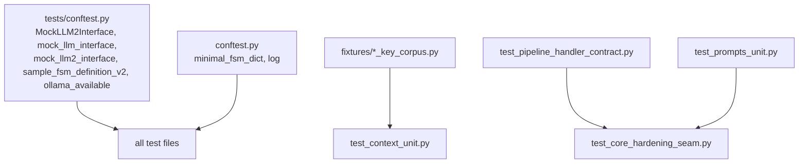

# test_fsm_llm

Path: `tests/test_fsm_llm`
Purpose: pytest suite for the core `fsm_llm` framework (API, FSMManager, 2-pass MessagePipeline, transitions, prompts, LLM wrapper, handlers, memory, validator, visualizer, logging).

## Scope

In: tests of the core modules in `src/fsm_llm/` (`engine/api/`, `engine/fsm/`, `engine/turn/` (the old `pipeline.py`), `core/transition_evaluator.py`, `core/expressions/`, `engine/classification.py`, `context/` (`context/layout/` is the old `prompts.py`), `llm/`, `ollama.py`, `handlers/`, `memory.py`, `engine/session.py`, `core/verify/` (the validator, `flow.py`), `core/visualize/` (the visualizer), `runner.py`, `context/filtering.py`, `llm/text.py`, `llm/json_extraction.py`, `core/coerce.py`, `core/loaders.py`, `logging.py`, `constants.py`), plus `fixtures/` (labelled secret-filter corpora).

Out: the subpackages `fsm_llm.agents`, `.reasoning`, `.workflows`, `.monitor`, `.eval`, `.synthesis` have their own suites under `tests/test_fsm_llm_<name>/`. A few tests here still import from them (see Dependencies).

Core flow under test, for reference:

```
User Input -> Pass 1: extraction (LLM) -> context update -> classification extractions
           -> transition evaluation (JsonLogic rules) -> if AMBIGUOUS: classifier
           -> state transition -> Pass 2: response generation (LLM) -> output
```

Outcomes: one passing transition is DETERMINISTIC, a tie at the lowest priority is AMBIGUOUS, none is BLOCKED (stay).

## Architecture

Test styles:

| Style | Files | How they drive code |
| --- | --- | --- |
| Unit | `*_unit.py`, `test_pipeline.py`, `test_fsm.py`, `test_expressions.py`, `test_memory.py`, ... | call one module directly |
| Seam | `*_seam.py`, `test_pipeline_handler_contract.py`, `test_turn_guard_deterministic.py` | go through `API.converse` / `converse_stream` / `push_fsm` / `pop_fsm`, or `LiteLLMInterface` with `patch("fsm_llm.llm.providers.litellm.completion")` |
| Audit regression | classes named `TestStepNN...` and tests named after the audit id (`test_a1_*`, `test_p0_1_*`) inside the feature files | one class per plan step, each run RED before its fix; no `test_audit_*.py` file remains |



Arrows between test files mean helper imports (`_Prov`, `_PromptSpy`, `_ClassBulkProv`, `_ConnectionHarness`, `_ExplodingHandler`, ...). Renaming a `_` helper in an earlier file breaks later ones.

### fixtures/ (child package)

Pure data, no logic besides `arm_of()`. The corpora hold `(name, value, ground_truth)` rows labelled `credential` or `safe`, consumed only by `test_context_unit.py`, which runs them through `is_forbidden_context_entry` (`fsm_llm.constants`) and `clean_context_keys(..., strip_forbidden_keys=True)` (`fsm_llm.context`). The folder also holds one generated file, `kind_equality_baseline.json` (the recorded answers of the code before the state-kind refactor; written only by `python -m tests.test_fsm_llm.kind_corpus --write`, read by `test_kind_equality.py`); it is not a corpus.

Terms: fail open = a credential reaches the prompt; over-strip = a safe value is removed; arm = `key` or `token` (by name); two-sided pin = a frozenset of known-wrong entries that must match the measurement exactly, so a fix and a regression both fail a test.

| File | Role |
| --- | --- |
| `context_key_corpus.py` | regression and shape-coverage corpus: past leaks and over-strips, every value-shape carve-out has one credential and one safe instance; pinned sets such as `KNOWN_OVER_STRIPPED` |
| `holdout_key_corpus.py` | burned holdout, 181 rows, measured once, now regression only; exports `arm_of()`; pinned sets such as `HOLDOUT_KNOWN_FAIL_OPEN` |
| `census_key_corpus.py` | current independence corpus, 341 rows, 196 distinct values, 124 values in both arms; imports only `arm_of` from the holdout |

Consuming classes in `test_context_unit.py`: `TestIndependentVocabularyKeyCorpus`, `TestCryptoKeyAndTokenTriggers`, `TestValueShapeLayer`, `TestBurnedHoldoutCorpus`, `TestShippedCorpusBounds`, `TestCensusCorpusAdequacy`.

## Key files

| File | Role | Notes |
| --- | --- | --- |
| `conftest.py` | `minimal_fsm_dict` fixture; `log` fixture (an `EventLog` under `tmp_path / "events"`, closed at teardown) | one state `only_state`, no transitions; `log` is shared by the event log test files |
| `event_log_support.py` | helpers the event log test files share: `_reply`, `_chunk`, `_Wrapper`, `_Dead`, `child_env()` (the one environment of every child process of these tests), `reopen_after_kill(open_)`, `tree_files(root)` and `tree_bytes(root)` (the regular files under a root and their joined bytes, skipping the byte-range-locked `.lock` files that a Windows reader cannot open), `child_process(args, err, *, stdin=)` (start `python -m <args>`, yield it, kill and reap it on exit) and `wait_ready(proc, ready, err)` (a bounded poll for the announced file, a failure if the child exits first) | not a test file and not collected (no `test_` prefix); imported by the `test_event_log_*` files and `test_llm_observer.py` |
| `support.py` | helpers shared by several test files: FSM builders (`_correction_fsm`, `_classified_fsm`), fake provider responses (`_fake_response`, `_stream_chunk`), the `_Prov` family of scripted providers, `_PassTwoSpy`, `_mock_llm`, `_api`, `_child_env` (the scrubbed environment of a child Python process) and `_plain_state` | not collected (no `test_` prefix); a helper used by one file stays in that file; a clashing name carries its source as a prefix (`_aiter1_ambiguous_fsm`) |
| `test_api.py`, `test_api_elaborate.py` | `API` loading, conversations, stacking | `test_api_elaborate.py` holds `TestBaseExceptionRollsBackUserMessage` |
| `test_fsm.py`, `test_fsm_elaborate.py` | `FSMManager` data filtering, stacking | nested filtering of `get_conversation_data` |
| `test_pipeline.py` | `MessagePipeline` 2-pass `process()` | Pass 2 failure is atomic (sync and stream) |
| `test_multipass_extraction.py` | field-level retry and merge | `ConversationPass1._build_field_configs_from_state` (the machinery is built over a pipeline: `ConversationPass1(pipeline)`) |
| `test_transition_evaluator.py` | `TransitionEvaluator` outcomes, priority | |
| `test_classification_extractions.py`, `test_classification_transitions.py` | classification extraction, AMBIGUOUS resolution via `Classifier` | classifier cache, NaN confidence |
| `test_expressions.py` | JsonLogic evaluator | short-circuit, arity, soft equality |
| `test_context_unit.py` | context cleaning/compaction/search, secret filter | largest file; holds the strict xfail |
| `test_prompts_unit.py` | prompt builders, `sanitize`, CDATA escape, token estimate | helpers reused by `test_core_hardening_seam.py` |
| `test_llm_unit.py`, `test_ollama.py` | `LiteLLMInterface`, `fsm_llm.llm.ollama` | stream guards, reasoning-content recovery |
| `test_llm_parse_fallback_seam.py` | parse ladder JSON -> embedded JSON -> raw text never raises | |
| `test_llm_finish_reason.py` | `CompletionResponse.finish_reason` / `truncated`, the one `length` WARNING in `_send`, cut-off text in bulk-extraction, field-extraction and classifier errors, the cut-envelope fallback message | a cut brace-opening reply is replaced, a cut prose reply and a `stop` reply are untouched; a partial `message` salvaged from a cut envelope is shipped and flagged `truncated` |
| `test_cut_off_record.py` | the turn's cut-off record `definitions.CONTEXT_KEY_CUT_OFF` (D-025) | `{"reply": True}` / `{"fields": [...]}` written from `truncated=True` responses (`MockLLM2Interface(cut_reply=, cut_fields=)`), absent when nothing was cut, cleared every turn, restored on rollback, never in `get_data`, prompts or a saved session, a completion state's `result_key`, `llm/providers/litellm.py` setting the flag |
| `test_internal_key_seeding_log.py` | `FSMContext.update` logs no WARNING for an internal-prefix key (D-026) | seeding, `push_fsm` and `update_context` are quiet; the accidental paths (extraction, handler delta) keep their own guards |
| `test_llm_provider_banner.py` | importing `fsm_llm.llm` sets `litellm.suppress_debug_info = True`; a provider error prints no banner; a host can set it back to False | |
| `test_handlers_unit.py`, `test_handler_timeout.py` | `HandlerSystem`, `HandlerBuilder`, `LambdaHandler`, timeouts | the timeout tests are `slow` |
| `test_pipeline_handler_contract.py` | handler failures through `API.converse` | critical propagation, rollback |
| `test_memory.py` | `WorkingMemory` | serialization, copy under concurrency |
| `test_session.py` | `FileSessionStore` ids, soft failures, fsync before replace, file logging after a failed sink add, the default save hook | `_c5_clean_logging` snapshots and restores the global logging state |
| `test_llm_observer.py` | the request observer of `LiteLLMInterface._send` (D-002): the allow-list of what an observer sees, fail-closed `begin_send` and a `end_send` that never breaks a reply, stream and retry paths, no observer and no scope, and the shared send path and its usage meter unchanged with an observer installed | patches `fsm_llm.llm.providers.litellm.completion`, a recording double as the observer |
| `test_event_log_format.py` | the event log format of `fsm_llm.runtime`: the closed vocabulary (the declared types and the produced ones), the safe encoder and decoder (one ASCII line per event, hostile and deep values cannot recurse), depth check, `to_jsonable`, the errors and constants, and a source scan that bans the forbidden file and JSON idioms in `src/fsm_llm/runtime` | no clock, no file |
| `test_event_log_jsonl.py` | the JSONL store: unbuffered append, the newline as the only commit marker, a torn tail cut by the next lock holder and ignored by readers, a bad middle line raises, the fsync policy, open flags, id rules, the advisory lock and the acknowledged-event proof across processes | crash points injected through `_write`, `_fsync`, `_truncate`; one child killed with `Popen.kill()`; the POSIX-mode test is the one expected Windows skip |
| `test_event_log_blobs.py` | the content-addressed blob store: hash and ref rules, a tampered or wrong-hash blob refused, write-if-absent, a stray `.tmp` ignored, races between threads and a child process | the Windows `os.replace` branch is simulated, unverified until the Windows run |
| `test_event_log_api.py` | `EventLog`: append, read and query, the clock injected and `seq` as the order, checkpoint fsyncs counted, fail-closed writes, the `tool/call` side-effect rule, the secret filter and the blob rules | no timing assertion |
| `test_event_log_scope.py` | the turn scope of the runtime layer: `emit` with and without a scope, binding, `scoped_iter`, the request observer path from the provider seam and the engine fallback `llm_call`; credentials never reach the log or a blob | patched provider binding and `ScriptedLLM` |
| `test_event_log_engine.py` | the opt-in `API(event_log=...)`: the `turn/start` and `turn/end` boundary and its outcomes, the state blob, the log-off guarantee (nothing bound, nothing written), strangler parity of replies and data, the lock order with the log on, and threads | every model is a `ScriptedLLM` |
| `test_event_log_producers.py` | the engine producers: the model call sites, the streamed reply recorder, executor and transition events, stack push and pop, the out-of-turn context record, fail-closed behaviour at each site, the privacy of the request blob, and that the produced set equals `PRODUCED_TYPES` over all scenarios | both the engine path (`ScriptedLLM`) and the provider path (patched `completion`); its `_run`, `_script`, `_FSM`, `_CHILD` helpers are imported by `test_event_log_acceptance.py` |
| `test_event_log_sessions.py` | session projections: `SessionProjection` v2 and its one v1 migration, the reader of old `FileSessionStore` files, the fold of a log (rolled-back turns, a pushed child, a future event type, a `None` delta value kept as the write keeps it), `EventLogSessionStore`, restore seeding with the declared-key allow-list and the lineage record, and a completion state | hand-built logs and real conversations; the on-versus-off snapshot parity test |
| `test_event_log_acceptance.py` | in-process acceptance proofs: the roadmap Log test (every `llm/request` rebuilt byte for byte from the log, on the provider path and per call kind on the engine path), strangler parity of a real interface (replies, data, history, snapshot, `usage()` and the exact provider requests, with a failed Pass 2 and its retry), and the privacy corpus end to end | imports private helpers from `test_event_log_producers.py` |
| `test_event_log_crash.py` | crash proofs: a child killed with `Popen.kill()` mid turn restores to the last committed turn with the in-flight tool as unknown, a death at every event offset (clean and torn) of a tool exchange and a rolled-back turn, the torn tail repaired by the next writer, and the exact fsync count of a scripted run | about 20 to 25 s; no marker (a test pins that); the child module `event_log_child.py` is not collected |
| `event_log_child.py` | the child process of `test_event_log_crash.py` and `test_event_log_stack_crash.py`, run as `python -m tests.test_fsm_llm.event_log_child <dir> <ready_file>` from the repo root (`stacked` as a third argument runs the stack child: role `run` blocks at frame 1 inside an in-flight tool call, role `resume <conversation_id>` resumes that log and holds the writer lock until its stdin closes); shared helpers `chat_fsm`, `stack_llm`, `top_id`, `stack_view`, `stacked_start`, `stacked_finish` | not a test file and not collected; blocks inside a model double so the parent can kill it |
| `test_event_log_stack.py` | the stack in the event log: the push and pop records, `fold_stack` on hand-built tapes under the recovery rule (one test per clause: a gap, a duplicate, a forged record), `turn_cut`, and a real stacked conversation folded after every state-carrying append and compared with what the live `API` showed | every model is a `ScriptedLLM`; the byte-level tampering helper is unverified until the Windows run |
| `test_event_log_stack_crash.py` | crash proofs of the stack: a death at every write offset, a torn tail of every length of a push and pop line, a lost or replayed push or pop, and a real `Popen.kill()` at frame 1 followed by resume, plus a second process holding the writer lock | the golden view is observed from the live `API`, never from a fold; no marker; imports `event_log_child.py` |
| `test_event_log_resume.py` | the seams of fork and resume: the id-preserving `FSMManager.start_conversation(conversation_id=)`, the one restore body shared with `restore_session`, and `API.resume` (the writer lock before any read, the stack with its own ids, an in-flight tool reported once and never run, a freed lock after every failure) | counts and sequences, never timing |
| `test_event_log_forks.py` | `API.fork`: a new conversation tree from the state of an old one at the end of its Nth turn with the whole stack rebuilt from the log, the forged routes (hand-written trees whose blobs lie), the refusals and the teardown at every stage of the rebuild | one RED test per route of the D-009 trust rule |
| `test_event_log_privacy.py` | privacy of the event log: the `shape` level read as bytes (no user text, no model text, no ref, no `blobs/`), `LogPrivacyError` on every fold, fork, resume and restore, and the redaction hook (fail closed, after the built-in filters) | counts, bytes and sequences, never timing |
| `test_event_log_retention.py` | `EventLog.prune`: logs by file mtime or count, blobs by mark and sweep with a grace, held writers and `.lock` files left alone, and a model differential over random trees of logs, forks and blobs | mtimes set with `os.utime`, no sleeps for ordering; a real refused unlink is unverified until the Windows run |
| `test_event_log_restore_trust.py` | the fix round of the whole-diff review of plan 5a6a1f80: a restored frame drops internal-prefixed return-context keys and shared key names (fork and resume, then `pop_fsm`), prune re-stats a blob before the unlink, a pushed frame's `max_steps` and `max_seconds` ride its push and come back with a fresh count, a classifier the API cannot run and a symlinked log are refused | each is RED on the parent commit and names its mutant; a symlink skips where the platform refuses one |
| `test_turn_budgets.py` | core turn budgets: lifetime `max_steps` and `max_seconds` per conversation and per pushed frame on `API`, `start_conversation`, `push_fsm` and `FSMManager`, charged after the claim and before any model call, a spent budget raising `RunBudgetExceededError` on the next turn, and `None` changing nothing | each test names the mutant it kills where that is not obvious |
| `test_usage_projection.py` | usage as a projection: the ledger with a marker that `reset_usage()` moves without losing history, and the one record shape and one fold shared by the ledger and the events of the log | the provider is the patched `fsm_llm.llm.providers.litellm.completion` binding |
| `test_strands_features.py` | schema output, invocation state, streaming, `save_session`/`restore_session` | imports `fsm_llm.agents.base` |
| `test_streaming_history_seam.py` | history after mid-stream error or abandonment | |
| `test_stack_lifecycle_seam.py` | `push_fsm`/`pop_fsm` races, stale cleanup | uses a fake clock |
| `test_turn_guard_deterministic.py` | concurrent `converse` on one conversation raises `FSMError` (from threads; the task and loop forms are in `test_turn_gate.py` and `test_async_engine.py`) | event-synchronised, no sleeps |
| `test_fsm_lock_order.py` | the lock order of `FSMManager`: recording lock wrappers over every manager operation, the exact `_lock` / `conv_lock` call order of the turn, read, write and end paths pinned, the checker proven on synthetic and inverted orders | single thread except one busy-lock test; read the anchors in `engine/fsm/` before changing a pin |
| `test_turn_gate.py` | `TurnGate`, the ticket-owned conversation lock (plan f150ec28): who re-enters (child task, `to_thread` worker, `copy_context` thread) and who does not (sibling task, plain thread), refusal without waiting, a bounded blocking wait on a thread, fail-fast on the loop thread, release by ticket from any Context, the asyncgen finalizer row; each row names the mutant it kills; one known-limit row (a timed-out handler thread keeps the ticket, plan f150ec28 D-020) | events and bounded joins, no clock assertion, one bounded 1 ms poll of the private queue (`_wait_queued`) |
| `test_async_engine.py` | The async bodies of the pipeline and the async API entries answer like the sync ones (plan f150ec28, steps 2 and 3: `aconverse`, `aadvance`, `astart_conversation`, the two async streams, `arun_until_terminal` and its stream, two conversations interleaving on one loop, the second turn refused while the first is suspended, the gate released by ticket on a consumer that breaks): the same scripted work run sync and async on a double whose `a*` twins really suspend, compared by reply, data, history, state, request bytes and usage meter; the module docstring lists the rows | no network, no clock; each row names the mutant it kills |
| `test_async_cancel.py` | A cancelled async turn changes nothing (plan f150ec28, step 4): a sweep that cancels a scripted turn at every model await and compares state, data, metadata, working memory and history with the pre-turn values, the gate, the budget, the ERROR handlers and (log on) the fold; stream and run-loop cancels; a sync-only interface whose late reply lands after the rollback; `TestKnownLimits` rows that pin limits the docs name (a consumer cancelled in its own await abandons the stream, a sync-only executor writes after a cancel, an executor subclass overriding only the sync `extract` is bypassed in async mode, the task that ran a stream's first step owns the conversation between chunks, a second run loop on a busy conversation gets `ConversationBusyError`) | no network, no clock; events and bounded waits; each row names the mutant it kills |
| `test_bulk_extraction.py` | bulk extraction through `API.converse`: correction overwrite, provenance, coercion and validation, rejected corrections, back-edge re-extraction, grounding, a failed bulk surfaced to Pass 2 | |
| `test_prompt_injection_seam.py` | extraction prompt sanitising at `LLMInterface.extract_field` | |
| `test_intent_entities_seam.py` | `IntentScore` keeps `None` entities | |
| `test_core_hardening_seam.py` | `FileSessionStore.save`, `setup_logging`, bounded context, locks | |
| `test_definitions.py` | `Conversation` history summary, `FSMDefinitionNotFoundError`, the shared entity coercer, version and session docs | the 2026-09-22 audit classes of those steps |
| `test_visualizer_golden.py`, `test_resolve_model.py`, `test_api_key_compare_sites.py` | golden pins of the ASCII, Mermaid and DOT renderers, the one model resolver, the API-key comparison sites | the 2026-11-05 source pass tests of one class per fixed finding live in the feature files named after what they test (`test_api.py`, `test_validator_unit.py`, `test_llm_complete.py`, `test_logging_settings.py` and others) |
| `test_validator_unit.py` | `FSMValidator`, agrees with the loader, `fsm-llm-validate` output | |
| `test_flow_analysis.py` | `fsm_llm.core.verify.flow`: the component primitive (a golden table written before the validator's Tarjan moved there, a very long chain), G3 data flow and G4 liveness findings, the `minted_keys` hook against the keys the pipeline mints for, over every example and corpus state | Refactor proof; pins the D-017 minting rule |
| `test_synthesize_field.py` | The optional `State.synthesize` field: load and refusal rules, the pipeline mint change (no extraction, handler-only result key), `fsm_id` of existing FSMs unchanged, a spike of the push-from-`before_step` seam on the real `API` | No synthesis package code |
| `test_schema_registry.py` | `fsm_llm.core.definitions.schema`: the field-introduction registry proven complete by walking the models reachable from `FSMDefinition`, `newer_fields`, the loader warning, the validator warnings (never stricter than the loader), `upgrade_fsm_file` and `fsm-llm-validate --upgrade` | declared versions are explicit; only `TestDefaultVersion` reads the default; log capture through a sink, never `caplog` |
| `test_codes.py` | `fsm_llm.core.codes`: `Status`, `Reason`, `CompletionKind` equal the wire strings of the pinned synthesis, agents and `CompletionResponse` modules; the stop-reason, tool-status and approval mappers | reads the pinned modules, never edits them |
| `test_kind_equality.py` | The state-kind registry safety net (plan d454fd62, group A4): the current code's `fsm_id`, dump hashes, validator, G3, G4, G6a findings, loader refusals and the request bytes of a plain, a completion and a synthesize-host turn against `fixtures/kind_equality_baseline.json`; corpus built by `kind_corpus.py` (not collected) | Compare only; regenerate by hand on the parent of a kind change (`python -m tests.test_fsm_llm.kind_corpus --write`), never to silence a failure; the scenarios run with the clock frozen at the recorded day (2026-11-13: the plain extraction prompt says "Today's date"), `test_the_day_never_reaches_a_scenario` pins it |
| `test_state_kinds.py` | `fsm_llm.core.state_kinds`: the registry is complete against the `State` model, `kind_of` and `State.kind`, `kind` absent from dumps and schemas and `fsm_id` unchanged over the corpus, the declarative hooks equal the rules the loader applies, the result-key readers (`handler_only_names`, `core.verify.flow._result_key`, the `owned` collision check, `API._build_push_context`) go through the registry, the minting and produced-keys hooks equal the old rules over the corpus and the pipeline reads them, the State validator refuses through `state_problem` with byte-equal texts over every kind and declaration shape, the loader's synthesize edge and host-key checks go through the `check_definition` and `sample_results` hooks (the recorded host scenarios, byte-equal refusal texts, a runtime-replaced hook, the evaluator passed in), the G4 arrival set, the G6a dry-run readers and the validator's raw lint read the registry (AST guards, equality with the old rules over the corpus and over raw shapes, a runtime-swapped hook per reader), the declared-tool-names readers (approval request, library, G5 raw twin) and the runner refusal read the registry (AST guards, equality with the old copies over the corpus and raw tool shapes, a runtime-swapped hook per reader), and the module imports nothing from `fsm_llm`. | fixture corpus `kind_corpus.py` (not collected); imports nothing from `fsm_llm` in the module under test |
| `test_executor_map.py` | the per-API `executors=` map (plan d454fd62 step 54): a test-only kind (a `State` subclass for its config, a `KindSpec` and an executor) runs a full conversation through `API` with no edit in core, two APIs with different maps and the module table stay isolated, a built-in kind can be replaced for one API, the map is a read-only copy, and the refusals (`TypeError` for a non-mapping or a non-`StateExecutor`, `ValueError` for an unknown kind name) at `API`, `FSMManager` and `MessagePipeline`. | a test-only kind, no edit in core |
| `test_executors.py` | `fsm_llm.engine.kinds` (plan d454fd62 steps 53 and 80): an AST ban on kind-config reads (`.completion`, `.synthesize`, `CompletionStateConfig`, `SynthesizeConfig`) in every module of `engine/turn/` (found on disk), every module of `engine/api/` (found on disk), the modules of `engine/fsm/`, `core/verify/flow.py` and `synthesis/dryrun.py`, an AST ban on `field_extractions`, `classification_extractions` and `extraction_instructions` reads and on any conversation Pass-1 method in `engine/turn/`, every module of `engine/kinds/` imports no turn, manager, API, builder or session module (`TYPE_CHECKING` imports included), the executor table (`synthesize` passive, unknown kind falls back to conversation, `register_executor`), `cleans_extracted` and `after_transition`, a real turn dispatched through a recording executor (cut-off record, D-021 flag), and a guard that the conversation Pass-1 methods (owned by the conversation executor since step 80, `ConversationPass1` over the services of one pipeline) are read only inside `engine/kinds/conversation/` (step 56). | the conversation Pass-1 methods are read only inside `engine/kinds/conversation/` |
| `test_visualizer_unit.py` | ASCII visualizer, box alignment, truncation, CLI output | |
| `test_runner_unit.py`, `test_utilities_unit.py` | runner redaction, `extract_json_from_text`, FSM loading (`test_utilities_unit.py` keeps its name: it tests the modules the old `utilities.py` was split into) | |
| `test_logging_unit.py`, `test_logging_structured.py` | logging helpers, `setup_logging`, JSON formatter, `replace_default_handler` | `TestDefaultHandlerIsReplacedNotDoubled` runs child processes (`sys.path` from `fsm_llm.__file__`, no `-I`) |
| `test_logging_settings.py` | `setup_logging` level normalisation, JSON line identity fields, file-handler id, CLI entry points at INFO, one `enable_debug_logging` path, a bad env format or level | an autouse fixture resets the handlers and clears `FSM_LLM_LOG_LEVEL` and `FSM_LLM_LOG_FORMAT` around every test |
| `test_okf.py`, `test_okf_cli.py` | Open Knowledge Format loader, writer, `capped_note`, `engine.okf_bridge` (handler; `bundle_from_memory_entries` is defined in `okf/memory_export.py` since step 95 and re-exported there) and `fsm-llm-okf` | imports `fsm_llm.okf`, `fsm_llm.okf.cli` and `fsm_llm.engine.okf_bridge`; a patch aims at the okf module that performs the lookup (the `_use_clock`, `_cap_issues` and `_patch_in` helpers of `test_okf.py`); the shared helper `resolve_within` is tested in `test_okf.py`; `TestBridgeLayering` pins the bridge's imports |
| `test_frontmatter.py` | `fsm_llm.frontmatter`: split, bounded `load_yaml`, `read_bytes`, `lone_surrogate`, layering | the one YAML loader; `TestOkfKeepsItsWiring` pins what `okf.py` keeps to it |
| `test_agent_skills.py` | `fsm_llm.skills` (`catalog`) parser, loader, catalog, render, confinement | pure ASCII file (controls built with `chr`); patches aim at `fsm_llm.skills.catalog` (`skills_module`), which performs the lookups; `TestLayering` runs `python -I` subprocesses and checks the package loads no okf module |
| `test_agent_skills_cli.py` | `fsm-llm-skills` commands (`show --file DIR` lists a directory), exit codes, output hygiene | `TestWiring` pins the console script |
| `test_cli_support.py` | `fsm_llm.cli_support`: exit mapping, BrokenPipe parking, output escape, `positive_seconds`; both CLIs use it | structure pins: neither CLI re-inlines the skeleton or imports a private name from the other |
| `test_resolve_model.py`, `test_model_not_configured.py`, `test_model_callers.py` | no built-in default model: `llm.resolve_model` and `ModelNotConfiguredError`, the classifier, `AgentConfig`, agent and meta callers; the sweep over every entry point (reasoning, every CLI, eval, the monitor) is `tests/test_fsm_llm_regression/test_no_model_paths.py` (plan ace7a8c8 D-048) | `test_env_file_flag.py` holds the CLI precedence (`--model`, process environment, file, error) |
| `test_no_implicit_env.py`, `test_load_env.py`, `test_env_file_flag.py` | no `.env` is read at import (`LITELLM_MODE=PRODUCTION` around the one litellm import); `fsm_llm.load_env`; `--env-file` and `--model` on the model CLIs and its absence on the CLIs that call no model | child interpreters, never a real model server, no test prints a `.env` content |
| `test_docs_snippets.py` | loads doc FSM snippets through `FSMDefinition` | see Invariants |
| `test_docs_links.py` | every relative link and anchor of `docs/**/*.md` resolves without importing mkdocs (`_link_problems(root)`: a file as MkDocs resolves it, `#anchor` by the `toc` rules of Python-Markdown in `_slug`, `_unique` and `_heading_ids`, a link out of `docs/`, to a directory, to an excluded file or root-absolute refused; included regions are not judged, their headings count as anchors; a `:::` page's anchors are not judged), `_fence_openings` and `_FENCE_INFO` (a bare word after the fence language is refused), a cross-check of `_heading_ids` against the real `toc` extension (skips without `markdown` and `pymdownx`), and mutation tests on a scratch tree | Imports `_config`, `_docs_dir`, `_exclude_patterns`, `_is_excluded`, `_nav_files` from `test_docs_site.py`; no network |
| `test_docs_content.py` | `_content_problems(root)`: the nav groups in order (Home, Getting started, Guides, Reference, Project), the wrapper pages (exactly one include, nothing else; `changelog.md` has `search: exclude: true`), every `*roadmap.md` page without front matter or directive, `docs/cli.md` against the console scripts of `pyproject.toml` (a section and the entry point of each, `--model`, `--env-file`, the exit code 130), `examples.md` links only absolute GitHub folders that exist, `index.md` links every page; the landing example runs offline; mutants on a copy of the real site | Imports `_links` from `test_docs_links.py` and helpers from `test_docs_site.py`; the copies of the site read the real `examples/` folder, nothing is linked or written |
| `test_readme_pypi.py` | `_readme_problems(text, root)`: the README is the PyPI long description, so every link and image is `https://` or `#anchor` (inline, reference definition and HTML `src`/`href`), no mkdocs-only syntax, every fence info string a plain language (indented fences too), every full FSM block loads (at least one; the README has no length rule, the maintainer deleted it), the docs site URL present, every GitHub `blob`/`tree` path and the raw logo image exist; `TestTheReadmeNamesAreTrue` checks every name the README gives (agent patterns, reasoning strategies, step factories, example categories, console scripts) against the code, the offline Quick Start blocks run, the showcase sections are present and every guide page is linked; also what the README points to (the Quick Start sections in `docs/quickstart.md` and its Python blocks parse, CONTRIBUTING.md has Project structure, Good places to help and the `make test` line and no relative link, the docs indexes name no deleted file); the install from PyPI (step 114 of plan d454fd62, D-020): `_install_problems(text, extras)` (`pip install llm-fsm` and `pip install "llm-fsm[extra]"` in code blocks, `pip uninstall fsm-llm`, the Python floor, every extra of `pyproject.toml` and the third-party names it adds, no clone-install line), `_CLONE_INSTALL` over the README, `docs/` (not the 2026 roadmap) and every `src/fsm_llm/**/README.md`, `_RELATIVE_ROOT_LINK` over `README.md`, `CONTRIBUTING.md` and `SECURITY.md`, `_EMOJI` over the README and `docs/**/*.md` (arrows are not emoji), the version badge equal to `__version__` and the Python badge equal to the classifiers (3.11 to 3.15); permanent mutants over a copy of the real README |
| `test_docs_site.py` | the docs site configuration without importing mkdocs (a `yaml.SafeLoader` subclass reads `mkdocs.yml` and its `!!python/name:` tags): `strict`, the `validation` block, `docs_dir`, every nav file exists, every `docs/**/*.md` is in the nav or in `exclude_docs`, no `AGENTS.md` reachable or included, every `include-markdown` target exists, theme and plugin options (`search` and `include-markdown`, no mkdocstrings and no `:::` block), no `reference/`, `packages/`, `upgrade-guide/` or `decisions/` folder, the `docs` dependency group (not an extra), the Makefile targets, the `check-yaml` exclusion; mutation tests run the checks on a scratch tree with one defect each | computed from the files on disk, so a later page needs no edit here |
| `test_live_classification_memory.py` | live classifier and memory agent on `ollama_chat/qwen3.5:9b-q8_0` | markers `integration`, `real_llm`, `slow` |

## Public interface

A test suite exports no product API. What other files consume:

Fixtures and helpers from `tests/conftest.py` (shared by all suites), and the doubles of `fsm_llm.testing`:

| Name | Kind | Use |
| --- | --- | --- |
| `MockLLM2Interface(extraction_data=None, response_text="Hello! How can I help you?", cut_reply=False, cut_fields=())` (defined in `fsm_llm.testing`; import it from there) | `LLMInterface` subclass | 2-pass mock; `extract_field` returns `extraction_data[field_name]`, records calls in `call_history`; `cut_reply=True` flags the Pass-2 reply `truncated`, a name in `cut_fields` comes back with value `None` and `truncated=True` (plain attributes, changeable between turns) |
| `configure_mock_extract_field(mock_llm, mock_data=None)` | function | gives a `Mock(spec=LLMInterface)` a working `extract_field` side effect |
| `mock_llm_interface`, `mock_llm2_interface` | fixtures | the two mock styles above |
| `sample_fsm_definition`, `sample_fsm_definition_v2` | fixtures | v3.0 and v4.1 FSM definitions |
| `ollama_available(model_tag: str) -> bool` | function | skip guard for live tests |

Markers registered there: `slow`, `integration`, `examples`, `real_llm`.

Local `conftest.py`: fixtures `minimal_fsm_dict` and `log` (an `EventLog` in a temporary directory, closed at teardown, for the event log tests).

Helpers imported across files in this directory (module path `tests.test_fsm_llm.<file>`):

| Defined in | Helpers | Imported by |
| --- | --- | --- |
| `support.py` | the helpers more than one test file needs (`_fake_response(content: str) -> MagicMock`, `_correction_fsm`, `_stream_chunk`, `_Prov`, `_PassTwoSpy`, `_EdgeProv`, `_PromptSpy`, `_ConnectionHarness`, `_mock_llm`, `_api`, `_child_env`, `_plain_state` and others) | the feature files that need them |
| `test_completion_state.py` | `_tool_fsm`, `_RESULT`, `_start`, `_to_call_model` | `test_api.py`, `test_classification_transitions.py`, `test_cut_off_record.py`, `test_definitions.py`, `test_validator_unit.py` |
| `test_llm_complete.py` | `_Provider`, `_reply`, `_call` | `test_api.py`, `test_completion_state.py` |
| `test_advance.py` | `_ScriptedLLM`, `_StreamingLLM`, `_trip_fsm`, `_start`, `_state`, `_always`, `_when_set`, `_CHUNKS`, `_REPLY` | `test_run_until_terminal.py` |
| `test_llm_request_path.py` | `_response`, `_schema` | `test_run_until_terminal.py` |
| `test_pipeline_handler_contract.py` | `_ExplodingHandler`, `_fsm_definition`, `_make_api` | `test_core_hardening_seam.py` |
| `test_prompts_unit.py` | `_make_state`, `_make_instance`, `_make_fsm_definition` | `test_core_hardening_seam.py` (imported under `_make_prompt_*` aliases) |
| `test_okf.py` | `_FakeClock` | `test_okf_cli.py` |
| `fixtures/context_key_corpus.py`, `fixtures/holdout_key_corpus.py`, `fixtures/census_key_corpus.py` | name tuples, value maps, known-wrong frozensets; `arm_of(name: str) -> str` in the holdout and census corpora | `test_context_unit.py` |

A helper that two or more files need lives once in `support.py`; the rows above are the existing cross-file imports from a feature file (keep those names stable, or move the helper to `support.py` and update both sides).

Seam files fake the backend with `patch("fsm_llm.llm.providers.litellm.completion", ...)` returning `MagicMock` responses built by `_fake_response`.

`test_docs_snippets.py` scans ```` ```json ```` and ```` ```python ```` fences naming `"initial_state"` in `README.md`, `docs/quickstart.md`, `src/fsm_llm/README.md`, `AGENTS.md` (repo root; must each contribute a snippet) and `docs/api_reference.md`, `docs/architecture.md`, `docs/fsm_design.md`, `docs/handlers.md`, `docs/synthesis.md` and `docs/testing.md` (must exist). Python blocks are parsed with `ast`, never executed. Test ids look like `test_doc_fsm_snippet_loads[<file>#block<n>]`.

## Data shapes

- `minimal_fsm_dict`: `{"name", "description", "initial_state": "only_state", "states": {"only_state": {"id", "description", "purpose", "transitions": []}}}`; exercises Pydantic defaults.
- Holdout and census corpus rows: `(name, value, ground_truth)` with `ground_truth` in `{"credential", "safe"}`; census totals 341 rows, 196 distinct values, 124 values in both arms.
- Regression corpus (`context_key_corpus.py`): name tuples (`SECRET_KEYS`, `SAFE_KEYS`, `CRYPTO_KEY_*_KEYS`, `TOKEN_*_KEYS`), value maps `dict[str, object]` (`TOKEN_SECRET_VALUES`, `CRYPTO_KEY_SAFE_VALUES`, ...), carve-out entries `(entry_id, name, value)` with `entry_id` like `"<shape>/credential"` or `"<shape>/safe"`, and known-wrong `frozenset[str]` pins (`KNOWN_OVER_STRIPPED`, `CARVE_OUT_KNOWN_FAIL_OPEN`, ...).
- `MockLLM2Interface.call_history`: list of `("extract_field" | "generate_response", request)` tuples.

## Invariants and constraints

- Run from the repo root: files import `tests.conftest` and `tests.test_fsm_llm.<module>`.
- No network in the default run. Only `test_live_classification_memory.py` reaches a model, and its tests skip via `ollama_available(MODEL_TAG)` when Ollama or the model is missing.
- `-m "not slow"` deselects the handler timeout tests and the live ones.
- `test_context_unit.py` holds an `xfail(strict=True)` bound test: the key arm fails open above the 5% bound. An XPASS after a reporting-only change means the measurement changed; revert, do not celebrate. Do not change bound denominators in the same edit as a disclosure change.
- fixtures invariants (enforced by `test_context_unit.py`): corpora must not import `fsm_llm.constants`; holdout and regression corpora share no names and exactly one value (`True`); census names appear in neither sibling; census numbers (341 rows, 196 distinct values, 124 in both arms) and banner strings are asserted verbatim; known-wrong sets are two-sided pins; credential values are synthetic (real vendor prefixes keep `NOTAREALTOKEN`-style bodies; census uses invented prefixes like `xk_live_`).
- `test_pipeline.py::TestDecisionAnchorsArePlacedAndQualified` asserts `# DECISION plan-2026-09-19T175721-21cd7f8e/D-016` in `fsm_llm.engine.kinds.conversation.fields` and `/D-011` in `fsm_llm.core.verify.structure`. Moving or rewording those anchors fails it.
- Audit tests pin behaviour that was deliberately fixed. Treat a failure as a regression in `src/`, not a stale test, unless the plan decision it cites was reversed.

## Dependencies

- Core modules of `fsm_llm` listed in Scope.
- Cross-subpackage imports: `fsm_llm.agents` (`test_live_classification_memory.py`, `test_strands_features.py`, `test_validator_unit.py` via `fsm_llm.agents.fsm_definitions` and `fsm_llm.tools.ToolRegistry`), `fsm_llm.workflows.exceptions` and `.models` (`test_logging_unit.py`), `fsm_llm.workflows` itself (`test_handlers_unit.py`, which also simulates its import failing).
- External: pytest, `unittest.mock`; the live file also uses litellm callbacks and a local Ollama.

## Failure modes

- `ModuleNotFoundError: tests...` when pytest runs from another directory.
- A docs edit that breaks an FSM example fails `test_doc_fsm_snippet_loads[<file>#block<n>]`; moving a fence style makes `test_the_extractor_found_the_first_touch_snippets` fail instead of passing vacuously.
- A secret-filter change in `src/fsm_llm/constants.py` that fixes or breaks a corpus entry fails the matching two-sided pin.
- Live tests failing on timeouts under GPU load is a known pattern, not necessarily a code bug.

## Working here

- Name files `test_<module>.py` / `test_<module>_elaborate.py`, classes `Test<Feature>`, helpers with a `_` prefix.
- New regression for a public-path bug: add a seam test that drives `API.converse` or patched `fsm_llm.llm.providers.litellm.completion`, not only a helper-level test.
- Reuse a helper by import (see the helper table) rather than copying it. Name a new test file for the behaviour it pins, never for an audit, review round or plan step (a review rule).
- Do not relabel, delete or regenerate corpus rows to improve a rate; do not add filter words to catch one corpus entry. Add names from real vocabulary without reading `constants.py` first.
- After adding or removing tests, measure with the first command below; no document states a count of tests or files.

```bash
.venv/bin/python -m pytest tests/test_fsm_llm/ --collect-only -q | tail -1
.venv/bin/python -m pytest tests/test_fsm_llm/ -q -m "not slow"
.venv/bin/python -m pytest tests/test_fsm_llm/test_context_unit.py -q
```
