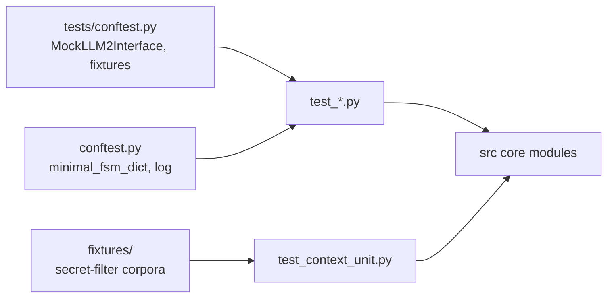

# test_fsm_llm

The pytest suite for the core `fsm_llm` framework, at `tests/test_fsm_llm/`. It holds the core test files plus a `fixtures/` package of labelled secret-filter data.

## What it is for

FSM-LLM runs conversations as JSON-defined finite state machines driven by an LLM. Each user turn goes through a 2-pass pipeline: Pass 1 extracts data from the message, rules pick the next state, and Pass 2 writes the reply. This suite checks the core pieces behind that flow: the `API` class, `FSMManager`, `MessagePipeline`, transition rules, prompts, the LLM wrapper, handlers, working memory, the validator, the visualizer and logging.

Almost every test uses a fake LLM, so the suite runs offline and fast. Only one file talks to a real model, and it skips itself when that model is not available.

## How it works

The test files come in these kinds.

- Unit tests (`*_unit.py` and plain module names such as `test_pipeline.py`) call one module directly.
- Seam tests (`*_seam.py`, `test_pipeline_handler_contract.py`) go through a public entry point, usually `API.converse` or `LiteLLMInterface` with `fsm_llm.llm.providers.litellm.completion` patched. A "seam" here means the boundary where two parts meet; these tests exist because some bugs were invisible to tests that call helpers directly.
- Audit regression tests (classes `TestStepNN...`, tests named after the audit id) pin fixes from past code audits and live in the feature files; no `test_audit_*.py` file remains. Each was run failing before its fix landed.



The `fixtures/` package holds hand-written lists of context key names and values, each labelled "credential" or "safe". `test_context_unit.py` runs every entry through the secret filter (`is_forbidden_context_entry` in `src/fsm_llm/constants.py`) and counts two kinds of error: a credential that reaches the prompt ("fail open") and a harmless value that gets removed ("over-strip"). The lists have separate jobs: a regression list of past bugs, a holdout that was measured once and is now regression only, and a census that is the current independent measurement.

## Files

- `conftest.py` - the `minimal_fsm_dict` fixture (a one-state FSM with only required fields) and the `log` fixture (an `EventLog` in a temporary directory, closed at teardown, shared by the event log tests).
- `event_log_support.py` - helpers the event log test files share (scripted provider replies and chunks, a wrapper interface, the child process environment, the reopen after a kill, `tree_files` and `tree_bytes` that skip byte-range-locked `.lock` files, and `child_process` and `wait_ready` that start a child Python process and wait for its announced point). Not collected: the name has no `test_` prefix.
- `support.py` - helpers that more than one test file uses (FSM builders, fake provider responses, scripted providers). Not collected: the name has no `test_` prefix.
- `kind_corpus.py` - the corpus and recording code behind `test_kind_equality.py` (the example FSMs, the agent, `native_fc`, meta and reasoning builders, the synthesis-bench FSMs and hand-written completion and synthesize fixtures, plus scripted turns). Not collected; `python -m tests.test_fsm_llm.kind_corpus --write` regenerates the baseline, `--show CASE` prints one record.
- `fixtures/` - labelled corpora for the secret filter (`context_key_corpus.py`, `holdout_key_corpus.py`, `census_key_corpus.py`).
- `test_api.py`, `test_api_elaborate.py` - the `API` class: loading definitions, starting and running conversations, FSM stacking.
- `test_fsm.py`, `test_fsm_elaborate.py` - `FSMManager`: data filtering in `get_conversation_data`, stacking.
- `test_pipeline.py` - `MessagePipeline`: the 2-pass `process()`, atomic rollback when Pass 2 fails, context scope, bulk extraction.
- `test_multipass_extraction.py` - field-level retry and merge in extraction.
- `test_transition_evaluator.py` - DETERMINISTIC, AMBIGUOUS and BLOCKED outcomes and priority ranking.
- `test_classification_extractions.py`, `test_classification_transitions.py` - classification-based extraction and classifier-resolved ambiguous transitions.
- `test_expressions.py` - the JsonLogic evaluator used in transition conditions.
- `test_context_unit.py` - context cleaning, compaction, search, and the secret filter measured against `fixtures/`.
- `test_prompts_unit.py` - prompt builders, text sanitizing, token estimates, secret filtering in prompts.
- `test_llm_unit.py`, `test_ollama.py` - `LiteLLMInterface` and Ollama-specific parameters.
- `test_model_not_configured.py`, `test_model_callers.py` - no built-in default model: `resolve_model` raises `ModelNotConfiguredError` (a blank value counts as unset); the classifier, `AgentConfig`, agents and the meta builder resolve through it (an injected `llm_interface` needs no model). The sweep over every entry point (reasoning, the CLIs, eval, the monitor) is `tests/test_fsm_llm_regression/test_no_model_paths.py`.
- `test_no_implicit_env.py`, `test_load_env.py`, `test_env_file_flag.py` - importing `fsm_llm` loads no `.env` (child interpreters), `fsm_llm.load_env` and `fsm-llm --env-file`/`--model`, and `--env-file` on the other model CLIs (and not on the CLIs that call no model); precedence is argument, process environment, file, then `ModelNotConfiguredError`.
- `test_llm_complete.py` - `LLMInterface.complete`, the one request primitive: `CompletionRequest` and `CompletionResponse` models, request rules in `LiteLLMInterface`, reply normalising, failures as `LLMResponseError`.
- `test_llm_request_path.py` - the classifier sends through `fsm_llm.llm`, and no provider request carries an empty user turn.
- `test_llm_usage.py` - the per-call-kind usage counters of `LiteLLMInterface` (`usage()`, `reset_usage()`), including errors, streams and concurrency.
- `test_embedder.py` - `LiteLLMEmbedder`: request shape, construction, reply shapes, usage.
- `test_completion_state.py` - the optional `completion` state field: definition rules, `tool_exchange`, one `complete` call per Pass 1, structured turns, failures that roll the turn back.
- `test_advance.py`, `test_run_until_terminal.py` - the message-free step `API.advance` (and its stream form) and the bounded loops `run_until_terminal` and `run_until_terminal_stream` (budgets, `before_step`, FSM stack).
- `test_typed_field_extraction.py` - the core `typed_field_extraction` builder and its prompt-context narrowing through a real `API` turn.
- `test_builders.py` - the core `BuildError` shared by every `build()`, and the `HandlerBuilder`, `API` and `FSMManager` builders.
- `test_llm_parse_fallback_seam.py` - response parsing falls back from JSON to embedded JSON to raw text and never raises.
- `test_llm_finish_reason.py` - a reply cut by `max_tokens`: `CompletionResponse.finish_reason` and `truncated`, the one WARNING per cut reply, the cut-off note in extraction and classification errors, the cut-off message that replaces a half JSON envelope, and the partial `message` the salvage rungs ship from a cut envelope (still `truncated`).
- `test_cut_off_record.py` - the per-turn record of a reply cut off at `max_tokens` (`definitions.CONTEXT_KEY_CUT_OFF`): written from a `truncated` response, absent when nothing was cut, cleared each turn, kept out of prompts, `get_data` and saved sessions.
- `test_internal_key_seeding_log.py` - writing an internal-prefix key through `start_conversation`, `push_fsm` or `update_context` logs no WARNING.
- `test_llm_provider_banner.py` - `fsm_llm.llm` sets `litellm.suppress_debug_info = True` at import, so a provider error prints no litellm banner to stdout; a host can set it back to False.
- `test_handlers_unit.py`, `test_handler_timeout.py` - `HandlerSystem`, `HandlerBuilder`, timing points, priorities, timeouts.
- `test_pipeline_handler_contract.py` - handler failures seen through `API.converse`, including rollback.
- `test_memory.py` - `WorkingMemory` buffers, serialization, copies and concurrency.
- `test_session.py` - `FileSessionStore` id validation, soft failures, fsync-before-replace, file logging after a failed sink add, and the default save hook.
- `test_llm_observer.py` - the request observer of `LiteLLMInterface._send` (D-002): the allow-list of what an observer sees, fail-closed `begin_send` and a `end_send` that never breaks a reply, stream and retry paths, no observer and no scope, and the shared send path and its usage meter unchanged with an observer installed.
- `test_event_log_format.py` - the event log format of `fsm_llm.runtime`: the closed vocabulary (the declared types and the produced ones), the safe encoder and decoder (one ASCII line per event, hostile and deep values cannot recurse), depth check, `to_jsonable`, the errors and constants, and a source scan that bans the forbidden file and JSON idioms in `src/fsm_llm/runtime`.
- `test_event_log_jsonl.py` - the JSONL store: unbuffered append, the newline as the only commit marker, a torn tail cut by the next lock holder and ignored by readers, a bad middle line raises, the fsync policy, open flags, id rules, the advisory lock and the acknowledged-event proof across processes.
- `test_event_log_blobs.py` - the content-addressed blob store: hash and ref rules, a tampered or wrong-hash blob refused, write-if-absent, a stray `.tmp` ignored, races between threads and a child process.
- `test_event_log_api.py` - `EventLog`: append, read and query, the clock injected and `seq` as the order, checkpoint fsyncs counted, fail-closed writes, the `tool/call` side-effect rule, the secret filter and the blob rules.
- `test_event_log_scope.py` - the turn scope of the runtime layer: `emit` with and without a scope, binding, `scoped_iter`, the request observer path from the provider seam and the engine fallback `llm_call`; credentials never reach the log or a blob.
- `test_event_log_engine.py` - the opt-in `API(event_log=...)`: the `turn/start` and `turn/end` boundary and its outcomes, the state blob, the log-off guarantee (nothing bound, nothing written), strangler parity of replies and data, the lock order with the log on, and threads.
- `test_event_log_producers.py` - the engine producers: the model call sites, the streamed reply recorder, executor and transition events, stack push and pop, the out-of-turn context record, fail-closed behaviour at each site, the privacy of the request blob, and the product-path matrix (one product scenario per produced type).
- `test_event_log_greeting.py` - the root greeting as a logged call: its pair before the start record, the request fsynced before the model call, the bytes sent, a failed or cancelled greeting, a log killed inside it.
- `test_event_log_extraction.py` - the extraction family: `extraction`, `extraction/miss`, `intent/out_of_scope`, the key filter, shape, quiet failed writes, the fold rule, log on equal to log off.
- `test_event_log_handlers.py` - `handler` and `executable/resolve`: one event per execution, the outcomes, the calling thread writes, a straggler writes nothing, quiet failed writes, the fold rule, log on equal to log off.
- `test_purpose.py` - the purpose of a model call: on every `llm/*` event, scope over table, no request byte moves, `usage_by_purpose`.
- `test_failure_codes.py` - `LlmFailureCode` from the real litellm classes, the mapper order, the recorded refusal and malformed fixtures.
- `test_message_source.py` - `source` on `turn/start` (`user`, `simulator`, `remote_client`, `run`), record only: no approval path or prompt reads it, the scope resets.
- `test_event_log_lanes.py` - the lane threads of the event log and the fsync outside the append guard: FIFO per tree, inline in sync mode, a cancelled await leaves the job running, `close` and `release` run behind the queued jobs, a checkpoint is acknowledged only after its fsync, a failed fsync poisons the writer; the deferred jobs of a tree (a streamed reply and an awaited push) and the order guard of an inline append.
- `test_event_log_census.py` - the loop census of row 1.18 (plan 3f4530d3 step 8b): one scripted logged async conversation does no fsync, blob replace, mkdir, temp file or `os.open` on the loop thread (speaking, silent and observed variants), the durable totals equal the sync run, a parked fsync never stops a ticking loop (no clock), a tool turn adds exactly the `tool/call` fsync (the stated known limit), the log bytes of an async run equal the sync run up to `ts`, bodies are built on the loop, the request is fsynced before the model is called, a streamed turn and an awaited push leave the loop (census `{}`, totals and order equal the sync run), and a bound below the conversations in flight records which thread re-opens.
- `test_event_log_bounded.py` - the bounded writer table of `EventLog(max_open_writers=)`: the descriptor count of many idle conversations unbounded and bounded, a child under `RLIMIT_NOFILE` that fails unbounded and passes bounded, the validation of the bound, the least recently used rule, pins, a poisoned writer never evicted, bound 0, the lease set (`has_writer`, `open_existing`, `prune`, `release`, `close`), a re-open on the same file and `seq` that fails closed for a link, a vanished or changed file and a held lock, a killed churning child then `resume`, and a race of threads recording the pin and the guard at every close.
- `test_event_log_hops.py` - a cancel at every lane hop of a logged async turn, of an observed turn and of a start (the job parked on an Event, nothing reads a clock): a rolled-back turn in the log, every request paired with its end, the orphan job ran, the gate is free, a second turn works; the end write of a committed turn consumes the cancel (D-016); a release queued behind an orphan job; a second cancel; a kill after the request hop of an async child; the observer twins.
- `test_event_log_signals.py` - the signals reader of one frame of an event log: failure counts from every provider error, evidence only from clean turn windows, no blob read, both privacy levels.
- `test_llm_similarity.py` - `EmbedTextsFn` and `cosine_similarity` in `fsm_llm.llm`: values, the one WARNING, the static surface, no alias at the old path.
- `test_simulation_layering.py` - `fsm_llm.simulation` imports no consumer package (the contract and a planted import).
- `test_simulation_stats.py` - Wilson interval, `pass_rate` and the exact `below_percent` check of `fsm_llm.simulation.stats`.
- `test_simulation_driver.py` - the generic turn loop `play` and `Trial`.
- `test_simulation_simulator.py` - `Simulator` and `Budget`: the interface rule and the bound rule.
- `test_simulation_scenarios.py` - `write_scenarios`: the one writer call, parsed and cleaned.
- `test_simulation_roles.py` - `Roles` and the refusal of a judge that is not provably a different model.
- `test_event_log_approvals.py` - approvals: `approval/request` before the callback and `approval/outcome` after it, the reasons, a failed write changes no verdict, no grant or internal key in any event, privacy, the fold rule, log on equal to log off.
- `test_event_log_tools.py` - the tool wrapper: `ToolRegistry.execute` writes `tool/call` (fsynced before the body for a side-effecting call) and `tool/result`, a failed log write is a failed result, the codes, a timeout written once by the caller, retry and cache, `parallel_react`, the fold rule, a real `Popen.kill()` inside a registry tool body followed by `API.resume`, and the layer rule (`tools` and `policy` import no `runtime` or `llm`).
- `test_event_log_sessions.py` - session projections: `SessionProjection` v2 and its one v1 migration, the reader of old `FileSessionStore` files, the fold of a log (rolled-back turns, a pushed child, a future event type, a `None` delta value kept as the write keeps it), `EventLogSessionStore`, restore seeding with the declared-key allow-list and the lineage record, and a completion state.
- `test_event_log_acceptance.py` - in-process acceptance proofs: the roadmap Log test (every `llm/request` rebuilt byte for byte from the log, on the provider path and per call kind on the engine path), strangler parity of a real interface (replies, data, history, snapshot, `usage()` and the exact provider requests, with a failed Pass 2 and its retry), and the privacy corpus end to end.
- `test_event_log_crash.py` - crash proofs: a child killed with `Popen.kill()` mid turn restores to the last committed turn with the in-flight tool as unknown, a death at every event offset (clean and torn) of a tool exchange, a rolled-back turn, a spent budget and the product paths (a registry tool, an approval, the extraction family, a handler, the greeting; sync and async entry points), the torn tail repaired by the next writer, and the exact fsync count of a scripted run.
- `test_event_log_stack.py` - the stack in the event log: the push and pop records, `fold_stack` on hand-built tapes under the recovery rule (one test per clause: a gap, a duplicate, a forged record), `turn_cut`, and a real stacked conversation folded after every state-carrying append and compared with what the live `API` showed.
- `test_event_log_parity.py` - the extended parity matrix of the event log: five product paths (a registry tool, a `ReactAgent` run, the greeting, an approval granted then denied, a `call` run) through the sync and the async entry points, log off against a golden written on the plan base, log on against log off at `values` and `shape` (replies, data, history, snapshot, usage, provider bytes), every stored prompt equal to the bytes sent, and the produced-type set. The cells are in `event_log_parity_cells.py`.
- `test_event_log_stack_crash.py` - crash proofs of the stack: a death at every write offset, a torn tail of every length of a push and pop line, a lost or replayed push or pop, and a real `Popen.kill()` at frame 1 followed by resume, plus a second process holding the writer lock.
- `test_event_log_resume.py` - the seams of fork and resume: the id-preserving `FSMManager.start_conversation(conversation_id=)`, the one restore body shared with `restore_session`, and `API.resume` (the writer lock before any read, the stack with its own ids, an in-flight tool reported once and never run, a freed lock after every failure).
- `test_event_log_forks.py` - `API.fork`: a new conversation tree from the state of an old one at the end of its Nth turn with the whole stack rebuilt from the log, the forged routes (hand-written trees whose blobs lie), the refusals and the teardown at every stage of the rebuild.
- `test_event_log_privacy.py` - privacy of the event log: the `shape` level read as bytes (no user text, no model text, no ref, no `blobs/`), `LogPrivacyError` on every fold, fork, resume and restore, and the redaction hook (fail closed, after the built-in filters).
- `test_event_log_retention.py` - `EventLog.prune`: logs by file mtime or count, blobs by mark and sweep with a grace, held writers and `.lock` files left alone, and a model differential over random trees of logs, forks and blobs.
- `test_event_log_restore_trust.py` - the fix round of the whole-diff review of plan 5a6a1f80: a restored frame drops internal-prefixed return-context keys and shared key names (fork and resume, then `pop_fsm`), prune re-stats a blob before the unlink, a pushed frame's `max_steps` and `max_seconds` ride its push and come back with a fresh count, a classifier the API cannot run and a symlinked log are refused.
- `test_turn_budgets.py` - core turn budgets: lifetime `max_steps` and `max_seconds` per conversation and per pushed frame on `API`, `start_conversation`, `push_fsm` and `FSMManager`, charged after the claim and before any model call, a spent budget raising `RunBudgetExceededError` on the next turn, and `None` changing nothing.
- `test_usage_projection.py` - usage as a projection: the ledger with a marker that `reset_usage()` moves without losing history, and the one record shape and one fold shared by the ledger and the events of the log.
- `test_strands_features.py` - schema-enforced output, invocation state, streaming, session save and restore.
- `test_streaming_history_seam.py` - history stays consistent when a stream fails or is abandoned.
- `test_stack_lifecycle_seam.py` - races in `push_fsm`/`pop_fsm` and stale-conversation cleanup.
- `test_turn_guard_deterministic.py` - a second `converse` on a busy conversation raises `FSMError`.
- `test_fsm_lock_order.py` - the lock order of `FSMManager` (`_lock` before `conv_lock`, `_fsm_cache_lock` a leaf): every manager operation runs over recording locks and the exact `_lock` and `conv_lock` call order of the turn, read, write and end paths is pinned (plan d454fd62 step 78, for the split of `engine/fsm/`).
- `test_bulk_extraction.py` - bulk extraction through `API.converse`: correction overwrite, provenance, coercion and validation, rejected corrections, back-edge re-extraction, grounding, and a failed bulk surfaced to Pass 2.
- `test_prompt_injection_seam.py` - hostile user text is sanitized before it reaches the extraction prompt.
- `test_intent_entities_seam.py` - `None` entity values survive intent classification.
- `test_core_hardening_seam.py` - session file writes, logging redaction, bounded context, read concurrency.
- `test_definitions.py` - `Conversation` history summary, `FSMDefinitionNotFoundError`, the shared entity coercer, version and session docs. The 2026-09-21, 2026-09-22 and 2026-11-05 audit classes and the cross-module agreement sweeps live in the feature files named after what they test (`test_api.py`, `test_context_unit.py`, `test_expressions.py`, `test_handlers_unit.py`, `test_prompt_injection_seam.py`, `test_validator_unit.py`, `test_session.py` and others).
- `test_visualizer_golden.py`, `test_resolve_model.py`, `test_api_key_compare_sites.py` - golden pins of the renderers, the one model resolver and the API-key comparison sites. The one-class-per-finding tests of the 2026-11-05 source pass and of the review rounds of the step-driver and LLM-layer plans live in the feature files named after what they test (`test_api.py`, `test_validator_unit.py`, `test_llm_complete.py`, `test_completion_state.py`, `test_run_until_terminal.py`, `test_logging_settings.py` and others).
- `test_validator_unit.py`, `test_visualizer_unit.py` - `FSMValidator` and the ASCII visualizer, including their CLIs.
- `test_flow_analysis.py` - `fsm_llm.core.verify.flow`: the shared graph primitive (with a golden table that pinned the validator's trap detection before it moved), the data-flow and liveness analyses that runtime synthesis uses as gates, and a check that the key-minting hook equals what the pipeline mints for.
- `test_synthesize_field.py` - the optional `synthesize` state field: what the loader accepts and refuses, that the pipeline mints no extraction for such a state, and a spike of a hook-driven push from `before_step` (on a passive executor: a bare `API` refuses the state).
- `test_schema_registry.py` - `fsm_llm.core.definitions.schema`: the registry of the version each definition field appeared in (proven complete by walking the models reachable from `FSMDefinition`), the loader and validator version warnings, and `fsm-llm-validate --upgrade`.
- `test_state_kinds.py` - `fsm_llm.core.state_kinds`: the registry is complete against the `State` model, `kind_of` and `State.kind`, `kind` absent from dumps and schemas and `fsm_id` unchanged over the corpus, the declarative hooks equal the rules the loader applies, the result-key readers (`handler_only_names`, `core.verify.flow._result_key`, the `owned` collision check, `API._build_push_context`) go through the registry, the minting and produced-keys hooks equal the old rules over the corpus and the pipeline reads them, the State validator refuses through `state_problem` with byte-equal texts over every kind and declaration shape, the loader's synthesize edge and host-key checks go through the `check_definition` and `sample_results` hooks (the recorded host scenarios, byte-equal refusal texts, a runtime-replaced hook, the evaluator passed in), the G4 arrival set, the G6a dry-run readers and the validator's raw lint read the registry (AST guards, equality with the old rules over the corpus and over raw shapes, a runtime-swapped hook per reader), the declared-tool-names readers (approval request, library, G5 raw twin) and the runner refusal read the registry (AST guards, equality with the old copies over the corpus and raw tool shapes, a runtime-swapped hook per reader), and the module imports nothing from `fsm_llm`.
- `test_executor_map.py` - the per-API `executors=` map (plan d454fd62 step 54): a test-only kind (a `State` subclass for its config, a `KindSpec` and an executor) runs a full conversation through `API` with no edit in core, two APIs with different maps and the module table stay isolated, a built-in kind can be replaced for one API, the map is a read-only copy, and the refusals (`TypeError` for a non-mapping or a non-`StateExecutor`, `ValueError` for an unknown kind name) at `API`, `FSMManager` and `MessagePipeline`.
- `test_executors.py` - `fsm_llm.engine.kinds` (plan d454fd62 steps 53 and 80): an AST ban on kind-config reads (`.completion`, `.synthesize`, `CompletionStateConfig`, `SynthesizeConfig`) in every module of `engine/turn/` (found on disk), every module of `engine/api/` (found on disk), the modules of `engine/fsm/`, `core/verify/flow.py` and `synthesis/dryrun.py`, an AST ban on `field_extractions`, `classification_extractions` and `extraction_instructions` reads and on any conversation Pass-1 method in `engine/turn/`, every module of `engine/kinds/` imports no turn, manager, API, builder or session module (`TYPE_CHECKING` imports included), the executor table (`synthesize` passive, unknown kind falls back to conversation, `register_executor`), `cleans_extracted` and `after_transition`, a real turn dispatched through a recording executor (cut-off record, D-021 flag), and a guard that the conversation Pass-1 methods (owned by the conversation executor since step 80, `ConversationPass1` over the services of one pipeline) are read only inside `engine/kinds/conversation/` (step 56).
- `test_apush_fsm.py` - `API.apush_fsm`, the one push body, and `push_fsm` as its `run_sync` wrapper (plan baa37f40, step 9): the two names agree, the refusals leave nothing behind, and a cancel in the child's greeting leaves no child, no in-flight id and the parent as it was.
- `test_target_resolver.py` - the target resolver of the `call` kind (plan baa37f40, step 10): `ResolvedTarget`, `check_targets`, `ExecutableRegistry.resolve_target`, `API(targets=)` with the named refusal at construction, push and fork, and `RunContext.registry`.
- `test_codes.py` - `fsm_llm.core.codes`: the status, reason and completion-kind vocabulary, held equal to the wire strings of the modules it mirrors, and its mappers.
- `test_kind_equality.py` - the safety net of the state-kind registry (roadmap row 0.14): recomputes, on the current code, the record that `kind_corpus.py` stored for the code before the refactor (`fsm_id`, dump hashes, validator and gate findings, loader refusals, and the request bytes of a plain, a completion and a synthesize-host turn on fake interfaces) and compares it with `fixtures/kind_equality_baseline.json`. It only compares; the baseline is regenerated by hand.
- `test_runner_unit.py`, `test_utilities_unit.py` - the interactive runner's redaction and JSON helpers, FSM file loading (`test_utilities_unit.py` tests the modules the old `utilities.py` was split into).
- `test_logging_unit.py`, `test_logging_structured.py` - logging helpers, `setup_logging()` and JSON output; child-process tests that `setup_logging()` and `enable_debug_logging()` replace loguru's default handler (a library record prints once, the host's default output stays, `LOGURU_*` settings apply).
- `test_logging_settings.py` - `setup_logging()` level normalisation, JSON line identity, file-handler id, CLI entry points at INFO and a bad env format or level; an autouse fixture resets the handlers.
- `test_okf.py`, `test_okf_cli.py` - Open Knowledge Format: the shared path-confinement helper, parser, loader, link graph, search, writer, `capped_note`, the memory export and handler of `engine/okf_bridge.py` (`TestMemoryExportLayering`: `bundle_from_memory_entries` is defined in `okf/memory_export.py` and re-exported by the bridge, step 95; `TestBridgeLayering`: the bridge imports only public names of `okf`), and the `fsm-llm-okf` command.
- `test_frontmatter.py` - `fsm_llm.frontmatter`, the one YAML frontmatter seam shared by OKF and Agent Skills: split, bounded load with limits as parameters, no-follow read, surrogate walk, layering, and the wiring `okf.py` keeps to it.
- `test_agent_skills.py` - `fsm_llm.skills`: the parser as a total function over every frontmatter value shape, the bounded loader, symlink and path confinement, the catalog that keeps no body, `render_catalog`, limits, real-world layouts and injection staying in labelled or stripped fields.
- `test_agent_skills_cli.py` - `fsm-llm-skills`: `validate` (including `--strict`; a symlinked `SKILL.md` exits 1), `list`, `show` (`--file DIR` lists a directory), exit codes, output hygiene and wiring.
- `test_cli_support.py` - `fsm_llm.cli_support`, the skeleton `fsm-llm-okf` and `fsm-llm-skills` share: exit-code mapping, BrokenPipe parking, the unencodable-output escape, the `--max-seconds` type, and pins that neither CLI re-inlines them or imports a private name from the other.
- `test_docs_snippets.py` - every fenced `json` or `python` block that contains `"initial_state"` in `README.md`, `AGENTS.md`, `docs/quickstart.md`, `src/fsm_llm/README.md`, `docs/api_reference.md`, `docs/architecture.md`, `docs/fsm_design.md`, `docs/handlers.md`, `docs/synthesis.md` and `docs/testing.md` must load through `FSMDefinition`.
- `test_docs_links.py` - every relative link and anchor of the pages under `docs/` resolves, without importing mkdocs: files as MkDocs resolves them, anchors by the `toc` rules (cross-checked against Python-Markdown when the docs tools are installed), a link out of `docs/`, to a directory or to an excluded file refused, no fence info string the site's fence parser cannot open, plus mutation tests on a scratch tree. Included root files are judged by the strict build, not here.
- `test_docs_content.py` - the content pages and the nav: the grouped nav, the wrapper pages that include the root files (the changelog one out of the search index), the roadmaps published unedited, the command line page against `[project.scripts]`, the examples links as absolute GitHub URLs to folders that exist, the landing page links, the landing example run offline, plus mutation tests on a copy of the real site.
- `test_readme_pypi.py` - the README as the PyPI page: no relative URL, no mkdocs-only syntax, plain fences, every full FSM block loads (at least one; no length rule), the offline examples run, every name the README states (agent patterns, reasoning strategies, step factories, example categories, console scripts) is read from the code, the showcase sections are present, every guide page is linked, what the README points to is where it says (the Quick Start sections in `docs/quickstart.md`, the project structure and the `make test` line in `CONTRIBUTING.md`), and the install from PyPI (step 114): the README says `pip install llm-fsm`, the extras of `pyproject.toml` and `pip uninstall fsm-llm`, no reader-facing text installs from a clone, no relative link in `README.md`, `CONTRIBUTING.md` and `SECURITY.md`, no emoji in the README and `docs/`, the version badge is `__version__`.
- `test_docs_site.py` - the docs site configuration (`mkdocs.yml`, `docs/`, the `docs` dependency group, the Makefile targets) without importing mkdocs: strict mode, the `validation` block, nav files, pages in the nav or in `exclude_docs`, no `AGENTS.md` published, `include-markdown` targets, plus mutation tests that run each check on a scratch tree with one defect.
- `test_live_classification_memory.py` - real-model tests on Ollama `qwen3.5:9b-q8_0`, marked `integration`, `real_llm` and `slow`, skipped without the model.

## How to use it

From the repository root, with the project virtualenv:

```bash
.venv/bin/python -m pytest tests/test_fsm_llm/ -q
.venv/bin/python -m pytest tests/test_fsm_llm/ -q -m "not slow"
.venv/bin/python -m pytest tests/test_fsm_llm/test_pipeline.py -q
```

## Things to know

- Run pytest from the repository root. Several files import helpers as `tests.conftest` or `tests.test_fsm_llm.<file>`.
- The tests marked `slow` are those of `test_handler_timeout.py` (they sleep) and the live Ollama tests, which also carry `integration` and `real_llm`. `-m "not slow"` skips them.
- The live file needs Ollama running with `qwen3.5:9b-q8_0` pulled. Without it the tests are skipped, not failed.
- One test in `test_context_unit.py` is `xfail(strict=True)` on purpose: the secret filter misses its target rate. If it starts passing, the test fails, so the change gets looked at.
- Do not edit the `fixtures/` corpora to make a failure rate look better. Tests pin exact counts and banner text in those files.
- A few tests import from `fsm_llm.agents` and `fsm_llm.workflows`, so those subpackages must be importable.
- Editing an FSM example in the listed docs can break `test_docs_snippets.py`.
- Logging is off by default, so tests that check a log line enable `fsm_llm` logging with a temporary loguru sink (`caplog` cannot see loguru output).
