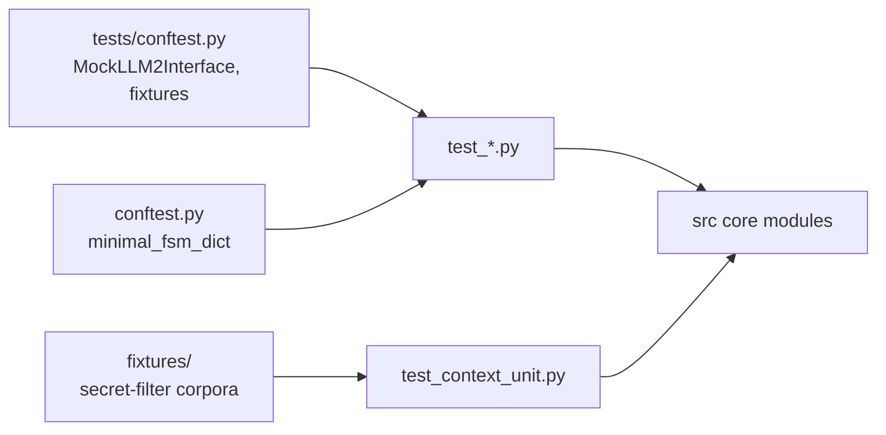

# test_fsm_llm

The pytest suite for the core `fsm_llm` framework, at `tests/test_fsm_llm/`. It holds 72 test files (6,237 collected tests) plus a `fixtures/` package of labelled secret-filter data.

## What it is for

FSM-LLM runs conversations as JSON-defined finite state machines driven by an LLM. Each user turn goes through a 2-pass pipeline: Pass 1 extracts data from the message, rules pick the next state, and Pass 2 writes the reply. This suite checks the core pieces behind that flow: the `API` class, `FSMManager`, `MessagePipeline`, transition rules, prompts, the LLM wrapper, handlers, working memory, the validator, the visualizer and logging.

Almost every test uses a fake LLM, so the suite runs offline and fast. Only one file talks to a real model, and it skips itself when that model is not available.

## How it works

There are three kinds of test files.

- Unit tests (`*_unit.py` and plain module names such as `test_pipeline.py`) call one module directly.
- Seam tests (`*_seam.py`, `test_pipeline_handler_contract.py`) go through a public entry point, usually `API.converse` or `LiteLLMInterface` with `fsm_llm.llm.providers.litellm.completion` patched. A "seam" here means the boundary where two parts meet; these tests exist because some bugs were invisible to tests that call helpers directly.
- Audit regression tests (classes `TestStepNN...`, tests named after the audit id) pin fixes from past code audits and live in the feature files; no `test_audit_*.py` file remains. Each was run failing before its fix landed.



The `fixtures/` package holds three hand-written lists of context key names and values, each labelled "credential" or "safe". `test_context_unit.py` runs every entry through the secret filter (`is_forbidden_context_entry` in `src/fsm_llm/constants.py`) and counts two kinds of error: a credential that reaches the prompt ("fail open") and a harmless value that gets removed ("over-strip"). The three lists have separate jobs: a regression list of past bugs, a holdout that was measured once and is now regression only, and a census that is the current independent measurement.

## Files

- `conftest.py` - the `minimal_fsm_dict` fixture: a one-state FSM with only required fields.
- `support.py` - helpers that more than one test file uses (FSM builders, fake provider responses, scripted providers). Not collected: the name has no `test_` prefix.
- `kind_corpus.py` - the corpus and recording code behind `test_kind_equality.py` (the 14 example FSMs, the agent, `native_fc`, meta and reasoning builders, the 32 synthesis-bench FSMs and hand-written completion and synthesize fixtures, plus three scripted turns). Not collected; `python -m tests.test_fsm_llm.kind_corpus --write` regenerates the baseline, `--show CASE` prints one record.
- `fixtures/` - labelled corpora for the secret filter (`context_key_corpus.py`, `holdout_key_corpus.py`, `census_key_corpus.py`).
- `test_api.py`, `test_api_elaborate.py` - the `API` class: loading definitions, starting and running conversations, FSM stacking.
- `test_fsm.py`, `test_fsm_elaborate.py` - `FSMManager`: data filtering in `get_conversation_data`, stacking.
- `test_pipeline.py` - `MessagePipeline`: the 2-pass `process()`, atomic rollback when Pass 2 fails, context scope, bulk extraction.
- `test_multipass_extraction.py` - field-level retry and merge in extraction.
- `test_transition_evaluator.py` - DETERMINISTIC, AMBIGUOUS and BLOCKED outcomes and priority ranking.
- `test_classification_extractions.py`, `test_classification_transitions.py` - classification-based extraction and classifier-resolved ambiguous transitions.
- `test_expressions.py` - the JsonLogic evaluator used in transition conditions.
- `test_context_unit.py` - context cleaning, compaction, search, and the secret filter measured against `fixtures/`.
- `test_prompts_unit.py` - prompt builders, text sanitizing, token estimates, secret filtering in prompts.
- `test_llm_unit.py`, `test_ollama.py` - `LiteLLMInterface` and Ollama-specific parameters.
- `test_model_not_configured.py`, `test_model_callers.py`, `test_default_model_removed.py` - no built-in default model: `resolve_model` raises `ModelNotConfiguredError` (a blank value counts as unset); the classifier, `AgentConfig`, agents and the meta builder resolve through it (an injected `llm_interface` needs no model); reasoning, eval, monitor and every CLI exit 1 with one stderr line.
- `test_no_implicit_env.py`, `test_load_env.py`, `test_env_file_flag.py` - importing `fsm_llm` loads no `.env` (child interpreters), `fsm_llm.load_env` and `fsm-llm --env-file`/`--model`, and `--env-file` on the other model CLIs (and not on the four that call no model); precedence is argument, process environment, file, then `ModelNotConfiguredError`.
- `test_llm_complete.py` - `LLMInterface.complete`, the one request primitive: `CompletionRequest` and `CompletionResponse` models, request rules in `LiteLLMInterface`, reply normalising, failures as `LLMResponseError`.
- `test_llm_request_path.py` - the classifier sends through `fsm_llm.llm`, and no provider request carries an empty user turn.
- `test_llm_usage.py` - the per-call-kind usage counters of `LiteLLMInterface` (`usage()`, `reset_usage()`), including errors, streams and concurrency.
- `test_embedder.py` - `LiteLLMEmbedder`: request shape, construction, reply shapes, usage.
- `test_completion_state.py` - the optional `completion` state field: definition rules, `tool_exchange`, one `complete` call per Pass 1, structured turns, failures that roll the turn back.
- `test_advance.py`, `test_run_until_terminal.py` - the message-free step `API.advance` (and its stream form) and the bounded loops `run_until_terminal` and `run_until_terminal_stream` (budgets, `before_step`, FSM stack).
- `test_typed_field_extraction.py` - the core `typed_field_extraction` builder and its prompt-context narrowing through a real `API` turn.
- `test_builders.py` - the core `BuildError` shared by every `build()`, and the `HandlerBuilder`, `API` and `FSMManager` builders.
- `test_removed_legacy.py` - absence pins for core names removed by the "no legacy" cleanup.
- `test_llm_parse_fallback_seam.py` - response parsing falls back from JSON to embedded JSON to raw text and never raises.
- `test_llm_finish_reason.py` - a reply cut by `max_tokens`: `CompletionResponse.finish_reason` and `truncated`, the one WARNING per cut reply, the cut-off note in extraction and classification errors, the cut-off message that replaces a half JSON envelope, and the partial `message` the salvage rungs ship from a cut envelope (still `truncated`).
- `test_cut_off_record.py` - the per-turn record of a reply cut off at `max_tokens` (`definitions.CONTEXT_KEY_CUT_OFF`): written from a `truncated` response, absent when nothing was cut, cleared each turn, kept out of prompts, `get_data` and saved sessions.
- `test_internal_key_seeding_log.py` - writing an internal-prefix key through `start_conversation`, `push_fsm` or `update_context` logs no WARNING.
- `test_llm_provider_banner.py` - `fsm_llm.llm` sets `litellm.suppress_debug_info = True` at import, so a provider error prints no litellm banner to stdout; a host can set it back to False.
- `test_handlers_unit.py`, `test_handler_timeout.py` - `HandlerSystem`, `HandlerBuilder`, timing points, priorities, timeouts.
- `test_pipeline_handler_contract.py` - handler failures seen through `API.converse`, including rollback.
- `test_memory.py` - `WorkingMemory` buffers, serialization, copies and concurrency.
- `test_session.py` - `FileSessionStore` id validation, soft failures, fsync-before-replace, file logging after a failed sink add, and the default save hook.
- `test_strands_features.py` - schema-enforced output, invocation state, streaming, session save and restore.
- `test_streaming_history_seam.py` - history stays consistent when a stream fails or is abandoned.
- `test_stack_lifecycle_seam.py` - races in `push_fsm`/`pop_fsm` and stale-conversation cleanup.
- `test_cpu_timer.py` - the `cpu_timer` helper: budgets about computation are measured in CPU time, not wall time (a loaded host inflates wall time).
- `test_timing_factor.py` - the `timing_factor` fixture that scales wall-clock budgets under a tracer or load.
- `test_turn_guard_deterministic.py` - a second `converse` on a busy conversation raises `FSMError`.
- `test_fsm_lock_order.py` - the lock order of `FSMManager` (`_lock` before `conv_lock`, `_fsm_cache_lock` a leaf): every manager operation runs over recording locks and the exact `_lock` and `conv_lock` call order of the turn, read, write and end paths is pinned (plan d454fd62 step 78, for the three-module split of `engine/fsm/`).
- `test_bulk_extraction.py` - bulk extraction through `API.converse`: correction overwrite, provenance, coercion and validation, rejected corrections, back-edge re-extraction, grounding, and a failed bulk surfaced to Pass 2.
- `test_prompt_injection_seam.py` - hostile user text is sanitized before it reaches the extraction prompt.
- `test_intent_entities_seam.py` - `None` entity values survive intent classification.
- `test_core_hardening_seam.py` - session file writes, logging redaction, bounded context, read concurrency.
- `test_definitions.py` - `Conversation` history summary, `FSMDefinitionNotFoundError`, the shared entity coercer, version and session docs. The 2026-09-21, 2026-09-22 and 2026-11-05 audit classes and the cross-module agreement sweeps live in the feature files named after what they test (`test_api.py`, `test_context_unit.py`, `test_expressions.py`, `test_handlers_unit.py`, `test_prompt_injection_seam.py`, `test_validator_unit.py`, `test_session.py` and others).
- `test_visualizer_golden.py`, `test_resolve_model.py`, `test_api_key_compare_sites.py` - golden pins of the renderers, the one model resolver and the API-key comparison sites. The one-class-per-finding tests of the 2026-11-05 source pass and of the two review rounds of the step-driver and LLM-layer plans live in the feature files named after what they test (`test_api.py`, `test_validator_unit.py`, `test_llm_complete.py`, `test_completion_state.py`, `test_run_until_terminal.py`, `test_logging_settings.py` and others).
- `test_validator_unit.py`, `test_visualizer_unit.py` - `FSMValidator` and the ASCII visualizer, including their CLIs.
- `test_flow_analysis.py` - `fsm_llm.core.verify.flow`: the shared graph primitive (with a golden table that pinned the validator's trap detection before it moved), the data-flow and liveness analyses that runtime synthesis uses as gates, and a check that the key-minting hook equals what the pipeline mints for.
- `test_synthesize_field.py` - the optional `synthesize` state field: what the loader accepts and refuses, that the pipeline mints no extraction for such a state, and a spike of a runner-style push from the `before_step` hook.
- `test_schema_registry.py` - `fsm_llm.core.definitions.schema`: the registry of the version each definition field appeared in (proven complete by walking the models reachable from `FSMDefinition`), the loader and validator version warnings, and `fsm-llm-validate --upgrade`.
- `test_state_kinds.py` - `fsm_llm.core.state_kinds`: the registry is complete against the `State` model, `kind_of` and `State.kind`, `kind` absent from dumps and schemas and `fsm_id` unchanged over the corpus, the declarative hooks equal the rules the loader applies, the result-key readers (`handler_only_names`, `core.verify.flow._result_key`, the `owned` collision check, `API._build_push_context`) go through the registry, the minting and produced-keys hooks equal the old rules over the corpus and the pipeline reads them, the State validator refuses through `state_problem` with byte-equal texts over every kind and declaration shape, the loader's synthesize edge and host-key checks go through the `check_definition` and `sample_results` hooks (15 recorded host scenarios, byte-equal refusal texts, a runtime-replaced hook, the evaluator passed in), the G4 arrival set, the G6a dry-run readers and the validator's raw lint read the registry (AST guards, equality with the old rules over the corpus and over raw shapes, a runtime-swapped hook per reader), the declared-tool-names readers (approval request, library, G5 raw twin) and the runner refusal read the registry (AST guards, equality with the three old copies over the corpus and raw tool shapes, a runtime-swapped hook per reader), and the module imports nothing from `fsm_llm`.
- `test_executor_map.py` - the per-API `executors=` map (plan d454fd62 step 54): a test-only kind (a `State` subclass for its config, a `KindSpec` and an executor) runs a full conversation through `API` with no edit in core, two APIs with different maps and the module table stay isolated, a built-in kind can be replaced for one API, the map is a read-only copy, and the refusals (`TypeError` for a non-mapping or a non-`StateExecutor`, `ValueError` for an unknown kind name) at `API`, `FSMManager` and `MessagePipeline`.
- `test_executors.py` - `fsm_llm.engine.kinds` (plan d454fd62 steps 53 and 80): an AST ban on kind-config reads (`.completion`, `.synthesize`, `CompletionStateConfig`, `SynthesizeConfig`) in every module of `engine/turn/` (8 files, found on disk), every module of `engine/api/` (found on disk), the four modules of `engine/fsm/`, `core/verify/flow.py` and `synthesis/dryrun.py`, an AST ban on `field_extractions`, `classification_extractions` and `extraction_instructions` reads and on any conversation Pass-1 method in `engine/turn/`, every module of `engine/kinds/` imports no turn, manager, API, builder or session module (`TYPE_CHECKING` imports included), the executor table (`synthesize` passive, unknown kind falls back to conversation, `register_executor`), `cleans_extracted` and `after_transition`, a real turn dispatched through a recording executor (cut-off record, D-021 flag), and a guard that the conversation Pass-1 methods (owned by the conversation executor since step 80, `ConversationPass1` over the services of one pipeline) are read only inside `engine/kinds/conversation/` (step 56).
- `test_codes.py` - `fsm_llm.core.codes`: the status, reason and completion-kind vocabulary, held equal to the wire strings of the modules it mirrors, and its mappers.
- `test_kind_equality.py` - the safety net of the state-kind registry (roadmap row 0.14): recomputes, on the current code, the record that `kind_corpus.py` stored for the code before the refactor (`fsm_id`, dump hashes, validator and gate findings, loader refusals, and the request bytes of a plain, a completion and a synthesize-host turn on fake interfaces) and compares it with `fixtures/kind_equality_baseline.json`. It only compares; the baseline is regenerated by hand.
- `test_runner_unit.py`, `test_utilities_unit.py` - the interactive runner's redaction and JSON helpers, FSM file loading (`test_utilities_unit.py` tests the five modules the old `utilities.py` was split into).
- `test_logging_unit.py`, `test_logging_structured.py` - logging helpers, `setup_logging()` and JSON output; child-process tests that `setup_logging()` and `enable_debug_logging()` replace loguru's default handler (a library record prints once, the host's default output stays, `LOGURU_*` settings apply).
- `test_logging_settings.py` - `setup_logging()` level normalisation, JSON line identity, file-handler id, CLI entry points at INFO and a bad env format or level; an autouse fixture resets the handlers.
- `test_okf.py`, `test_okf_cli.py` - Open Knowledge Format: the shared path-confinement helper, parser, loader, link graph, search, writer, `capped_note`, the memory export and handler of `okf_bridge.py` (`TestBridgeLayering`: the bridge imports only public names of `okf`), and the `fsm-llm-okf` command.
- `test_frontmatter.py` - `fsm_llm.frontmatter`, the one YAML frontmatter seam shared by OKF and Agent Skills: split, bounded load with limits as parameters, no-follow read, surrogate walk, layering, and the wiring `okf.py` keeps to it.
- `test_agent_skills.py` - `fsm_llm.agent_skills`: the parser as a total function over every frontmatter value shape, the bounded loader, symlink and path confinement, the catalog that keeps no body, `render_catalog`, limits, real-world layouts and injection staying in labelled or stripped fields.
- `test_agent_skills_cli.py` - `fsm-llm-skills`: `validate` (including `--strict`; a symlinked `SKILL.md` exits 1), `list`, `show` (`--file DIR` lists a directory), exit codes, output hygiene and wiring.
- `test_cli_support.py` - `fsm_llm.cli_support`, the skeleton `fsm-llm-okf` and `fsm-llm-skills` share: exit-code mapping, BrokenPipe parking, the unencodable-output escape, the `--max-seconds` type, and pins that neither CLI re-inlines them or imports a private name from the other.
- `test_docs_snippets.py` - every fenced `json` or `python` block that contains `"initial_state"` in `README.md`, `AGENTS.md`, `docs/quickstart.md`, `src/fsm_llm/README.md`, `docs/api_reference.md`, `docs/architecture.md`, `docs/fsm_design.md`, `docs/handlers.md`, `docs/synthesis.md` and `docs/testing.md` must load through `FSMDefinition`.
- `test_live_classification_memory.py` - 7 real-model tests on Ollama `qwen3.5:9b-q8_0`, marked `integration`, `real_llm` and `slow`, skipped without the model.

## How to use it

From the repository root, with the project virtualenv:

```bash
.venv/bin/python -m pytest tests/test_fsm_llm/ -q
.venv/bin/python -m pytest tests/test_fsm_llm/ -q -m "not slow"
.venv/bin/python -m pytest tests/test_fsm_llm/test_pipeline.py -q
```

## Things to know

- Run pytest from the repository root. Several files import helpers as `tests.conftest` or `tests.test_fsm_llm.<file>`.
- 14 tests are marked `slow`: 7 in `test_handler_timeout.py` (they sleep) and the 7 live Ollama tests, which also carry `integration` and `real_llm`. `-m "not slow"` skips them.
- The live file needs Ollama running with `qwen3.5:9b-q8_0` pulled. Without it the tests are skipped, not failed.
- One test in `test_context_unit.py` is `xfail(strict=True)` on purpose: the secret filter misses its target rate. If it starts passing, the test fails, so the change gets looked at.
- Do not edit the `fixtures/` corpora to make a failure rate look better. Tests pin exact counts and banner text in those files.
- A few tests import from `fsm_llm.agents` and `fsm_llm.workflows`, so those subpackages must be importable.
- Editing an FSM example in the listed docs can break `test_docs_snippets.py`.
- Logging is off by default, so tests that check a log line enable `fsm_llm` logging with a temporary loguru sink (`caplog` cannot see loguru output).
