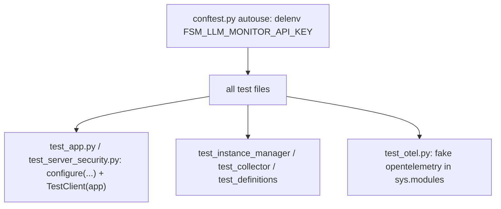

# test_fsm_llm_monitor

Path: `tests/test_fsm_llm_monitor`
Purpose: pytest suite for `fsm_llm.monitor`, the FastAPI dashboard package in `src/fsm_llm/monitor/`.

## Scope

- Unit and HTTP-level tests for `server/` (a package), `instance_manager/`, `collector.py`, `definitions.py`, `otel.py`, `__main__.py` (`_browser_url` only) and the package `__init__.py` exports.
- No real LLM calls, no network, no browser. The FSM `API` is a `MagicMock` or a small fake; HTTP goes through `fastapi.testclient.TestClient`.
- Not here: the monitor source itself (`src/fsm_llm/monitor/`) and most of the JS SPA logic: static file presence, HTTP 200 and the HTML/CSS limits in `TestUiMatchesServerLimits` are checked, and `test_static_js.py` runs node probes (`static_probes/*.mjs`, a DOM stand-in in `stub.mjs`) for the Markdown renderer and the page behaviours.

## Architecture

Server test pattern: `configure(manager=InstanceManager(), api_key=...)` (keyword-only) then `TestClient(app)`. `test_server_security.py` wraps this in `_client(api_key=None)` using `InstanceManager(config=MonitorConfig(refresh_interval=0.5))`.

Manager test pattern: `InstanceManager(config=MonitorConfig())`, then `mgr.global_collector.cleanup()` to drop its loguru sink, then inject instances directly into `mgr._instances` / `mgr._collectors` (under `mgr._lock` in most tests).

## Key files

| File | Role | Notes |
| --- | --- | --- |
| `conftest.py` | autouse `_clear_monitor_api_key_env` | `monkeypatch.delenv("FSM_LLM_MONITOR_API_KEY", raising=False)`; without it an exported key makes `test_app.py` tests answer 401 |
| `support.py` | `_manager(**config)` (an `InstanceManager` with a cleaned global collector; keyword arguments go to `MonitorConfig`), shared by the feature files; `server_modules()` (the source text of every module of the `fsm_llm.monitor.server` package by module name) and `server_package_modules()` (the module objects), for a test that reads or inspects "the server" as a whole | not collected (no `test_` prefix) |
| `test_app.py` | routes, static assets, exports, version, API-key gate, WS redaction, UI limits vs server constants | asserts `"0.13.0"` for `/api/info` `monitor_version` and `fsm_llm.monitor.__version__` |
| `test_server_security.py` | Origin/Host, body limit, headers, gated reads, WebSocket auth, error mapping, bounds, dashboard config, builder busy guard, `validate_preset_id` | autouse `_reset_key` reconfigures with env key `""` after each test |
| `test_instance_manager.py` | `Managed*` classes, `InstanceManager`, handlers, snapshots, workflow presets, agent types, stub tools, failed launch, terminal send, OTEL re-enable (real SDK), instance event feed, `close()` teardown | contains unmarked `async def` tests |
| `test_collector.py` | `EventCollector` | - |
| `test_definitions.py` | models, `normalize_message_history`, `model_to_dict` | - |
| `test_otel.py` | `OTELExporter` | autouse `_mock_otel` fixture |
| `test_lifecycle_remainders.py`, `test_usage_metrics.py`, `test_conversation_signals.py`, `test_event_log_browse.py` | plan 51fde95b step 12: the closed manager and the run list cap, `MetricSnapshot.usage` (a meter double that counts `reset_usage`) and the two workflow spans (real SDK, `importorskip`), the snapshot's classification and cut-off fields, the read-only event log browse (real `EventLog` in `tmp_path`, a symlinked log) | `test_usage_metrics.py` needs `opentelemetry` for its span rows and skips them without it |
| `test_instance_concurrency.py` | plan 1f0925d2 steps 3 and 4: the builder start slots (a start reserves its slot before the model call, a timed out or cancelled start keeps it until its worker ends, every other exit frees it, a late failure is retrieved, the lock belongs to the running loop, a leak census over the exits) and the manager races (capacity checked and the instance inserted in one `_lock` hold, nothing blocks or nests `_catalog_lock` under `_lock`, one registry snapshot per launch, the config setter as one scope, the usage of an ended instance never missing) | guard file of the D9 row; the doubles are a fake builder agent and a fake `create_agent` gated by a `threading.Event`, a `_SpyLock` that records whether the lock is held at each check, and a `_Tape`; an Event, a counter or a recorded lock state decides each race, never a sleep, and `_until` only bounds a wait |
| `test_server_consistency.py` | 2026-11-05 server and SPA fixes (plan 5980fbb7 step 17), preset UTF-8 read, route-launched workflow stop | autouse `_reset_key` |
| `test_workflow_presets.py` | plan 7d9c0955 step 7: the two preset documents pass V1 to V5 and hold names and no code, the constructor loads nothing, the first read loads once under `_catalog_lock` and never under `_lock`, concurrent first calls load once, a failed load caches nothing, the route loads off the loop, bad documents and an empty or missing directory, exact id matching, a fresh definition per launch, preset runs with no model | A model call that raises and a blank `LLM_MODEL` guard every run |
| `test_workflow_preset_golden.py`, `workflow_preset_corpus.py` | Differential G2: the preset runs and the monitor wire (presets, refusal texts, HTTP bodies) equal a golden written from the code before the move, except two named deltas of the `finish` step | The comparer is shown to fail under planted mutants |
| `test_agent_types.py` | plan 659c07c3 step 3: the launchable rule two-sided (each clause decides), the registry loads once, lazily, off the loop, outside the manager lock and retries after a failed load, `GET /api/agent/types` is open while launch is gated, a user directory, the lifespan carry, `--executables` (missing directory, a file, a bad file, `--help`) | a guard file of the D6 and D9 rows of `scripts/gate.sh`; doubles only |
| `test_agent_launch.py` | plan 659c07c3 steps 4 and 7: launch by exact id (parity with the seven old classes through the golden, the `create_agent` kwargs set, no flagged stub, hostile ids refused with no registry read), model resolved first, a user file launches, the wire carries the id, and no file under `src/fsm_llm` names a retired table (word-bound and AST scans) | guard file of the D1, D9 and D11 rows |
| `test_agent_draw.py` | plan 659c07c3 step 5: `GET /api/agent/visualize?agent_type=<id>` draws every drawable id as the parent golden, hostile and unlisted ids are a fixed 404, the route calls `_fsm_viz_or_400` and builds no agent or model call, `flows.json` holds only `workflows` | guard file of the D6 row |
| `test_agent_selects.py` | plan 659c07c3 step 6: the page holds no agent list (the template selects are empty, no class name or table in any script), options are set with `textContent`, every offered id answers, every Builder id is a registry id | guard file of the D6 row; the node probes it relies on are in `test_static_js.py` |
| `test_builder_improvements.py` | plan 51fde95b step 13 (the Builder): the launch form limits against the server constants, `/api/capabilities` `agent_types` against the launchable ids, the builder enum against the registry, the `max_tokens` default and bounds through the real start route (`_FakeBuilderAgent`, the `builder_client` fixture: no model call), and the forced delete of a busy session (`_SlowBuilderAgent`: refused, dropped at once, released and not put back) | the fixture replaces `meta_builder.MetaBuilderAgent` with `monkeypatch.setattr` on the module the route reads |
| `test_static_js.py` | node probes of the frontend ES modules (plan 52ce5464, D-009) | skips when `node` 18 or newer is not on PATH; `test_node_is_present_on_linux_ci` fails when `GITHUB_ACTIONS=true` on Linux and no usable node, so CI cannot skip them silently; the probes live in `static_probes/` (`stub.mjs` is the DOM stand-in; each probe prints one JSON line; `stale_state.mjs` (plan 1f0925d2) holds the rows of the stale-reply rule on the real modules: timers are a fake scheduler (`setTimeout` recorded, run by `fire()`), replies are gates opened by the row, `flush()` yields to the event loop with `setImmediate`, so no sleep or clock decides anything, and a new `await` in a page needs a row there; `json_highlight.mjs` and `json_surfaces.mjs` print named booleans that `TestJsonColouring` requires to be all true, and `TestJsonColouring` also computes the contrast of the `--json-*` colours from `style.css`) |
| `test_server_package.py` | the old `monitor/server.py` became the package `monitor/server/` (plan d454fd62 step 94): the static and template directories the server itself uses (the mount, the Jinja search path, the served bytes, `flows.json`), the registration order of routes and middleware (a pinned list of the entries of `app.routes`, the OpenAPI path order), one home for each global that `configure()` rebinds and `configure()` seen through every router module and the WebSocket, the package layout (facade `__all__`, sibling imports, log record names) | autouse `_reset_key` |

## Public interface

Suite entry points (what a new test uses):

- Fixtures: `_clear_monitor_api_key_env` (autouse, `conftest.py`), `_reset_key` (autouse, `test_server_security.py`), `_mock_otel` (autouse, `test_otel.py`).
- Helpers: `_client(api_key=None) -> TestClient` (`test_server_security.py`); `_minimal_fsm_dict()` (in `test_app.py`); `_manager(**config) -> InstanceManager` (`support.py`, shared by `test_instance_manager.py` and `test_server_consistency.py`), `_fsm(mgr, iid, api=None) -> ManagedFSM`, `_fire(api, timing, current, target)`, `_snapshot_api(collected, extraction=None) -> MagicMock` (`test_instance_manager.py`), fakes `_FakeAPI`, `_FakeHandlerSystem` (`test_collector.py`) and `_Secretive` (`test_instance_manager.py`); `_build_otel_mocks()`, `_import_otel()`, `_make_event(event_type="conversation_start", conv_id="conv-1", **kwargs)` (`test_otel.py`).
- Test classes per file:
  - `test_app.py`: `TestWebServer`, `TestMonitorImports`, `TestUiMatchesServerLimits`, `TestServerFSMEndpoints`, `TestServerInstanceEndpoints`, `TestServerConfigEndpoints`, `TestDashboardConfigEndpoints`, `TestServerPresetEndpoints`, `TestServerErrorHandling`, `TestActivityEndpoint`, `TestServerHygieneAndWorkflow`, `TestApiKeyGate`, `TestDashboardWebsocketRedaction`, `TestCliHelpers`.
  - `test_server_package.py`: `TestStaticAndTemplateDirectories`, `TestRegistrationOrder`, `TestSharedStateHasOneHome`, `TestServerPackageLayout`.
  - `test_server_security.py`: `TestOriginAndHost`, `TestApiKeyGating`, `TestWebSocket`, `TestErrorMapping`, `TestRequestBounds`, `TestDashboardConfig`, `TestBuilderGuards`, `TestPresetValidation`, `TestInstanceReadsNeedTheKey`, `TestListLimitsAreBounded`, `TestAPresetIsAJsonFile`, `TestUnknownIdsEchoNothing`, `TestActivitySurvivesADestroyedAgent`.
  - `test_instance_concurrency.py`: `TestAStartReservesItsSlotBeforeTheModelCall`, `TestATimedOutOrCancelledStartKeepsItsSlotUntilTheWorkerEnds`, `TestEveryOtherExitReleasesTheSlotAtOnce`, `TestAFailureAfterTheRequestGaveUpIsRetrieved`, `TestTheLockBelongsToTheRunningLoop`, `TestNoPathLeaksASlot`, `TestALaunchChecksCapacityAndRegistersInOneHold`, `TestNothingBlocksOrNestsUnderTheLock`, `TestTheRegistryOfALaunchIsOneSnapshot`, `TestTheConfigSetterIsOneScope`, `TestTheUsageOfAnEndedInstanceIsVisibleAtEveryMoment`.
  - `test_static_js.py` (plan 1f0925d2 classes, all on the probe `stale_state.mjs`): `TestLaunchFlows`, `TestConversationDetailRaces`, `TestEventLogLoadMore`, `TestControlDrawerStepDataAndDetails`, `TestBuilderStartInputAndStatusTiming`, `TestSmallUiFixes`, `TestVisualizerEmptyOption`, `TestLogsClearCursor`, `TestLogsClearAcrossLevels`, `TestDrawerDirectOpen`.
  - `test_instance_manager.py`: `TestManagedClasses`, `TestInstanceManager`, `TestRegisterMonitorHandlers`, `TestSnapshotInternalKeyHiding`, `TestConversationCaching`, `TestInstanceManagerListFilter`, `TestDestroyInstance`, `TestActivitySnapshots`, `TestFindExamplesDir`, `TestWorkflowPresets`, `TestDisabledAgentTypes`, `TestAgentConcurrencyHardening`, `TestStubToolExecution`, `TestRedaction`, `TestCancelAgent`, `TestFSMLifecycle`, `TestWorkflowTracking`, `TestFailedLaunchKeepsFinishedInstance`, `TestTerminalSendKeepsTheConversationOpenWhenEndFails`, `TestOtelReenableDoesNotExportTwice`, `TestInstanceEventFeed`, `TestCloseTearsDownEveryInstanceType`, `TestInstanceManagerPackageLayout` (the package layout: facade names, owning modules, the mixin MRO, anchors, log record names, the one `__file__` reader).

Monitor surface the tests pin:

HTTP routes and statuses (`test_app.py`, `test_server_security.py`):
- `GET /` 200 containing "FSM-LLM Monitor"; `/static/style.css`, `/static/app.js`, `/static/flows.json` and the JS modules under `services/`, `utils/`, `pages/` serve 200. Files must exist in `src/fsm_llm/monitor/static/` and `templates/index.html`.
- `GET /health` returns `{"status": "ok"}`.
- `POST /api/fsm/load` and `POST /api/fsm/visualize` with non-JSON body: 400. Unknown conversation, instance, agent, builder session: 404. `GET /api/workflow/{id}/status` without the `workflow_instance_id` query parameter: 400. `DELETE /api/builder/{id}` for an unknown id: 200 with `deleted: false`.
- Preset traversal (`/api/preset/fsm/../../etc/passwd`): 400 or 404. `validate_preset_id` raises `ValueError` for `../`, absolute and escaping ids, `FileNotFoundError` for a missing file.
- Unexpected internal error: 500 with detail exactly `"Internal server error"`.
- `limit` on `/api/events`, `/api/logs` and `/api/instances/{id}/events`: 0, -1 and 1001 are 422, 1 and 1000 are 200, and the three routes read the one constant `MAX_QUERY_LIMIT` (a source row refuses a literal `le=` number; `TestListLimitsAreBounded`). `GET /api/eventlog/{id}?limit=0` stays 200 (`test_event_log_browse.py`; deliberate). A directory, an empty id and a non-`.json` file as a preset id are 404 on `/api/preset/fsm/`, `/api/fsm/visualize/preset/` and `POST /api/fsm/launch` (`TestAPresetIsAJsonFile`, on a `tmp_path` examples directory). An unknown workflow id on `/api/workflow/visualize` is a 404 whose text carries no id.
- `POST /api/agent/launch` with `evaluator_optimizer` (an id that is not launchable) or with a class name such as `ReactAgent`: 400 "Unknown agent type" with the launchable ids; an id of 65 or 5000 characters: the same 400, the whole id never echoed (`test_a_long_id_is_http_400_and_the_whole_id_is_never_echoed`; the refusal quotes the stripped id with `!r`).
- Error mapping: `ConversationBusyError` -> 409, `MonitorCapacityError` -> 429, `NotImplementedError` -> 501, unknown FSM preset on launch -> 404, `POST /api/fsm/launch` with `{}` -> 400.
- Request bounds (422): config `refresh_interval: 0`, `max_events: -1`, `log_level: "LOUD"`; agent launch `max_iterations` 0 or 10,000, `timeout_seconds: 0`, empty `task`; converse `message` over 10,000 chars.
- Cross-origin POST (Origin `http://evil.example`): 403. Foreign `Host`: 400. A body of about 1.1 MB (`b"{" + b" " * 1_100_000 + b"}"`): 413. Responses carry CSP with `frame-ancestors 'none'` and `x-content-type-options: nosniff`.
- `POST /api/dashboard/config` accepts builder output both wrapped in `{"config": {...}}` and unwrapped; panels/alerts given as dicts become lists; `{"panels": [...list...]}` -> 400.
- Builder session in `server_module._builder_busy`: result reports `busy: true`, delete returns 409.

API-key gate (`TestApiKeyGate`, `TestApiKeyGating`, `TestWebSocket`):
- `configure(api_key=...)` gates mutating routes and sensitive reads. Accepted headers: `Authorization: Bearer <key>` or `X-API-Key: <key>`. Missing or wrong key: 401.
- Gated mutating routes listed in `test_all_named_mutating_routes_gated` plus `/api/fsm/{id}/start|converse|end`, `/api/workflow/{id}/advance|cancel|event`, `/api/agent/{id}/cancel`. With no key configured these never return 401.
- Gated reads: `/api/conversations`, `/api/activity`, `/api/events`, `/api/logs`, `/api/agent/{id}/status|result`, `/api/builder/result/{id}`, `/api/fsm/{id}/conversations`. `GET /api/instances` and `GET /api/instances/{id}` are gated too (plan 1f0925d2; `test_open_reads_stay_open_and_instance_reads_take_the_key` pins 401 with no or a wrong key and 200 with `X-API-Key` and Bearer, and a keyless server unchanged). Always open: `/health`, `GET /api/config`. `GET /api/auth` returns `{"auth_required": bool}`.
- Key comparison uses `hmac.compare_digest` on encoded bytes; non-ASCII header values give 401, not 500 (tested by calling `server_module._require_api_key` with a raw starlette `Request`).
- Empty or whitespace `api_key` passed to `configure` raises `ValueError` and keeps the old key. Env `FSM_LLM_MONITOR_API_KEY=""` means unset. The env key applies at import without `configure` (checked in a subprocess).
- Re-calling `configure` without `api_key` after one was set logs a WARNING containing "previously configured API key is being cleared"; the first call does not.
- Key changes take effect after the first request (read at request time).
- Reconfiguring the same manager keeps `global_collector._log_sink_id`.
- WebSocket `/ws`: client sends `{"type": "auth", "api_key": ...}`; right or unneeded key gets a `metrics` message; wrong key closes with 4401; cross-origin closes with 4403.
- The source of `server/` (every module, read with `support.server_modules()`) must contain `default=redacting_json_default` and no `default=str` call site.

Collector (`test_collector.py`):
- `get_events`/`get_logs` newest first; bounded deques (`max_events`, `max_log_lines`) while `total_events` keeps counting.
- Metrics: `total_errors`, `total_transitions`, `states_visited`, `active_conversations`, `total_agent_iterations`, `total_tool_calls`, `total_workflow_steps`; `clear()` resets all; timestamps are UTC.
- `get_logs(level=...)` is case-insensitive, `SUCCESS` ranks above INFO, unknown level returns all.
- `events_after(cursor, limit)` / `logs_after(cursor, limit)` return `(items, cursor)` oldest first, skip dropped items and restart after `clear()`.
- `create_handler_callbacks()` returns one callback per handler timing but `POST_TRANSITION`, all returning `{}`.
- The loguru sink records `LogRecord`s only (no `"log"` events), with tz-aware timestamps. `cleanup()` is idempotent and sets `_log_sink_id` to `None`.
- `snapshot_context` and `redact_context(data, drop_internal=True)` drop secret-looking keys (including nested) and replace objects with `"<redacted:ClassName>"` without calling `__str__`.

Instance manager:
- `register_monitor_handlers(api, collector)` registers one handler per timing but POST_TRANSITION, is idempotent; `unregister_monitor_handlers` returns the number it removed, the same as were registered. `_MonitorHandler.execute` returns `{}`.
- Transition events carry the core's `current`/`target` states; END event `data["state"]` is the final state.
- `snapshot_from_api(api, conv_id, show_internal_keys=...)`: internal prefixes `_`, `system_`, `internal_`, `__` (case-insensitive) hidden when False; secret-looking keys hidden either way; `last_extraction` is redacted.
- `attach_api(api)` (`TestAttachApi`) registers the monitor handlers; nothing attached shows nothing; the attached API's conversations are listed and snapshotted; its listing or snapshot failures yield `[]` or `None`; snapshots honour `config.show_internal_keys`.
- `end_instance`: agent -> `cancelled` with `cancel_event` set, bounded join (under 5 s) and one `logger.warning` naming the id if the thread is still alive; workflow -> `completed`; unknown id -> `KeyError`.
- `_get_fsm`/`_get_workflow`/`_get_agent`: `KeyError` if missing, `TypeError` on wrong type. `launch_fsm()` without data: `ValueError` "Must provide".
- `get_agent_status`: dead thread in `cancelling` -> `cancelled`; dead `running` without result -> `failed`. `cancel_agent` returns False on finished agents and emits `agent_cancelled` once.
- The launchable rows exclude `evaluator_optimizer`, `maker_checker`, `orchestrator`, `prompt_chain`, `swarm`, `meta_builder` and `reasoning.solve`, and include `react` and `debate` (`test_agent_types.py`).
- Workflow presets are `demo_linear` and `demo_branching`, `workflow` documents of `monitor/workflows/` (`amount: 5000` -> `tier == "high"`); `test_workflow_presets.py` holds the lazy-load, lock, retry, hostile-document and exact-id rows, and `test_workflow_preset_golden.py` with `workflow_preset_corpus.py` compare the tree with a golden written from the code before the move (two named deltas: the `finish` history message and the `next_step_id` of its hook data). Completed instances leave `active_instance_ids`; advancing them is `KeyError`. `definition_json` -> `ValueError` "not supported". Status context hides secret and internal keys. Event delivery is not a step.
- FSM lifecycle: terminal reply ends the conversation and marks `completed`; `start_conversation` reopens to `running`; unknown conversation end is `KeyError`. `_make_room()` evicts oldest finished instance or raises `MonitorCapacityError` when `max_instances` are all active.
- Setting `mgr.config` resizes global buffers. `dashboard_config` assignment increments `dashboard_config_version`.
- `find_examples_dir()` must equal the repo `examples/` directory.
- Stub tools from `StubToolConfig` run with any parameters and return `stub_response`.

OTEL (`test_otel.py`): constructing `OTELExporter` must not call `set_tracer_provider`; `enable(collector)` wraps `record_event`, idempotent, switching collectors restores the first; `disable()` restores and ends open spans; `_export_event` swallows exceptions and does nothing when disabled; trace id 32 chars, span id 16.

CLI: `_browser_url("0.0.0.0" or "::", port)` -> `http://127.0.0.1:<port>`, `"::1"` -> `http://[::1]:<port>`.

## Data shapes

Models (`test_definitions.py`): defaults for `MonitorConfig` (`refresh_interval=1.0`, `max_events=1000`, `max_log_lines=5000`, `log_level="INFO"`, `show_internal_keys=False`, `auto_scroll_logs=True`), `LaunchFSMRequest` (temperature 0.5), `LaunchAgentRequest` (`react`, 10 iterations, no bound on the id), `DashboardConfig` (30 s refresh, 24 h retention), `StubToolConfig` stub response; `BuilderStartRequest` temperature within 0.0..2.0 and `max_tokens >= 1`; `ApplyDashboardRequest` must not exist. Invalid `MonitorConfig` values (0, negative, NaN, inf, unknown level) raise `ValueError`; `log_level` is upper-cased.

Other models constructed and dumped in `test_definitions.py`: `MonitorEvent`, `LogRecord`, `MetricSnapshot`, `ConversationSnapshot`, `StateInfo`, `TransitionInfo`, `FSMSnapshot`, `InstanceInfo` (UTC `created_at`), `ActivityItem`, plus helpers `normalize_message_history` and `model_to_dict`.

Payloads and records pinned elsewhere in the suite:

- `GET /health`: `{"status": "ok"}`. `GET /api/auth`: `{"auth_required": bool}`. `GET /api/info` carries `monitor_version`.
- WebSocket `/ws` client auth message: `{"type": "auth", "api_key": ...}`; server stream messages include type `metrics`.
- Dashboard config body for `POST /api/dashboard/config`: either `{"config": {...}}` or the bare config; `panels`/`alerts` as dicts are turned into lists.
- Collector metrics fields: `total_events`, `total_errors`, `total_transitions`, `states_visited`, `active_conversations`, `total_agent_iterations`, `total_tool_calls`, `total_workflow_steps`, UTC timestamp.
- Redacted object placeholder: `"<redacted:ClassName>"`.

## Invariants and constraints

- Tests must be independent of the ambient environment; keep `conftest.py`'s delenv and reset server globals after tests that set a key.
- `server/` holds module-level state (`_api_key` in `server.application`, `_builder_sessions` and `_builder_busy` in `server.routes_builder`). Any test that sets it must restore it (`try/finally`, `teardown_method`, or autouse fixture).
- Library logging is disabled by default; tests that assert log output call `logger.enable("fsm_llm")` and `logger.disable("fsm_llm")` around a temporary sink.
- `test_otel.py` must restore `sys.modules` entries it replaces; the fixture already does.
- Threads started in tests are daemon threads and are released before the test ends.

## Dependencies

- `fsm_llm.monitor.*` (under test), `fsm_llm.handlers.HandlerTiming`, `fsm_llm.core.definitions.ConversationBusyError`, `fsm_llm.context.filtering.redacting_json_default`, `fsm_llm.logging.logger`.
- Optional: `fsm_llm.workflows` (without it `TestWorkflowTracking` in `test_instance_manager.py` is skipped), `fsm_llm.agents` (`TestStubToolExecution`, `ToolCall`).
- External: `pytest`, `fastapi` (`TestClient`, `HTTPException`), `starlette` (`Request`, `WebSocketDisconnect`), `loguru`. `opentelemetry` is not needed.
- pytest config in `pyproject.toml`: `asyncio_mode = "auto"` (needed for the unmarked async tests).

## Failure modes

- 401s across `test_app.py`: an API key leaked in (env var or a test that did not reset `configure`).
- Version assertion failures in `test_app.py` after a release: update the `"0.13.0"` literals.
- Static file tests fail if a JS module under `src/fsm_llm/monitor/static/` is renamed or removed.
- `TestFindExamplesDir` (`test_instance_manager.py`) fails if the module that reads the `examples/` directory (`instance_manager/examples.py`) moves to another depth; it also loads a copy of the module at a scratch depth so the test cannot pass vacuously.
- Preset tests only assert when `/api/presets` finds FSM presets; they pass vacuously if none exist.

## Working here

- Run: `.venv/bin/python -m pytest tests/test_fsm_llm_monitor/`.
- Put tests for a source module in the matching `test_<module>.py`; a regression goes in the feature file that owns the behaviour (`test_server_consistency.py` for server and SPA findings), one class per finding, never in a file named for an audit or a date.
- Use the local `_minimal_fsm_dict()` helpers (defined in `test_app.py`) for FSM payloads.
- No document states this suite's test count; measure it with `.venv/bin/python -m pytest tests/test_fsm_llm_monitor --collect-only -q | tail -1`.
- Do not change files under `examples/`; preset tests read them.
