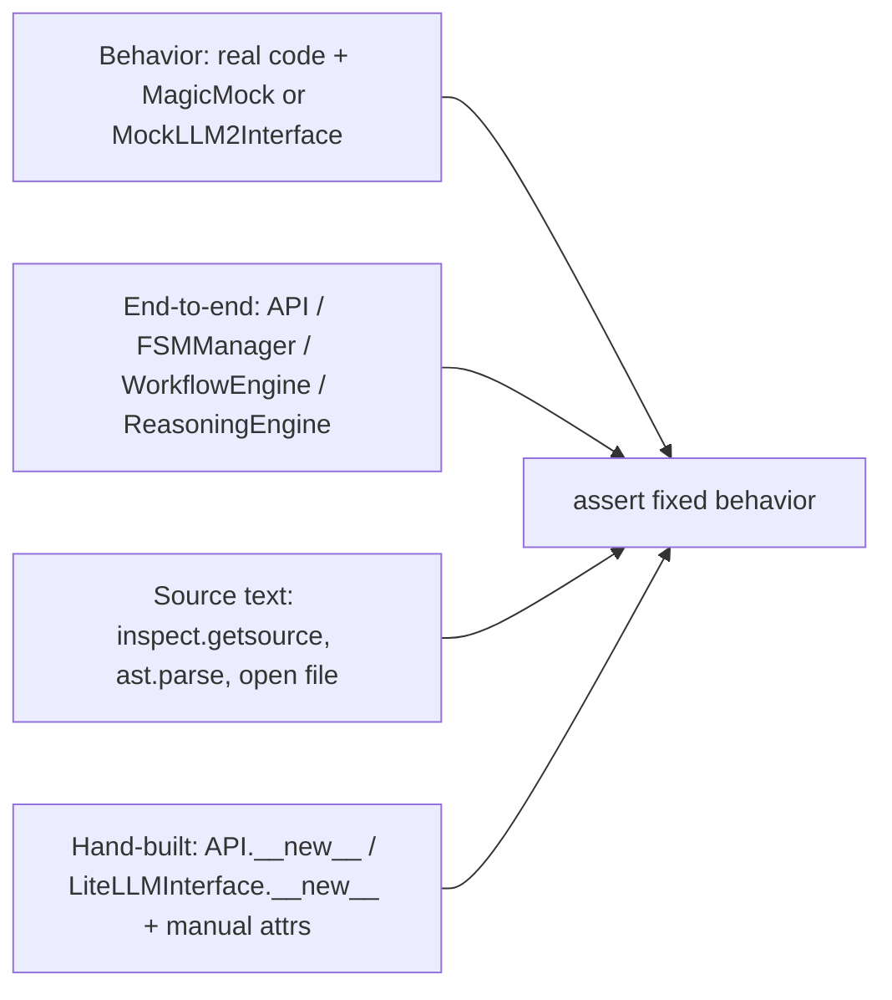

# test_fsm_llm_regression

Path: `tests/test_fsm_llm_regression/`
Purpose: pytest regression suite that pins fixed bugs in the `fsm_llm` package (core, reasoning, workflows, CLI, packaging files), one test class per bug id.

## Scope

- In scope: 32 test modules plus an empty `__init__.py`. 1,826 tests collected; 266 pass, 2 skip (as of this writing).
- Code under test: `fsm_llm` core modules (`engine/api`, `engine/fsm`, `engine/turn` via `FSMManager._pipeline`, `core/transition_evaluator`, `core/expressions`, `core/definitions`, `llm` (incl. `llm/ollama`), `context` (incl. `context/layout`), `constants`, `handlers`, `logging`, `core/verify`, `core/visualize`, `runner`, `__main__`), plus `fsm_llm.reasoning` and `fsm_llm.workflows` subpackages.
- Also reads repo files: `README.md`, `docs/quickstart.md`, `pyproject.toml`, `tox.ini`, `src/fsm_llm/__init__.py`, `src/fsm_llm/engine/api/conversation.py`, `src/fsm_llm/py.typed`.
- Not in scope: live LLM calls (none here), agents, monitor, eval. No fixtures or conftest live in this folder.

## Architecture

Each file groups tests from one review round. Class docstrings carry the bug id and the fixed behavior. Test styles:

## Key files

| File | Round and ids | Tests | Notes |
| --- | --- | --- | --- |
| `test_bugs.py` | B1-B8, B-NEW-1..6, CR3, plan 3 P3-B1..B11, C1; review H1 (LLM `timeout`), H2 (one `import re`), M1 (no async handlers) | 43 | Many source checks; `importlib.reload(fsm_llm.logging)` in a temp cwd; mutates and restores `OPENAI_API_KEY` |
| `test_engine_integration.py` | reasoning + workflow engine integration, iter-2 F-002 (`solve_problem` leaves the caller's context unchanged) and F-004 (WaitEventStep validation), ED-001 to ED-003 (falsy solutions, event and timer auto-registration, type aliases), review C2, C3, H4 (reasoning context pruning, `ContextKeys`, no `MergeStrategy` alias) | 51 | Unmarked `async def` tests (need `asyncio_mode = "auto"`); timer test sleeps 0.1 s; reasoning solves run through core on `_ScriptedLLM` and `_VALID_SCRIPT` imported from `tests/test_fsm_llm_reasoning/test_engine_scripted.py` (the calls are asserted, not a vacuous `"Processing..."` stub); workflow tests use `@pytest.mark.asyncio` |
| `test_functional.py` | functional lifecycle | 24 | Uses `mock_llm2_interface`, `sample_fsm_definition_v2`; local fixtures `greeting_fsm_dict`, `sub_fsm_dict` |
| `test_regression_cli_and_exports.py` | plan 13: H-1..3, M-1..3, M-5, L-3; review C1 (version pin), H5, M3, M6 | 24 | Reads `README.md`, `docs/quickstart.md`, `src/fsm_llm/py.typed`, `pyproject.toml`, `tox.ini`; version pin `"0.13.0"`; 2 skipped `requirements.txt` tests; needs `packaging` and `tomllib` |
| `test_regression_core_bugs.py` | plan 6: VB1..VB25; iter-2 F-003 (`api_key` forbidden pattern), F-005 (LRU FSM cache), F-006 (`less` docstring) | 39 | Imports `_GENERIC_FALLBACK_MESSAGE` from `fsm_llm.llm.parsing` |
| `test_regression_expressions_and_transitions.py` | plan 5: B1..B20 | 19 | `--version` exit code 0 via `fsm_llm.__main__.main_cli` |
| `test_regression_handlers_and_state.py` | plan 4: B1..B7 | 8 | Spies on `HandlerSystem.execute_handlers` |
| `test_regression_jsonlogic_and_merge.py` | plan 9: VB1..VB15 | 31 | Helper `_frame_definition(name)`; scans `src/fsm_llm/*.py` for `"transition_decision"` |
| `test_regression_logic_and_visualizer.py` | plan 7: VB1..VB4 | 9 | `build_state_boxes` width checks |
| `test_regression_messages_and_operators.py` | plan 12: V1, V4, V5, V14, V15 | 10 | Reads `pyproject.toml` for `requires-python = ">=3.11"` |
| `test_api_snapshot.py` | the public API snapshot `docs/api.txt` equals the output of `scripts/api_snapshot.py` | 17 | Runs the script in a child process; `importorskip("fastapi")`; fails with `make api-snapshot` as the fix; `TestMroAwareClassLines` and `TestSamePackageMixinRule` load the script by path and build fake classes with a claimed `__module__` (private and Mixin bases) |
| `test_regression_transition_eval.py` | plan 8: B1..B6 | 7 | Replaces pipeline methods with `MagicMock` |
| `test_module_path_map.py` | the layout plan's module path map `fixtures/module_path_map.json`: every module has one decision, no old path imports (no shim), every new path and symbol resolves; a plain module that gave symbols away must not still define them (`still_defined`, `TestStillDefined`) | 41 | Walks the package directory (`src/fsm_llm/`, found by its `__init__.py`) through `support.py`; scanners are pure functions, the mutation proofs run them over scratch trees and synthetic maps; `--write` refreshes `unmoved` |
| `test_decision_anchor_multiset.py` | the `plan-<id>/D-NNN` token multiset of `src/` equals `fixtures/anchor_multiset.json` plus its `reasons` | 19 | Counts every occurrence in the planner's anchor-scan file types, both id forms; reports tokens LOST and GAINED; the baseline is written once |
| `test_patch_targets.py` | no patch string in `tests/` aims at a package `__init__` that only re-exports the name | 17 | AST scan of the patch positions (`patch`, `patch.dict`, `setattr`/`delattr` with a dotted string) against the package files, nothing imported; an `__init__` that still holds code and loads the name in its own function or class bodies (`fsm_llm.llm` and `fsm_llm.context` until steps 73 and 74) is the lookup module and stays a legitimate target (step 72); the unit tests are mutation proofs over scratch packages |
| `test_module_size_guard.py` | no `src` module over 800 physical lines unless in the `OVERSIZED` ceiling table (grow, stale entry and missing module fail; the table is empty since step 94, `test_the_table_ends_empty`) | 15 | Counts `len(text.splitlines())`; keys are dotted modules so the table survives the 0.3 move; a split step deleted its entry |
| `test_import_contract.py` | the import contract of `.importlinter` runs with pytest: exit 0, contract count read from the file, every `ignore_imports` line a tagged debt in the pinned set, the layers rows, no package left unplaced, a planted import breaks the named contract | 13 | Runs `lint-imports --no-cache` through `python -c` (portable); the plant test copies `src/fsm_llm` and the config to `tmp_path` and appends a function-local import; skips only when `importlinter` is absent (the `dev` extra); count not re-measured (D-021) |
| `test_docs_layout_paths.py` | the current docs name only modules of the Section 5 layout: every dotted `fsm_llm` path resolves, an imported name exists, an old module's `name.py` is a real file in the doc's scope, a past-tense mention ("the old ...") is not judged | 11 | Reads every non-historical `.md` (list `HISTORICAL`, exceptions in `ALLOWED` with a reason); 10 of the tests drive the scanners on synthetic text; no network, no model; count not re-measured (D-021) |
| `test_import_laziness.py` | `import fsm_llm` loads exactly the pinned set of first-level packages, no subpackage, no `okf`/`skills`/`tools`/`policy`, no extras-only third-party package; a planted eager import in a scratch copy is reported | 10 | One `python -I` child per probe, model variables on a closed port; the plant tests copy `src/fsm_llm` to a temp dir (module-scoped fixture); count not re-measured (D-021) |
| `test_string_imports.py` | no module of `src/fsm_llm` imports by a string outside the two allowed files (review gate 2 blind spot) | 14 | AST scan for `import_module`, `__import__`, `find_spec`, `spec_from_file_location`, `module_from_spec`, `exec_module`; allowlist `fsm_llm/__init__.py` (subpackage probes) and `agents/python_tools.py` (user tool files), stale allowances fail; scanner tested on synthetic text and a planted call; reads the files, no subprocess |
| `test_decision_index.py` | `scripts/decision_index.py`: the anchor scanner and the manifest parser (roadmap row 0.5, plan d454fd62 step 98) | 160 | Synthetic trees under `tmp_path` for each state (`resolved`, `retired`, `unresolved`, `badprefix`), the planner's grammar, the manifest line (a `\|` or `<` inside a rationale survives), skip rules and depth, scope and comment-run text, determinism under a reversed `os.scandir`, the script's source (stdlib only, no `fsm_llm`, no `sys.path`, no line numbers); loose real-repo numbers (700 to 900 anchors, a sub-multiset of `tests/fixtures/anchor_multiset.json`, the real tree has 0 `unresolved` and 0 `badprefix` since step 99 appended the manifest lines; the gate itself is `test_decision_index_gate.py`, step 100); fixture text is built in pieces so the file holds no anchor-looking line itself |
| `test_decision_index_gate.py` | `scripts/decision_index.py` render, `--write`, `--check`, `--report` and the committed `docs/decisions/index.md` (roadmap row 0.5, plan d454fd62 step 100) | 62 | The committed index equals the fresh render of the working tree (the default-suite anchor gate; a red run says `make decision-index`), a stale or missing copy and an `unresolved` or `badprefix` anchor each exit 1, the same text for `CI` set and unset, determinism under shuffled input and a reversed `os.scandir`, ASCII, no trailing space, one final newline, no line number or absolute path, the Retired and unanchored sections, the comment share by `tokenize`, and the report-only `resolved-local` tier; fixture text is built in pieces so the file holds no anchor-looking line itself |
| `test_ci_workflow.py` | `.github/workflows/python-package.yml`, the CI matrix (roadmap rows 0.1 and 0.2, plan d454fd62 steps 108 and 109) | 131 | `workflow_problems(text)` is a pure function returning rule codes and `matrix_legs` computes the legs from the YAML (GitHub's include and exclude rules): the real workflow returns none, the exact set of nine (os, python) pairs is pinned in either matrix form, and each of 90 one-edit mutants (a leg removed or added, `fail-fast`, permissions, the job set, the concurrency group, the linters in `lint`, an unpinned or truncated `uses:`, `-latest`, a missing timeout, `PYTHONUTF8`, a `--deselect`, the audit, `mcp`, the ratchet check, the guard on pushes) returns its own code; no network |
| `test_supply_chain.py` | the supply-chain checks (roadmap row 0.10, plan d454fd62 step 109): the `supply-chain` and `dependency-review` jobs of `python-package.yml`, EVERY file under `.github/workflows`, the canary fixture, the pins and `SECURITY.md` | 111 | `supply_chain_problems`, `cross_file_problems` (glob of the workflow directory: SHA pin with a tag comment, no `pull_request_target`, read-only top-level token, a write scope only from the `_WRITE_ALLOWED` table a new workflow registers its grant in), `pin_problems`, `fixture_problems` and `policy_problems` return rule codes, `canary_behaviour_problems` runs the canary script in bash against a stub `pip-audit` (exit 1 with a report passes; a clean exit, another exit code and an empty report fail); each of 64 one-edit mutants returns its own code; no network |
| `test_changelog_check.py` | `scripts/changelog_check.py`, the CHANGELOG checker and the release-notes extractor (roadmap row 0.5, plan d454fd62 step 111) | 265 | Fixtures only: every test builds its CHANGELOG and `docs/` tree under `tmp_path`, the real `CHANGELOG.md` is never read (`tests/test_packaging.py::TestTheRealChangelog` enforces it since step 118); `extract --link-base URL` (the release body links the tag, step 118) has its own case table, CLI scenarios and mutants; a table of 88 CHANGELOG texts with the finding codes each must give (every code CL001 to CL011 triggered and not triggered, every BREAKING-bullet shape: valid links in five forms, a missing file or heading, no version directory, another version's directory, spelling and prose variants, continuation lines, nested bullets, markers in code spans and fences), 20 `extract` cases, the CLI exit codes, CRLF, determinism, read-only and stdlib-only AST checks, the slug rule held equal to `tests/test_fsm_llm/test_docs_links.py` on a table; 39 one-edit mutants of the script source each caught by its own scenario |
| `test_refresh_pins.py` | `scripts/refresh_pins.py`, the scheduled litellm and mcp pin refresh (roadmap row 0.10, plan d454fd62 step 110) | 160 | The script is loaded by path (also as 33 mutated copies); canned PyPI JSON and an injected fetcher, `urlopen` made to fail so a tested path cannot reach the network; `scenario_problems(module, tmp_path)` returns the codes of failing scenarios and each mutant must return its own; a specifier evaluator (a PEP 440 subset) compared with `packaging` over a grid; never run against the real `constraints.txt` (scratch copies only) |
| `test_refresh_workflow.py` | `.github/workflows/refresh-pins.yml` (step 110) | 86 | `workflow_problems(text)` is a pure function returning rule codes; the install line, the marker selection and the mypy command are read from `python-package.yml`, not copied; two jobs: `test` (read-only, no credentials, stages and uploads the artifact before the install) and `propose` (`needs`, the write scope, no installer); the guard step and the pull request step are run in bash against scratch repositories (22 scenarios, 13 script mutants); the command scanner; 100 workflow mutants (write scope on `test`, credentials on `test`, an install in `propose`, `git add -A`, guard removed or moved, `needs`/`if` removed, artifact renamed, ...) |
| `test_release_workflow.py` | `.github/workflows/release.yml` (step 112) | 232 | `workflow_problems(text)` is a pure function returning rule codes; 96 mutants over the workflow text (id-token or contents write on the wrong job, environment name or url, a password or `twine upload`, tag guard, extract, `--strict`, attestations, an unpinned action, `pull_request_target`, a container or reusable workflow on `publish`, a dispatch trigger, job order, SBOM without `[all]`, ...) each return their own code; the guard, notes extraction, notes cut, file-name check, wheel finder and SBOM check are extracted from the YAML and run in bash on synthetic trees, with 36 script mutants killed by their batteries; the guard is checked against the docs workflow's pre-release classification; the project name must be `llm-fsm` (tightened at step 113) and the environment url must name it |
| `test_distribution_name.py` | the rename of the distribution to `llm-fsm` (roadmap row 0.1, plan d454fd62 step 113, D-020) | 34 | `[project] name`, the ten `llm-fsm[extra]` self-references of `all` (a floor of 10 so an extraction can never match nothing), no `fsm-llm` requirement anywhere; what did NOT change (the eight console script names and targets, the import package, the GitHub urls, the OKF product string `fsm-llm/<version>`, the default OTEL service name); every one of the nine "From a clone" hints, now `pip install "llm-fsm[extra]"` with the extra its module needs (text and run: the `get_*` extension errors and the `_require_*` helpers raise it) |
| `test_release_version.py` | the version bump of a release (roadmap row 0.1, plan d454fd62 step 119) | 27 | One literal pin of `[project] version` (the gate), then derived checks: `pyproject.toml`, `__version__.py` (text), subpackage re-exports, README badge, `> Covers FSM-LLM v<version>` headers, `AGENTS.md` lines, guide `Covers X to <version>` lines, CHANGELOG newest section and compare references; `TestTheHighlights` pins the `**Highlights**` preamble (before the first `###`, under 8,000 characters, `docs/` or `https://` links, no breaking-marker word). The real-notes replay of the workflow steps is `test_release_workflow.py::TestTheRealReleaseNotes` |
| `test_docs_workflow.py` | `.github/workflows/docs.yml`, the docs build and deploy (roadmap row 0.7, plan d454fd62 step 106) | 78 | `workflow_problems(text)` is a pure function returning rule codes: the real workflow returns none and each of 38 mutants (widened permission, a tag instead of a SHA pin, `ubuntu-latest`, the guard removed or made silent, `latest` on a pre-release, deploy on a pull request, `fetch-depth` or `concurrency` removed, `--strict` removed, `pull_request_target`, an event field in a `run:`, ...) returns its own code; the guard script of the deploy job is extracted from the YAML and run with bash on synthetic refs (`v0.13.0` against `0.13.0` passes, `v0.13.1` against `0.13.0` fails, pre-release classification); `yaml.safe_load` only, the key `on` is read as `True` and put back |
| `test_no_model_paths.py` | review gate 1 of plan d454fd62: the no-model sweep | 58 | Deletes `LLM_MODEL` itself (the root autouse fixture sets it); one row per public entry point that takes an injected interface, plus the paths that still raise `ModelNotConfiguredError` |

## Public interface

None. Entry points are pytest test classes named `Test<BugId><Feature>` or `Test<Feature>`.

Fixtures consumed from `tests/conftest.py`:

- `mock_llm2_interface`: `MockLLM2Interface` with `call_history` (list of `(call_name, request)` tuples; names `"generate_response"`, `"extract_field"`) and `extraction_data` (dict read by `extract_field` by `field_name`).
- `sample_fsm_definition_v2`: v4.1 `FSMDefinition` with states `greeting` (to `farewell`, gated on `user_name`) and `farewell`.

## Data shapes

Behaviors pinned, grouped by area (the assertion, not the history):

- Transition evaluation (`TransitionEvaluator`): a single passing transition is DETERMINISTIC at any priority (600, 900); among passing transitions the unique lowest `priority` wins (0 beats 500, 10 beats 500, 50 beats 100); no transitions means BLOCKED; with `strict_condition_matching=True` an exception in a condition stops evaluation after one call and gives `all_pass` False; `requires_context_keys` supports dot notation (`user.name`); `TransitionEvaluatorConfig` has no `early_termination`.
- Self-transition: `_execute_transition_evaluation_and_execution` returns `transition_occurred is True` when the target equals the current state.
- JsonLogic (`fsm_llm.core.expressions`): `{"var": ""}` returns the whole data; `and`/`or` return values, not bools; `{"and": []}` is `True`, `{"or": []}` is `False`; `>`/`>=` chain; two numeric strings compare numerically; `min`/`max` coerce strings to floats; `missing_some` treats a string arg as one var; `!` on `[0]` is `True`; comparisons with `None` return `False` or a bool, never raise; a dict with several operator keys raises `TransitionEvaluationError` matching `"multiple keys"`; `soft_equals(True, "true")` is true.
- LLM wrapper (`LiteLLMInterface`): `None` content raises `LLMResponseError`; missing, empty or reasoning-only `message` never returns the reasoning or raw JSON (reasoning-only yields `_GENERIC_FALLBACK_MESSAGE`); JSON arrays and dict content do not crash; default `timeout` 120.0, `None` omits `timeout` from `completion`; extra kwargs cannot override `model`/`temperature`; `get_supported_openai_params` returning `None` is handled; `response_format` is sent only for `data_extraction` and `field_extraction`; on `ollama_chat/...` models `reasoning_effort == "none"` always and `temperature == 0` only for structured calls; `build_ollama_response_format("transition_decision")` is `None`; `_configure_api_keys` does not set `os.environ`.
- Prompts: `_sanitize_text_for_prompt` escapes `<information_to_extract>`, `<user_message>`, `<response_instructions>`, `<extracted_data>`, `<system>`, `<instruction>`, `<role>`; `</response_format>` is its own list element; no `..` in the response task section; previous state appears in the final state context after a transition; `BasePromptConfig` has no `json_overhead_factor`.
- API and FSMManager: `end_conversation` removes the `conversation_stacks` entry; `FSMError` is not double-wrapped by `start_conversation`/`converse`; `ValueError` messages propagate unchanged; terminal-state `process_message` raises; a failing START_CONVERSATION handler (`handler_error_mode="raise"`) leaves no instance; `pop_fsm` on a single frame raises matching `"only one FSM remaining"`; `pop_fsm` pops the frame even when `end_conversation` fails and raises `FSMError`; `fsm_cache` is an `OrderedDict` with LRU eviction; POST_TRANSITION receives the new state as `current_state`; no CONTEXT_UPDATE handlers when extracted data is all `None`.
- Context: `get_user_visible_data` keeps a bare `system` key as an ordinary visible key and drops the `_`, `system_` and `internal_` prefixed ones (B9); `clean_context_keys` keeps `api_key` but logs one warning via `logger.bind(...).warning`; `COMPILED_FORBIDDEN_CONTEXT_PATTERNS` match `api_key`, `key_api`, `api_key_value`, `my_api_key`, not `user_name`; `context/compactor.py` source contains `is_forbidden_context_entry`; `FSMContext` has no `has_keys`/`get_missing_keys`.
- Conversation: `max_history_size=0` keeps no exchanges; truncated messages end with `"... [truncated]"` and stay within `max_message_length`.
- Definitions and tools: `FSMDefinition` rejects unknown initial state, unknown targets, no terminal state, and `state.id` not matching its key (`"does not match"`); `FSMValidator` reports no `Orphaned` errors when the initial state is invalid and finds one cycle for A->B->C->A; `FSMValidationResult` text uses `[VALID]`, `[INVALID]`, `[ERROR]`, `[WARN]`; `HandlerSystem(handler_error_mode="skip")` raises `ValueError` matching `"Invalid handler_error_mode"`.
- Reasoning: `OutputFormatter.extract_final_solution` keeps `0` and `False`, skips `None` and `""`; `map_reasoning_type` aliases (math, logic, pattern, brainstorm, evaluate, hypothesis, compare, ...) are case and whitespace insensitive, unknown maps to analytical; `ContextManager.merge_reasoning_results` sets `<type>_reasoning_completed` for every `ReasoningType`; `ReasoningHandlers.prune_context` truncates lists to at most 10; every state in `ALL_REASONING_FSMS` has non-empty `extraction_instructions` and `response_instructions` and no bare `instructions` key.
- Workflows: waiting on `wait_event_step` auto-registers `engine.event_listeners[event_type]`; `event_mapping` maps `{local_key: payload_key}`; `timer_step` registers `engine.timers[f"{iid}_timer"]` and completes after the delay; `_waiting_info` is removed after the event; `get_statistics()["active_workflows"] == 0` after completion; `WaitEventStep.referenced_step_ids` includes the success and timeout step ids; `fsm_llm.workflows.cli` does not exist.
- Packaging text: `__version__ == "0.13.0"` in `fsm_llm.__version__`, `fsm_llm`, `fsm_llm.reasoning.__version__` and `fsm_llm.workflows`; README python badge has `3.11` and no `3.8`/`3.9`/`3.10`; README headings have no emoji; litellm spec in `pyproject.toml` excludes 1.82.7 and 1.82.8; `tox.ini` has no `sphinx` and no `[testenv:docs]`; `src/fsm_llm/__init__.py` has no `__all__.extend`/`__all__.append` and every `__all__` name resolves.

## Invariants and constraints

- No test may hit a real LLM or network. Patch `fsm_llm.llm.providers.litellm.completion` and `fsm_llm.llm.providers.litellm.get_supported_openai_params` when driving `_make_llm_call`.
- Hand-built `API.__new__(API)` objects must mirror `__init__` attributes the method reads: `_stack_lock` (a `threading.Lock`), `conversation_stacks`, `fsm_manager`, `_last_accessed`, `_temp_fsm_definitions`, `_pending_push_ids`, `_ended_conversations`, `_MAX_ENDED_CACHE`. `end_conversation` is called through `.__wrapped__` to skip its decorator.
- Tests that change global state restore it: cwd (`os.chdir` in `finally`), `OPENAI_API_KEY`, `fsm_llm.logging._file_handler_initialized`.
- Code comments cite decision ids (`D-003`, `D-010`, `D-013`, `D-019`, `D-039`, `D-041`, `D-050`); they explain why a test was re-baselined. Do not revert those re-baselines.

## Dependencies

- Internal: `fsm_llm` and its `reasoning` and `workflows` subpackages; `tests/conftest.py` fixtures.
- External: `pytest`, `pytest-asyncio` (`asyncio_mode = "auto"`), `unittest.mock`, `packaging` and `tomllib` for the litellm spec test.

## Failure modes

- Version bump without editing `TestVersionAlignment` in `test_regression_cli_and_exports.py` fails 2 tests. Iter-2 F-001 is covered by `test_fsm_llm_workflows/test_workflows.py::TestStepDataInternalKeyFilter`.
- Renaming private methods pinned here fails tests: `_determine_evaluation_result`, `_evaluate_single_condition`, `_evaluate_transition_conditions`, `_evaluate_single_transition`, `_make_llm_call`, `_parse_response_generation_response`, `_configure_api_keys`, `_sanitize_text_for_prompt`, `_build_enhanced_history_section`, `_build_response_format_section`, `_build_response_task_section`, `_build_final_state_context_section`, `_merge_context_with_strategy`, `_find_cycles`, `_classify_problem`, `FSMManager._execute_handlers`, and pipeline methods `_execute_transition_evaluation_and_execution`, `_execute_state_transition`, `_execute_extraction_and_transition_pass`, `_execute_data_extraction`.
- Source checks fail on text: `md5` in any module of `engine/api/`; `.pop(0)` or missing `deque` in `definitions.reachable_from`; `handler_error_mode == "skip"` in `HandlerSystem.execute_handlers`; `logger.info("evaluation_result` in `_evaluate_single_transition`; `max_history_messages * 2` in `_build_enhanced_history_section`; `\ndef extract_json_from_text` outside `llm/json_extraction.py`; more than one `import re` in a module of the `llm` package; `import asyncio` in a module of the `handlers` package; `KeyError` in `_parse_response_generation_response`; a `logger.error` line directly followed by `logger.exception` in `runner.py`; a `"transition_decision"` literal in any `src/*.py` other than `ollama.py`; `reasoning/engine.py` must contain `ContextMergeStrategy`, `from fsm_llm import` and a `from .constants import` line without `MergeStrategy`.
- `TestEndConversationStackOrder` runs a real `API` with two pushed frames and records `fsm_manager.end_conversation` calls; iterating the stack forward in `API.end_conversation` fails it.
- Some names are historical: `TestFloatingPointTiebreaker` and `TestTransitionSubstringMatching` describe removed mechanisms; the assertions now check the priority rule and `Classifier.classify` existence.

## Working here

- Run: `.venv/bin/python -m pytest tests/test_fsm_llm_regression/` (about 1 s). Single bug: `-k VB14b` or a class name.
- Add a regression as a new `Test<Id><Feature>` class with a docstring naming the id and fixed behavior, in the file for its review round, or a new `test_regression_<topic>.py`.
- Import code under test inside the test function when other tests in the file do; top-level imports are fine for stable modules.
- After adding or removing tests, re-measure with `.venv/bin/python -m pytest --collect-only -q | tail -1` and update pinned counts elsewhere in the repo (the root docs list a per-suite count for this folder, and `tests/test_packaging.py` checks those counts).
- When a fix changes pinned behavior on purpose, re-baseline the assertion and cite the decision id in the docstring, as existing tests do.
